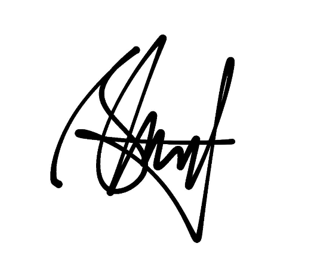

# Deklarasi Penggunaan AI

## Tugas Besar IF2150 - Rekayasa Perangkat Lunak

| Informasi | Keterangan |
|---|---|
| Kelas | 02 |
| Nomor Kelompok | 08|
| Nama Kelompok | BS3N |
| Nama Perangkat Lunak | KlimPooL |

**Anggota Kelompok:**

| NIM | Nama |
|---|---|
| 13525023 | Shaquille Nathan Kalevi |
| 13525080 | Neysa Alya Mukhbita |
| 13525092 | Bryan Pamungkas Prahara |
| 13525134 | Sahla Nailah Salsabilla |
| 13525140 | Nayla Putri Ghaisani |

---

### Daftar Isi
* [Milestone 1](#milestone-1)
* [Milestone 2](#milestone-2)
* [Milestone 3](#milestone-3)
* [Milestone 4](#milestone-4)
* [Milestone 5](#milestone-5)
* [Milestone 6](#milestone-6)
* [Milestone 7](#milestone-7)
* [Milestone 8](#milestone-8)
* [Milestone 9](#milestone-9)
* Notes: Copy bagian Daftar Isi seperti Milestone 1 untuk Milestone berikutnya, contoh ``* [Milestone 2](#milestone-2)``. Ketika Daftar isi diklik maka akan langsung diarahkan ke bagian bawah sesuai dengan Milestone tujuan.

---

### Log Penggunaan AI per Milestone

Silakan catat penggunaan AI yang berdampak signifikan pada pengerjaan tugas (misal: *generate* fungsi algoritma yang kompleks, *generate* draf dokumen SKPL/DPPL, atau *debugging* error utama). 
*Penggunaan sepele seperti memperbaiki *typo* atau auto-complete satu baris kode tidak perlu dicatat.*

### Milestone 1
| Tool AI | Tujuan Penggunaan | Contoh Prompt Utama | Modifikasi & Validasi Manusia |
| :--- | :--- | :--- | :--- |
| Gemini | Pemilihan data seperti apa yang akan digunakan pada bab 1 | "aku ingin membuat latar belakang dari tugas RPL ku yang akan menyusun suatu aplikasi seperti kitabisa yang mengamalkan/mencari bantuan dengan fitur fitur yang lebih lengkap seperti ada footprint calculator, hingga tidak hanya uang melainkan bantuan fisik/tenaga, aku mengambil sdgs climate action, aku ingin ada 3 paragraf yang dari umum menuju spesifik ke aplikasi ku dengan mengangkat kasus hangat seperti gletser nepal mencair membunuh banyak orang hingga skala nasional kebakaran hutan dan gempa bumi, tuliskan ide/data lain yang dapat saya cantumkan dan darimana sumbernya" | AI memberikan list ide dan data lalu kami cek data dan sumbernya. Kami memastikan data benar-benar ada dan dari sumber terpercaya. | |
| Gemini | Merapihkan alur activity diagram dengan runtut | "Saya telah membuat alur activity diagram, apakah alur yang aku kerjakan sudah sesuai dan tidak ada yang terbalik? Jika ada tolong diperbaiki dan berikan saran sebaiknya bagaimana" | AI memberikan jawaban berupa validasi alur diagram yang saya kerjakan, kami menyesuaikan kembali jawaban AI dengan peran tiap aktor yang telah dikerjakan | |

### Milestone 2
| Tool AI | Tujuan Penggunaan | Contoh Prompt Utama | Modifikasi & Validasi Manusia |
| :--- | :--- | :--- | :--- |
| Gemini | Validasi kesesuaian antara kebutuhan non-fungsional dengan kebutuhan umum | "Apakah kebutuhan non-fungsional yang aku buat dengan keserasiannya dengan kebutuhan umum sudah sesuai? |AI memvalidasi dan memberikan saran tambahan untuk kebutuhan non-fungsional | |
| Gemini | Verifikasi kesesuaian kalimat kebutuhan fungsional dengan struktur dan kategori EARS | "Apakah kalimat kebutuhan fungsional yang saya buat sudah sesuai dengan kategori EARS yang ada?" | Penyesuaian ouput AI dengan ketentuan EARS dan ID Aktivitas | |
| ChatGPT | Mencari tahu konsep/algoritma yang sesuai untuk digunakan pada perangkat lunak (untuk system requirements) | "Pada perangkat lunak kami, akan diimplementasikan requirements pada password, transaksi saldo internal (tanpa payment API gateway), dan cara implementasi supaya user dapat melakukan aksi sesuai role. Apa algoritma yang dapat digunakan?" | Melakukan double checking pada jawaban yang dihasilkan dengan mencari di sumber internet terkait implementasi perangkat lunak dengan algoritma yang diberikan | |

### Milestone 3
| Tool AI | Tujuan Penggunaan | Contoh Prompt Utama | Modifikasi & Validasi Manusia |
| :--- | :--- | :--- | :--- |
| Gemini | Double check apakah ada edge case skenario use case yang terlewat | "Apakah masih ada edge case yang belum menjadi skenario alternatif use case" | Double-checking apakah edge case yang disarankan sesuai dengan rancangan sistem atau tidak |
| ChatGPT | Mengubah format untuk skenario tanpa mengubah isinya | "Berikut adalah skenario yang dibuat untuk masing-masing use case pada perangkat lunak. Ada revisi terkait format tabelnya, aktor menjadi dipisah dan selang-seling antara aksi dan reaksi p/l. Tolong disesuaikan" | Double-checking supaya AI hanya membantu melakukan perubahan format (daripada melakukan manual secara repetitif) dan memastikan tidak ada isi yang tiba-tiba diubah dan tidak sesuai |

### Milestone 4
| Tool AI | Tujuan Penggunaan | Contoh Prompt Utama | Modifikasi & Validasi Manusia |
| :--- | :--- | :--- | :--- |

### Milestone 5
| Tool AI | Tujuan Penggunaan | Contoh Prompt Utama | Modifikasi & Validasi Manusia |
| :--- | :--- | :--- | :--- |

### Milestone 6
| Tool AI | Tujuan Penggunaan | Contoh Prompt Utama | Modifikasi & Validasi Manusia |
| :--- | :--- | :--- | :--- |
| Claude | Pemilihan jenis diagram Process View | Saya ingin membuat diagram Process View, dari 3 contoh yang diberikan di PPT (activity, sequence, communication), mana yang paling cocok | Penyesuaian dengan SKPL dan Bab 2 M6|

### Milestone 7
| Tool AI | Tujuan Penggunaan | Contoh Prompt Utama | Modifikasi & Validasi Manusia |
| :--- | :--- | :--- | :--- |
| Claude | Membantu menuliskan sintaks XML agar rancangan CD & Sequence Diagram yang sudah saya susun dapat diimpor ke draw.io | "Bantu ubah alur proses berikut menjadi XML draw.io | Alur proses, aktor, dan langkah ditentukan sendiri berdasarkan SKPL dan Bab 2 M6. Hasil XML diimpor ke draw.io, lalu label, urutan alur, dan tata letak diperiksa dan disesuaikan secara manual |

### Milestone 8
| Tool AI | Tujuan Penggunaan | Contoh Prompt Utama | Modifikasi & Validasi Manusia |
| :--- | :--- | :--- | :--- |

### Milestone 9
| Tool AI | Tujuan Penggunaan | Contoh Prompt Utama | Modifikasi & Validasi Manusia |
| :--- | :--- | :--- | :--- |
| OpenAI melalui OpenCode | Bantuan analisis, implementasi campaign/project/verifikasi/My Actions, penulisan tes dan dokumentasi pada branch lokal `feat/aksi-pembuat`; bantuan pemeriksaan PR tim | "lanjtukan kerjaanku yang lain dan tetap perhatikan perintahku sebelumnya" | Perubahan dan commit lokal dilakukan atas arahan Bryan. Tes otomatis, pemeriksaan browser dan batasannya dicatat di `M9/IMPLEMENTASI-AKSI.md`. Review kode/UAT manusia serta penyatuan modul tim masih diperlukan; belum dicatat sebagai selesai. |
| OpenAI melalui OpenCode | Lanjutan penggabungan stack yang sudah disetujui ke branch integrasi lokal, penyambungan tab Account, batas Suspense Next, runner tes dan pengujian produksi | "kerjakan lanjutkan tugasku yang belom" | PR awal #66–73 sudah terlihat approved/merged di GitHub. Hasil otomatis lanjutan dicatat terpisah, termasuk fixture sesi, batas MariaDB, dan header/dompet preview. Review manusia atas perubahan lanjutan serta UAT login tim belum diklaim selesai. |

| OpenAI melalui OpenCode (Bryan, 13 November) | Audit, integrasi terhadap auth/Account/progres terkini, tes produksi, serta pengisian hanya bagian Bryan pada laporan resmi dan logbook | "cek tugasku apakah beanr benar selesai termasuk tugas memasukkan ke docs"; "eksekusi" | Durasi logbook 4/5/4 jam dikonfirmasi Bryan. Tes otomatis dibedakan dari UAT manusia; modul anggota lain tidak diatribusikan kepada Bryan. Review lanjutan dan persentase kontribusi belum dikonfirmasi. |

Catatan M9: hasil pengujian otomatis bukan pengganti validasi manusia. Pernyataan integritas akhir perlu dikonfirmasi kembali setelah review dan UAT selesai; entri ini tidak menyatakan seluruh hasil M9 sudah divalidasi manusia.

---
### Pernyataan Integritas dan Persetujuan

Kami yang bertanda tangan di bawah ini menyatakan bahwa seluruh log penggunaan AI di atas adalah benar. Kami telah memvalidasi seluruh hasil AI dan bertanggung jawab penuh atas orisinalitas, keamanan, dan kebenaran hasil akhir dari tugas ini.

| Tanda Tangan | Nama Anggota |
| :---: | :--- |
|  | **[13525023 - Shaquille Nathan Kalevi]** |
|  | **[13525080 - Neysa Alya Mukhbita]** |
|  | **[13525092 - Bryan Pamungkas Prahara]** |
|  | **[13525134 - Sahla Nailah Salsabilla]** |
|  | **[13525140 - Nayla Putri Ghaisani]** |
