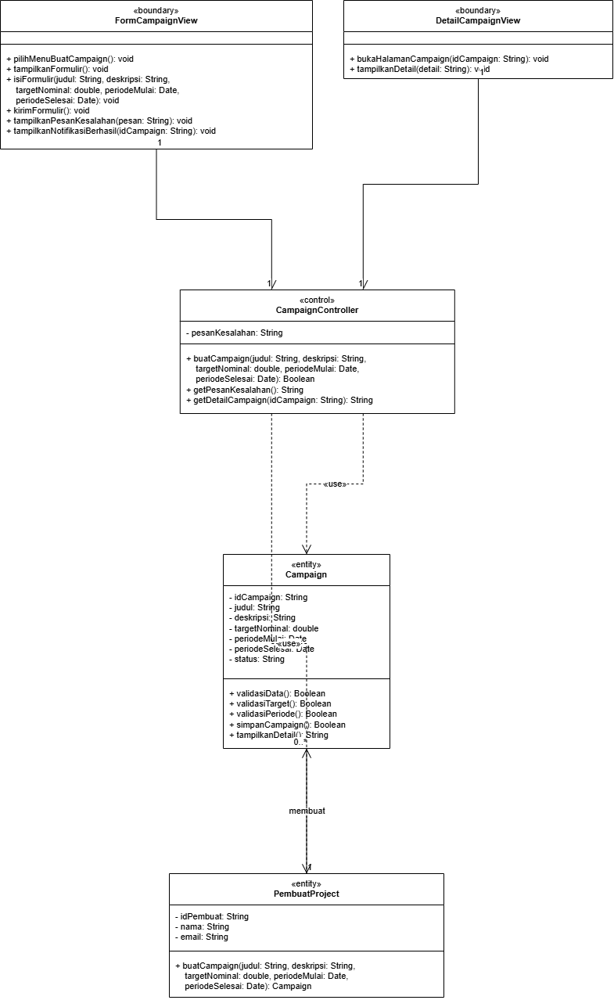
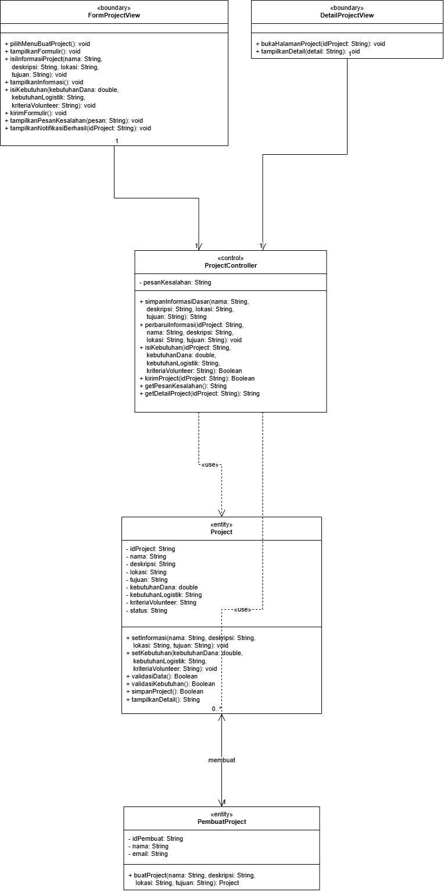
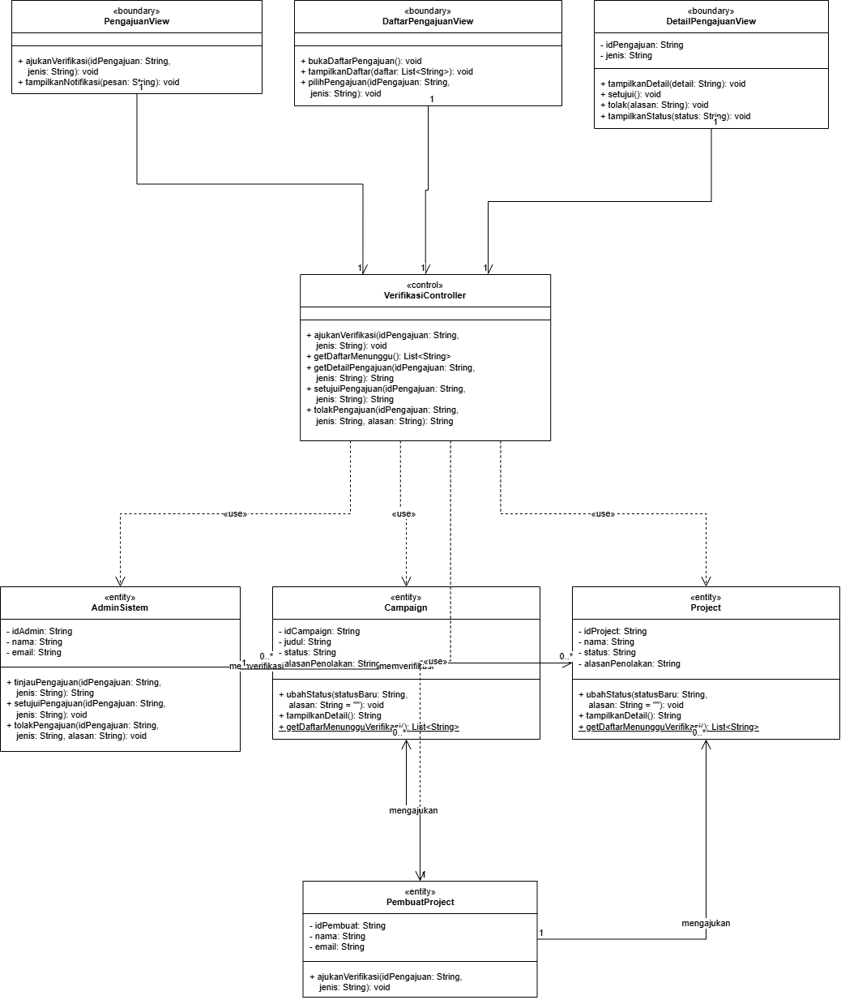
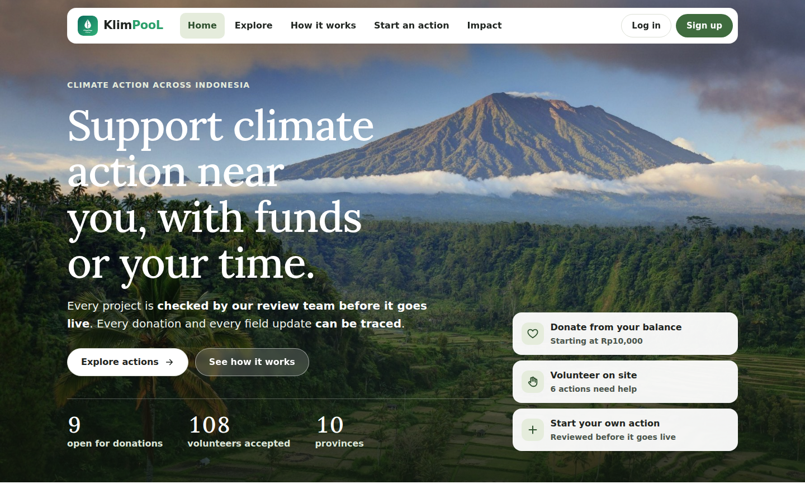
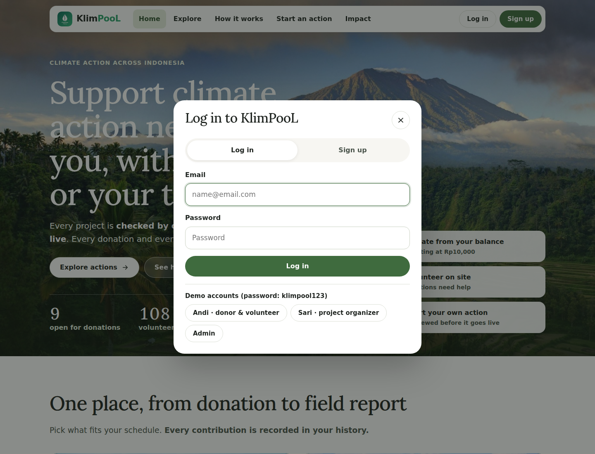
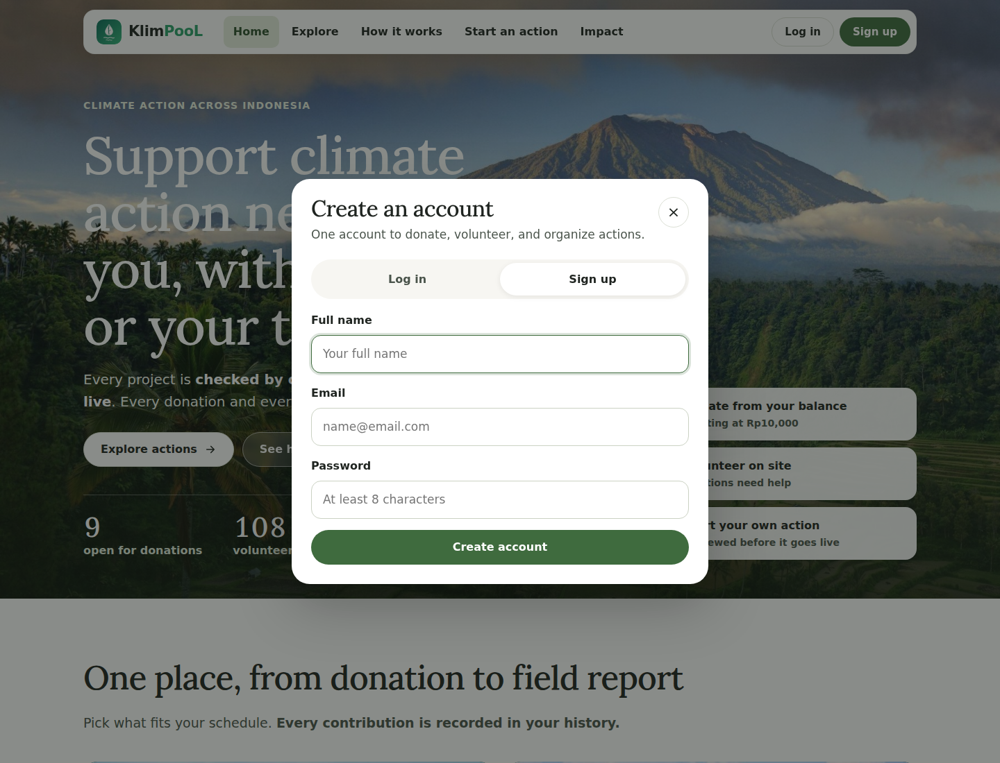
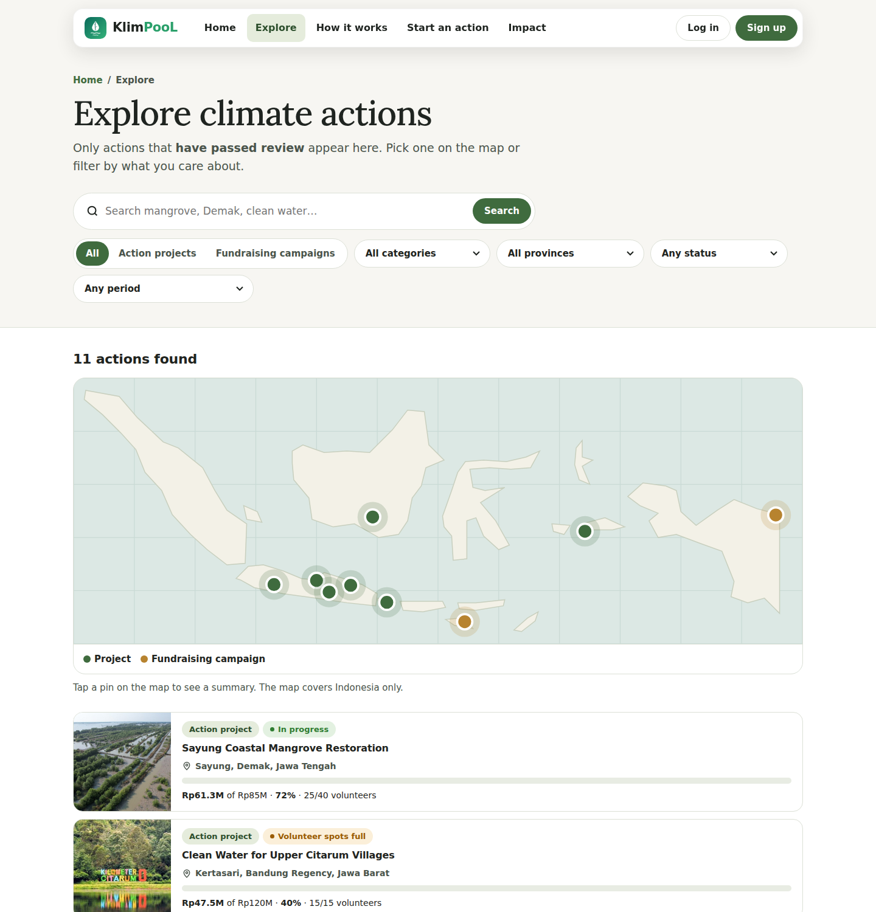
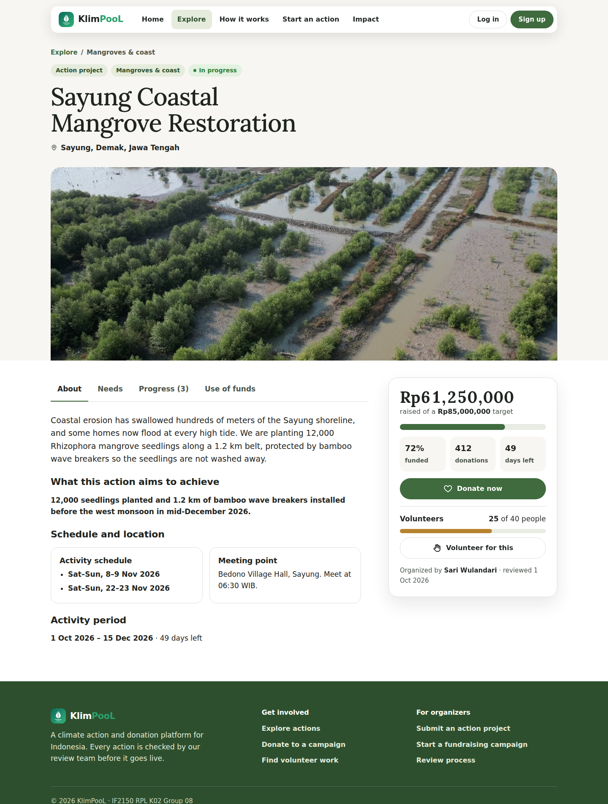

<h1>
IF2150 REKAYASA PERANGKAT LUNAK
<br>
TUGAS 8
<br>
DESKRIPSI PERANCANGAN PERANGKAT LUNAK (DPPL 2)
</h1>
<br>

## KlimPooL
### *[Logo Perangkat Lunak]*

### Untuk: Made Branenda Jordhy

Dipersiapkan oleh:
| Informasi | Keterangan |
| --- | --- |
| Kelas | 02 |
| Kelompok | 08  |

| NIM | Nama |
|---|---|
| 13525023 | Shaquille Nathan Kalevi |
| 13525080 | Neysa Alya Mukhbita |
| 13525092 | Bryan Pamungkas Prahara |
| 13525134 | Sahla Nailah Salsabilla |
| 13525140 | Nayla Putri Ghaisani |

---

## Daftar Perubahan

| Revisi | Deskripsi |
| :--- | :--- |
| *A* | Perubahan dari DPPL 1 ke DPPL 2: Tabel 3.2–3.4 dan paragraf identifikasi kelas UC02–UC04 diganti agar memakai kelas yang sama dengan sequence diagram dan diagram kelas, yaitu `FormCampaignView`, `CampaignController`, `FormProjectView`, `ProjectController`, `VerifikasiController`, dan seterusnya. Nama komponen (`CampaignProjectView`, `CampaignProjectController`, dll.) tidak digambar lagi sebagai kelas.<br>|
| *B* |  |
| *C* |  |

<br>

---

# BAB 1: Pendahuluan

## 1.1 Tujuan Penulisan Dokumen

Dokumen Deskripsi Perancangan Perangkat Lunak (DPPL) ini bertujuan menjabarkan rancangan perangkat lunak KlimPooL, mulai dari rancangan lingkungan implementasi, *style/pattern* arsitektur acuan, komponen penyusun sistem, realisasi setiap use case ke dalam kelas perancangan, sampai diagram kelas keseluruhan dan matriks kerunutannya. Jika dokumen SKPL menjawab pertanyaan "apa yang harus dipenuhi perangkat lunak" dan dokumen APL menjawab "bagaimana perangkat lunak disusun pada tingkat arsitektur", dokumen ini menjawab "bagaimana setiap kebutuhan diwujudkan menjadi kelas, atribut, operasi, dan interaksi antarobjek yang siap diimplementasikan". Dokumen ini ditujukan bagi tim pengembang (Kelompok 08) sebagai acuan langsung pada tahap implementasi dan pengujian, serta bagi asisten (Made Branenda Jordhy) sebagai dasar penilaian kesesuaian rancangan terhadap kebutuhan yang telah disepakati.

## 1.2 Lingkup Masalah

KlimPooL adalah perangkat lunak berbasis web yang dirancang sebagai platform terpusat untuk mengoordinasikan aksi mitigasi perubahan iklim dan penanganan bencana alam. Aplikasi ini menjembatani pemilik project atau penggalang donasi dengan masyarakat luas yang ingin berkontribusi, baik melalui penyaluran dana finansial secara aman, penyediaan pasokan logistik, maupun pendaftaran sebagai relawan (*volunteer*) guna mewujudkan penanggulangan dampak iklim yang transparan dan terstruktur.

## 1.3 Definisi, Istilah, dan Singkatan

Semua definisi dan singkatan yang digunakan dalam dokumen ini beserta penjelasannya.

Tabel 1.3. Definisi Istilah dan Singkatan

| Singkatan, Akronim, atau Istilah | Penjelasan |
| :--- | :--- |
| *P/L* | *Singkatan dari Perangkat Lunak, yaitu aplikasi yang memberikan perintah kepada komputer untuk menjalankan tugas tertentu.* |
| *SKPL* | *Singkatan dari Spesifikasi Kebutuhan Perangkat Lunak, yaitu dokumen yang merangkum kriteria-kriteria yang diperlukan untuk membangun aplikasi menjalankan tugasnya.* |
| *APL* | *Singkatan dari Arsitektur Perangkat Lunak, yaitu dokumen yang menetapkan style/pattern arsitektur, komponen penyusun, dan model arsitektur P/L.* |
| *DPPL* | *Singkatan dari Deskripsi Perancangan Perangkat Lunak, yaitu dokumen yang menjabarkan rancangan rinci P/L sampai ke tingkat kelas, atribut, operasi, dan interaksi antarobjek.* |
| *KF* | *Singkatan dari Kebutuhan Fungsional.* |
| *KNF* | *Singkatan dari Kebutuhan Non-Fungsional.* |
| *UC* | *Singkatan dari Use Case.* |
| *C* | *Singkatan dari Class/Kelas.* |
| *Kelas analisis* | *Kelas yang diidentifikasi pada tahap analisis kebutuhan, yaitu kelas pada BAB 5 dokumen SKPL.* |
| *Kelas perancangan* | *Kelas yang diturunkan dari kelas analisis pada tahap perancangan, lengkap dengan atribut, operasi, visibilitas, dan tipe data yang siap diimplementasikan.* |
| *Boundary* | *Stereotipe kelas perancangan yang menangani interaksi antara aktor dan sistem, yaitu kelas antarmuka.* |
| *Control* | *Stereotipe kelas perancangan yang mengoordinasikan jalannya sebuah use case dan menghubungkan kelas boundary dengan kelas entity.* |
| *Entity* | *Stereotipe kelas perancangan yang menyimpan data dan aturan bisnis yang bertahan lama di dalam sistem.* |
| *Sequence Diagram* | *Diagram interaksi UML yang menunjukkan urutan pesan antarpartisipan berdasarkan waktu.* |
| *TLS* | *Singkatan dari Transport Layer Security, yaitu sebuah protokol keamanan digital yang bertugas menyamarkan dan melindungi data saat dikirimkan melalui internet.* |

## 1.4 Aturan Penomoran

Dokumen ini memakai pola penomoran yang sama dengan dokumen SKPL dan APL. Tidak ada pola ID baru yang diperkenalkan pada dokumen ini.

Tabel 1.4. Aturan Penomoran

| Hal/Bagian | Penomoran | Keterangan |
| :--- | :--- | :--- |
| *Kebutuhan Fungsional* | *KFXX* | *Mengikuti Tabel 3.1 dokumen SKPL.* |
| *Kebutuhan Non-Fungsional* | *KNFXX* | *Mengikuti Tabel 3.2 dokumen SKPL.* |
| *Aktor* | *AXX* | *Mengikuti subbab 4.1 dokumen SKPL.* |
| *Use Case* | *UCXX* | *Mengikuti subbab 4.2 dokumen SKPL.* |
| *Kelas* | *CXX* | *Mengikuti subbab 5.1 dokumen SKPL. Kelas entity mempertahankan ID kelas analisisnya (C00–C13). Kelas boundary dan control yang baru muncul pada tahap perancangan melanjutkan penomoran yang sama mulai dari C14, sehingga tidak ada pola ID baru.* |

## 1.5 Referensi

- Kelompok 08 Kelas 02 IF2150. *Spesifikasi Kebutuhan Perangkat Lunak (SKPL) KlimPooL*. Dokumen `docs/M5/K02_G08_SKPL.md` pada repositori kelompok.
- Kelompok 08 Kelas 02 IF2150. *Arsitektur Perangkat Lunak (APL) KlimPooL*. Dokumen `docs/M6/K02_G08_APL.md` pada repositori kelompok.
- Kelompok 08 Kelas 02 IF2150. *Analisis Solusi dan Pemodelan Use Case KlimPooL*. Dokumen `docs/M1/K02_G08_TB.md` sampai `docs/M4` pada repositori kelompok.
- Materi kuliah IF2150: *Objek, Tanggung Jawab, dan Kolaborasi*; *Stereotipe, Gaya Kendali, dan Lapisan*; serta *Spesifikasi Kebutuhan Perangkat Lunak (SWEBOK v4)*.
- Object Management Group. *Unified Modeling Language (UML) Specification*. Diakses melalui https://www.omg.org/spec/UML/
- Perkakas pemodelan diagram: https://www.drawio.com/ dan https://staruml.io/

## 1.6 Deskripsi Umum Dokumen (Ikhtisar)

Dokumen DPPL KlimPooL ini disusun dalam lima bab. BAB 1 Pendahuluan memuat tujuan penulisan dokumen, lingkup masalah, definisi dan singkatan, aturan penomoran, referensi, serta ikhtisar dokumen. BAB 2 Perancangan Arsitektur memuat rancangan lingkungan implementasi, *style/pattern* arsitektur acuan, identifikasi komponen penyusun sistem, dan model arsitektur dalam bentuk *Logical View* serta *Process View*, seluruhnya mengacu pada dokumen APL. BAB 3 Realisasi Use Case menjabarkan setiap use case pada SKPL menjadi kelas perancangan, *sequence diagram* untuk skenario normal dan alternatif, serta diagram kelas per use case. BAB 4 Diagram Kelas Keseluruhan menyatukan seluruh kelas perancangan beserta atribut dan operasinya ke dalam satu diagram dan satu tabel. BAB 5 Matriks Kerunutan memetakan setiap kelas perancangan terhadap use case yang direalisasikannya, sehingga rancangan pada dokumen ini dapat ditelusuri balik sampai ke kebutuhan pada dokumen SKPL.

<br>

---

# BAB 2: Perancangan Arsitektur

## 2.1 Rancangan Lingkungan Implementasi

Lingkungan implementasi KlimPooL ditetapkan mengikuti Tabel 1.2 *Spesifikasi Implementasi* pada dokumen APL, dengan tambahan rincian bahasa pemrograman, *development tools*, dan *filing system* yang diputuskan pada tahap perancangan ini.

Tabel 2.1. Rancangan Lingkungan Implementasi

| Aspek | Rancangan |
| :--- | :--- |
| *Operating System* server | Lingkungan *serverless* berbasis Linux yang dikelola Vercel, dengan *runtime* Node.js 22 LTS dan region Singapura. |
| *Operating System* client | Tidak dibatasi. P/L dapat diakses dari Windows, macOS, Linux, Android, maupun iOS selama tersedia peramban modern (Chrome, Firefox, Edge, atau Safari versi terkini). |
| DBMS | MySQL dengan *storage engine* InnoDB, dipilih karena mendukung transaksi ACID yang dibutuhkan pemrosesan donasi (KF15–KF18). |
| Bahasa pemrograman | TypeScript pada seluruh lapisan aplikasi Next.js, mencakup komponen React pada lapisan presentasi dan *route handler* pada lapisan API. SQL digunakan untuk operasi basis data pada lapisan akses data. |
| *Framework* dan pustaka | Next.js sebagai kerangka kerja *full-stack* (frontend dan API dalam satu proyek), React sebagai pustaka antarmuka, dan Tailwind CSS sebagai kerangka kerja gaya tampilan. |
| *Development tools* | Visual Studio Code sebagai editor kode, Git dan GitHub untuk kendali versi serta kolaborasi, npm sebagai pengelola paket, dan draw.io untuk pemodelan diagram UML. |
| *Filing system* | Data terstruktur (akun, campaign, project, saldo, transaksi, pendaftaran relawan, dan progres) disimpan pada MySQL. Berkas dokumentasi progres yang diunggah Pembuat Project disimpan pada layanan penyimpanan objek, sedangkan basis data hanya menyimpan tautan dan metadatanya agar ukuran basis data tetap terkendali. |
| Jaringan dan protokol | HTTPS dengan TLS 1.2 atau lebih tinggi menggunakan sertifikat otomatis dari Vercel; HTTP dialihkan ke HTTPS. Pertukaran data antara peramban dan server memakai API REST berformat JSON. |

## 2.2 Style/Pattern Arsitektur Acuan

KlimPooL memakai kombinasi **Client-Server Architecture** dan **Layered Architecture**, sesuai ketetapan BAB 1 dokumen APL.

*Client-Server Architecture* menjelaskan komunikasi antara peramban pengguna dan aplikasi web yang berjalan di Vercel. Peramban menjalankan antarmuka KlimPooL yang dibangun dengan Next.js (React) dan Tailwind CSS, lalu mengirim permintaan ke API REST pada aplikasi Next.js. Aplikasi *serverless* memproses permintaan tersebut, mengakses MySQL, dan mengirim respons kembali ke peramban. Pola ini dipilih karena KlimPooL diakses oleh Pembuat Project, Donatur, Volunteer, dan Admin Sistem melalui peramban tanpa pemasangan aplikasi khusus, dan karena HTTPS/TLS serta JSON yang menyertainya memenuhi batasan komunikasi pada SKPL.

*Layered Architecture* menjelaskan pembagian tanggung jawab di dalam aplikasi Next.js menjadi empat lapisan, yaitu lapisan presentasi yang menampilkan antarmuka, lapisan API/aplikasi yang menerima permintaan JSON dan mengoordinasikan use case, lapisan domain/bisnis yang menerapkan aturan dan validasi inti, serta lapisan akses data yang menjalankan operasi baca/tulis ke MySQL. Pola ini dipilih karena KlimPooL mencakup alur autentikasi, verifikasi campaign/project, pencarian, donasi, pendaftaran relawan, pembaruan progres, dan riwayat yang aturan bisnis dan datanya saling terkait. Pemisahan lapisan menjaga modularitas (KNF11), memungkinkan aturan transaksi donasi dijalankan terpisah dari antarmuka, dan menjaga agar aturan akses Admin Sistem serta validasi pengajuan tidak bergantung langsung pada tampilan. Pemisahan ini bersifat logis dalam satu proyek *full-stack*, bukan berarti setiap lapisan dideploy sebagai server terpisah.

<p align="center">

</p>
<p align="center">
<i>Gambar 1. Client-Server dan lapisan internal KlimPooL</i>
</p>

Gambar 1 menunjukkan peramban sebagai *client*, aplikasi Next.js di Vercel sebagai *server*, dan MySQL sebagai penyimpanan data. Operasi basis data memakai koneksi/driver MySQL, sedangkan JSON dipakai pada API antara peramban dan server, bukan sebagai pengganti akses basis data.

## 2.3 Identifikasi Komponen / Modul / Subsistem

Komponen penyusun KlimPooL diambil dari Tabel 2.1 dokumen APL dan dikelompokkan mengikuti lapisan pada *Layered Architecture*. Kolom **Jenis** menyatakan peran komponen di dalam pola tersebut, yaitu *View* untuk lapisan presentasi, *Controller* untuk lapisan API/aplikasi, *Service* untuk lapisan domain/bisnis, *Repository* untuk lapisan akses data, serta *Pendukung* untuk komponen bantu yang dipakai bersama. Satu komponen dapat mewadahi lebih dari satu kelas pada diagram kelas, sehingga komponen tidak sama dengan kelas.

Tabel 2.3. Identifikasi Komponen/Modul/Subsistem

| Nama Komponen/Modul/Subsistem | Jenis | Penjelasan |
| :--- | :--- | :--- |
| `LoginView` | *View* | Menampilkan formulir pendaftaran dan login serta meneruskan data autentikasi pengguna ke komponen aplikasi. |
| `CampaignProjectView` | *View* | Menampilkan informasi campaign dan project serta menyediakan antarmuka untuk membuat dan mengelola pengajuan, serta untuk peninjauan dan verifikasi oleh Admin Sistem. |
| `KatalogPetaView` | *View* | Menampilkan kegiatan pada katalog dan peta interaktif serta menerima interaksi pengguna untuk menelusuri kegiatan. |
| `DonasiView` | *View* | Menampilkan informasi saldo dan formulir donasi serta meneruskan permintaan donasi pengguna. |
| `RelawanView` | *View* | Menampilkan informasi project dan formulir pendaftaran relawan. |
| `ProgresView` | *View* | Menampilkan progres kegiatan dan menyediakan antarmuka untuk memperbarui progres. |
| `RiwayatView` | *View* | Menampilkan riwayat transaksi dan progres pengguna. |
| `AutentikasiController` | *Controller* | Memproses permintaan pendaftaran dan autentikasi pengguna melalui API. |
| `CampaignProjectController` | *Controller* | Memproses permintaan pembuatan, pengelolaan, dan pengajuan campaign/project, serta peninjauan dan verifikasi (diterima/ditolak) oleh Admin Sistem. |
| `PencarianController` | *Controller* | Memproses permintaan pencarian dan penelusuran campaign/project. |
| `DonasiController` | *Controller* | Memproses permintaan donasi dan mengoordinasikan proses transaksi donasi. |
| `RelawanController` | *Controller* | Memproses pendaftaran dan pengelolaan relawan pada project. |
| `ProgresController` | *Controller* | Memproses pembaruan dan pengambilan data progres kegiatan. |
| `RiwayatController` | *Controller* | Memproses permintaan data riwayat transaksi dan progres. |
| `AutentikasiService` | *Service* | Mewadahi PenggunaUmum (C00), Akun (C12), dan SesiLogin (C13). Memvalidasi input dan ketersediaan email, memverifikasi kredensial, mengelola sesi login, dan menerapkan hak akses berdasarkan peran. |
| `CampaignProjectService` | *Service* | Mewadahi PembuatProject (C10), Campaign (C03), Project (C02), dan AdminSistem (C11). Memvalidasi data, target, periode, dan kebutuhan, serta mengelola status publikasi dan verifikasi yang hanya dapat dilakukan Admin Sistem. |
| `PencarianService` | *Service* | Mewadahi Katalog (C01) dan PetaWilayah (C05). Memproses kata kunci dan filter, serta hanya mengembalikan campaign/project berstatus dipublikasikan. |
| `DonasiService` | *Service* | Mewadahi Donatur (C04), TransaksiDonasi (C06), dan BuktiTransaksi (C07). Memeriksa kelayakan donasi, mencegah transaksi berulang, memproses donasi secara atomik, memperbarui dana terkumpul, dan menghasilkan bukti transaksi. |
| `RelawanService` | *Service* | Mewadahi Volunteer (C08) dan PendaftaranRelawan (C09). Menerapkan aturan pendaftaran relawan dan memperbarui status keputusan Pembuat Project. |
| `ProgresService` | *Service* | Menangani bagian progres pada Project (C02) dan PembuatProject (C10). Memvalidasi hak akses pembaruan, menyimpan milestone dan dokumentasi, serta mencatat timestamp. |
| `RiwayatService` | *Service* | Menyusun riwayat TransaksiDonasi (C06) dan progres Project (C02) milik PenggunaUmum (C00) secara kronologis. |
| `UserRepository` | *Repository* | Operasi baca/tulis data pengguna, akun, dan sesi (C00, C08, C10, C11, C12, C13) ke MySQL. |
| `CampaignProjectRepository` | *Repository* | Operasi baca/tulis data Campaign (C03) dan Project (C02), termasuk status verifikasi, alasan penolakan, dan dana terkumpul, ke MySQL. |
| `DonasiRepository` | *Repository* | Operasi baca/tulis saldo Donatur (C04), TransaksiDonasi (C06), dan BuktiTransaksi (C07) ke MySQL dalam transaksi ACID. |
| `RelawanRepository` | *Repository* | Operasi baca/tulis data PendaftaranRelawan (C09) beserta statusnya ke MySQL. |
| `ProgresRepository` | *Repository* | Operasi baca/tulis milestone, status pelaksanaan, dokumentasi, dan timestamp progres Project (C02) ke MySQL. |
| `DatabaseConnection` | *Pendukung* | Mengelola koneksi/driver MySQL dan batas transaksi yang dipakai bersama seluruh repository. |

## 2.4 Model Arsitektur Perangkat Lunak

Model arsitektur KlimPooL disajikan dalam dua *view*, yaitu *Logical View* dan *Process View*, mengikuti BAB 3 dokumen APL. *Logical View* memperlihatkan komponen apa saja yang ada dan siapa memanggil siapa, sedangkan *Process View* memperlihatkan urutan pemanggilan dan titik sinkronisasi ketika komponen tersebut dijalankan. Seluruh partisipan pada kedua *view* memakai nama komponen yang sama persis dengan Tabel 2.3.

### 2.4.1 View Logical

*Logical View* mendeskripsikan abstraksi utama perangkat lunak beserta hubungan antarabstraksi tersebut dalam mendukung kebutuhan fungsional. *View* ini dipilih karena KlimPooL memiliki tujuh alur layanan yang berdiri sendiri, yaitu autentikasi, pengelolaan campaign dan project, pencarian, donasi, relawan, progres, serta riwayat, yang ketujuhnya memakai pembagian tanggung jawab yang sama. Pemetaan komponen ke dalam lapisan menjadi cara paling langsung untuk memperlihatkan keseluruhan sistem dalam satu gambar tanpa menonjolkan salah satu use case. *View* ini juga memperlihatkan *Layered Architecture* secara eksplisit melalui pengelompokan komponen ke dalam empat lapisan, sekaligus memperlihatkan *Client-Server* melalui batas antara kotak *Client* dan *Server*.

<p align="center">

</p>
<p align="center">
<i>Gambar 2. Logical View KlimPooL</i>
</p>

Lapisan presentasi berada di dalam kotak *Client* karena dijalankan pada peramban pengguna, sedangkan tiga lapisan lainnya berada di dalam kotak *Server* karena dijalankan pada aplikasi Next.js di Vercel. MySQL digambarkan dengan garis putus-putus karena merupakan basis data pada lingkungan implementasi, bukan komponen perangkat lunak pada Tabel 2.3. Tidak terdapat relasi dari lapisan bawah ke lapisan di atasnya maupun relasi yang melompati lapisan, sesuai ketentuan *Layered Architecture*.

Tabel 2.4. Makna Label Relasi pada Logical View

| Label relasi | Makna |
| :--- | :--- |
| memanggil API | Komponen *View* mengirim permintaan ke komponen *Controller* melalui API REST berformat JSON di atas HTTPS dengan TLS 1.2 atau lebih tinggi. |
| meminta layanan | Komponen *Controller* meneruskan permintaan ke komponen *Service* yang menerapkan aturan dan validasi inti. |
| membaca/menulis data | Komponen *Service* memakai komponen *Repository* untuk membaca maupun menulis data yang dibutuhkannya. |
| memakai koneksi | Setiap *repository* memakai `DatabaseConnection` untuk memperoleh koneksi dan batas transaksi yang sama. |
| query/simpan | `DatabaseConnection` menjalankan perintah baca/tulis ke MySQL. |

### 2.4.2 View Process

*Process View* mendeskripsikan proses pada saat sistem berjalan, termasuk komunikasi, konkurensi, dan koordinasi antarproses. *View* ini dipilih karena KlimPooL memiliki alur yang urutannya menentukan kebenaran data. Pada transaksi donasi, pemeriksaan nominal, status campaign, dan transaksi ganda harus selesai sebelum saldo diubah, dan perubahan saldo, dana campaign, serta transaksi harus berhasil bersama atau dibatalkan seluruhnya (KF15–KF18). Urutan seperti ini tidak terlihat pada *Logical View* yang bersifat struktural. Selain itu, KlimPooL berjalan pada lingkungan *serverless* dengan *autoscaling* dan harus melayani 1.000 pengguna aktif secara simultan (KNF09), sehingga perlu terlihat di titik mana pemeriksaan dan transaksi atomik mengoordinasikan permintaan yang berjalan bersamaan. Alur donasi (UC06) dipilih sebagai representasi karena merupakan alur paling kritis pada SKPL.

<p align="center">

</p>
<p align="center">
<i>Gambar 3. Process View KlimPooL</i>
</p>

Pada Gambar 3, `DonasiController` memastikan Donatur sudah login melalui `AutentikasiService`, lalu meneruskan permintaan ke `DonasiService`. `DonasiService` memvalidasi nominal, memeriksa status campaign/project, dan memeriksa ID transaksi untuk mencegah transaksi ganda. Bila seluruh pemeriksaan lolos dan saldo mencukupi, pengurangan saldo, penambahan dana campaign/project, dan pembuatan transaksi dijalankan dalam satu *database transaction* yang atomik, sehingga tidak mungkin saldo berkurang tetapi dana campaign tidak bertambah. Kegagalan pada titik mana pun membatalkan seluruh perubahan. Bukti transaksi kemudian dibuat dan ditampilkan kepada Donatur.

<br>

---


# BAB 3: Realisasi Use Case

## 3.1 Use Case Melakukan Pendaftaran dan Autentikasi

**ID Use Case:** UC01  
**Nama Use Case:** Melakukan Pendaftaran dan Autentikasi

### 3.1.1 Identifikasi Kelas

Realisasi UC01 memisahkan antarmuka pendaftaran dan antarmuka login menjadi dua kelas *boundary*, karena keduanya ditampilkan pada halaman yang berbeda dan memiliki masukan yang berbeda. Keduanya berbicara kepada satu kelas *control*, yaitu `AutentikasiController`, yang mengoordinasikan seluruh alur use case ini. Kelas analisis PenggunaUmum (C00) pada SKPL berperan sebagai aktor sekaligus pemilik akun, sehingga pada tahap perancangan perannya dipecah: tindakan antarmuka dipindahkan ke kelas *boundary*, sedangkan data pengguna tetap berada pada kelas *entity* `PenggunaUmum`. Aturan validasi kelengkapan input, ketersediaan email, dan kebenaran kredensial tetap melekat pada `Akun` sesuai deskripsi C12, sedangkan pembuatan dan pemeriksaan sesi tetap melekat pada `SesiLogin` sesuai deskripsi C13.

Tabel 3.1. Identifikasi Kelas Use Case UC01

| No | Nama Kelas Perancangan | Nama Kelas Analisis Terkait |
|:--- | :--- | :--- |
| 1 | FormPendaftaranView | PenggunaUmum (C00) |
| 2 | FormLoginView | PenggunaUmum (C00) |
| 3 | AutentikasiController | PenggunaUmum (C00) |
| 4 | PenggunaUmum | PenggunaUmum (C00) |
| 5 | Akun | Akun (C12) |
| 6 | SesiLogin | SesiLogin (C13) |

### 3.1.2 Sequence Diagram

- **Skenario Normal**

<p align="center">

</p>
<p align="center">
<i>Gambar 3.1.1. Sequence Diagram UC01 - Skenario Normal</i>
</p>

Pengguna Umum membuka formulir pendaftaran melalui `FormPendaftaranView`, mengisi nama, email, dan password, lalu mengirimkannya. `AutentikasiController` meminta `PenggunaUmum` membuat objek `Akun`, kemudian memanggil `validasiKelengkapanInput()`, `cekKetersediaanEmail()`, dan `simpanAkun()` secara berurutan. Setelah akun tersimpan, Pengguna Umum memasukkan kredensial pada `FormLoginView`. `AutentikasiController` memverifikasi kredensial melalui `validasiKredensial()` pada `Akun`, lalu membuat `SesiLogin` dan mengarahkan pengguna ke halaman utama.

- **Skenario Alternatif 1: Email Sudah Terdaftar**

<p align="center">

</p>
<p align="center">
<i>Gambar 3.1.2. Sequence Diagram UC01 - Email Sudah Terdaftar</i>
</p>

Alur berjalan sama dengan skenario normal sampai pemeriksaan ketersediaan email. `cekKetersediaanEmail()` mengembalikan `false`, sehingga `simpanAkun()` tidak dipanggil dan akun baru tidak tersimpan. `FormPendaftaranView` mengambil pesan kesalahan melalui `getPesanKesalahan()` dan menampilkannya, lalu pengguna dapat mengirim ulang formulir dengan email lain.

- **Skenario Alternatif 2: Kredensial Login Tidak Valid**

<p align="center">

</p>
<p align="center">
<i>Gambar 3.1.3. Sequence Diagram UC01 - Kredensial Login Tidak Valid</i>
</p>

`validasiKredensial()` pada `Akun` mengembalikan `false`, sehingga `buatSesi()` tidak dipanggil dan pengguna tidak memperoleh sesi login. `FormLoginView` menampilkan pesan kesalahan dan pengguna tetap berada pada halaman login untuk memasukkan kembali kredensialnya.

### 3.1.3 Diagram Kelas

<p align="center">

</p>
<p align="center">
<i>Gambar 3.1.4. Diagram Kelas Melakukan Pendaftaran dan Autentikasi (UC01)</i>
</p>

`FormPendaftaranView` dan `FormLoginView` masing-masing berasosiasi satu-ke-satu dengan `AutentikasiController`. `AutentikasiController` memiliki dependensi «use» terhadap ketiga kelas *entity* karena hanya memakai objeknya selama use case berlangsung tanpa menyimpannya. `PenggunaUmum` berelasi komposisi dengan `Akun`, karena akun tidak dapat ada tanpa pengguna pemiliknya dan ikut terhapus ketika pengguna dihapus. Satu `Akun` dapat menghasilkan nol sampai banyak `SesiLogin` sepanjang masa hidupnya, yaitu satu sesi untuk setiap kali pengguna berhasil login.

---

## 3.2 Use Case Membuat Campaign Penggalangan Donasi

**ID Use Case:** UC02  
**Nama Use Case:** Membuat Campaign Penggalangan Donasi

### 3.2.1 Identifikasi Kelas

`FormCampaignView` menerima judul, deskripsi, target nominal, dan periode campaign serta menampilkan pesan kesalahan atau notifikasi keberhasilan, sedangkan `DetailCampaignView` menampilkan informasi campaign beserta status verifikasinya. Keduanya berinteraksi dengan `CampaignController`, kelas *control* yang mengoordinasikan pembuatan campaign. Validasi kelengkapan data, target, dan periode, serta penyimpanan campaign dengan status "Menunggu Verifikasi", tetap menjadi tanggung jawab `Campaign` sesuai deskripsi C03. `PembuatProject` (C10) berperan sebagai aktor sekaligus pemilik campaign. Pada tingkat komponen (Tabel 2.3), kelas-kelas ini dihimpun oleh `CampaignProjectView`, `CampaignProjectController`, `CampaignProjectService`, dan `CampaignProjectRepository`, sehingga komponen tersebut tidak digambar lagi sebagai kelas pada diagram.

Tabel 3.2. Identifikasi Kelas Use Case UC02

| No | Nama Kelas Perancangan | Nama Kelas Analisis Terkait |
|:--- | :--- | :--- |
| 1 | FormCampaignView | PembuatProject (C10) |
| 2 | DetailCampaignView | Campaign (C03) |
| 3 | CampaignController | PembuatProject (C10), Campaign (C03) |
| 4 | PembuatProject | PembuatProject (C10) |
| 5 | Campaign | Campaign (C03) |


### 3.2.2 Sequence Diagram

- **Skenario Normal**

<p align="center">

</p>
<p align="center">
<i>Gambar 3.2.1. Sequence Diagram UC02 - Skenario Normal</i>
</p>

- **Skenario Alternatif 1: Data Campaign Tidak Lengkap**

<p align="center">

</p>
<p align="center">
<i>Gambar 3.2.2. Sequence Diagram UC02 - Data Campaign Tidak Lengkap</i>
</p>

- **Skenario Alternatif 2: Target atau Periode Campaign Tidak Valid**

<p align="center">

</p>
<p align="center">
<i>Gambar 3.2.3. Sequence Diagram UC02 - Target atau Periode Campaign Tidak Valid</i>
</p>

### 3.2.3 Diagram Kelas

<p align="center">

</p>
<p align="center">
<i>Gambar 3.2.4. Diagram Kelas Membuat Campaign Penggalangan Donasi (UC02)</i>
</p>

---

## 3.3 Use Case Membuat Project Aksi Iklim

**ID Use Case:** UC03  
**Nama Use Case:** Membuat Project Aksi Iklim

### 3.3.1 Identifikasi Kelas

Realisasi UC03 memakai pembagian yang sama dengan UC02. Perbedaannya, entitas yang dikelola adalah `Project`, dan terdapat validasi kebutuhan project (dana, logistik, dan kriteria volunteer) yang dijalankan sebelum formulir dikirim. `FormProjectView` menerima informasi dasar dan kebutuhan project, `DetailProjectView` menampilkan project beserta status verifikasinya, dan `ProjectController` mengoordinasikan keduanya. Pemetaan ke komponen pada Tabel 2.3 sama dengan UC02.

Tabel 3.3. Identifikasi Kelas Use Case UC03

| No | Nama Kelas Perancangan | Nama Kelas Analisis Terkait |
|:--- | :--- | :--- |
| 1 | FormProjectView | PembuatProject (C10) |
| 2 | DetailProjectView | Project (C02) |
| 3 | ProjectController | PembuatProject (C10), Project (C02) |
| 4 | PembuatProject | PembuatProject (C10) |
| 5 | Project | Project (C02) |

### 3.3.2 Sequence Diagram

- **Skenario Normal**

<p align="center">

</p>
<p align="center">
<i>Gambar 3.3.1. Sequence Diagram UC03 - Skenario Normal</i>
</p>

- **Skenario Alternatif 1: Informasi Project Tidak Lengkap**

<p align="center">

</p>
<p align="center">
<i>Gambar 3.3.2. Sequence Diagram UC03 - Informasi Project Tidak Lengkap</i>
</p>

- **Skenario Alternatif 2: Data Kebutuhan Project Tidak Valid**

<p align="center">

</p>
<p align="center">
<i>Gambar 3.3.3. Sequence Diagram UC03 - Data Kebutuhan Project Tidak Valid</i>
</p>

### 3.3.3 Diagram Kelas

<p align="center">

</p>
<p align="center">
<i>Gambar 3.3.4. Diagram Kelas Membuat Project Aksi Iklim (UC03)</i>
</p>

---

## 3.4 Use Case Meninjau dan Memverifikasi Project

**ID Use Case:** UC04  
**Nama Use Case:** Meninjau dan Memverifikasi Project

### 3.4.1 Identifikasi Kelas

Realisasi UC04 melibatkan dua aktor, yaitu Pembuat Project yang mengajukan verifikasi melalui `PengajuanView` dan Admin Sistem yang meninjau pengajuan melalui `DaftarPengajuanView` dan `DetailPengajuanView`. Ketiganya berinteraksi dengan `VerifikasiController`. Tindakan menyetujui dan menolak diwujudkan melalui `AdminSistem` (C11), sedangkan perubahan status dan alasan penolakan disimpan oleh `Campaign` atau `Project` melalui `ubahStatus()`.


Tabel 3.4. Identifikasi Kelas Use Case UC04

| No | Nama Kelas Perancangan | Nama Kelas Analisis Terkait |
|:--- | :--- | :--- |
| 1 | PengajuanView | PembuatProject (C10) |
| 2 | DaftarPengajuanView | AdminSistem (C11) |
| 3 | DetailPengajuanView | AdminSistem (C11) |
| 4 | VerifikasiController | PembuatProject (C10), AdminSistem (C11) |
| 5 | PembuatProject | PembuatProject (C10) |
| 6 | AdminSistem | AdminSistem (C11) |
| 7 | Campaign | Campaign (C03) |
| 8 | Project | Project (C02) |

### 3.4.2 Sequence Diagram

- **Skenario Normal**

<p align="center">

</p>
<p align="center">
<i>Gambar 3.4.1. Sequence Diagram UC04 - Skenario Normal</i>
</p>

- **Skenario Alternatif 1: Campaign atau Project Ditolak**

<p align="center">

</p>
<p align="center">
<i>Gambar 3.4.2. Sequence Diagram UC04 - Campaign atau Project Ditolak</i>
</p>

### 3.4.3 Diagram Kelas

<p align="center">

</p>
<p align="center">
<i>Gambar 3.4.3. Diagram Kelas Meninjau dan Memverifikasi Project (UC04)</i>
</p>

---

## 3.5 Use Case Mencari dan Menelusuri Project

**ID Use Case:** UC05  
**Nama Use Case:** Mencari dan Menelusuri Project

### 3.5.1 Identifikasi Kelas

Realisasi UC05 memisahkan antarmuka pencarian dari antarmuka detail campaign dan project. `FormPencarianView` menerima kata kunci dan filter serta menampilkan hasil pencarian, sedangkan `DetailCampaignView` dan `DetailProjectView` digunakan kembali untuk menampilkan informasi kegiatan yang dipilih. Ketiga kelas *boundary* tersebut berinteraksi dengan `PencarianController` sebagai kelas *control* yang mengoordinasikan pencarian dan pengambilan detail. Kelas analisis PenggunaUmum (C00) tetap dipertahankan sebagai kelas *entity* untuk data pengguna, sementara tindakan pencariannya ditangani oleh antarmuka. Parameter pencarian dan penyaringan tetap menjadi tanggung jawab `Katalog` sesuai deskripsi C01, sedangkan informasi kegiatan tetap berada pada `Project` dan `Campaign`. Hasil pencarian dibatasi pada campaign dan project yang telah dipublikasikan sesuai KF13–KF14; apabila tidak ada hasil yang sesuai, antarmuka menampilkan pesan agar pengguna dapat mengubah kata kunci atau filter.

Tabel 3.5. Identifikasi Kelas Use Case UC05

| No | Nama Kelas Perancangan | Nama Kelas Analisis Terkait |
|:--- | :--- | :--- |
| 1 | FormPencarianView | PenggunaUmum (C00), Katalog (C01) |
| 2 | DetailCampaignView | Campaign (C03) |
| 3 | DetailProjectView | Project (C02) |
| 4 | PencarianController | PenggunaUmum (C00), Katalog (C01) |
| 5 | PenggunaUmum | PenggunaUmum (C00) |
| 6 | Katalog | Katalog (C01) |
| 7 | Project | Project (C02) |
| 8 | Campaign | Campaign (C03) |

### 3.5.2 Sequence Diagram

- **Skenario Normal**

<p align="center">

</p>
<p align="center">
<i>Gambar 3.5.1. Sequence Diagram UC05 - Skenario Normal</i>
</p>

- **Skenario Alternatif 1: Project Tidak Ditemukan**

<p align="center">

</p>
<p align="center">
<i>Gambar 3.5.2. Sequence Diagram UC05 - Project Tidak Ditemukan</i>
</p>

### 3.5.3 Diagram Kelas

<p align="center">

</p>
<p align="center">
<i>Gambar 3.5.3. Diagram Kelas Mencari dan Menelusuri Project (UC05)</i>
</p>

---

## 3.6 Use Case Melakukan Transaksi Donasi

**ID Use Case:** UC06  
**Nama Use Case:** Melakukan Transaksi Donasi

### 3.6.1 Identifikasi Kelas

Realisasi UC06 memisahkan antarmuka peta, formulir donasi, dan tampilan bukti transaksi menjadi tiga kelas *boundary*, yaitu `FormPetaWilayahView`, `FormDonasiView`, dan `DetailBuktiTransaksiView`. `DonasiController` mengoordinasikan alur donasi, termasuk pemeriksaan status login melalui `SesiLogin`. Kelas analisis `PetaWilayah` tetap menyimpan parameter wilayah dan menyediakan data sebaran kegiatan, sedangkan `Donatur` menyimpan data pengguna beserta saldonya. Validasi nominal, pemeriksaan duplikasi berdasarkan *idempotency key*, serta pemrosesan dan pencatatan donasi tetap menjadi tanggung jawab `TransaksiDonasi` sesuai deskripsi C06. `Project` atau `Campaign` menjadi tujuan dana yang diperiksa statusnya dan diperbarui dana terkumpul serta persentase pencapaian targetnya. Pengurangan saldo, penambahan dana tujuan, dan pencatatan transaksi dijalankan secara atomik, sehingga seluruh perubahan dibatalkan apabila salah satu tahap gagal sesuai KF15–KF18 dan KF26. Setelah transaksi berhasil, `BuktiTransaksi` menghasilkan rincian bukti untuk ditampilkan kepada Donatur.

Tabel 3.6. Identifikasi Kelas Use Case UC06

| No | Nama Kelas Perancangan | Nama Kelas Analisis Terkait |
|:--- | :--- | :--- |
| 1 | FormPetaWilayahView | PetaWilayah (C05) |
| 2 | FormDonasiView | Donatur (C04), TransaksiDonasi (C06) |
| 3 | DetailBuktiTransaksiView | BuktiTransaksi (C07) |
| 4 | DonasiController | Donatur (C04), TransaksiDonasi (C06) |
| 5 | SesiLogin | SesiLogin (C13) |
| 6 | PetaWilayah | PetaWilayah (C05) |
| 7 | Donatur | Donatur (C04) |
| 8 | TransaksiDonasi | TransaksiDonasi (C06) |
| 9 | Project | Project (C02) |
| 10 | Campaign | Campaign (C03) |
| 11 | BuktiTransaksi | BuktiTransaksi (C07) |

### 3.6.2 Sequence Diagram

- **Skenario Normal**

<p align="center">

</p>
<p align="center">
<i>Gambar 3.6.1. Sequence Diagram UC06 - Skenario Normal</i>
</p>

- **Skenario Alternatif 1: Saldo Tidak Mencukupi / Kegagalan Transaksi**

<p align="center">

</p>
<p align="center">
<i>Gambar 3.6.2. Sequence Diagram UC06 - Saldo Tidak Mencukupi / Kegagalan Transaksi</i>
</p>

- **Skenario Alternatif 2: Duplikasi Permintaan Transaksi**

<p align="center">

</p>
<p align="center">
<i>Gambar 3.6.3. Sequence Diagram UC06 - Duplikasi Permintaan Transaksi</i>
</p>

- **Skenario Alternatif 3: Campaign Sudah Berakhir / Ditutup**

<p align="center">

</p>
<p align="center">
<i>Gambar 3.6.4. Sequence Diagram UC06 - Campaign Sudah Berakhir / Ditutup</i>
</p>

- **Skenario Alternatif 4: Nominal Donasi Tidak Valid**

<p align="center">

</p>
<p align="center">
<i>Gambar 3.6.5. Sequence Diagram UC06 - Nominal Donasi Tidak Valid</i>
</p>

### 3.6.3 Diagram Kelas

<p align="center">

</p>
<p align="center">
<i>Gambar 3.6.6. Diagram Kelas Melakukan Transaksi Donasi (UC06)</i>
</p>

---

## 3.7 Use Case Mendaftar Sebagai Volunteer

**ID Use Case:** UC07  
**Nama Use Case:** Mendaftar Sebagai Volunteer

### 3.7.1 Identifikasi Kelas

Realisasi UC07 memakai kembali `FormPetaWilayahView` untuk menampilkan sebaran project dan menambahkan `FormPendaftaranRelawanView` sebagai kelas *boundary* untuk menerima data diri, keahlian, pengalaman, dan ketersediaan jadwal Volunteer. `RelawanController` mengoordinasikan pembukaan formulir dan pengiriman pendaftaran, dengan pemeriksaan status login tetap menjadi tanggung jawab `SesiLogin`. Data pengguna dan parameter wilayah tetap berada pada kelas *entity* `Volunteer` dan `PetaWilayah`, sedangkan data formulir, validasi kelengkapan, pemeriksaan pendaftaran ganda, serta penyimpanan status tetap menjadi tanggung jawab `PendaftaranRelawan` sesuai deskripsi C09 dan KF19–KF20. Ketersediaan kuota dan status pembukaan pendaftaran diperiksa melalui `Project` sesuai skenario alternatif UC07. Pendaftaran yang memenuhi ketentuan disimpan dengan status awal `pending` dan diteruskan kepada `PembuatProject` untuk ditinjau; keputusan penerimaan atau penolakan ditangani pada UC08.

Tabel 3.7. Identifikasi Kelas Use Case UC07

| No | Nama Kelas Perancangan | Nama Kelas Analisis Terkait |
|:--- | :--- | :--- |
| 1 | FormPetaWilayahView | PetaWilayah (C05) |
| 2 | FormPendaftaranRelawanView | Volunteer (C08), PendaftaranRelawan (C09) |
| 3 | RelawanController | Volunteer (C08), PendaftaranRelawan (C09) |
| 4 | SesiLogin | SesiLogin (C13) |
| 5 | PetaWilayah | PetaWilayah (C05) |
| 6 | Volunteer | Volunteer (C08) |
| 7 | PendaftaranRelawan | PendaftaranRelawan (C09) |
| 8 | Project | Project (C02) |
| 9 | PembuatProject | PembuatProject (C10) |

### 3.7.2 Sequence Diagram

- **Skenario Normal**

<p align="center">

</p>
<p align="center">
<i>Gambar 3.7.1. Sequence Diagram UC07 - Skenario Normal</i>
</p>

- **Skenario Alternatif 1: Formulir Tidak Lengkap**

<p align="center">

</p>
<p align="center">
<i>Gambar 3.7.2. Sequence Diagram UC07 - Formulir Tidak Lengkap</i>
</p>

- **Skenario Alternatif 2: Pendaftaran Ganda**

<p align="center">

</p>
<p align="center">
<i>Gambar 3.7.3. Sequence Diagram UC07 - Pendaftaran Ganda</i>
</p>

- **Skenario Alternatif 3: Kuota Volunteer Penuh / Pendaftaran Ditutup**

<p align="center">

</p>
<p align="center">
<i>Gambar 3.7.4. Sequence Diagram UC07 - Kuota Volunteer Penuh / Pendaftaran Ditutup</i>
</p>

### 3.7.3 Diagram Kelas

<p align="center">

</p>
<p align="center">
<i>Gambar 3.7.5. Diagram Kelas Mendaftar Sebagai Volunteer (UC07)</i>
</p>

Berkas sumber seluruh diagram UC05–UC07 yang dapat diedit di draw.io tersedia pada [XML Diagram UC05–UC07](./assets/diagram/uc05-uc07.xml), dengan satu diagram pada setiap tab.

---

## 3.8 Use Case Mengelola Pendaftaran Relawan

**ID Use Case:** UC08  
**Nama Use Case:** Mengelola Pendaftaran Relawan

### 3.8.1 Identifikasi Kelas

Realisasi UC08 memisahkan antarmuka pengelolaan pendaftar yang dipakai Pembuat Project dari antarmuka status pendaftaran yang dilihat Volunteer menjadi dua kelas *boundary*, yaitu `FormVolunteerManagementView` dan `DetailStatusPendaftaranView`. Keduanya berinteraksi dengan `RelawanController`, yaitu kelas *control* yang sudah dipakai pada UC07 dan kini juga mengoordinasikan peninjauan pendaftar serta pengambilan keputusan terima/tolak. Pemeriksaan status login tetap menjadi tanggung jawab `SesiLogin`. Kelas analisis PembuatProject (C10) dan Volunteer (C08) berperan sebagai aktor sekaligus pemilik data, sehingga tindakan antarmukanya (membuka menu, meninjau, memilih keputusan, melihat instruksi) diwujudkan melalui kelas *boundary*, sedangkan data pengguna beserta operasi analisisnya tetap berada pada kelas *entity* `PembuatProject` dan `Volunteer`. Setelah status diperbarui, `DetailStatusPendaftaranView` menampilkan hasil keputusan kepada Volunteer, disertai instruksi lokasi dan jadwal apabila pendaftaran diterima.

Tabel 3.8. Identifikasi Kelas Use Case UC08

| No | Nama Kelas Perancangan | Nama Kelas Analisis Terkait |
|:--- | :--- | :--- |
| 1 | FormVolunteerManagementView | PembuatProject (C10), PendaftaranRelawan (C09) |
| 2 | DetailStatusPendaftaranView | Volunteer (C08), PendaftaranRelawan (C09) |
| 3 | RelawanController | PembuatProject (C10), PendaftaranRelawan (C09), Volunteer (C08) |
| 4 | SesiLogin | SesiLogin (C13) |
| 5 | PembuatProject | PembuatProject (C10) |
| 6 | Project | Project (C02) |
| 7 | PendaftaranRelawan | PendaftaranRelawan (C09) |
| 8 | Volunteer | Volunteer (C08) |

### 3.8.2 Sequence Diagram

- **Skenario Normal**

<p align="center">

</p>
<p align="center">
<i>Gambar 3.8.1. Sequence Diagram UC08 - Skenario Normal</i>
</p>

Pembuat Project memilih menu volunteer management pada `FormVolunteerManagementView`. `RelawanController` memeriksa status login melalui `SesiLogin.cekStatusLogin()`, lalu meminta `Project` memeriksa keberadaan pendaftar dengan `cekAdaPendaftar()` dan mengambil daftarnya dengan `getDaftarPendaftar()`. Detail setiap pendaftar (data diri, keahlian, pengalaman, dan ketersediaan jadwal) diambil dari `PendaftaranRelawan` melalui `getDetailPendaftar()` dan ditampilkan oleh `tampilkanDaftarPendaftar()`. Setelah meninjau data, Pembuat Project memilih keputusan terima atau tolak. `RelawanController` memanggil `buatKeputusan()`, yang meneruskan keputusan ke `PendaftaranRelawan.perbaruiStatus()` sehingga status berubah menjadi `accepted` atau `rejected`. Selanjutnya `DetailStatusPendaftaranView` menampilkan hasil keputusan kepada Volunteer, disertai instruksi lokasi dan jadwal apabila pendaftaran diterima.

- **Skenario Alternatif 1: Belum Ada Pendaftar Volunteer**

<p align="center">

</p>
<p align="center">
<i>Gambar 3.8.2. Sequence Diagram UC08 - Belum Ada Pendaftar Volunteer</i>
</p>

Alur berjalan sama dengan skenario normal sampai pemeriksaan pendaftar. `cekAdaPendaftar()` pada `Project` mengembalikan `false`, sehingga `getDaftarPendaftar()` dan `perbaruiStatus()` tidak dipanggil. `FormVolunteerManagementView` menampilkan pesan bahwa belum ada pendaftar volunteer pada project tersebut melalui `tampilkanPesanBelumAdaPendaftar()`.

### 3.8.3 Diagram Kelas

<p align="center">

</p>
<p align="center">
<i>Gambar 3.8.3. Diagram Kelas Mengelola Pendaftaran Relawan (UC08)</i>
</p>

---

## 3.9 Use Case Memperbarui Progres Project

**ID Use Case:** UC09  
**Nama Use Case:** Memperbarui Progres Project

### 3.9.1 Identifikasi Kelas

Realisasi UC09 memakai satu kelas *boundary*, yaitu `FormProgresProjectView`, yang menerima data milestone, status pelaksanaan, dan berkas dokumentasi dari Pembuat Project serta menampilkan pesan kesalahan atau notifikasi keberhasilan. `ProgresController` berperan sebagai kelas *control* yang mengoordinasikan pembukaan halaman, pemeriksaan hak akses, dan penyimpanan pembaruan. Pemeriksaan status login tetap menjadi tanggung jawab `SesiLogin`. Kelas analisis PembuatProject (C10) berperan sebagai aktor sekaligus pemilik data, sehingga tindakan antarmukanya (membuka halaman, mengisi milestone, mengunggah dokumentasi) diwujudkan melalui `FormProgresProjectView`, sedangkan data pengguna beserta operasi analisisnya tetap berada pada kelas *entity* `PembuatProject`. Validasi hak akses, validasi format dan ukuran dokumentasi, penyimpanan pembaruan progres, serta pencatatan stempel waktu tetap menjadi tanggung jawab `Project` sesuai deskripsi C02. Peran Admin Sistem yang memastikan pengguna adalah Pembuat Project pada skenario diimplementasikan sebagai pemeriksaan otomatis `validasiHakAkses()` pada `Project`, sehingga tidak menjadi kelas tersendiri.

Tabel 3.9. Identifikasi Kelas Use Case UC09

| No | Nama Kelas Perancangan | Nama Kelas Analisis Terkait |
|:--- | :--- | :--- |
| 1 | FormProgresProjectView | PembuatProject (C10), Project (C02) |
| 2 | ProgresController | PembuatProject (C10), Project (C02) |
| 3 | SesiLogin | SesiLogin (C13) |
| 4 | PembuatProject | PembuatProject (C10) |
| 5 | Project | Project (C02) |

### 3.9.2 Sequence Diagram

- **Skenario Normal**

<p align="center">

</p>
<p align="center">
<i>Gambar 3.9.1. Sequence Diagram UC09 - Skenario Normal</i>
</p>

Pembuat Project membuka halaman pembaruan progres melalui `FormProgresProjectView`. `ProgresController` memeriksa status login melalui `SesiLogin.cekStatusLogin()`, kemudian meminta `Project` menjalankan `validasiHakAkses()` untuk memastikan pengguna adalah Pembuat Project dari project tersebut. Setelah lolos, `tampilkanFormulir()` menampilkan formulir pembaruan progres. Pembuat Project mengisi milestone dan status pelaksanaan, mengunggah dokumentasi, lalu mengirim formulir. `ProgresController` memanggil `simpanPembaruanProgres()` pada `Project`, yang memeriksa format dan ukuran berkas dokumentasi sebelum menyimpan milestone, status pelaksanaan, dan dokumentasi progres. Setelah tersimpan, `catatTimestamp()` mencatat riwayat pembaruan beserta stempel waktunya dan menghubungkannya dengan project. `FormProgresProjectView` menampilkan notifikasi keberhasilan.

- **Skenario Alternatif 1: Akses Ditolak (Bukan Pembuat Project)**

<p align="center">

</p>
<p align="center">
<i>Gambar 3.9.2. Sequence Diagram UC09 - Akses Ditolak (Bukan Pembuat Project)</i>
</p>

Alur berjalan sama dengan skenario normal sampai pemeriksaan hak akses. `validasiHakAkses()` pada `Project` mengembalikan `false`, sehingga `tampilkanFormulir()` dan `simpanPembaruanProgres()` tidak dipanggil dan tidak ada data progres yang berubah. `FormProgresProjectView` menampilkan pesan bahwa tindakan tidak diizinkan melalui `tampilkanPesanKesalahan()`.

- **Skenario Alternatif 2: Gagal Mengunggah Dokumentasi Progres**

<p align="center">

</p>
<p align="center">
<i>Gambar 3.9.3. Sequence Diagram UC09 - Gagal Mengunggah Dokumentasi Progres</i>
</p>

Alur berjalan sama dengan skenario normal sampai pengiriman formulir. `simpanPembaruanProgres()` pada `Project` mengembalikan `false` karena format atau ukuran berkas tidak valid, atau pengunggahan terputus akibat kesalahan jaringan. Data tidak disimpan dan `catatTimestamp()` tidak dipanggil, sehingga pembaruan progres dibatalkan dan dokumen tidak tersimpan. `ProgresController` menyediakan pesan melalui `getPesanKesalahan()`, lalu `FormProgresProjectView` menampilkannya sebagai pesan kesalahan unggah berkas.

### 3.9.3 Diagram Kelas

<p align="center">

</p>
<p align="center">
<i>Gambar 3.9.4. Diagram Kelas Memperbarui Progres Project (UC09)</i>
</p>

---

## 3.10 Use Case Melihat Riwayat dan Penelusuran

**ID Use Case:** UC10  
**Nama Use Case:** Melihat Riwayat dan Penelusuran

### 3.10.1 Identifikasi Kelas

Realisasi UC10 memisahkan antarmuka daftar riwayat dari antarmuka detail riwayat menjadi dua kelas *boundary*. `FormRiwayatView` menampilkan menu dan daftar riwayat secara kronologis atau pesan bahwa riwayat belum tersedia, sedangkan `DetailRiwayatView` menampilkan rincian transaksi donasi (nominal, waktu, status) atau rincian laporan progres project. Keduanya berinteraksi dengan `RiwayatController` sebagai kelas *control* yang mengoordinasikan pengambilan riwayat dan detail, dengan pemeriksaan status login tetap menjadi tanggung jawab `SesiLogin`. Kelas analisis PenggunaUmum (C00) tetap dipertahankan sebagai kelas *entity* untuk data pengguna (termasuk perannya sebagai Pembuat Project, Donatur, atau Volunteer) beserta operasi `bukaMenuRiwayat()`, sementara tampilan menu dan daftar riwayat diwujudkan melalui `FormRiwayatView`. Catatan transaksi donasi tetap berada pada `TransaksiDonasi` sesuai deskripsi C06, sedangkan riwayat pembaruan progres (milestone dan status pelaksanaan) tetap berada pada `Project` sesuai deskripsi C02.

Tabel 3.10. Identifikasi Kelas Use Case UC10

| No | Nama Kelas Perancangan | Nama Kelas Analisis Terkait |
|:--- | :--- | :--- |
| 1 | FormRiwayatView | PenggunaUmum (C00) |
| 2 | DetailRiwayatView | TransaksiDonasi (C06), Project (C02) |
| 3 | RiwayatController | PenggunaUmum (C00), TransaksiDonasi (C06), Project (C02) |
| 4 | SesiLogin | SesiLogin (C13) |
| 5 | PenggunaUmum | PenggunaUmum (C00) |
| 6 | TransaksiDonasi | TransaksiDonasi (C06) |
| 7 | Project | Project (C02) |

### 3.10.2 Sequence Diagram

- **Skenario Normal**

<p align="center">

</p>
<p align="center">
<i>Gambar 3.10.1. Sequence Diagram UC10 - Skenario Normal</i>
</p>

Pengguna Umum membuka menu riwayat melalui `FormRiwayatView`. `RiwayatController` memeriksa status login melalui `SesiLogin.cekStatusLogin()`, lalu mengambil riwayat transaksi dari `TransaksiDonasi.getRiwayatTransaksi()` dan riwayat pembaruan progres dari `Project.getRiwayatProgres()`. Hasilnya ditampilkan oleh `tampilkanDaftarRiwayat()` dalam urutan kronologis. Ketika Pengguna Umum memilih salah satu entri, `RiwayatController` memanggil `getDetailTransaksi()` pada `TransaksiDonasi` atau `getDetailProgres()` pada `Project` sesuai jenis entri, dan `DetailRiwayatView` menampilkan rincian transaksi atau rincian laporan progres.

- **Skenario Alternatif 1: Riwayat Belum Tersedia**

<p align="center">

</p>
<p align="center">
<i>Gambar 3.10.2. Sequence Diagram UC10 - Riwayat Belum Tersedia</i>
</p>

Alur berjalan sama dengan skenario normal sampai pengambilan riwayat. `getRiwayatTransaksi()` dan `getRiwayatProgres()` tidak mengembalikan data karena pengguna belum pernah berdonasi, menjadi volunteer, atau membuat project. `FormRiwayatView` menampilkan pesan bahwa riwayat belum tersedia melalui `tampilkanPesanRiwayatKosong()`, dan `DetailRiwayatView` tidak ditampilkan.

### 3.10.3 Diagram Kelas

<p align="center">

</p>
<p align="center">
<i>Gambar 3.10.3. Diagram Kelas Melihat Riwayat dan Penelusuran (UC10)</i>
</p>

---

# BAB 4: Diagram Kelas Keseluruhan

## 4.1 Diagram Kelas

Diagram kelas keseluruhan menggabungkan seluruh kelas perancangan dari BAB 3, yaitu kelas *boundary*, *control*, dan *entity* dari UC01 sampai UC10. Kelas *entity* yang dipakai oleh lebih dari satu use case digambarkan satu kali saja dengan atribut dan operasi gabungan. Visibilitas ditulis `+` (public) dan `-` (private). Tipe data memakai notasi yang sama dengan diagram kelas dan sequence diagram per use case (`String`, `double`, `Boolean`, `Date`, `List<T>`), yang dipetakan ke tipe TypeScript saat implementasi sesuai Tabel 2.1. Nilai yang diizinkan untuk atribut berstatus dijelaskan pada Tabel 4.2.

<p align="center">

</p>
<p align="center">
<i>Gambar 4.1. Diagram Kelas Perancangan Keseluruhan KlimPooL</i>
</p>

Tabel 4.1. Daftar Kelas Perancangan Keseluruhan

| ID Kelas | Nama Kelas | Atribut | Metode/Operasi |
| :--- | :--- | :--- | :--- |
| C00 | PenggunaUmum | `- idPengguna: String`<br>`- nama: String`<br>`- email: String`<br>`- peran: String` | `+ buatAkun(nama: String, email: String, password: String): Akun`<br>`+ bukaKatalog(): void`<br>`+ bukaMenuRiwayat(): void` |
| C12 | Akun | `- idAkun: String`<br>`- email: String`<br>`- passwordHash: String`<br>`- statusAkun: String`<br>`- tanggalDibuat: Date` | `+ validasiKelengkapanInput(nama: String, email: String, password: String): Boolean`<br>`+ cekKetersediaanEmail(email: String): Boolean`<br>`+ simpanAkun(): Boolean`<br>`+ validasiKredensial(email: String, password: String): Boolean` |
| C13 | SesiLogin | `- idSesi: String`<br>`- idPengguna: String`<br>`- waktuMulai: Date`<br>`- waktuKedaluwarsa: Date`<br>`- statusSesi: String` | `+ buatSesi(idPengguna: String): SesiLogin`<br>`+ cekStatusLogin(idSesi: String): Boolean`<br>`+ akhiriSesi(): void` |
| C14 | FormPendaftaranView | - | `+ pilihMenuPendaftaran(): void`<br>`+ tampilkanFormulir(): void`<br>`+ isiFormulir(nama: String, email: String, password: String): void`<br>`+ kirimFormulir(): void`<br>`+ tampilkanPesanKesalahan(pesan: String): void`<br>`+ tampilkanNotifikasiBerhasil(): void` |
| C15 | FormLoginView | - | `+ isiKredensial(email: String, password: String): void`<br>`+ kirimKredensial(): void`<br>`+ tampilkanPesanKesalahan(pesan: String): void`<br>`+ arahkanKeHalamanUtama(): void` |
| C16 | AutentikasiController | `- pesanKesalahan: String` | `+ daftarAkun(nama: String, email: String, password: String): Boolean`<br>`+ login(email: String, password: String): Boolean`<br>`+ getPesanKesalahan(): String` |
| C10 | PembuatProject | `- idPembuat: String`<br>`- nama: String`<br>`- email: String` | `+ buatCampaign(judul: String, deskripsi: String, targetNominal: double, periodeMulai: Date, periodeSelesai: Date): Campaign`<br>`+ buatProject(nama: String, deskripsi: String, lokasi: String, tujuan: String): Project`<br>`+ ajukanVerifikasi(idPengajuan: String, jenis: String): void`<br>`+ bukaMenuVolunteerManagement(idProject: String): void`<br>`+ tinjauPendaftar(idPendaftaran: String): PendaftaranRelawan`<br>`+ buatKeputusan(idPendaftaran: String, keputusan: String): Boolean`<br>`+ bukaHalamanProgres(idProject: String): void`<br>`+ isiPembaruanMilestone(milestone: String, statusPelaksanaan: String): void`<br>`+ unggahDokumentasi(berkas: File): void` |
| C03 | Campaign | `- idCampaign: String`<br>`- judul: String`<br>`- deskripsi: String`<br>`- targetNominal: double`<br>`- periodeMulai: Date`<br>`- periodeSelesai: Date`<br>`- status: String`<br>`- alasanPenolakan: String`<br>`- kebutuhan: String`<br>`- lokasi: String`<br>`- danaTerkumpul: double` | `+ validasiData(): Boolean`<br>`+ validasiTarget(): Boolean`<br>`+ validasiPeriode(): Boolean`<br>`+ simpanCampaign(): Boolean`<br>`+ tampilkanDetail(): String`<br>`+ ubahStatus(statusBaru: String, alasan: String = ""): void`<br>`+ getDaftarMenungguVerifikasi(): List<String>`<br>`+ cekStatusCampaign(): Boolean`<br>`+ tambahDana(nominal: double): Boolean`<br>`+ hitungPersentaseCapaian(): double` |
| C17 | FormCampaignView | - | `+ pilihMenuBuatCampaign(): void`<br>`+ tampilkanFormulir(): void`<br>`+ isiFormulir(judul: String, deskripsi: String, targetNominal: double, periodeMulai: Date, periodeSelesai: Date): void`<br>`+ kirimFormulir(): void`<br>`+ tampilkanPesanKesalahan(pesan: String): void`<br>`+ tampilkanNotifikasiBerhasil(idCampaign: String): void` |
| C18 | DetailCampaignView | - | `+ bukaHalamanCampaign(idCampaign: String): void`<br>`+ tampilkanDetail(detail: String): void` |
| C19 | CampaignController | `- pesanKesalahan: String` | `+ buatCampaign(judul: String, deskripsi: String, targetNominal: double, periodeMulai: Date, periodeSelesai: Date): Boolean`<br>`+ getPesanKesalahan(): String`<br>`+ getDetailCampaign(idCampaign: String): String` |
| C02 | Project | `- idProject: String`<br>`- nama: String`<br>`- deskripsi: String`<br>`- lokasi: String`<br>`- tujuan: String`<br>`- kebutuhanDana: double`<br>`- kebutuhanLogistik: String`<br>`- kriteriaVolunteer: String`<br>`- status: String`<br>`- alasanPenolakan: String`<br>`- danaTerkumpul: double`<br>`- kuotaRelawan: int`<br>`- statusPendaftaranProject: String`<br>`- milestone: String`<br>`- statusPelaksanaan: String`<br>`- dokumentasiProgres: String`<br>`- timestampPembaruan: Date` | `+ setInformasi(nama: String, deskripsi: String, lokasi: String, tujuan: String): void`<br>`+ setKebutuhan(kebutuhanDana: double, kebutuhanLogistik: String, kriteriaVolunteer: String): void`<br>`+ validasiData(): Boolean`<br>`+ validasiKebutuhan(): Boolean`<br>`+ simpanProject(): Boolean`<br>`+ tampilkanDetail(): String`<br>`+ ubahStatus(statusBaru: String, alasan: String = ""): void`<br>`+ getDaftarMenungguVerifikasi(): List<String>`<br>`+ cekStatusProject(): Boolean`<br>`+ tambahDana(nominal: double): Boolean`<br>`+ hitungPersentaseCapaian(): double`<br>`+ cekKuota(): Boolean`<br>`+ cekStatusPendaftaran(): Boolean`<br>`+ cekAdaPendaftar(): Boolean`<br>`+ getDaftarPendaftar(): List<PendaftaranRelawan>`<br>`+ validasiHakAkses(idPengguna: String): Boolean`<br>`+ simpanPembaruanProgres(milestone: String, statusPelaksanaan: String, dokumentasi: File): Boolean`<br>`+ catatTimestamp(): void`<br>`+ getRiwayatProgres(idPengguna: String): List<String>`<br>`+ getDetailProgres(idProgres: String): String` |
| C20 | FormProjectView | - | `+ pilihMenuBuatProject(): void`<br>`+ tampilkanFormulir(): void`<br>`+ isiInformasiProject(nama: String, deskripsi: String, lokasi: String, tujuan: String): void`<br>`+ tampilkanInformasi(): void`<br>`+ isiKebutuhan(kebutuhanDana: double, kebutuhanLogistik: String, kriteriaVolunteer: String): void`<br>`+ kirimFormulir(): void`<br>`+ tampilkanPesanKesalahan(pesan: String): void`<br>`+ tampilkanNotifikasiBerhasil(idProject: String): void` |
| C21 | DetailProjectView | - | `+ bukaHalamanProject(idProject: String): void`<br>`+ tampilkanDetail(detail: String): void` |
| C22 | ProjectController | `- pesanKesalahan: String` | `+ simpanInformasiDasar(nama: String, deskripsi: String, lokasi: String, tujuan: String): String`<br>`+ perbaruiInformasi(idProject: String, nama: String, deskripsi: String, lokasi: String, tujuan: String): void`<br>`+ isiKebutuhan(idProject: String, kebutuhanDana: double, kebutuhanLogistik: String, kriteriaVolunteer: String): Boolean`<br>`+ kirimProject(idProject: String): Boolean`<br>`+ getPesanKesalahan(): String`<br>`+ getDetailProject(idProject: String): String` |
| C11 | AdminSistem | `- idAdmin: String`<br>`- nama: String`<br>`- email: String` | `+ tinjauPengajuan(idPengajuan: String, jenis: String): String`<br>`+ setujuiPengajuan(idPengajuan: String, jenis: String): void`<br>`+ tolakPengajuan(idPengajuan: String, jenis: String, alasan: String): void` |
| C23 | PengajuanView | - | `+ ajukanVerifikasi(idPengajuan: String, jenis: String): void`<br>`+ tampilkanNotifikasi(pesan: String): void` |
| C24 | DaftarPengajuanView | - | `+ bukaDaftarPengajuan(): void`<br>`+ tampilkanDaftar(daftar: List<String>): void`<br>`+ pilihPengajuan(idPengajuan: String, jenis: String): void` |
| C25 | DetailPengajuanView | `- idPengajuan: String`<br>`- jenis: String` | `+ tampilkanDetail(detail: String): void`<br>`+ setujui(): void`<br>`+ tolak(alasan: String): void`<br>`+ tampilkanStatus(status: String): void` |
| C26 | VerifikasiController | - | `+ ajukanVerifikasi(idPengajuan: String, jenis: String): void`<br>`+ getDaftarMenunggu(): List<String>`<br>`+ getDetailPengajuan(idPengajuan: String, jenis: String): String`<br>`+ setujuiPengajuan(idPengajuan: String, jenis: String): String`<br>`+ tolakPengajuan(idPengajuan: String, jenis: String, alasan: String): String` |
| C01 | Katalog | `- kataKunci: String`<br>`- filter: String` | `+ terimaKataKunci(kataKunci: String): void`<br>`+ terapkanFilter(filter: String): void`<br>`+ cari(): List<String>`<br>`+ tampilkanHasil(): List<String>` |
| C04 | Donatur | `- idDonatur: String`<br>`- nama: String`<br>`- email: String`<br>`- saldo: double` | `+ getSaldo(): double`<br>`+ kurangiSaldo(nominal: double): Boolean` |
| C05 | PetaWilayah | `- koordinatPusat: String`<br>`- radius: double` | `+ tampilkanSebaranProject(): List<Project>`<br>`+ tampilkanSebaranCampaign(): List<Campaign>` |
| C06 | TransaksiDonasi | `- idTransaksi: String`<br>`- idDonatur: String`<br>`- idTujuan: String`<br>`- jenisTujuan: String`<br>`- idempotencyKey: String`<br>`- nominal: double`<br>`- tanggal: Date`<br>`- statusTransaksi: String` | `+ validasiNominal(nominal: double): Boolean`<br>`+ validasiDuplikasi(idempotencyKey: String): Boolean`<br>`+ prosesDonasi(): Boolean`<br>`+ buatTransaksi(idDonatur: String, idTujuan: String, jenisTujuan: String, nominal: double, idempotencyKey: String): TransaksiDonasi`<br>`+ getRiwayatTransaksi(idPengguna: String): List<String>`<br>`+ getDetailTransaksi(idTransaksi: String): String` |
| C07 | BuktiTransaksi | `- idBukti: String`<br>`- idTransaksi: String`<br>`- rincian: String` | `+ cetakBukti(): void`<br>`+ tampilkanBukti(): String` |
| C08 | Volunteer | `- idVolunteer: String`<br>`- nama: String`<br>`- email: String` | `+ isiFormulir(dataDiri: String, keahlian: String, pengalaman: String, ketersediaanJadwal: String): void`<br>`+ kirimPendaftaran(idProject: String): Boolean` |
| C09 | PendaftaranRelawan | `- idPendaftaran: String`<br>`- idVolunteer: String`<br>`- idProject: String`<br>`- dataDiri: String`<br>`- keahlian: String`<br>`- pengalaman: String`<br>`- ketersediaanJadwal: String`<br>`- statusPendaftaran: String` | `+ buatPendaftaran(idVolunteer: String, idProject: String, dataDiri: String, keahlian: String, pengalaman: String, ketersediaanJadwal: String): PendaftaranRelawan`<br>`+ validasiKelengkapan(): Boolean`<br>`+ cekPendaftaranGanda(): Boolean`<br>`+ simpanPendaftaran(): Boolean`<br>`+ getDetailPendaftar(): String`<br>`+ perbaruiStatus(statusBaru: String): void` |
| C27 | FormPencarianView | - | `+ bukaKatalog(): void`<br>`+ masukkanKriteria(kataKunci: String, filter: String): void`<br>`+ tampilkanHasil(hasil: List<String>): void`<br>`+ tampilkanPesanKesalahan(pesan: String): void` |
| C28 | PencarianController | `- pesanKesalahan: String` | `+ getDaftarDipublikasikan(): List<String>`<br>`+ cari(kataKunci: String, filter: String): List<String>`<br>`+ getDetailProject(idProject: String): String`<br>`+ getDetailCampaign(idCampaign: String): String`<br>`+ getPesanKesalahan(): String` |
| C29 | FormPetaWilayahView | - | `+ bukaPeta(): void`<br>`+ tampilkanPeta(sebaran: List<String>): void` |
| C30 | FormDonasiView | - | `+ tekanDonasi(): void`<br>`+ tampilkanFormulir(saldo: double): void`<br>`+ isiNominal(nominal: double): void`<br>`+ konfirmasiPembayaran(): void`<br>`+ tampilkanPesanKesalahan(pesan: String): void` |
| C31 | DetailBuktiTransaksiView | - | `+ bukaBukti(idTransaksi: String): void`<br>`+ tampilkanBukti(bukti: String): void` |
| C32 | DonasiController | `- pesanKesalahan: String` | `+ getSebaran(): List<String>`<br>`+ bukaFormDonasi(idTujuan: String, jenisTujuan: String): Boolean`<br>`+ konfirmasiDonasi(idTujuan: String, jenisTujuan: String, nominal: double, idempotencyKey: String): Boolean`<br>`+ getBuktiTransaksi(idTransaksi: String): String`<br>`+ getPesanKesalahan(): String` |
| C33 | FormPendaftaranRelawanView | - | `+ tekanDaftar(idProject: String): void`<br>`+ tampilkanFormulir(): void`<br>`+ isiFormulir(dataDiri: String, keahlian: String, pengalaman: String, ketersediaanJadwal: String): void`<br>`+ kirimPendaftaran(): void`<br>`+ tampilkanPesanKesalahan(pesan: String): void`<br>`+ tampilkanStatus(status: String): void` |
| C34 | RelawanController | `- pesanKesalahan: String` | `+ getSebaranProject(): List<String>`<br>`+ bukaFormPendaftaran(idProject: String): Boolean`<br>`+ daftarRelawan(idProject: String, dataDiri: String, keahlian: String, pengalaman: String, ketersediaanJadwal: String): Boolean`<br>`+ getPesanKesalahan(): String`<br>`+ getDaftarPendaftar(idProject: String): List<String>`<br>`+ buatKeputusan(idPendaftaran: String, keputusan: String): void`<br>`+ getStatusPendaftaran(idPendaftaran: String): String` |
| C35 | FormVolunteerManagementView | - | `+ pilihMenuVolunteerManagement(idProject: String): void`<br>`+ tampilkanDaftarPendaftar(daftar: List<String>): void`<br>`+ pilihPendaftar(idPendaftaran: String): void`<br>`+ pilihKeputusan(keputusan: String): void`<br>`+ tampilkanNotifikasiBerhasil(): void`<br>`+ tampilkanPesanBelumAdaPendaftar(): void` |
| C36 | DetailStatusPendaftaranView | - | `+ bukaHalamanStatusPendaftaran(idPendaftaran: String): void`<br>`+ tampilkanStatus(status: String): void`<br>`+ tampilkanInstruksiKegiatan(lokasi: String, jadwal: String): void` |
| C37 | FormProgresProjectView | - | `+ pilihMenuProgres(idProject: String): void`<br>`+ tampilkanFormulir(): void`<br>`+ isiPembaruanMilestone(milestone: String, statusPelaksanaan: String): void`<br>`+ unggahDokumentasi(berkas: File): void`<br>`+ kirimFormulir(): void`<br>`+ tampilkanPesanKesalahan(pesan: String): void`<br>`+ tampilkanNotifikasiBerhasil(): void` |
| C38 | ProgresController | `- pesanKesalahan: String` | `+ bukaHalamanProgres(idProject: String): Boolean`<br>`+ perbaruiProgres(idProject: String, milestone: String, statusPelaksanaan: String, berkas: File): Boolean`<br>`+ getPesanKesalahan(): String` |
| C39 | FormRiwayatView | - | `+ pilihMenuRiwayat(): void`<br>`+ tampilkanDaftarRiwayat(daftar: List<String>): void`<br>`+ pilihRiwayat(idEntri: String, jenis: String): void`<br>`+ tampilkanPesanRiwayatKosong(): void` |
| C40 | DetailRiwayatView | - | `+ tampilkanDetailTransaksi(detail: String): void`<br>`+ tampilkanDetailProgres(detail: String): void` |
| C41 | RiwayatController | - | `+ getRiwayat(idPengguna: String): List<String>`<br>`+ getDetailTransaksi(idTransaksi: String): String`<br>`+ getDetailProgres(idProgres: String): String` |

Tabel 4.2. Catatan Tipe dan Nilai Domain pada Tabel 4.1

| Tipe atau atribut | Keterangan |
| :--- | :--- |
| `String`, `double`, `int`, `Boolean`, `Date`, `void` | Notasi tipe yang sama dengan diagram kelas dan sequence diagram per use case. Saat implementasi dipetakan ke `string`, `number`, `number`, `boolean`, `Date`, dan `void` pada TypeScript. |
| `List<T>` | Kumpulan objek bertipe T. `List<String>` dipakai untuk daftar ringkas yang ditampilkan antarmuka (daftar pengajuan, hasil pencarian, sebaran peta, riwayat). |
| `File` | Berkas unggahan dari peramban (dokumentasi progres, maksimal 50 MB). |
| `status` (Campaign, Project), `statusBaru` | Menunggu Verifikasi, Diterima, atau Ditolak. KF06 juga menyebut Draft. |
| `jenis`, `jenisTujuan` | `campaign` atau `project`. |
| `statusPendaftaran`, `keputusan` | `pending`, `accepted`, atau `rejected`. Nilai `keputusan` hanya `accepted` atau `rejected`. |
| `statusPendaftaranProject` | `dibuka` atau `ditutup`. |
| `statusTransaksi` | `berhasil` atau `gagal`. |
| `peran` | Pembuat Project, Donatur, Volunteer, atau Admin Sistem. |
| `statusAkun`, `statusSesi` | `aktif` atau `nonaktif` (akun); `aktif` atau `berakhir` (sesi). |
<br>

---

# BAB 5: Perancangan Rinci Kelas

Bagian ini merinci seluruh kelas perancangan menjadi daftar
operasi dan atribut beserta *visibility*-nya, lalu menuliskan algoritma untuk
operasi yang memuat aturan bisnis atau mengakses basis data. Tipe data pada
tabel atribut ditulis dalam notasi TypeScript sesuai bahasa pemrograman yang
ditetapkan pada Tabel 2.1, dengan pemetaan dari notasi diagram kelas mengikuti
Tabel 4.2.

Tabel 5.1. Daftar Kelas Perancangan dan Kelas Analisis Terkait

| No | Nama Kelas Perancangan | Nama Kelas Analisis Terkait |
| :--- | :--- | :--- |
| 1 | PenggunaUmum (C00) | PenggunaUmum (C00) |
| 2 | Akun (C12) | Akun (C12) |
| 3 | SesiLogin (C13) | SesiLogin (C13) |
| 4 | FormPendaftaranView (C14) | PenggunaUmum (C00) |
| 5 | FormLoginView (C15) | PenggunaUmum (C00) |
| 6 | AutentikasiController (C16) | PenggunaUmum (C00) |
| 7 | PembuatProject (C10) | PembuatProject (C10) |
| 8 | Campaign (C03) | Campaign (C03) |
| 9 | FormCampaignView (C17) | PembuatProject (C10) |
| 10 | DetailCampaignView (C18) | Campaign (C03) |
| 11 | CampaignController (C19) | PembuatProject (C10), Campaign (C03) |
| 12 | Project (C02) | Project (C02) |
| 13 | FormProjectView (C20) | PembuatProject (C10) |
| 14 | DetailProjectView (C21) | Project (C02) |
| 15 | ProjectController (C22) | PembuatProject (C10), Project (C02) |
| 16 | AdminSistem (C11) | AdminSistem (C11) |
| 17 | PengajuanView (C23) | PembuatProject (C10) |
| 18 | DaftarPengajuanView (C24) | AdminSistem (C11) |
| 19 | DetailPengajuanView (C25) | AdminSistem (C11) |
| 20 | VerifikasiController (C26) | PembuatProject (C10), AdminSistem (C11) |
| 21 | Katalog (C01) | Katalog (C01) |
| 22 | FormPencarianView (C27) | PenggunaUmum (C00), Katalog (C01) |
| 23 | PencarianController (C28) | PenggunaUmum (C00), Katalog (C01) |
| 24 | PetaWilayah (C05) | PetaWilayah (C05) |
| 25 | Donatur (C04) | Donatur (C04) |
| 26 | TransaksiDonasi (C06) | TransaksiDonasi (C06) |
| 27 | BuktiTransaksi (C07) | BuktiTransaksi (C07) |
| 28 | Volunteer (C08) | Volunteer (C08) |
| 29 | PendaftaranRelawan (C09) | PendaftaranRelawan (C09) |
| 30 | FormPetaWilayahView (C29) | PetaWilayah (C05) |
| 31 | FormDonasiView (C30) | Donatur (C04), TransaksiDonasi (C06) |
| 32 | DetailBuktiTransaksiView (C31) | BuktiTransaksi (C07) |
| 33 | DonasiController (C32) | Donatur (C04), TransaksiDonasi (C06) |
| 34 | FormPendaftaranRelawanView (C33) | Volunteer (C08), PendaftaranRelawan (C09) |
| 35 | RelawanController (C34) | Volunteer (C08), PendaftaranRelawan (C09), PembuatProject (C10) |
| 36 | FormVolunteerManagementView (C35) | PembuatProject (C10), PendaftaranRelawan (C09) |
| 37 | DetailStatusPendaftaranView (C36) | Volunteer (C08), PendaftaranRelawan (C09) |
| 38 | FormProgresProjectView (C37) | PembuatProject (C10), Project (C02) |
| 39 | ProgresController (C38) | PembuatProject (C10), Project (C02) |
| 40 | FormRiwayatView (C39) | PenggunaUmum (C00) |
| 41 | DetailRiwayatView (C40) | TransaksiDonasi (C06), Project (C02) |
| 42 | RiwayatController (C41) | PenggunaUmum (C00), TransaksiDonasi (C06), Project (C02) |

## 5.1 Kelas PenggunaUmum
 
**Nama Kelas:** PenggunaUmum  
**ID Kelas:** C00
 
Tabel 5.1.a. Operasi Kelas PenggunaUmum
 
| Nama Operasi | Visibility (private, public) | Keterangan |
| :--- | :--- | :--- |
| `buatAkun(nama: String, email: String, password: String): Akun` | public | Membentuk objek Akun baru dari nama, email, dan password yang diisi pengguna. |
| `bukaKatalog(): void` | public | Membuka halaman katalog kegiatan bagi pengguna. |
| `bukaMenuRiwayat(): void` | public | Membuka halaman riwayat transaksi dan progres milik pengguna. |
 
Tabel 5.1.b. Atribut Kelas PenggunaUmum
 
| Nama Atribut | Visibility (private, public) | Tipe |
| :--- | :--- | :--- |
| `idPengguna` | private | `string` |
| `nama` | private | `string` |
| `email` | private | `string` |
| `peran` | private | `string` |
 
## 5.2 Kelas Akun
 
**Nama Kelas:** Akun  
**ID Kelas:** C12
 
Tabel 5.2.a. Operasi Kelas Akun
 
| Nama Operasi | Visibility (private, public) | Keterangan |
| :--- | :--- | :--- |
| `validasiKelengkapanInput(nama: String, email: String, password: String): Boolean` | public | Memastikan nama, email, dan password terisi serta memenuhi format yang ditetapkan. |
| `cekKetersediaanEmail(email: String): Boolean` | public | Memeriksa apakah email belum dipakai akun lain (KF02). Lihat Algo-001. |
| `simpanAkun(): Boolean` | public | Menyimpan akun baru dengan password yang sudah di-hash (KF01, KF03). Lihat Algo-002. |
| `validasiKredensial(email: String, password: String): Boolean` | public | Memverifikasi email dan password saat login. Lihat Algo-003. |
 
Tabel 5.2.b. Atribut Kelas Akun
 
| Nama Atribut | Visibility (private, public) | Tipe |
| :--- | :--- | :--- |
| `idAkun` | private | `string` |
| `email` | private | `string` |
| `passwordHash` | private | `string` |
| `statusAkun` | private | `string` |
| `tanggalDibuat` | private | `Date` |
 
### 5.2.1 Algoritma/Query
 
**Nama Kelas:** Akun  
**Nama Operasi:** `+ cekKetersediaanEmail(email: String): Boolean`  
**ID Algoritma:** Algo-001
 
```text
FUNCTION cekKetersediaanEmail(email: String) -> Boolean
    {true bila email belum dipakai akun lain (KF02).}
 
    emailNormal <- toLowerCase(trim(email))
 
    IF emailNormal = "" OR NOT cocokPolaEmail(emailNormal) THEN
        LEMPAR GalatValidasi("Format email tidak valid")
    ENDIF
 
    jumlah <- jalankanQuery(Q-001, emailNormal)
    RETURN jumlah = 0
ENDFUNCTION
```
 
Email dinormalkan menjadi huruf kecil sebelum diperiksa agar `Budi@mail.com` dan
`budi@mail.com` tidak menjadi dua akun berbeda. Hasil `false` diterjemahkan
`AutentikasiController` menjadi pesan "Email sudah terdaftar". Kolom `email`
diberi *unique index* sehingga pemeriksaan ini tetap aman bila dua pendaftaran
dikirim bersamaan; galat *duplicate key* pada Algo-002 menjadi lapis pengaman
terakhir.
 
Tabel 5.2.1. Query Operasi cekKetersediaanEmail()
 
| No Query | Query | Keterangan |
| :--- | :--- | :--- |
| Q-001 | `SELECT COUNT(*) AS jumlah FROM akun WHERE email = ?;` | Menghitung akun yang sudah memakai email tersebut. Hasil 0 berarti email tersedia. |
 
### 5.2.2 Algoritma/Query
 
**Nama Kelas:** Akun  
**Nama Operasi:** `+ simpanAkun(): Boolean`  
**ID Algoritma:** Algo-002
 
```text
FUNCTION simpanAkun() -> Boolean
    {Menyimpan akun baru dengan password ter-hash (KF01, KF03, B06).}
 
    {passwordSementara hanya hidup di memori sejak PenggunaUmum.buatAkun()
      dan tidak pernah menjadi kolom basis data.}
    IF this.passwordSementara = NULL THEN
        LEMPAR GalatValidasi("Password wajib diisi")
    ENDIF
 
    this.passwordHash      <- bcryptHash(this.passwordSementara, costFactor = 12)
    this.passwordSementara <- NULL        {dihapus segera setelah di-hash}
 
    this.idAkun        <- buatUUID()
    this.statusAkun    <- "aktif"
    this.tanggalDibuat <- waktuSekarang()
 
    TRY
        jalankanQuery(Q-002, this.idAkun, this.pemilik.idPengguna, this.email,
                             this.passwordHash, this.statusAkun, this.tanggalDibuat)
    CATCH galatKunciGanda
        RETURN false
    ENDTRY
 
    RETURN true
ENDFUNCTION
```
 
Password tidak pernah disimpan maupun dicatat dalam bentuk aslinya. `costFactor`
12 dipilih karena bcrypt dengan nilai tersebut masih di bawah satu detik pada
*runtime* Node.js 22, sehingga tidak melanggar batas waktu tanggap 3 detik pada
Tabel 1.1, namun cukup lambat untuk menghambat serangan *brute force*. Blok
`CATCH galatKunciGanda` menangani kasus dua pendaftaran beremail sama yang lolos
Algo-001 karena dikirim pada saat yang hampir bersamaan. `this.pemilik` adalah
sisi `PenggunaUmum` dari relasi komposisi pada Gambar 4.1.
 
Tabel 5.2.2. Query Operasi simpanAkun()
 
| No Query | Query | Keterangan |
| :--- | :--- | :--- |
| Q-002 | `INSERT INTO akun (id_akun, id_pengguna, email, password_hash, status_akun, tanggal_dibuat) VALUES (?, ?, ?, ?, ?, ?);` | Menyimpan satu baris akun baru. Kolom `email` memiliki *unique index*. |
 
### 5.2.3 Algoritma/Query
 
**Nama Kelas:** Akun  
**Nama Operasi:** `+ validasiKredensial(email: String, password: String): Boolean`  
**ID Algoritma:** Algo-003
 
```text
FUNCTION validasiKredensial(email: String, password: String) -> Boolean
    {Memverifikasi kredensial login (KF01, KF03).}
 
    emailNormal <- toLowerCase(trim(email))
    baris       <- jalankanQuery(Q-003, emailNormal)
 
    IF baris = KOSONG THEN
        {Hash tiruan tetap diverifikasi agar lama prosesnya sama dengan email
          yang terdaftar, sehingga email yang sudah dipakai tidak dapat ditebak
          dari selisih waktu tanggapan.}
        bcryptVerify(password, HASH_TIRUAN)
        RETURN false
    ENDIF
 
    IF baris.status_akun <> "aktif" THEN
        RETURN false
    ENDIF
 
    IF NOT bcryptVerify(password, baris.password_hash) THEN
        RETURN false
    ENDIF
 
    this.idAkun       <- baris.id_akun
    this.email        <- baris.email
    this.passwordHash <- baris.password_hash
    this.statusAkun   <- baris.status_akun
    RETURN true
ENDFUNCTION
```
 
Ketiga jalur kegagalan sengaja mengembalikan `false` tanpa membedakan
penyebabnya, dan `AutentikasiController` menampilkan satu pesan yang sama untuk
semuanya, yaitu "Email atau password tidak valid". Membedakan "email tidak
terdaftar" dari "password salah" akan memberi tahu penyerang email mana yang
terdaftar di KlimPooL.
 
Tabel 5.2.3. Query Operasi validasiKredensial()
 
| No Query | Query | Keterangan |
| :--- | :--- | :--- |
| Q-003 | `SELECT id_akun, id_pengguna, email, password_hash, status_akun FROM akun WHERE email = ?;` | Mengambil hash dan status akun untuk dibandingkan di sisi aplikasi. Password tidak pernah dibandingkan di dalam query. |
 
## 5.3 Kelas SesiLogin
 
**Nama Kelas:** SesiLogin  
**ID Kelas:** C13
 
Tabel 5.3.a. Operasi Kelas SesiLogin
 
| Nama Operasi | Visibility (private, public) | Keterangan |
| :--- | :--- | :--- |
| `buatSesi(idPengguna: String): SesiLogin` | public | Membuat sesi login baru beserta waktu kedaluwarsanya (KF04). Lihat Algo-004. |
| `cekStatusLogin(idSesi: String): Boolean` | public | Memastikan pengguna masih berada dalam sesi aktif (KF04). Lihat Algo-005. |
| `akhiriSesi(): void` | public | Menutup sesi pengguna dan mengubah statusnya menjadi berakhir. |
 
Tabel 5.3.b. Atribut Kelas SesiLogin
 
| Nama Atribut | Visibility (private, public) | Tipe |
| :--- | :--- | :--- |
| `idSesi` | private | `string` |
| `idPengguna` | private | `string` |
| `waktuMulai` | private | `Date` |
| `waktuKedaluwarsa` | private | `Date` |
| `statusSesi` | private | `string` |
 
### 5.3.1 Algoritma/Query
 
**Nama Kelas:** SesiLogin  
**Nama Operasi:** `+ buatSesi(idPengguna: String): SesiLogin`  
**ID Algoritma:** Algo-004
 
```text
FUNCTION buatSesi(idPengguna: String) -> SesiLogin
    {Membuat sesi login baru setelah kredensial terverifikasi (KF04).}
 
    sesi <- SesiLogin BARU
    sesi.idSesi           <- buatTokenAcak(32)      {32 byte dari CSPRNG}
    sesi.idPengguna       <- idPengguna
    sesi.waktuMulai       <- waktuSekarang()
    sesi.waktuKedaluwarsa <- sesi.waktuMulai + DURASI_SESI
    sesi.statusSesi       <- "aktif"
 
    jalankanQuery(Q-004, sesi.idSesi, sesi.idPengguna, sesi.waktuMulai,
                         sesi.waktuKedaluwarsa, sesi.statusSesi)
    RETURN sesi
ENDFUNCTION
```
 
`DURASI_SESI` ditetapkan 24 jam. `idSesi` dibangkitkan dari pembangkit acak
kriptografis, bukan dari nomor urut atau dari `idPengguna`, agar tidak dapat
ditebak. Sesi lama milik pengguna yang sama tidak dihapus, sehingga satu
pengguna boleh login dari lebih dari satu peramban sekaligus.
 
Tabel 5.3.1. Query Operasi buatSesi()
 
| No Query | Query | Keterangan |
| :--- | :--- | :--- |
| Q-004 | `INSERT INTO sesi_login (id_sesi, id_pengguna, waktu_mulai, waktu_kedaluwarsa, status_sesi) VALUES (?, ?, ?, ?, ?);` | Menyimpan sesi baru berstatus `aktif`. |
 
### 5.3.2 Algoritma/Query
 
**Nama Kelas:** SesiLogin  
**Nama Operasi:** `+ cekStatusLogin(idSesi: String): Boolean`  
**ID Algoritma:** Algo-005
 
```text
FUNCTION cekStatusLogin(idSesi: String) -> Boolean
    {Dipanggil setiap kali pengguna mengakses fitur yang butuh login (KF04).}
 
    IF idSesi = NULL OR idSesi = "" THEN
        RETURN false
    ENDIF
 
    baris <- jalankanQuery(Q-005, idSesi)
 
    IF baris = KOSONG THEN
        RETURN false
    ENDIF
 
    IF baris.status_sesi <> "aktif" THEN
        RETURN false
    ENDIF
 
    IF baris.waktu_kedaluwarsa <= waktuSekarang() THEN
        jalankanQuery(Q-006, idSesi)     {tandai berakhir agar tidak dicek ulang}
        RETURN false
    ENDIF
 
    this.idSesi           <- baris.id_sesi
    this.idPengguna       <- baris.id_pengguna
    this.waktuKedaluwarsa <- baris.waktu_kedaluwarsa
    this.statusSesi       <- baris.status_sesi
    RETURN true
ENDFUNCTION
```
 
Kedaluwarsa dibandingkan terhadap waktu peladen, bukan waktu perangkat pengguna,
supaya tidak dapat dilewati dengan mengubah jam di komputer sendiri. Operasi ini
dipanggil oleh hampir seluruh *controller* pada UC02–UC10, sehingga `id_sesi`
dijadikan *primary key* agar pencariannya hanya satu kali akses indeks.
 
Tabel 5.3.2. Query Operasi cekStatusLogin()
 
| No Query | Query | Keterangan |
| :--- | :--- | :--- |
| Q-005 | `SELECT id_sesi, id_pengguna, waktu_kedaluwarsa, status_sesi FROM sesi_login WHERE id_sesi = ?;` | Mengambil satu sesi beserta waktu kedaluwarsa dan statusnya. |
| Q-006 | `UPDATE sesi_login SET status_sesi = 'berakhir' WHERE id_sesi = ?;` | Menutup sesi yang sudah melewati waktu kedaluwarsa. |

## 5.4 Kelas FormPendaftaranView
 
**Nama Kelas:** FormPendaftaranView  
**ID Kelas:** C14
 
Tabel 5.4.a. Operasi Kelas FormPendaftaranView
 
| Nama Operasi | Visibility (private, public) | Keterangan |
| :--- | :--- | :--- |
| `pilihMenuPendaftaran(): void` | public | Menerima tindakan pengguna membuka menu pendaftaran. |
| `tampilkanFormulir(): void` | public | Menampilkan formulir pendaftaran akun. |
| `isiFormulir(nama: String, email: String, password: String): void` | public | Menerima nama, email, dan password yang diketik pengguna. |
| `kirimFormulir(): void` | public | Mengirimkan isian formulir pendaftaran ke AutentikasiController. |
| `tampilkanPesanKesalahan(pesan: String): void` | public | Menampilkan pesan kesalahan pendaftaran kepada pengguna. |
| `tampilkanNotifikasiBerhasil(): void` | public | Menampilkan pemberitahuan bahwa akun berhasil dibuat. |
 
Kelas ini tidak memiliki atribut. Seluruh data yang diperlukan diterima
sebagai parameter operasi dan langsung diteruskan ke kelas lain, sehingga
tidak ada keadaan yang disimpan di dalam objeknya.
 
## 5.5 Kelas FormLoginView
 
**Nama Kelas:** FormLoginView  
**ID Kelas:** C15
 
Tabel 5.5.a. Operasi Kelas FormLoginView
 
| Nama Operasi | Visibility (private, public) | Keterangan |
| :--- | :--- | :--- |
| `isiKredensial(email: String, password: String): void` | public | Menerima email dan password yang diketik pengguna pada halaman login. |
| `kirimKredensial(): void` | public | Mengirimkan kredensial login ke AutentikasiController. |
| `tampilkanPesanKesalahan(pesan: String): void` | public | Menampilkan pesan bahwa email atau password tidak valid. |
| `arahkanKeHalamanUtama(): void` | public | Mengarahkan pengguna ke halaman utama setelah login berhasil. |
 
Kelas ini tidak memiliki atribut. Seluruh data yang diperlukan diterima
sebagai parameter operasi dan langsung diteruskan ke kelas lain, sehingga
tidak ada keadaan yang disimpan di dalam objeknya.
 
## 5.6 Kelas AutentikasiController
 
**Nama Kelas:** AutentikasiController  
**ID Kelas:** C16
 
Tabel 5.6.a. Operasi Kelas AutentikasiController
 
| Nama Operasi | Visibility (private, public) | Keterangan |
| :--- | :--- | :--- |
| `daftarAkun(nama: String, email: String, password: String): Boolean` | public | Mengoordinasikan pendaftaran akun, mulai dari validasi sampai penyimpanan. |
| `login(email: String, password: String): Boolean` | public | Mengoordinasikan autentikasi dan pembuatan sesi login. |
| `getPesanKesalahan(): String` | public | Mengembalikan pesan kesalahan terakhir untuk ditampilkan antarmuka. |
 
Tabel 5.6.b. Atribut Kelas AutentikasiController
 
| Nama Atribut | Visibility (private, public) | Tipe |
| :--- | :--- | :--- |
| `pesanKesalahan` | private | `string` |
 
## 5.7 Kelas PembuatProject
 
**Nama Kelas:** PembuatProject  
**ID Kelas:** C10
 
Tabel 5.7.a. Operasi Kelas PembuatProject
 
| Nama Operasi | Visibility (private, public) | Keterangan |
| :--- | :--- | :--- |
| `buatCampaign(judul: String, deskripsi: String, targetNominal: double, periodeMulai: Date, periodeSelesai: Date): Campaign` | public | Membentuk objek Campaign baru dari isian formulir. |
| `buatProject(nama: String, deskripsi: String, lokasi: String, tujuan: String): Project` | public | Membentuk objek Project baru dari isian formulir. |
| `ajukanVerifikasi(idPengajuan: String, jenis: String): void` | public | Mengajukan campaign atau project miliknya untuk ditinjau Admin Sistem. |
| `bukaMenuVolunteerManagement(idProject: String): void` | public | Membuka halaman pengelolaan pendaftar relawan pada suatu project. |
| `tinjauPendaftar(idPendaftaran: String): PendaftaranRelawan` | public | Mengambil data satu pendaftar relawan untuk ditinjau. |
| `buatKeputusan(idPendaftaran: String, keputusan: String): Boolean` | public | Menetapkan keputusan terima atau tolak atas pendaftaran relawan. |
| `bukaHalamanProgres(idProject: String): void` | public | Membuka halaman pembaruan progres project miliknya. |
| `isiPembaruanMilestone(milestone: String, statusPelaksanaan: String): void` | public | Mengisi milestone dan status pelaksanaan kegiatan. |
| `unggahDokumentasi(berkas: File): void` | public | Mengunggah berkas dokumentasi progres kegiatan. |
 
Tabel 5.7.b. Atribut Kelas PembuatProject
 
| Nama Atribut | Visibility (private, public) | Tipe |
| :--- | :--- | :--- |
| `idPembuat` | private | `string` |
| `nama` | private | `string` |
| `email` | private | `string` |
 
## 5.8 Kelas Campaign
 
**Nama Kelas:** Campaign  
**ID Kelas:** C03
 
Tabel 5.8.a. Operasi Kelas Campaign
 
| Nama Operasi | Visibility (private, public) | Keterangan |
| :--- | :--- | :--- |
| `validasiData(): Boolean` | public | Memastikan judul, deskripsi, dan lokasi campaign terisi. |
| `validasiTarget(): Boolean` | public | Menolak target dana yang kosong atau tidak positif (KF07). Lihat Algo-006. |
| `validasiPeriode(): Boolean` | public | Menolak rentang periode penggalangan yang tidak valid (KF07). Lihat Algo-007. |
| `simpanCampaign(): Boolean` | public | Menyimpan campaign baru berstatus menunggu verifikasi (KF06). Lihat Algo-008. |
| `tampilkanDetail(): String` | public | Menyusun rincian campaign untuk ditampilkan antarmuka. |
| `ubahStatus(statusBaru: String, alasan: String = ""): void` | public | Memperbarui status verifikasi beserta alasannya (KF11). Lihat Algo-010. |
| `getDaftarMenungguVerifikasi(): List<String>` | public | Mengambil daftar campaign yang menunggu peninjauan Admin Sistem. Lihat Algo-009. |
| `cekStatusCampaign(): Boolean` | public | Memastikan campaign masih berstatus diterima dan periodenya belum berakhir. |
| `tambahDana(nominal: double): Boolean` | public | Menambahkan nominal donasi ke dana terkumpul campaign (KF15). |
| `hitungPersentaseCapaian(): double` | public | Menghitung perbandingan dana terkumpul terhadap target nominal. |
 
Tabel 5.8.b. Atribut Kelas Campaign
 
| Nama Atribut | Visibility (private, public) | Tipe |
| :--- | :--- | :--- |
| `idCampaign` | private | `string` |
| `judul` | private | `string` |
| `deskripsi` | private | `string` |
| `targetNominal` | private | `number` |
| `periodeMulai` | private | `Date` |
| `periodeSelesai` | private | `Date` |
| `status` | private | `string` |
| `alasanPenolakan` | private | `string` |
| `kebutuhan` | private | `string` |
| `lokasi` | private | `string` |
| `danaTerkumpul` | private | `number` |
 
### 5.8.1 Algoritma/Query
 
**Nama Kelas:** Campaign  
**Nama Operasi:** `+ validasiTarget(): Boolean`  
**ID Algoritma:** Algo-006
 
```text
FUNCTION validasiTarget() -> Boolean
    { Menolak target dana kosong atau tidak positif (KF07). }
 
    IF this.targetNominal = NULL THEN
        LEMPAR GalatValidasi("Target dana wajib diisi")
    ENDIF
 
    IF this.targetNominal <= 0 THEN
        LEMPAR GalatValidasi("Target dana harus lebih besar dari nol")
    ENDIF
 
    IF this.targetNominal > BATAS_TARGET THEN
        LEMPAR GalatValidasi("Target dana melebihi batas yang diizinkan")
    ENDIF
 
    RETURN true
ENDFUNCTION
```
 
Operasi ini murni perhitungan di memori sehingga tidak memerlukan query.
`BATAS_TARGET` ditetapkan Rp1.000.000.000, sekaligus menjaga agar nilai tidak
melampaui jangkauan tipe `double`. Nilai nol ditolak karena campaign tanpa
target tidak dapat dihitung persentase capaiannya oleh
`hitungPersentaseCapaian()`.
 
### 5.8.2 Algoritma/Query
 
**Nama Kelas:** Campaign  
**Nama Operasi:** `+ validasiPeriode(): Boolean`  
**ID Algoritma:** Algo-007
 
```text
FUNCTION validasiPeriode() -> Boolean
    { Menolak rentang periode yang tidak valid (KF07). }
 
    IF this.periodeMulai = NULL OR this.periodeSelesai = NULL THEN
        LEMPAR GalatValidasi("Periode penggalangan wajib diisi")
    ENDIF
 
    IF this.periodeMulai >= this.periodeSelesai THEN
        LEMPAR GalatValidasi("Tanggal selesai harus setelah tanggal mulai")
    ENDIF
 
    IF this.periodeSelesai < tanggalHariIni() THEN
        LEMPAR GalatValidasi("Periode penggalangan sudah lewat")
    ENDIF
 
    IF bedaHari(this.periodeMulai, this.periodeSelesai) > BATAS_HARI THEN
        LEMPAR GalatValidasi("Periode penggalangan melebihi batas")
    ENDIF
 
    RETURN true
ENDFUNCTION
```
 
Yang dibandingkan dengan hari ini adalah `periodeSelesai`, bukan `periodeMulai`,
supaya Pembuat Project tetap boleh mendaftarkan campaign yang periodenya sudah
berjalan selama penggalangannya belum berakhir. `BATAS_HARI` ditetapkan 365
hari.
 
### 5.8.3 Algoritma/Query
 
**Nama Kelas:** Campaign  
**Nama Operasi:** `+ simpanCampaign(): Boolean`  
**ID Algoritma:** Algo-008
 
```text
FUNCTION simpanCampaign() -> Boolean
    { Menyimpan campaign baru berstatus menunggu verifikasi (KF06). }
 
    this.validasiData()         { melempar GalatValidasi bila gagal }
    this.validasiTarget()       { Algo-006 }
    this.validasiPeriode()      { Algo-007 }
 
    this.idCampaign      <- buatUUID()
    this.status          <- "Menunggu Verifikasi"
    this.danaTerkumpul   <- 0
    this.alasanPenolakan <- ""
 
    jalankanQuery(Q-007, this.idCampaign, this.pembuat.idPembuat, this.judul,
                         this.deskripsi, this.targetNominal, this.periodeMulai,
                         this.periodeSelesai, this.lokasi, this.kebutuhan,
                         this.status, this.danaTerkumpul)
    RETURN true
ENDFUNCTION
```
 
Status awal selalu `"Menunggu Verifikasi"` dan tidak pernah diterima dari
antarmuka, sehingga campaign tidak mungkin langsung terbit tanpa melewati Admin
Sistem. `danaTerkumpul` diinisialisasi nol agar `tambahDana()` dan
`hitungPersentaseCapaian()` pada UC06 selalu bekerja atas nilai yang
terdefinisi. `this.pembuat` adalah sisi `PembuatProject` dari asosiasi "membuat"
pada Gambar 4.1, yang menjadi kolom `id_pembuat` di basis data sesuai KF06.
 
Tabel 5.8.3. Query Operasi simpanCampaign()
 
| No Query | Query | Keterangan |
| :--- | :--- | :--- |
| Q-007 | `INSERT INTO campaign (id_campaign, id_pembuat, judul, deskripsi, target_nominal, periode_mulai, periode_selesai, lokasi, kebutuhan, status, dana_terkumpul, tanggal_dibuat) VALUES (?, ?, ?, ?, ?, ?, ?, ?, ?, ?, ?, NOW());` | Menyimpan campaign baru beserta kaitannya ke akun Pembuat Project (KF06). |
 
### 5.8.4 Algoritma/Query
 
**Nama Kelas:** Campaign  
**Nama Operasi:** `+ getDaftarMenungguVerifikasi(): List<String>`  
**ID Algoritma:** Algo-009
 
```text
FUNCTION getDaftarMenungguVerifikasi() -> List<String>
    { Daftar pengajuan yang perlu ditinjau Admin Sistem (KF11). }
 
    daftar <- List KOSONG
    hasil  <- jalankanQuery(Q-008)
 
    FOR EACH baris IN hasil DO
        ringkasan <- susunRingkasan(baris.id_campaign, "campaign", baris.judul,
                                    baris.nama_pembuat, baris.tanggal_pengajuan)
        daftar.tambah(ringkasan)
    ENDFOR
 
    RETURN daftar
ENDFUNCTION
```
 
`Project.getDaftarMenungguVerifikasi()` memakai algoritma yang sama dengan
Q-009. `VerifikasiController.getDaftarMenunggu()` memanggil keduanya, menggabung
hasilnya, lalu mengurutkan ulang berdasarkan tanggal pengajuan, sehingga Admin
Sistem melihat satu daftar gabungan campaign dan project. Pengurutan menaik
dipakai agar pengajuan terlama ditinjau lebih dahulu.
 
Tabel 5.8.4. Query Operasi getDaftarMenungguVerifikasi()
 
| No Query | Query | Keterangan |
| :--- | :--- | :--- |
| Q-008 | `SELECT c.id_campaign, c.judul, c.tanggal_pengajuan, p.nama AS nama_pembuat FROM campaign c JOIN pengguna p ON p.id_pengguna = c.id_pembuat WHERE c.status = 'Menunggu Verifikasi' ORDER BY c.tanggal_pengajuan ASC;` | Mengambil seluruh campaign yang menunggu verifikasi beserta nama pembuatnya. |
| Q-009 | `SELECT pr.id_project, pr.nama, pr.tanggal_pengajuan, p.nama AS nama_pembuat FROM project pr JOIN pengguna p ON p.id_pengguna = pr.id_pembuat WHERE pr.status = 'Menunggu Verifikasi' ORDER BY pr.tanggal_pengajuan ASC;` | Query setara untuk `Project.getDaftarMenungguVerifikasi()`. |
 
### 5.8.5 Algoritma/Query
 
**Nama Kelas:** Campaign  
**Nama Operasi:** `+ ubahStatus(statusBaru: String, alasan: String = ""): void`  
**ID Algoritma:** Algo-010
 
```text
PROCEDURE ubahStatus(statusBaru: String, alasan: String = "")
    { Memperbarui status verifikasi beserta alasannya (KF11). }
 
    IF statusBaru NOT IN {"Menunggu Verifikasi", "Diterima", "Ditolak"} THEN
        LEMPAR GalatValidasi("Status tidak dikenal")
    ENDIF
 
    IF statusBaru = "Ditolak" AND trim(alasan) = "" THEN
        LEMPAR GalatValidasi("Penolakan wajib disertai alasan")
    ENDIF
 
    IF statusBaru = "Diterima" THEN
        alasan <- ""      { dikosongkan agar tidak menyisakan alasan penolakan lama }
    ENDIF
 
    this.status          <- statusBaru
    this.alasanPenolakan <- alasan
 
    jalankanQuery(Q-010, this.status, this.alasanPenolakan, this.idCampaign)
ENDPROCEDURE
```
 
Alasan diwajibkan hanya ketika status menjadi `"Ditolak"`, sesuai KF11 yang
meminta status verifikasi diperbarui beserta alasannya. Campaign berstatus
`"Diterima"` inilah yang dianggap telah dipublikasikan dan muncul pada pencarian
UC05. `Project.ubahStatus()` memakai algoritma yang sama dengan Q-011.
 
Tabel 5.8.5. Query Operasi ubahStatus()
 
| No Query | Query | Keterangan |
| :--- | :--- | :--- |
| Q-010 | `UPDATE campaign SET status = ?, alasan_penolakan = ?, tanggal_verifikasi = NOW() WHERE id_campaign = ?;` | Memperbarui status verifikasi campaign beserta alasan dan waktu peninjauannya. |
| Q-011 | `UPDATE project SET status = ?, alasan_penolakan = ?, tanggal_verifikasi = NOW() WHERE id_project = ?;` | Query setara untuk `Project.ubahStatus()`. |
 
## 5.9 Kelas FormCampaignView
 
**Nama Kelas:** FormCampaignView  
**ID Kelas:** C17
 
Tabel 5.9.a. Operasi Kelas FormCampaignView
 
| Nama Operasi | Visibility (private, public) | Keterangan |
| :--- | :--- | :--- |
| `pilihMenuBuatCampaign(): void` | public | Menerima tindakan Pembuat Project membuka menu pembuatan campaign. |
| `tampilkanFormulir(): void` | public | Menampilkan formulir pembuatan campaign. |
| `isiFormulir(judul: String, deskripsi: String, targetNominal: double, periodeMulai: Date, periodeSelesai: Date): void` | public | Menerima judul, deskripsi, target nominal, dan periode campaign. |
| `kirimFormulir(): void` | public | Mengirimkan isian formulir campaign ke CampaignController. |
| `tampilkanPesanKesalahan(pesan: String): void` | public | Menampilkan pesan kesalahan pembuatan campaign. |
| `tampilkanNotifikasiBerhasil(idCampaign: String): void` | public | Menampilkan pemberitahuan bahwa campaign berhasil dibuat. |
 
Kelas ini tidak memiliki atribut. Seluruh data yang diperlukan diterima
sebagai parameter operasi dan langsung diteruskan ke kelas lain, sehingga
tidak ada keadaan yang disimpan di dalam objeknya.
 
## 5.10 Kelas DetailCampaignView
 
**Nama Kelas:** DetailCampaignView  
**ID Kelas:** C18
 
Tabel 5.10.a. Operasi Kelas DetailCampaignView
 
| Nama Operasi | Visibility (private, public) | Keterangan |
| :--- | :--- | :--- |
| `bukaHalamanCampaign(idCampaign: String): void` | public | Membuka halaman detail satu campaign. |
| `tampilkanDetail(detail: String): void` | public | Menampilkan rincian campaign beserta status verifikasinya. |
 
Kelas ini tidak memiliki atribut. Seluruh data yang diperlukan diterima
sebagai parameter operasi dan langsung diteruskan ke kelas lain, sehingga
tidak ada keadaan yang disimpan di dalam objeknya.
 
## 5.11 Kelas CampaignController
 
**Nama Kelas:** CampaignController  
**ID Kelas:** C19
 
Tabel 5.11.a. Operasi Kelas CampaignController
 
| Nama Operasi | Visibility (private, public) | Keterangan |
| :--- | :--- | :--- |
| `buatCampaign(judul: String, deskripsi: String, targetNominal: double, periodeMulai: Date, periodeSelesai: Date): Boolean` | public | Mengoordinasikan pembuatan campaign, dari validasi sampai penyimpanan. |
| `getPesanKesalahan(): String` | public | Mengembalikan pesan kesalahan terakhir untuk ditampilkan antarmuka. |
| `getDetailCampaign(idCampaign: String): String` | public | Mengambil rincian campaign untuk ditampilkan DetailCampaignView. |
 
Tabel 5.11.b. Atribut Kelas CampaignController
 
| Nama Atribut | Visibility (private, public) | Tipe |
| :--- | :--- | :--- |
| `pesanKesalahan` | private | `string` |
 
## 5.12 Kelas Project
 
**Nama Kelas:** Project  
**ID Kelas:** C02
 
Tabel 5.12.a. Operasi Kelas Project
 
| Nama Operasi | Visibility (private, public) | Keterangan |
| :--- | :--- | :--- |
| `setInformasi(nama: String, deskripsi: String, lokasi: String, tujuan: String): void` | public | Mengisi informasi dasar project, yaitu nama, deskripsi, lokasi, dan tujuan. |
| `setKebutuhan(kebutuhanDana: double, kebutuhanLogistik: String, kriteriaVolunteer: String): void` | public | Mengisi kebutuhan dana, logistik, dan kriteria volunteer project. |
| `validasiData(): Boolean` | public | Memastikan nama, deskripsi, lokasi, dan tujuan project terisi (KF10). |
| `validasiKebutuhan(): Boolean` | public | Menolak kebutuhan project yang kosong atau bernilai negatif (KF10). Lihat Algo-011. |
| `simpanProject(): Boolean` | public | Menyimpan project baru berstatus menunggu verifikasi (KF09). Lihat Algo-012. |
| `tampilkanDetail(): String` | public | Menyusun rincian project untuk ditampilkan antarmuka. |
| `ubahStatus(statusBaru: String, alasan: String = ""): void` | public | Memperbarui status verifikasi project beserta alasannya (KF11). |
| `getDaftarMenungguVerifikasi(): List<String>` | public | Mengambil daftar project yang menunggu peninjauan Admin Sistem. |
| `cekStatusProject(): Boolean` | public | Memastikan project masih berstatus diterima. |
| `tambahDana(nominal: double): Boolean` | public | Menambahkan nominal donasi ke dana terkumpul project (KF15). |
| `hitungPersentaseCapaian(): double` | public | Menghitung perbandingan dana terkumpul terhadap kebutuhan dana. |
| `cekKuota(): Boolean` | public | Memastikan kuota relawan project belum penuh (KF20). |
| `cekStatusPendaftaran(): Boolean` | public | Memastikan pendaftaran relawan project masih dibuka. |
| `cekAdaPendaftar(): Boolean` | public | Memeriksa apakah sudah ada relawan yang mendaftar pada project. |
| `getDaftarPendaftar(): List<PendaftaranRelawan>` | public | Mengambil seluruh pendaftaran relawan pada project. |
| `validasiHakAkses(idPengguna: String): Boolean` | public | Memastikan hanya Pembuat Project pemilik yang boleh memperbarui progres (KF23). |
| `simpanPembaruanProgres(milestone: String, statusPelaksanaan: String, dokumentasi: File): Boolean` | public | Menyimpan milestone, status pelaksanaan, dan dokumentasi progres (KF24). |
| `catatTimestamp(): void` | public | Mencatat waktu pembaruan progres terakhir (KF25). |
| `getRiwayatProgres(idPengguna: String): List<String>` | public | Mengambil riwayat progres project secara kronologis (KF27). |
| `getDetailProgres(idProgres: String): String` | public | Mengambil rincian satu entri progres project. |
 
Tabel 5.12.b. Atribut Kelas Project
 
| Nama Atribut | Visibility (private, public) | Tipe |
| :--- | :--- | :--- |
| `idProject` | private | `string` |
| `nama` | private | `string` |
| `deskripsi` | private | `string` |
| `lokasi` | private | `string` |
| `tujuan` | private | `string` |
| `kebutuhanDana` | private | `number` |
| `kebutuhanLogistik` | private | `string` |
| `kriteriaVolunteer` | private | `string` |
| `status` | private | `string` |
| `alasanPenolakan` | private | `string` |
| `danaTerkumpul` | private | `number` |
| `kuotaRelawan` | private | `number` |
| `statusPendaftaranProject` | private | `string` |
| `milestone` | private | `string` |
| `statusPelaksanaan` | private | `string` |
| `dokumentasiProgres` | private | `string` |
| `timestampPembaruan` | private | `Date` |
 
### 5.12.1 Algoritma/Query
 
**Nama Kelas:** Project  
**Nama Operasi:** `+ validasiKebutuhan(): Boolean`  
**ID Algoritma:** Algo-011
 
```text
FUNCTION validasiKebutuhan() -> Boolean
    { Menolak kebutuhan project yang kosong atau bernilai negatif (KF10). }
 
    IF this.kebutuhanDana = NULL OR this.kebutuhanDana < 0 THEN
        LEMPAR GalatValidasi("Kebutuhan dana tidak boleh negatif")
    ENDIF
 
    IF trim(this.kebutuhanLogistik) = "" THEN
        LEMPAR GalatValidasi("Kebutuhan logistik wajib diisi")
    ENDIF
 
    IF trim(this.kriteriaVolunteer) = "" THEN
        LEMPAR GalatValidasi("Kriteria volunteer wajib diisi")
    ENDIF
 
    IF this.kuotaRelawan = NULL OR this.kuotaRelawan <= 0 THEN
        LEMPAR GalatValidasi("Jumlah volunteer harus lebih besar dari nol")
    ENDIF
 
    RETURN true
ENDFUNCTION
```
 
Berbeda dengan `validasiTarget()` pada campaign, `kebutuhanDana` bernilai nol
tetap diterima karena ada project aksi iklim yang hanya membutuhkan relawan dan
logistik tanpa penggalangan dana. Yang ditolak hanya nilai negatif, persis bunyi
KF10. Sebaliknya `kuotaRelawan` wajib positif karena `cekKuota()` pada UC07
membandingkan jumlah pendaftar terhadap kuota tersebut.
 
### 5.12.2 Algoritma/Query
 
**Nama Kelas:** Project  
**Nama Operasi:** `+ simpanProject(): Boolean`  
**ID Algoritma:** Algo-012
 
```text
FUNCTION simpanProject() -> Boolean
    { Menyimpan project baru berstatus menunggu verifikasi (KF09). }
 
    this.validasiData()           { melempar GalatValidasi bila gagal }
    this.validasiKebutuhan()      { Algo-011 }
 
    this.idProject                <- buatUUID()
    this.status                   <- "Menunggu Verifikasi"
    this.statusPendaftaranProject <- "ditutup"
    this.danaTerkumpul            <- 0
    this.alasanPenolakan          <- ""
 
    jalankanQuery(Q-012, this.idProject, this.pembuat.idPembuat, this.nama,
                         this.deskripsi, this.lokasi, this.tujuan,
                         this.kebutuhanDana, this.kebutuhanLogistik,
                         this.kriteriaVolunteer, this.kuotaRelawan, this.status,
                         this.statusPendaftaranProject, this.danaTerkumpul)
    RETURN true
ENDFUNCTION
```
 
`statusPendaftaranProject` sengaja diisi `"ditutup"` saat penyimpanan karena
project belum diverifikasi, sehingga pendaftaran relawan pada UC07 tidak mungkin
dibuka untuk project yang belum terbit. Pendaftaran baru dapat dibuka setelah
Admin Sistem mengubah status menjadi `"Diterima"`.
 
Tabel 5.12.2. Query Operasi simpanProject()
 
| No Query | Query | Keterangan |
| :--- | :--- | :--- |
| Q-012 | `INSERT INTO project (id_project, id_pembuat, nama, deskripsi, lokasi, tujuan, kebutuhan_dana, kebutuhan_logistik, kriteria_volunteer, kuota_relawan, status, status_pendaftaran_project, dana_terkumpul, tanggal_dibuat) VALUES (?, ?, ?, ?, ?, ?, ?, ?, ?, ?, ?, ?, ?, NOW());` | Menyimpan project baru beserta kaitannya ke akun Pembuat Project (KF09). |
 
## 5.13 Kelas FormProjectView
 
**Nama Kelas:** FormProjectView  
**ID Kelas:** C20
 
Tabel 5.13.a. Operasi Kelas FormProjectView
 
| Nama Operasi | Visibility (private, public) | Keterangan |
| :--- | :--- | :--- |
| `pilihMenuBuatProject(): void` | public | Menerima tindakan Pembuat Project membuka menu pembuatan project. |
| `tampilkanFormulir(): void` | public | Menampilkan formulir pembuatan project. |
| `isiInformasiProject(nama: String, deskripsi: String, lokasi: String, tujuan: String): void` | public | Menerima nama, deskripsi, lokasi, dan tujuan project. |
| `tampilkanInformasi(): void` | public | Menampilkan kembali informasi dasar yang sudah diisi. |
| `isiKebutuhan(kebutuhanDana: double, kebutuhanLogistik: String, kriteriaVolunteer: String): void` | public | Menerima kebutuhan dana, logistik, dan kriteria volunteer. |
| `kirimFormulir(): void` | public | Mengirimkan isian formulir project ke ProjectController. |
| `tampilkanPesanKesalahan(pesan: String): void` | public | Menampilkan pesan kesalahan pembuatan project. |
| `tampilkanNotifikasiBerhasil(idProject: String): void` | public | Menampilkan pemberitahuan bahwa project berhasil dibuat. |
 
Kelas ini tidak memiliki atribut. Seluruh data yang diperlukan diterima
sebagai parameter operasi dan langsung diteruskan ke kelas lain, sehingga
tidak ada keadaan yang disimpan di dalam objeknya.
 
## 5.14 Kelas DetailProjectView
 
**Nama Kelas:** DetailProjectView  
**ID Kelas:** C21
 
Tabel 5.14.a. Operasi Kelas DetailProjectView
 
| Nama Operasi | Visibility (private, public) | Keterangan |
| :--- | :--- | :--- |
| `bukaHalamanProject(idProject: String): void` | public | Membuka halaman detail satu project. |
| `tampilkanDetail(detail: String): void` | public | Menampilkan rincian project beserta status verifikasinya. |
 
Kelas ini tidak memiliki atribut. Seluruh data yang diperlukan diterima
sebagai parameter operasi dan langsung diteruskan ke kelas lain, sehingga
tidak ada keadaan yang disimpan di dalam objeknya.
 
## 5.15 Kelas ProjectController
 
**Nama Kelas:** ProjectController  
**ID Kelas:** C22
 
Tabel 5.15.a. Operasi Kelas ProjectController
 
| Nama Operasi | Visibility (private, public) | Keterangan |
| :--- | :--- | :--- |
| `simpanInformasiDasar(nama: String, deskripsi: String, lokasi: String, tujuan: String): String` | public | Menyimpan informasi dasar project dan mengembalikan ID project. |
| `perbaruiInformasi(idProject: String, nama: String, deskripsi: String, lokasi: String, tujuan: String): void` | public | Memperbarui informasi dasar project yang sudah tersimpan. |
| `isiKebutuhan(idProject: String, kebutuhanDana: double, kebutuhanLogistik: String, kriteriaVolunteer: String): Boolean` | public | Menyimpan kebutuhan dana, logistik, dan kriteria volunteer project. |
| `kirimProject(idProject: String): Boolean` | public | Menjalankan validasi akhir lalu menyimpan project (KF09). |
| `getPesanKesalahan(): String` | public | Mengembalikan pesan kesalahan terakhir untuk ditampilkan antarmuka. |
| `getDetailProject(idProject: String): String` | public | Mengambil rincian project untuk ditampilkan DetailProjectView. |
 
Tabel 5.15.b. Atribut Kelas ProjectController
 
| Nama Atribut | Visibility (private, public) | Tipe |
| :--- | :--- | :--- |
| `pesanKesalahan` | private | `string` |
 
## 5.16 Kelas AdminSistem
 
**Nama Kelas:** AdminSistem  
**ID Kelas:** C11
 
Tabel 5.16.a. Operasi Kelas AdminSistem
 
| Nama Operasi | Visibility (private, public) | Keterangan |
| :--- | :--- | :--- |
| `tinjauPengajuan(idPengajuan: String, jenis: String): String` | public | Mengambil rincian pengajuan campaign atau project untuk ditinjau (KF11). |
| `setujuiPengajuan(idPengajuan: String, jenis: String): void` | public | Menyetujui pengajuan sehingga kegiatan dipublikasikan (KF11). |
| `tolakPengajuan(idPengajuan: String, jenis: String, alasan: String): void` | public | Menolak pengajuan beserta alasan penolakannya (KF11). |
 
Tabel 5.16.b. Atribut Kelas AdminSistem
 
| Nama Atribut | Visibility (private, public) | Tipe |
| :--- | :--- | :--- |
| `idAdmin` | private | `string` |
| `nama` | private | `string` |
| `email` | private | `string` |
 
## 5.17 Kelas PengajuanView
 
**Nama Kelas:** PengajuanView  
**ID Kelas:** C23
 
Tabel 5.17.a. Operasi Kelas PengajuanView
 
| Nama Operasi | Visibility (private, public) | Keterangan |
| :--- | :--- | :--- |
| `ajukanVerifikasi(idPengajuan: String, jenis: String): void` | public | Mengirimkan pengajuan verifikasi campaign atau project. |
| `tampilkanNotifikasi(pesan: String): void` | public | Menampilkan pemberitahuan bahwa pengajuan telah dikirim. |
 
Kelas ini tidak memiliki atribut. Seluruh data yang diperlukan diterima
sebagai parameter operasi dan langsung diteruskan ke kelas lain, sehingga
tidak ada keadaan yang disimpan di dalam objeknya.
 
## 5.18 Kelas DaftarPengajuanView
 
**Nama Kelas:** DaftarPengajuanView  
**ID Kelas:** C24
 
Tabel 5.18.a. Operasi Kelas DaftarPengajuanView
 
| Nama Operasi | Visibility (private, public) | Keterangan |
| :--- | :--- | :--- |
| `bukaDaftarPengajuan(): void` | public | Membuka halaman daftar pengajuan yang menunggu verifikasi. |
| `tampilkanDaftar(daftar: List<String>): void` | public | Menampilkan daftar pengajuan kepada Admin Sistem. |
| `pilihPengajuan(idPengajuan: String, jenis: String): void` | public | Menerima pilihan Admin Sistem atas satu pengajuan. |
 
Kelas ini tidak memiliki atribut. Seluruh data yang diperlukan diterima
sebagai parameter operasi dan langsung diteruskan ke kelas lain, sehingga
tidak ada keadaan yang disimpan di dalam objeknya.
 
## 5.19 Kelas DetailPengajuanView
 
**Nama Kelas:** DetailPengajuanView  
**ID Kelas:** C25
 
Tabel 5.19.a. Operasi Kelas DetailPengajuanView
 
| Nama Operasi | Visibility (private, public) | Keterangan |
| :--- | :--- | :--- |
| `tampilkanDetail(detail: String): void` | public | Menampilkan rincian pengajuan yang sedang ditinjau. |
| `setujui(): void` | public | Menerima tindakan Admin Sistem menyetujui pengajuan. |
| `tolak(alasan: String): void` | public | Menerima tindakan Admin Sistem menolak pengajuan beserta alasannya. |
| `tampilkanStatus(status: String): void` | public | Menampilkan hasil peninjauan kepada Admin Sistem. |
 
Tabel 5.19.b. Atribut Kelas DetailPengajuanView
 
| Nama Atribut | Visibility (private, public) | Tipe |
| :--- | :--- | :--- |
| `idPengajuan` | private | `string` |
| `jenis` | private | `string` |
 
## 5.20 Kelas VerifikasiController
 
**Nama Kelas:** VerifikasiController  
**ID Kelas:** C26
 
Tabel 5.20.a. Operasi Kelas VerifikasiController
 
| Nama Operasi | Visibility (private, public) | Keterangan |
| :--- | :--- | :--- |
| `ajukanVerifikasi(idPengajuan: String, jenis: String): void` | public | Mengubah status kegiatan menjadi menunggu verifikasi atas permintaan Pembuat Project. |
| `getDaftarMenunggu(): List<String>` | public | Menggabungkan daftar campaign dan project yang menunggu verifikasi. |
| `getDetailPengajuan(idPengajuan: String, jenis: String): String` | public | Mengambil rincian satu pengajuan untuk ditinjau Admin Sistem. |
| `setujuiPengajuan(idPengajuan: String, jenis: String): String` | public | Memastikan pemanggilnya Admin Sistem lalu menyetujui pengajuan (KF12). Lihat Algo-013. |
| `tolakPengajuan(idPengajuan: String, jenis: String, alasan: String): String` | public | Memastikan pemanggilnya Admin Sistem lalu menolak pengajuan beserta alasannya (KF12). |
 
Kelas ini tidak memiliki atribut. Seluruh data yang diperlukan diterima
sebagai parameter operasi dan langsung diteruskan ke kelas lain, sehingga
tidak ada keadaan yang disimpan di dalam objeknya.
 
### 5.20.1 Algoritma/Query
 
**Nama Kelas:** VerifikasiController  
**Nama Operasi:** `+ setujuiPengajuan(idPengajuan: String, jenis: String): String`  
**ID Algoritma:** Algo-013
 
```text
FUNCTION setujuiPengajuan(idPengajuan: String, jenis: String) -> String
    { Menyetujui pengajuan setelah memastikan pemanggilnya Admin Sistem (KF12). }
 
    { idSesi diambil dari cookie permintaan HTTP, bukan dari badan permintaan,
      sesuai pola Client-Server pada BAB 2. }
    idSesi <- konteksPermintaan.idSesi
    sesi   <- SesiLogin BARU
 
    IF NOT sesi.cekStatusLogin(idSesi) THEN           { Algo-005 }
        RETURN "Gagal: sesi tidak valid, silakan login kembali"
    ENDIF
 
    peran <- jalankanQuery(Q-013, sesi.idPengguna)
 
    IF peran <> "Admin Sistem" THEN
        RETURN "Gagal: akses ditolak, fungsi ini hanya untuk Admin Sistem"
    ENDIF
 
    IF jenis = "campaign" THEN
        pengajuan <- Campaign.muat(idPengajuan)
    ELSE
        pengajuan <- Project.muat(idPengajuan)
    ENDIF
 
    IF pengajuan = KOSONG THEN
        RETURN "Gagal: pengajuan tidak ditemukan"
    ENDIF
 
    IF pengajuan.status <> "Menunggu Verifikasi" THEN
        RETURN "Gagal: pengajuan sudah pernah ditinjau"
    ENDIF
 
    pengajuan.ubahStatus("Diterima")                  { Algo-010 }
    RETURN "Diterima"
ENDFUNCTION
```
 
Pemeriksaan peran dikerjakan di sisi peladen dan dibaca dari basis data, bukan
dari data yang dikirim peramban, sehingga pengguna biasa tidak dapat mengaku
sebagai Admin Sistem dengan menyunting permintaan. Pemeriksaan
`status <> "Menunggu Verifikasi"` mencegah satu pengajuan diverifikasi dua kali
bila tombol tertekan berulang. Nilai kembalian berupa `String` ditampilkan
`DetailPengajuanView.tampilkanStatus()`, sehingga kelas ini tidak memerlukan
atribut `pesanKesalahan` seperti *controller* lain.
 
`tolakPengajuan(idPengajuan, jenis, alasan)` memakai algoritma yang sama persis,
dengan dua perbedaan: ditambah pemeriksaan `trim(alasan) <> ""` sebelum
`Campaign.muat()`, dan baris terakhirnya menjadi
`pengajuan.ubahStatus("Ditolak", alasan)`.
 
Tabel 5.20.1. Query Operasi setujuiPengajuan()
 
| No Query | Query | Keterangan |
| :--- | :--- | :--- |
| Q-013 | `SELECT peran FROM pengguna WHERE id_pengguna = ?;` | Mengambil peran pemilik sesi untuk penegakan KF12. |
 
## 5.21 Kelas Katalog
 
**Nama Kelas:** Katalog  
**ID Kelas:** C01
 
Tabel 5.21.a. Operasi Kelas Katalog
 
| Nama Operasi | Visibility (private, public) | Keterangan |
| :--- | :--- | :--- |
| `terimaKataKunci(kataKunci: String): void` | public | Menyimpan kata kunci pencarian yang dimasukkan pengguna. |
| `terapkanFilter(filter: String): void` | public | Menyimpan kriteria penyaringan kategori, lokasi, dan periode. |
| `cari(): List<String>` | public | Mencari kegiatan yang telah dipublikasikan sesuai kata kunci dan filter (KF13, KF14). Lihat Algo-014. |
| `tampilkanHasil(): List<String>` | public | Menyusun hasil pencarian untuk ditampilkan antarmuka. |
 
Tabel 5.21.b. Atribut Kelas Katalog
 
| Nama Atribut | Visibility (private, public) | Tipe |
| :--- | :--- | :--- |
| `kataKunci` | private | `string` |
| `filter` | private | `string` |
 
### 5.21.1 Algoritma/Query
 
**Nama Kelas:** Katalog  
**Nama Operasi:** `+ cari(): List<String>`  
**ID Algoritma:** Algo-014
 
```text
FUNCTION cari() -> List<String>
    { Pencarian berfilter dinamis, hanya kegiatan yang telah dipublikasikan
      (KF13, KF14). }
 
    kunci <- trim(this.kataKunci)
    f     <- uraikanFilter(this.filter)    { kategori, lokasi, mulai, selesai }
 
    IF panjang(kunci) > 0 AND panjang(kunci) < 3 THEN
        LEMPAR GalatValidasi("Kata kunci minimal 3 karakter")
    ENDIF
 
    hasil <- List KOSONG
 
    IF f.kategori = "campaign" OR f.kategori = "semua" THEN
        hasil.gabung(jalankanQuery(Q-014, kunci, kunci, kunci,
                                          f.lokasi, f.lokasi,
                                          f.mulai, f.mulai,
                                          f.selesai, f.selesai))
    ENDIF
 
    IF f.kategori = "project" OR f.kategori = "semua" THEN
        hasil.gabung(jalankanQuery(Q-015, kunci, kunci, kunci,
                                          f.lokasi, f.lokasi,
                                          f.mulai, f.mulai,
                                          f.selesai, f.selesai))
    ENDIF
 
    urutkanMenurut(hasil, "tanggal_dibuat", MENURUN)
    RETURN hasil
ENDFUNCTION
```
 
Filter dibuat dinamis tanpa menyambung string SQL. Setiap syarat ditulis dengan
pola `(? = '' OR kolom ...)`, sehingga parameter yang dikosongkan membuat syarat
tersebut selalu benar dan filter itu seolah tidak dipasang. Dengan cara ini
seluruh kombinasi filter dilayani oleh satu query yang bentuknya tidak pernah
berubah, dan tidak ada celah penyuntikan SQL.
 
Syarat `status = 'Diterima'` berada di dalam query dan tidak dapat dimatikan
oleh filter mana pun, sehingga kegiatan yang masih menunggu verifikasi atau
ditolak tidak akan pernah muncul pada hasil pencarian pengguna umum (KF14).
Penyaringan periode memakai pola tumpang tindih rentang: sebuah campaign ikut
terambil bila periodenya beririsan dengan rentang yang diminta, bukan hanya bila
seluruhnya berada di dalam rentang tersebut.
 
Tabel 5.21.1. Query Operasi cari()
 
| No Query | Query | Keterangan |
| :--- | :--- | :--- |
| Q-014 | `SELECT id_campaign AS id, 'campaign' AS jenis, judul AS nama, lokasi, periode_mulai AS mulai, periode_selesai AS selesai, tanggal_dibuat FROM campaign WHERE status = 'Diterima' AND (? = '' OR judul LIKE CONCAT('%', ?, '%') OR deskripsi LIKE CONCAT('%', ?, '%')) AND (? = '' OR lokasi = ?) AND (? = '' OR periode_selesai >= ?) AND (? = '' OR periode_mulai <= ?);` | Mencari campaign yang telah dipublikasikan sesuai kata kunci, lokasi, dan periode. |
| Q-015 | `SELECT id_project AS id, 'project' AS jenis, nama, lokasi, NULL AS mulai, NULL AS selesai, tanggal_dibuat FROM project WHERE status = 'Diterima' AND (? = '' OR nama LIKE CONCAT('%', ?, '%') OR deskripsi LIKE CONCAT('%', ?, '%')) AND (? = '' OR lokasi = ?) AND (? = '' OR tanggal_dibuat >= ?) AND (? = '' OR tanggal_dibuat <= ?);` | Query setara untuk project. Project tidak memiliki kolom periode, sehingga penyaringan waktu memakai `tanggal_dibuat`. |
 
## 5.22 Kelas FormPencarianView
 
**Nama Kelas:** FormPencarianView  
**ID Kelas:** C27
 
Tabel 5.22.a. Operasi Kelas FormPencarianView
 
| Nama Operasi | Visibility (private, public) | Keterangan |
| :--- | :--- | :--- |
| `bukaKatalog(): void` | public | Membuka halaman katalog kegiatan. |
| `masukkanKriteria(kataKunci: String, filter: String): void` | public | Menerima kata kunci dan filter pencarian dari pengguna. |
| `tampilkanHasil(hasil: List<String>): void` | public | Menampilkan daftar hasil pencarian kepada pengguna. |
| `tampilkanPesanKesalahan(pesan: String): void` | public | Menampilkan pesan bahwa hasil pencarian kosong atau kriteria tidak valid. |
 
Kelas ini tidak memiliki atribut. Seluruh data yang diperlukan diterima
sebagai parameter operasi dan langsung diteruskan ke kelas lain, sehingga
tidak ada keadaan yang disimpan di dalam objeknya.
 
## 5.23 Kelas PencarianController
 
**Nama Kelas:** PencarianController  
**ID Kelas:** C28
 
Tabel 5.23.a. Operasi Kelas PencarianController
 
| Nama Operasi | Visibility (private, public) | Keterangan |
| :--- | :--- | :--- |
| `getDaftarDipublikasikan(): List<String>` | public | Mengambil seluruh kegiatan yang berstatus diterima (KF14). |
| `cari(kataKunci: String, filter: String): List<String>` | public | Meneruskan kata kunci dan filter ke Katalog lalu mengembalikan hasilnya (KF13). |
| `getDetailProject(idProject: String): String` | public | Mengambil rincian project yang dipilih dari hasil pencarian. |
| `getDetailCampaign(idCampaign: String): String` | public | Mengambil rincian campaign yang dipilih dari hasil pencarian. |
| `getPesanKesalahan(): String` | public | Mengembalikan pesan kesalahan terakhir untuk ditampilkan antarmuka. |
 
Tabel 5.23.b. Atribut Kelas PencarianController
 
| Nama Atribut | Visibility (private, public) | Tipe |
| :--- | :--- | :--- |
| `pesanKesalahan` | private | `string` |

## 5.24 Kelas PetaWilayah

**Nama Kelas:** PetaWilayah  
**ID Kelas:** C05

Tabel 5.24.a. Operasi Kelas PetaWilayah

| Nama Operasi | Visibility (private, public) | Keterangan |
| :--- | :--- | :--- |
| `tampilkanSebaranProject(): List<Project>` | public | Mengambil project berstatus dipublikasikan di dalam wilayah peta untuk ditampilkan sebagai penanda (KF14, KF15). Lihat Algo-101. |
| `tampilkanSebaranCampaign(): List<Campaign>` | public | Mengambil campaign berstatus dipublikasikan di dalam wilayah peta (KF14, KF15). Lihat Algo-102. |

Tabel 5.24.b. Atribut Kelas PetaWilayah

| Nama Atribut | Visibility (private, public) | Tipe |
| :--- | :--- | :--- |
| `koordinatPusat` | private | `string` |
| `radius` | private | `number` |

### 5.24.1 Algoritma/Query

**Nama Kelas:** PetaWilayah  
**Nama Operasi:** `+ tampilkanSebaranProject(): List<Project>`  
**ID Algoritma:** Algo-101

```text
FUNCTION tampilkanSebaranProject() -> List<Project>
    {Project berstatus Diterima (dipublikasikan) di dalam wilayah peta (KF14).}

    pusat <- pecahKoordinat(this.koordinatPusat)      {"lat,lng" -> (lat, lng)}

    IF this.radius > 0 THEN
        baris <- jalankanQuery(Q-101, pusat.lng, pusat.lat, this.radius * 1000)
    ELSE
        baris <- jalankanQuery(Q-102)                  {tanpa filter wilayah}
    ENDIF

    daftar <- DAFTAR KOSONG
    FOR EACH b IN baris DO
        daftar.tambah(Project dari b)
    ENDFOR
    RETURN daftar
ENDFUNCTION
```

`radius` dalam kilometer dan dikalikan 1000 karena `ST_Distance_Sphere` mengembalikan meter. Bila `radius` 0, seluruh project dipublikasikan ditampilkan, yang dipakai saat peta pertama kali dibuka. Hanya project dengan `latitude` dan `longitude` terisi yang ikut, sebab penanda tidak dapat digambar tanpa koordinat.

Tabel 5.24.1. Query Operasi tampilkanSebaranProject()

| No Query | Query | Keterangan |
| :--- | :--- | :--- |
| Q-101 | `SELECT id_project, nama, lokasi, latitude, longitude, kebutuhan_dana, dana_terkumpul FROM project WHERE status = 'Diterima' AND latitude IS NOT NULL AND longitude IS NOT NULL AND ST_Distance_Sphere(POINT(longitude, latitude), POINT(?, ?)) <= ?;` | Project dipublikasikan dalam radius dari titik pusat. |
| Q-102 | `SELECT id_project, nama, lokasi, latitude, longitude, kebutuhan_dana, dana_terkumpul FROM project WHERE status = 'Diterima' AND latitude IS NOT NULL AND longitude IS NOT NULL;` | Seluruh project dipublikasikan yang punya koordinat. |

### 5.24.2 Algoritma/Query

**Nama Kelas:** PetaWilayah  
**Nama Operasi:** `+ tampilkanSebaranCampaign(): List<Campaign>`  
**ID Algoritma:** Algo-102

```text
FUNCTION tampilkanSebaranCampaign() -> List<Campaign>
    {Campaign berstatus Diterima yang periodenya belum berakhir (KF14).}

    pusat <- pecahKoordinat(this.koordinatPusat)

    IF this.radius > 0 THEN
        baris <- jalankanQuery(Q-103, pusat.lng, pusat.lat, this.radius * 1000)
    ELSE
        baris <- jalankanQuery(Q-104)
    ENDIF

    daftar <- DAFTAR KOSONG
    FOR EACH b IN baris DO
        daftar.tambah(Campaign dari b)
    ENDFOR
    RETURN daftar
ENDFUNCTION
```

Campaign yang periodenya sudah lewat tidak ditampilkan karena tidak dapat lagi menerima donasi (UC06 Alt 3). Aturan yang sama dipakai oleh `cekStatusCampaign()` pada Algo-132 agar peta dan formulir donasi tidak saling bertentangan.

Tabel 5.24.2. Query Operasi tampilkanSebaranCampaign()

| No Query | Query | Keterangan |
| :--- | :--- | :--- |
| Q-103 | `SELECT id_campaign, judul, lokasi, latitude, longitude, target_nominal, dana_terkumpul FROM campaign WHERE status = 'Diterima' AND periode_selesai >= CURDATE() AND latitude IS NOT NULL AND longitude IS NOT NULL AND ST_Distance_Sphere(POINT(longitude, latitude), POINT(?, ?)) <= ?;` | Campaign aktif dalam radius. |
| Q-104 | `SELECT id_campaign, judul, lokasi, latitude, longitude, target_nominal, dana_terkumpul FROM campaign WHERE status = 'Diterima' AND periode_selesai >= CURDATE() AND latitude IS NOT NULL AND longitude IS NOT NULL;` | Seluruh campaign aktif yang punya koordinat. |

## 5.25 Kelas Donatur

**Nama Kelas:** Donatur  
**ID Kelas:** C04

Tabel 5.25.a. Operasi Kelas Donatur

| Nama Operasi | Visibility (private, public) | Keterangan |
| :--- | :--- | :--- |
| `getSaldo(): double` | public | Membaca saldo Donatur terkini (KF15). Lihat Algo-103. |
| `kurangiSaldo(nominal: double): Boolean` | public | Mengurangi saldo Donatur secara atomik dan menolak bila saldo tidak cukup (KF15, KF16). Lihat Algo-104. |

Tabel 5.25.b. Atribut Kelas Donatur

| Nama Atribut | Visibility (private, public) | Tipe |
| :--- | :--- | :--- |
| `idDonatur` | private | `string` |
| `nama` | private | `string` |
| `email` | private | `string` |
| `saldo` | private | `number` |

### 5.25.1 Algoritma/Query

**Nama Kelas:** Donatur  
**Nama Operasi:** `+ getSaldo(): double`  
**ID Algoritma:** Algo-103

```text
FUNCTION getSaldo() -> double
    {Saldo terkini Donatur (KF15).}

    baris <- jalankanQuery(Q-105, this.idDonatur)
    IF baris = KOSONG THEN
        LEMPAR GalatTidakDitemukan("Donatur tidak ditemukan")
    ENDIF

    this.saldo <- baris.saldo
    RETURN this.saldo
ENDFUNCTION
```

Saldo selalu dibaca dari basis data, bukan dari atribut `saldo` yang mungkin sudah usang, karena aplikasi berjalan *serverless* dan tiap permintaan dapat ditangani instans berbeda. Di dalam `prosesDonasi()` pembacaan ini dilakukan dengan `FOR UPDATE` (lihat Algo-108).

Tabel 5.25.1. Query Operasi getSaldo()

| No Query | Query | Keterangan |
| :--- | :--- | :--- |
| Q-105 | `SELECT saldo FROM donatur WHERE id_donatur = ?;` | Membaca saldo satu Donatur. |

### 5.25.2 Algoritma/Query

**Nama Kelas:** Donatur  
**Nama Operasi:** `+ kurangiSaldo(nominal: double): Boolean`  
**ID Algoritma:** Algo-104

```text
FUNCTION kurangiSaldo(nominal: double) -> Boolean
    {Mengurangi saldo secara atomik. Dipanggil di dalam transaksi
      milik TransaksiDonasi.prosesDonasi() (KF15, KF16).}

    terpengaruh <- jalankanQuery(Q-106, nominal, this.idDonatur, nominal)

    IF terpengaruh = 0 THEN
        RETURN false                       {saldo kurang atau Donatur tidak ada}
    ENDIF

    this.saldo <- this.saldo - nominal
    RETURN true
ENDFUNCTION
```

Syarat `saldo >= ?` ditaruh di dalam `WHERE` agar pemeriksaan dan pengurangan terjadi dalam satu pernyataan. Dua donasi bersamaan dari Donatur yang sama tidak dapat sama-sama lolos dan membuat saldo negatif. Kolom `saldo` juga diberi `CHECK (saldo >= 0)` sebagai pengaman terakhir.

Tabel 5.25.2. Query Operasi kurangiSaldo()

| No Query | Query | Keterangan |
| :--- | :--- | :--- |
| Q-106 | `UPDATE donatur SET saldo = saldo - ? WHERE id_donatur = ? AND saldo >= ?;` | Mengurangi saldo hanya bila cukup. Jumlah baris terpengaruh 0 berarti ditolak. |

## 5.26 Kelas TransaksiDonasi

**Nama Kelas:** TransaksiDonasi  
**ID Kelas:** C06

Tabel 5.26.a. Operasi Kelas TransaksiDonasi

| Nama Operasi | Visibility (private, public) | Keterangan |
| :--- | :--- | :--- |
| `validasiNominal(nominal: double): Boolean` | public | Memastikan nominal donasi lebih dari nol dan berada dalam batas yang ditetapkan (KF15). Lihat Algo-105. |
| `validasiDuplikasi(idempotencyKey: String): Boolean` | public | Memeriksa apakah *idempotency key* sudah terdaftar (KF18). Lihat Algo-106. |
| `prosesDonasi(): Boolean` | public | Menjalankan pengurangan saldo, penambahan dana tujuan, dan pencatatan transaksi dalam satu transaksi basis data (KF15, KF16, KF26). Lihat Algo-108. |
| `buatTransaksi(idDonatur: String, idTujuan: String, jenisTujuan: String, nominal: double, idempotencyKey: String): TransaksiDonasi` | public | Membuat dan menyimpan catatan transaksi berstatus `berhasil` beserta ID uniknya (KF17). Lihat Algo-107. |
| `getRiwayatTransaksi(idPengguna: String): List<String>` | public | Mengambil seluruh transaksi milik pengguna dari yang terbaru (KF27). Lihat Algo-109. |
| `getDetailTransaksi(idTransaksi: String): String` | public | Mengambil rincian satu transaksi milik pengguna (KF27). Lihat Algo-110. |

Tabel 5.26.b. Atribut Kelas TransaksiDonasi

| Nama Atribut | Visibility (private, public) | Tipe |
| :--- | :--- | :--- |
| `idTransaksi` | private | `string` |
| `idDonatur` | private | `string` |
| `idTujuan` | private | `string` |
| `jenisTujuan` | private | `string` |
| `idempotencyKey` | private | `string` |
| `nominal` | private | `number` |
| `tanggal` | private | `Date` |
| `statusTransaksi` | private | `string` |

### 5.26.1 Algoritma/Query

**Nama Kelas:** TransaksiDonasi  
**Nama Operasi:** `+ validasiNominal(nominal: double): Boolean`  
**ID Algoritma:** Algo-105

```text
FUNCTION validasiNominal(nominal: double) -> Boolean
    {Nominal donasi harus valid sebelum transaksi dimulai (KF15).}

    IF nominal = NULL OR NOT adalahAngka(nominal) THEN
        RETURN false
    ENDIF
    IF nominal <= 0 THEN
        RETURN false
    ENDIF
    IF nominal > NOMINAL_MAKS THEN
        RETURN false
    ENDIF
    IF jumlahDesimal(nominal) > 2 THEN
        RETURN false
    ENDIF

    RETURN true
ENDFUNCTION
```

`NOMINAL_MAKS` ditetapkan 1.000.000.000 agar tidak melebihi rentang `DECIMAL(15,2)`. Nilai ini perlu dikonfirmasi kelompok karena SKPL hanya mensyaratkan nominal lebih dari nol. Operasi ini tidak mengakses basis data sehingga aman dijalankan sebelum transaksi dibuka.

### 5.26.2 Algoritma/Query

**Nama Kelas:** TransaksiDonasi  
**Nama Operasi:** `+ validasiDuplikasi(idempotencyKey: String): Boolean`  
**ID Algoritma:** Algo-106

```text
FUNCTION validasiDuplikasi(idempotencyKey: String) -> Boolean
    {true bila key SUDAH terdaftar, yaitu permintaan ini duplikat (KF18).}

    IF idempotencyKey = NULL OR idempotencyKey = "" THEN
        LEMPAR GalatValidasi("Idempotency key wajib ada")
    ENDIF

    jumlah <- jalankanQuery(Q-107, idempotencyKey)
    RETURN jumlah > 0
ENDFUNCTION
```

Hasil `true` berarti duplikat, jadi pemanggil menolak permintaan, sesuai diagram UC06 Alt 2 (`false: key belum terdaftar` pada skenario normal). *Unique index* pada `idempotency_key` menjaga kasus dua permintaan yang lolos pemeriksaan ini bersamaan: salah satunya gagal saat `INSERT` pada Algo-107 dan transaksinya dibatalkan.

Tabel 5.26.2. Query Operasi validasiDuplikasi()

| No Query | Query | Keterangan |
| :--- | :--- | :--- |
| Q-107 | `SELECT COUNT(*) AS jumlah FROM transaksi_donasi WHERE idempotency_key = ?;` | Menghitung transaksi yang memakai key tersebut. |

### 5.26.3 Algoritma/Query

**Nama Kelas:** TransaksiDonasi  
**Nama Operasi:** `+ buatTransaksi(idDonatur: String, idTujuan: String, jenisTujuan: String, nominal: double, idempotencyKey: String): TransaksiDonasi`  
**ID Algoritma:** Algo-107

```text
FUNCTION buatTransaksi(idDonatur: String, idTujuan: String, jenisTujuan: String,
                       nominal: double, idempotencyKey: String) -> TransaksiDonasi
    {Mencatat transaksi berhasil (KF17). Dipanggil di dalam transaksi
      basis data milik prosesDonasi().}

    t <- TransaksiDonasi BARU
    t.idTransaksi     <- buatUUID()
    t.idDonatur       <- idDonatur
    t.idTujuan        <- idTujuan
    t.jenisTujuan     <- jenisTujuan
    t.idempotencyKey  <- idempotencyKey
    t.nominal         <- nominal
    t.tanggal         <- waktuSekarang()
    t.statusTransaksi <- "berhasil"

    jalankanQuery(Q-108, t.idTransaksi, t.idDonatur, t.idTujuan, t.jenisTujuan,
                         t.idempotencyKey, t.nominal, t.tanggal, t.statusTransaksi)
    RETURN t
ENDFUNCTION
```

Hanya transaksi berstatus `berhasil` yang pernah disimpan. Karena seluruh proses berjalan dalam satu transaksi basis data, kegagalan di tahap mana pun membatalkan baris ini juga sehingga tidak ada transaksi `gagal` yang tertinggal, dan *idempotency key* yang gagal diproses dapat dipakai lagi pada percobaan ulang (UC06 Alt 1). Nilai `gagal` pada Tabel 4.2 tetap dipertahankan untuk pencatatan tambahan bila kelompok memutuskan menyimpannya.

Tabel 5.26.3. Query Operasi buatTransaksi()

| No Query | Query | Keterangan |
| :--- | :--- | :--- |
| Q-108 | `INSERT INTO transaksi_donasi (id_transaksi, id_donatur, id_tujuan, jenis_tujuan, idempotency_key, nominal, tanggal, status_transaksi) VALUES (?, ?, ?, ?, ?, ?, ?, ?);` | Menyimpan satu transaksi. `idempotency_key` memiliki *unique index*. |

### 5.26.4 Algoritma/Query

**Nama Kelas:** TransaksiDonasi  
**Nama Operasi:** `+ prosesDonasi(idDonatur: String, idTujuan: String, jenisTujuan: String, nominal: double, idempotencyKey: String): Boolean`  
**ID Algoritma:** Algo-108

```text
FUNCTION prosesDonasi(idDonatur: String, idTujuan: String, jenisTujuan: String,
                      nominal: double, idempotencyKey: String) -> Boolean
    {Satu transaksi atomik: kurangi saldo, tambah dana tujuan, catat transaksi
      (KF15, KF16, KF17, KF26).}

    MULAI_TRANSAKSI()

    TRY
        {1. Kunci baris Donatur sehingga donasi bersamaan menunggu giliran.}
        donatur <- Donatur BARU(idDonatur)
        saldoSaatIni <- jalankanQuery(Q-109, idDonatur).saldo
        IF saldoSaatIni < nominal THEN
            BATALKAN()
            this.alasanGagal <- "SALDO_KURANG"
            RETURN false                  {tidak ada yang berubah}
        ENDIF

        {2. Kurangi saldo.}
        IF NOT donatur.kurangiSaldo(nominal) THEN
            BATALKAN()
            this.alasanGagal <- "SALDO_KURANG"
            RETURN false
        ENDIF

        {3. Tambah dana tujuan; persentase capaian ikut diperbarui (KF26).}
        IF jenisTujuan = "project" THEN
            tujuan <- Project BARU(idTujuan)
        ELSE
            tujuan <- Campaign BARU(idTujuan)
        ENDIF
        IF NOT tujuan.tambahDana(nominal) THEN
            BATALKAN()
            this.alasanGagal <- "TUJUAN_DITUTUP"
            RETURN false
        ENDIF

        {4. Catat transaksi.}
        transaksi <- buatTransaksi(idDonatur, idTujuan, jenisTujuan,
                                   nominal, idempotencyKey)
        this.idTransaksi <- transaksi.idTransaksi

        KOMIT()
    CATCH galatKunciGanda
        BATALKAN()
        this.alasanGagal <- "DUPLIKAT"
        RETURN false
    CATCH galatApa PUN                    {gangguan jaringan atau basis data}
        BATALKAN()
        this.alasanGagal <- "GANGGUAN"
        RETURN false
    ENDTRY

    RETURN true
ENDFUNCTION
```

Seluruh langkah memakai satu koneksi dan satu transaksi MySQL (InnoDB, *isolation level* `REPEATABLE READ`), sehingga `BATALKAN()` mengembalikan saldo Donatur, dana tujuan, dan catatan transaksi sekaligus (KF16, KNF04). `FOR UPDATE` pada Q-109 memberi kunci baris yang menjadi realisasi blok `critical` pada diagram UC06. `alasanGagal` dibaca `DonasiController` untuk memilih pesan: `SALDO_KURANG`, `TUJUAN_DITUTUP`, `DUPLIKAT`, atau `GANGGUAN`.

Tabel 5.26.4. Query Operasi prosesDonasi()

| No Query | Query | Keterangan |
| :--- | :--- | :--- |
| Q-109 | `SELECT saldo FROM donatur WHERE id_donatur = ? FOR UPDATE;` | Membaca sekaligus mengunci baris saldo Donatur sampai transaksi selesai. |

### 5.26.5 Algoritma/Query

**Nama Kelas:** TransaksiDonasi  
**Nama Operasi:** `+ getRiwayatTransaksi(idPengguna: String): List<String>`  
**ID Algoritma:** Algo-109

```text
FUNCTION getRiwayatTransaksi(idPengguna: String) -> List<String>
    {Transaksi milik pengguna, terbaru lebih dulu (KF27).}

    baris <- jalankanQuery(Q-110, idPengguna)

    daftar <- DAFTAR KOSONG
    FOR EACH b IN baris DO
        daftar.tambah(JSON({ jenis: "transaksi", id: b.id_transaksi,
                             nominal: b.nominal, tujuan: b.nama_tujuan,
                             waktu: b.tanggal, status: b.status_transaksi }))
    ENDFOR
    RETURN daftar
ENDFUNCTION
```

Daftar berupa string JSON agar sesuai tipe `List<String>` pada Tabel 4.1 dan dapat diurai oleh `FormRiwayatView`. Daftar kosong bukan galat: `RiwayatController` yang memutuskan menampilkan pesan riwayat kosong. Nama tujuan diambil dengan `LEFT JOIN` ke `project` dan `campaign` karena satu transaksi hanya menunjuk salah satunya.

Tabel 5.26.5. Query Operasi getRiwayatTransaksi()

| No Query | Query | Keterangan |
| :--- | :--- | :--- |
| Q-110 | `SELECT t.id_transaksi, t.nominal, t.tanggal, t.status_transaksi, COALESCE(p.nama, c.judul) AS nama_tujuan FROM transaksi_donasi t LEFT JOIN project p ON t.jenis_tujuan = 'project' AND p.id_project = t.id_tujuan LEFT JOIN campaign c ON t.jenis_tujuan = 'campaign' AND c.id_campaign = t.id_tujuan WHERE t.id_donatur = ? ORDER BY t.tanggal DESC;` | Seluruh transaksi satu Donatur dari yang terbaru. |

### 5.26.6 Algoritma/Query

**Nama Kelas:** TransaksiDonasi  
**Nama Operasi:** `+ getDetailTransaksi(idTransaksi: String): String`  
**ID Algoritma:** Algo-110

```text
FUNCTION getDetailTransaksi(idTransaksi: String) -> String
    {Rincian satu transaksi. Pemeriksaan kepemilikan dilakukan pemanggil
      dengan menyertakan idDonatur pada kueri (KF27).}

    baris <- jalankanQuery(Q-111, idTransaksi, this.idDonatur)
    IF baris = KOSONG THEN
        LEMPAR GalatTidakDitemukan("Transaksi tidak ditemukan")
    ENDIF

    RETURN JSON({ id: baris.id_transaksi, donatur: baris.nama_donatur,
                  tujuan: baris.nama_tujuan, nominal: baris.nominal,
                  waktu: baris.tanggal, status: baris.status_transaksi })
ENDFUNCTION
```

Kueri memuat `id_donatur = ?` sehingga pengguna tidak dapat membuka transaksi orang lain dengan menebak `idTransaksi`. Transaksi milik orang lain diperlakukan sama seperti transaksi yang tidak ada agar keberadaannya tidak bocor.

Tabel 5.26.6. Query Operasi getDetailTransaksi()

| No Query | Query | Keterangan |
| :--- | :--- | :--- |
| Q-111 | `SELECT t.id_transaksi, t.nominal, t.tanggal, t.status_transaksi, u.nama AS nama_donatur, COALESCE(p.nama, c.judul) AS nama_tujuan FROM transaksi_donasi t JOIN pengguna u ON u.id_pengguna = t.id_donatur LEFT JOIN project p ON t.jenis_tujuan = 'project' AND p.id_project = t.id_tujuan LEFT JOIN campaign c ON t.jenis_tujuan = 'campaign' AND c.id_campaign = t.id_tujuan WHERE t.id_transaksi = ? AND t.id_donatur = ?;` | Satu transaksi beserta nama Donatur dan tujuannya, terbatas pada pemiliknya. |

## 5.27 Kelas BuktiTransaksi

**Nama Kelas:** BuktiTransaksi  
**ID Kelas:** C07

Tabel 5.27.a. Operasi Kelas BuktiTransaksi

| Nama Operasi | Visibility (private, public) | Keterangan |
| :--- | :--- | :--- |
| `cetakBukti(): void` | public | Membentuk dan menyimpan rincian bukti dari transaksi yang berhasil (KF17). Lihat Algo-111. |
| `tampilkanBukti(): String` | public | Mengembalikan rincian bukti untuk ditampilkan. Lihat Algo-112. |

Tabel 5.27.b. Atribut Kelas BuktiTransaksi

| Nama Atribut | Visibility (private, public) | Tipe |
| :--- | :--- | :--- |
| `idBukti` | private | `string` |
| `idTransaksi` | private | `string` |
| `rincian` | private | `string` |

### 5.27.1 Algoritma/Query

**Nama Kelas:** BuktiTransaksi  
**Nama Operasi:** `+ cetakBukti(): void`  
**ID Algoritma:** Algo-111

```text
PROCEDURE cetakBukti()
    {Membentuk dan menyimpan bukti dari transaksi yang baru berhasil (KF17).}

    transaksi <- jalankanQuery(Q-112, this.idTransaksi)
    IF transaksi = KOSONG OR transaksi.status_transaksi <> "berhasil" THEN
        LEMPAR GalatValidasi("Bukti hanya dibuat untuk transaksi berhasil")
    ENDIF

    this.idBukti <- buatUUID()
    this.rincian <- JSON({ donatur: transaksi.nama_donatur,
                           tujuan: transaksi.nama_tujuan,
                           nominal: transaksi.nominal,
                           waktu: transaksi.tanggal,
                           status: transaksi.status_transaksi })

    jalankanQuery(Q-113, this.idBukti, this.idTransaksi, this.rincian)
ENDPROCEDURE
```

Rincian disimpan sebagai salinan (*snapshot*) agar bukti tidak berubah bila nama project atau campaign kelak diubah. Kolom `id_transaksi` bersifat *unique* sehingga satu transaksi hanya punya satu bukti, dan pemanggilan ulang akibat percobaan ulang tidak membuat bukti ganda. Dijalankan setelah `prosesDonasi()` berhasil, di luar transaksi donasi: kegagalan di sini tidak membatalkan donasi dan dapat diulang.

Tabel 5.27.1. Query Operasi cetakBukti()

| No Query | Query | Keterangan |
| :--- | :--- | :--- |
| Q-112 | `SELECT t.nominal, t.tanggal, t.status_transaksi, u.nama AS nama_donatur, COALESCE(p.nama, c.judul) AS nama_tujuan FROM transaksi_donasi t JOIN pengguna u ON u.id_pengguna = t.id_donatur LEFT JOIN project p ON t.jenis_tujuan = 'project' AND p.id_project = t.id_tujuan LEFT JOIN campaign c ON t.jenis_tujuan = 'campaign' AND c.id_campaign = t.id_tujuan WHERE t.id_transaksi = ?;` | Data sumber rincian bukti. |
| Q-113 | `INSERT INTO bukti_transaksi (id_bukti, id_transaksi, rincian) VALUES (?, ?, ?) ON DUPLICATE KEY UPDATE id_bukti = id_bukti;` | Menyimpan bukti; pemanggilan ulang untuk transaksi yang sama tidak mengubah apa pun. |

### 5.27.2 Algoritma/Query

**Nama Kelas:** BuktiTransaksi  
**Nama Operasi:** `+ tampilkanBukti(): String`  
**ID Algoritma:** Algo-112

```text
FUNCTION tampilkanBukti() -> String
    {Mengembalikan rincian bukti untuk ditampilkan.}

    baris <- jalankanQuery(Q-114, this.idTransaksi)
    IF baris = KOSONG THEN
        LEMPAR GalatTidakDitemukan("Bukti transaksi tidak ditemukan")
    ENDIF

    this.idBukti <- baris.id_bukti
    this.rincian <- baris.rincian
    RETURN this.rincian
ENDFUNCTION
```

Kepemilikan bukti diperiksa oleh `DonasiController.getBuktiTransaksi()` (Algo-122) sebelum operasi ini dipanggil.

Tabel 5.27.2. Query Operasi tampilkanBukti()

| No Query | Query | Keterangan |
| :--- | :--- | :--- |
| Q-114 | `SELECT id_bukti, rincian FROM bukti_transaksi WHERE id_transaksi = ?;` | Mengambil bukti satu transaksi. |

## 5.28 Kelas Volunteer

**Nama Kelas:** Volunteer  
**ID Kelas:** C08

Tabel 5.28.a. Operasi Kelas Volunteer

| Nama Operasi | Visibility (private, public) | Keterangan |
| :--- | :--- | :--- |
| `isiFormulir(dataDiri: String, keahlian: String, pengalaman: String, ketersediaanJadwal: String): void` | public | Menampung data diri, keahlian, pengalaman, dan ketersediaan jadwal yang diisi Volunteer. Tidak mengakses basis data. |
| `kirimPendaftaran(idProject: String): Boolean` | public | Meneruskan data formulir menjadi pendaftaran pada project terpilih (KF19, KF20). Lihat Algo-118. |

Tabel 5.28.b. Atribut Kelas Volunteer

| Nama Atribut | Visibility (private, public) | Tipe |
| :--- | :--- | :--- |
| `idVolunteer` | private | `string` |
| `nama` | private | `string` |
| `email` | private | `string` |

### 5.28.1 Algoritma/Query

**Nama Kelas:** Volunteer  
**Nama Operasi:** `+ kirimPendaftaran(idProject: String): Boolean`  
**ID Algoritma:** Algo-118

```text
FUNCTION kirimPendaftaran(idProject: String) -> Boolean
    {Meneruskan data formulir yang sudah ditampung isiFormulir() (KF19, KF20).}

    pendaftaran <- PendaftaranRelawan.buatPendaftaran(this.idVolunteer, idProject,
                       this.dataDiri, this.keahlian, this.pengalaman,
                       this.ketersediaanJadwal)

    IF NOT pendaftaran.validasiKelengkapan() THEN
        RETURN false
    ENDIF
    IF pendaftaran.cekPendaftaranGanda() THEN
        RETURN false
    ENDIF

    RETURN pendaftaran.simpanPendaftaran()
ENDFUNCTION
```

Urutan pemeriksaan sama dengan `RelawanController.daftarRelawan()` (Algo-123) tetapi tanpa pemeriksaan login dan kuota, yang menjadi tugas *controller*. Alasan penolakan dibedakan oleh *controller*, bukan operasi ini.

## 5.29 Kelas PendaftaranRelawan

**Nama Kelas:** PendaftaranRelawan  
**ID Kelas:** C09

Tabel 5.29.a. Operasi Kelas PendaftaranRelawan

| Nama Operasi | Visibility (private, public) | Keterangan |
| :--- | :--- | :--- |
| `buatPendaftaran(idVolunteer: String, idProject: String, dataDiri: String, keahlian: String, pengalaman: String, ketersediaanJadwal: String): PendaftaranRelawan` | public | Membentuk objek pendaftaran berstatus `pending` dari data formulir (KF20). Lihat Algo-119. |
| `validasiKelengkapan(): Boolean` | public | Memastikan data diri, keahlian, pengalaman, dan ketersediaan jadwal terisi (KF19). Lihat Algo-113. |
| `cekPendaftaranGanda(): Boolean` | public | Memeriksa apakah Volunteer sudah mendaftar pada project yang sama (KF19). Lihat Algo-114. |
| `simpanPendaftaran(): Boolean` | public | Menyimpan pendaftaran berstatus `pending` (KF20). Lihat Algo-115. |
| `getDetailPendaftar(): String` | public | Mengambil data lengkap satu pendaftar untuk ditinjau Pembuat Project (KF21). Lihat Algo-116. |
| `perbaruiStatus(statusBaru: String): void` | public | Mengubah status pendaftaran menjadi `accepted` atau `rejected` (KF21). Lihat Algo-117. |

Tabel 5.29.b. Atribut Kelas PendaftaranRelawan

| Nama Atribut | Visibility (private, public) | Tipe |
| :--- | :--- | :--- |
| `idPendaftaran` | private | `string` |
| `idVolunteer` | private | `string` |
| `idProject` | private | `string` |
| `dataDiri` | private | `string` |
| `keahlian` | private | `string` |
| `pengalaman` | private | `string` |
| `ketersediaanJadwal` | private | `string` |
| `statusPendaftaran` | private | `string` |

### 5.29.1 Algoritma/Query

**Nama Kelas:** PendaftaranRelawan  
**Nama Operasi:** `+ buatPendaftaran(idVolunteer: String, idProject: String, dataDiri: String, keahlian: String, pengalaman: String, ketersediaanJadwal: String): PendaftaranRelawan`  
**ID Algoritma:** Algo-119

```text
FUNCTION buatPendaftaran(idVolunteer: String, idProject: String, dataDiri: String,
                         keahlian: String, pengalaman: String,
                         ketersediaanJadwal: String) -> PendaftaranRelawan
    {Membentuk objek pendaftaran di memori. Belum disimpan (KF20).}

    p <- PendaftaranRelawan BARU
    p.idPendaftaran      <- buatUUID()
    p.idVolunteer        <- idVolunteer
    p.idProject          <- idProject
    p.dataDiri           <- trim(dataDiri)
    p.keahlian           <- trim(keahlian)
    p.pengalaman         <- trim(pengalaman)
    p.ketersediaanJadwal <- trim(ketersediaanJadwal)
    p.statusPendaftaran  <- "pending"

    RETURN p
ENDFUNCTION
```

Status awal selalu `pending`. Nilai ini ditetapkan di sini, bukan diterima dari formulir, supaya pengguna tidak dapat mendaftarkan diri langsung sebagai `accepted`.

### 5.29.2 Algoritma/Query

**Nama Kelas:** PendaftaranRelawan  
**Nama Operasi:** `+ validasiKelengkapan(): Boolean`  
**ID Algoritma:** Algo-113

```text
FUNCTION validasiKelengkapan() -> Boolean
    {Keempat isian wajib terisi (KF19).}

    IF this.dataDiri = ""           THEN RETURN false ENDIF
    IF this.keahlian = ""           THEN RETURN false ENDIF
    IF this.pengalaman = ""         THEN RETURN false ENDIF
    IF this.ketersediaanJadwal = "" THEN RETURN false ENDIF

    RETURN true
ENDFUNCTION
```

Isian yang hanya berisi spasi dianggap kosong karena `buatPendaftaran()` sudah memangkasnya. Operasi ini tidak mengakses basis data. `RelawanController` menyebut bagian yang belum terisi dengan memeriksa tiap atribut sendiri-sendiri saat menyusun pesan kesalahan.

### 5.29.3 Algoritma/Query

**Nama Kelas:** PendaftaranRelawan  
**Nama Operasi:** `+ cekPendaftaranGanda(): Boolean`  
**ID Algoritma:** Algo-114

```text
FUNCTION cekPendaftaranGanda() -> Boolean
    {true bila Volunteer sudah pernah mendaftar pada project ini (KF19).}

    jumlah <- jalankanQuery(Q-115, this.idVolunteer, this.idProject)
    RETURN jumlah > 0
ENDFUNCTION
```

Pendaftaran yang sudah `rejected` tetap dihitung sebagai pendaftaran sehingga Volunteer tidak dapat mengajukan ulang pada project yang sama. Jika kelompok ingin membolehkan pengajuan ulang, tambahkan `AND status_pendaftaran <> 'rejected'` pada Q-115. *Unique index* `(id_volunteer, id_project)` menjaga kasus dua pengiriman bersamaan.

Tabel 5.29.3. Query Operasi cekPendaftaranGanda()

| No Query | Query | Keterangan |
| :--- | :--- | :--- |
| Q-115 | `SELECT COUNT(*) AS jumlah FROM pendaftaran_relawan WHERE id_volunteer = ? AND id_project = ?;` | Menghitung pendaftaran Volunteer pada project tersebut. |

### 5.29.4 Algoritma/Query

**Nama Kelas:** PendaftaranRelawan  
**Nama Operasi:** `+ simpanPendaftaran(): Boolean`  
**ID Algoritma:** Algo-115

```text
FUNCTION simpanPendaftaran() -> Boolean
    {Menyimpan pendaftaran berstatus pending (KF20).}

    TRY
        jalankanQuery(Q-116, this.idPendaftaran, this.idVolunteer, this.idProject,
                             this.dataDiri, this.keahlian, this.pengalaman,
                             this.ketersediaanJadwal, this.statusPendaftaran,
                             waktuSekarang())
    CATCH galatKunciGanda
        RETURN false                 {pendaftaran ganda yang lolos cekPendaftaranGanda()}
    ENDTRY

    RETURN true
ENDFUNCTION
```

Blok `CATCH` menangani dua pengiriman yang tiba hampir bersamaan: keduanya lolos `cekPendaftaranGanda()`, tetapi hanya satu yang berhasil memasukkan baris.

Tabel 5.29.4. Query Operasi simpanPendaftaran()

| No Query | Query | Keterangan |
| :--- | :--- | :--- |
| Q-116 | `INSERT INTO pendaftaran_relawan (id_pendaftaran, id_volunteer, id_project, data_diri, keahlian, pengalaman, ketersediaan_jadwal, status_pendaftaran, tanggal_daftar) VALUES (?, ?, ?, ?, ?, ?, ?, ?, ?);` | Menyimpan satu pendaftaran. Pasangan `(id_volunteer, id_project)` memiliki *unique index*. |

### 5.29.5 Algoritma/Query

**Nama Kelas:** PendaftaranRelawan  
**Nama Operasi:** `+ getDetailPendaftar(): String`  
**ID Algoritma:** Algo-116

```text
FUNCTION getDetailPendaftar() -> String
    {Data lengkap pendaftar untuk ditinjau Pembuat Project (KF21).}

    baris <- jalankanQuery(Q-117, this.idPendaftaran)
    IF baris = KOSONG THEN
        LEMPAR GalatTidakDitemukan("Pendaftaran tidak ditemukan")
    ENDIF

    RETURN JSON({ id: baris.id_pendaftaran, nama: baris.nama,
                  dataDiri: baris.data_diri, keahlian: baris.keahlian,
                  pengalaman: baris.pengalaman,
                  ketersediaanJadwal: baris.ketersediaan_jadwal,
                  status: baris.status_pendaftaran })
ENDFUNCTION
```

Hak Pembuat Project atas pendaftaran ini diperiksa `RelawanController` (Algo-124 dan Algo-125) sebelum operasi ini dipanggil. Email Volunteer sengaja tidak ikut dikembalikan karena tidak dibutuhkan untuk keputusan.

Tabel 5.29.5. Query Operasi getDetailPendaftar()

| No Query | Query | Keterangan |
| :--- | :--- | :--- |
| Q-117 | `SELECT r.id_pendaftaran, u.nama, r.data_diri, r.keahlian, r.pengalaman, r.ketersediaan_jadwal, r.status_pendaftaran FROM pendaftaran_relawan r JOIN pengguna u ON u.id_pengguna = r.id_volunteer WHERE r.id_pendaftaran = ?;` | Detail satu pendaftar beserta namanya. |

### 5.29.6 Algoritma/Query

**Nama Kelas:** PendaftaranRelawan  
**Nama Operasi:** `+ perbaruiStatus(statusBaru: String): void`  
**ID Algoritma:** Algo-117

```text
PROCEDURE perbaruiStatus(statusBaru: String)
    {Mengubah status pendaftaran hasil keputusan Pembuat Project (KF21).}

    IF statusBaru <> "accepted" AND statusBaru <> "rejected" THEN
        LEMPAR GalatValidasi("Keputusan tidak dikenal")
    ENDIF

    terpengaruh <- jalankanQuery(Q-118, statusBaru, this.idPendaftaran)
    IF terpengaruh = 0 THEN
        LEMPAR GalatKonflik("Pendaftaran sudah diputuskan atau tidak ditemukan")
    ENDIF

    this.statusPendaftaran <- statusBaru
ENDPROCEDURE
```

`AND status_pendaftaran = 'pending'` pada Q-118 membuat keputusan hanya dapat diambil satu kali. Dua Pembuat Project yang menekan tombol bersamaan tidak saling menimpa, dan keputusan yang sudah final tidak dapat diubah diam-diam.

Tabel 5.29.6. Query Operasi perbaruiStatus()

| No Query | Query | Keterangan |
| :--- | :--- | :--- |
| Q-118 | `UPDATE pendaftaran_relawan SET status_pendaftaran = ? WHERE id_pendaftaran = ? AND status_pendaftaran = 'pending';` | Mengubah status dari `pending` ke keputusan. |

## 5.30 Kelas FormPetaWilayahView

**Nama Kelas:** FormPetaWilayahView  
**ID Kelas:** C29

Tabel 5.30.a. Operasi Kelas FormPetaWilayahView

| Nama Operasi | Visibility (private, public) | Keterangan |
| :--- | :--- | :--- |
| `bukaPeta(): void` | public | Meminta data sebaran dari controller saat Donatur atau Volunteer membuka peta. |
| `tampilkanPeta(sebaran: List<String>): void` | public | Menggambar penanda campaign dan project pada peta dari data sebaran. |

Tabel 5.30.b. Atribut Kelas FormPetaWilayahView

| Nama Atribut | Visibility (private, public) | Tipe |
| :--- | :--- | :--- |
| - | - | - |

## 5.31 Kelas FormDonasiView

**Nama Kelas:** FormDonasiView  
**ID Kelas:** C30

Tabel 5.31.a. Operasi Kelas FormDonasiView

| Nama Operasi | Visibility (private, public) | Keterangan |
| :--- | :--- | :--- |
| `tekanDonasi(): void` | public | Menerima pilihan tujuan donasi (project atau campaign) dari pengguna dan meminta formulir. |
| `tampilkanFormulir(saldo: double): void` | public | Menampilkan formulir donasi beserta saldo Donatur. |
| `isiNominal(nominal: double): void` | public | Menerima nominal donasi dari Donatur. |
| `konfirmasiPembayaran(): void` | public | Membangkitkan *idempotency key* sekali per formulir dan mengirim permintaan donasi. |
| `tampilkanPesanKesalahan(pesan: String): void` | public | Menampilkan pesan saldo tidak cukup, nominal tidak valid, tujuan ditutup, duplikasi, atau kegagalan transaksi. |

Tabel 5.31.b. Atribut Kelas FormDonasiView

| Nama Atribut | Visibility (private, public) | Tipe |
| :--- | :--- | :--- |
| - | - | - |

## 5.32 Kelas DetailBuktiTransaksiView

**Nama Kelas:** DetailBuktiTransaksiView  
**ID Kelas:** C31

Tabel 5.32.a. Operasi Kelas DetailBuktiTransaksiView

| Nama Operasi | Visibility (private, public) | Keterangan |
| :--- | :--- | :--- |
| `bukaBukti(idTransaksi: String): void` | public | Meminta bukti transaksi berdasarkan ID transaksi. |
| `tampilkanBukti(bukti: String): void` | public | Menampilkan Donatur, tujuan dana, nominal, waktu, dan status transaksi. |

Tabel 5.32.b. Atribut Kelas DetailBuktiTransaksiView

| Nama Atribut | Visibility (private, public) | Tipe |
| :--- | :--- | :--- |
| - | - | - |

## 5.33 Kelas DonasiController

**Nama Kelas:** DonasiController  
**ID Kelas:** C32

Tabel 5.33.a. Operasi Kelas DonasiController

| Nama Operasi | Visibility (private, public) | Keterangan |
| :--- | :--- | :--- |
| `getSebaran(): List<String>` | public | Memeriksa login lalu mengambil sebaran project dan campaign dari `PetaWilayah`. Lihat Algo-145. |
| `bukaFormDonasi(idTujuan: String, jenisTujuan: String): Boolean` | public | Memeriksa login dan status tujuan, lalu mengambil saldo Donatur. Lihat Algo-120. |
| `konfirmasiDonasi(idTujuan: String, jenisTujuan: String, nominal: double, idempotencyKey: String): Boolean` | public | Mengoordinasikan validasi nominal, pemeriksaan duplikasi, dan pemrosesan donasi (KF15–KF18, KF26). Lihat Algo-121. |
| `getBuktiTransaksi(idTransaksi: String): String` | public | Mengambil bukti transaksi milik Donatur yang sedang login. Lihat Algo-122. |
| `getPesanKesalahan(): String` | public | Mengembalikan `pesanKesalahan` terakhir untuk ditampilkan view. |

Tabel 5.33.b. Atribut Kelas DonasiController

| Nama Atribut | Visibility (private, public) | Tipe |
| :--- | :--- | :--- |
| `pesanKesalahan` | private | `string` |

### 5.33.1 Algoritma/Query

**Nama Kelas:** DonasiController  
**Nama Operasi:** `+ bukaFormDonasi(idTujuan: String, jenisTujuan: String): Boolean`  
**ID Algoritma:** Algo-120

```text
FUNCTION bukaFormDonasi(idTujuan: String, jenisTujuan: String) -> Boolean
    {Memastikan Donatur boleh berdonasi sebelum formulir tampil (KF14, KF15).}
    sesi <- SesiLogin BARU
    IF NOT sesi.cekStatusLogin(idSesiPermintaan) THEN
        this.pesanKesalahan <- "Silakan login terlebih dahulu"
        RETURN false
    ENDIF
    idPengguna <- sesi.idPengguna

    IF jenisTujuan = "project" THEN
        tujuan <- Project BARU(idTujuan)
        aktif  <- tujuan.cekStatusProject()
    ELSE
        tujuan <- Campaign BARU(idTujuan)
        aktif  <- tujuan.cekStatusCampaign()
    ENDIF

    IF NOT aktif THEN
        this.pesanKesalahan <- "Campaign atau project sudah berakhir atau ditutup"
        RETURN false
    ENDIF

    donatur <- Donatur BARU(idPengguna)
    this.saldoDonatur <- donatur.getSaldo()
    RETURN true
ENDFUNCTION
```

`idDonatur` tidak diterima dari klien melainkan diambil dari sesi, sehingga pengguna tidak dapat berdonasi atas nama orang lain. Parameter `idDonatur` pada pesan `bukaFormDonasi` di diagram UC06 karena itu tidak diperlukan dan dapat dihapus dari diagram. `idSesiPermintaan` adalah nilai sesi dari *cookie* permintaan HTTP.

### 5.33.2 Algoritma/Query

**Nama Kelas:** DonasiController  
**Nama Operasi:** `+ konfirmasiDonasi(idTujuan: String, jenisTujuan: String, nominal: double, idempotencyKey: String): Boolean`  
**ID Algoritma:** Algo-121

```text
FUNCTION konfirmasiDonasi(idTujuan: String, jenisTujuan: String, nominal: double,
                          idempotencyKey: String) -> Boolean
    {Mengoordinasikan donasi dari validasi sampai bukti (KF15-KF18, KF26).}
    sesi <- SesiLogin BARU
    IF NOT sesi.cekStatusLogin(idSesiPermintaan) THEN
        this.pesanKesalahan <- "Silakan login terlebih dahulu"
        RETURN false
    ENDIF
    idPengguna <- sesi.idPengguna

    t <- TransaksiDonasi BARU

    IF NOT t.validasiNominal(nominal) THEN
        this.pesanKesalahan <- "Nominal donasi tidak valid"
        RETURN false
    ENDIF

    IF t.validasiDuplikasi(idempotencyKey) THEN
        this.pesanKesalahan <- "Permintaan donasi ini sudah diproses"
        RETURN false
    ENDIF

    IF NOT t.prosesDonasi(idPengguna, idTujuan, jenisTujuan, nominal, idempotencyKey) THEN
        PILIH t.alasanGagal
            "SALDO_KURANG"   : this.pesanKesalahan <- "Saldo tidak mencukupi"
            "TUJUAN_DITUTUP" : this.pesanKesalahan <- "Campaign atau project sudah berakhir atau ditutup"
            "DUPLIKAT"       : this.pesanKesalahan <- "Permintaan donasi ini sudah diproses"
            LAINNYA          : this.pesanKesalahan <- "Transaksi dibatalkan, saldo Anda tidak berubah"
        ENDPILIH
        RETURN false
    ENDIF

    bukti <- BuktiTransaksi BARU(t.idTransaksi)
    bukti.cetakBukti()
    this.idTransaksiTerakhir <- t.idTransaksi
    RETURN true
ENDFUNCTION
```

Pemeriksaan status tujuan diulang di dalam `prosesDonasi()` (blok `critical` pada diagram UC06) karena campaign dapat berakhir di antara pembukaan formulir dan penekanan tombol konfirmasi. `nominal` dikirim klien tetapi dibatasi ulang di sisi server oleh `validasiNominal()`. Bukti dibuat setelah transaksi donasi selesai; bila `cetakBukti()` gagal, donasi tetap sah dan bukti dapat dibuat ulang tanpa menggandakan baris (lihat Algo-111).

### 5.33.3 Algoritma/Query

**Nama Kelas:** DonasiController  
**Nama Operasi:** `+ getBuktiTransaksi(idTransaksi: String): String`  
**ID Algoritma:** Algo-122

```text
FUNCTION getBuktiTransaksi(idTransaksi: String) -> String
    {Bukti hanya boleh dilihat Donatur pemilik transaksi (KF17).}
    sesi <- SesiLogin BARU
    IF NOT sesi.cekStatusLogin(idSesiPermintaan) THEN
        this.pesanKesalahan <- "Silakan login terlebih dahulu"
        RETURN ""
    ENDIF
    idPengguna <- sesi.idPengguna

    jumlah <- jalankanQuery(Q-119, idTransaksi, idPengguna)
    IF jumlah = 0 THEN
        this.pesanKesalahan <- "Bukti transaksi tidak ditemukan"
        RETURN ""
    ENDIF

    bukti <- BuktiTransaksi BARU(idTransaksi)
    RETURN bukti.tampilkanBukti()
ENDFUNCTION
```

Tanpa pemeriksaan kepemilikan, siapa pun yang login dapat membaca bukti transaksi orang lain dengan mengganti `idTransaksi` pada alamat.

Tabel 5.33.3. Query Operasi getBuktiTransaksi()

| No Query | Query | Keterangan |
| :--- | :--- | :--- |
| Q-119 | `SELECT COUNT(*) AS jumlah FROM transaksi_donasi WHERE id_transaksi = ? AND id_donatur = ?;` | Memastikan transaksi milik pengguna yang login. |

### 5.33.4 Algoritma/Query

**Nama Kelas:** DonasiController  
**Nama Operasi:** `+ getSebaran(): List<String>`  
**ID Algoritma:** Algo-145

```text
FUNCTION getSebaran() -> List<String>
    {Sebaran project dan campaign untuk peta (KF14). Dipakai juga oleh
      RelawanController.getSebaranProject() dengan hanya mengambil bagian project.}
    sesi <- SesiLogin BARU
    IF NOT sesi.cekStatusLogin(idSesiPermintaan) THEN
        this.pesanKesalahan <- "Silakan login terlebih dahulu"
        RETURN DAFTAR KOSONG
    ENDIF
    idPengguna <- sesi.idPengguna

    peta <- PetaWilayah BARU(koordinatPusatBawaan, radiusBawaan)

    sebaran <- DAFTAR KOSONG
    FOR EACH p IN peta.tampilkanSebaranProject() DO
        sebaran.tambah(JSON({ jenis: "project", id: p.idProject, nama: p.nama,
                              lokasi: p.lokasi, lat: p.latitude, lng: p.longitude }))
    ENDFOR
    FOR EACH c IN peta.tampilkanSebaranCampaign() DO
        sebaran.tambah(JSON({ jenis: "campaign", id: c.idCampaign, nama: c.judul,
                              lokasi: c.lokasi, lat: c.latitude, lng: c.longitude }))
    ENDFOR

    RETURN sebaran
ENDFUNCTION
```

Operasi ini hanya menggabungkan dua hasil `PetaWilayah` sehingga tidak ada kueri baru. `latitude` dan `longitude` adalah kolom yang perlu ditambahkan pada tabel `project` dan `campaign` (lihat Tabel 5.B.1).

## 5.34 Kelas FormPendaftaranRelawanView

**Nama Kelas:** FormPendaftaranRelawanView  
**ID Kelas:** C33

Tabel 5.34.a. Operasi Kelas FormPendaftaranRelawanView

| Nama Operasi | Visibility (private, public) | Keterangan |
| :--- | :--- | :--- |
| `tekanDaftar(idProject: String): void` | public | Menerima pilihan project yang ingin diikuti dan meminta formulir. |
| `tampilkanFormulir(): void` | public | Menampilkan formulir pendaftaran relawan. |
| `isiFormulir(dataDiri: String, keahlian: String, pengalaman: String, ketersediaanJadwal: String): void` | public | Menerima data diri, keahlian, pengalaman, dan ketersediaan jadwal. |
| `kirimPendaftaran(): void` | public | Mengirim data formulir ke controller. |
| `tampilkanPesanKesalahan(pesan: String): void` | public | Menampilkan pesan formulir tidak lengkap, pendaftaran ganda, atau kuota penuh/pendaftaran ditutup. |
| `tampilkanStatus(status: String): void` | public | Menampilkan status pendaftaran setelah dikirim. |

Tabel 5.34.b. Atribut Kelas FormPendaftaranRelawanView

| Nama Atribut | Visibility (private, public) | Tipe |
| :--- | :--- | :--- |
| - | - | - |

## 5.35 Kelas RelawanController

**Nama Kelas:** RelawanController  
**ID Kelas:** C34

Tabel 5.35.a. Operasi Kelas RelawanController

| Nama Operasi | Visibility (private, public) | Keterangan |
| :--- | :--- | :--- |
| `getSebaranProject(): List<String>` | public | Sama dengan `DonasiController.getSebaran()` tetapi hanya mengembalikan project. Lihat Algo-145. |
| `bukaFormPendaftaran(idProject: String): Boolean` | public | Memeriksa login, status pendaftaran project, dan kuota sebelum formulir dibuka (KF19). Lihat Algo-123. |
| `daftarRelawan(idProject: String, dataDiri: String, keahlian: String, pengalaman: String, ketersediaanJadwal: String): Boolean` | public | Mengoordinasikan pendaftaran relawan dari validasi sampai penyimpanan (KF19, KF20). Lihat Algo-123. |
| `getPesanKesalahan(): String` | public | Mengembalikan `pesanKesalahan` terakhir untuk ditampilkan view. |
| `getDaftarPendaftar(idProject: String): List<String>` | public | Mengambil daftar pendaftar project milik Pembuat Project yang login (KF21). Lihat Algo-124. |
| `buatKeputusan(idPendaftaran: String, keputusan: String): void` | public | Menyimpan keputusan terima/tolak atas satu pendaftaran (KF21). Lihat Algo-125. |
| `getStatusPendaftaran(idPendaftaran: String): String` | public | Mengambil status pendaftaran milik Volunteer beserta instruksi kegiatan bila diterima (KF22). Lihat Algo-126. |

Tabel 5.35.b. Atribut Kelas RelawanController

| Nama Atribut | Visibility (private, public) | Tipe |
| :--- | :--- | :--- |
| `pesanKesalahan` | private | `string` |

### 5.35.1 Algoritma/Query

**Nama Kelas:** RelawanController  
**Nama Operasi:** `+ daftarRelawan(idProject: String, dataDiri: String, keahlian: String, pengalaman: String, ketersediaanJadwal: String): Boolean`  
**ID Algoritma:** Algo-123

```text
FUNCTION daftarRelawan(idProject: String, dataDiri: String, keahlian: String,
                       pengalaman: String, ketersediaanJadwal: String) -> Boolean
    {Alur pendaftaran relawan. bukaFormPendaftaran() menjalankan langkah 1-3
      yang sama sehingga formulir tidak tampil bagi project yang sudah ditutup.}

    {1. Login}
    sesi <- SesiLogin BARU
    IF NOT sesi.cekStatusLogin(idSesiPermintaan) THEN
        this.pesanKesalahan <- "Silakan login terlebih dahulu"
        RETURN false
    ENDIF
    idPengguna <- sesi.idPengguna

    {2. Pendaftaran project masih dibuka}
    project <- Project BARU(idProject)
    IF NOT project.cekStatusPendaftaran() THEN
        this.pesanKesalahan <- "Pendaftaran relawan pada project ini sudah ditutup"
        RETURN false
    ENDIF

    {3. Kuota masih tersedia}
    IF NOT project.cekKuota() THEN
        this.pesanKesalahan <- "Kuota volunteer sudah penuh"
        RETURN false
    ENDIF

    {4. Kelengkapan formulir}
    p <- PendaftaranRelawan.buatPendaftaran(idPengguna, idProject, dataDiri,
                                            keahlian, pengalaman, ketersediaanJadwal)
    IF NOT p.validasiKelengkapan() THEN
        this.pesanKesalahan <- "Data pendaftaran belum lengkap"
        RETURN false
    ENDIF

    {5. Pendaftaran ganda}
    IF p.cekPendaftaranGanda() THEN
        this.pesanKesalahan <- "Anda sudah mendaftar pada project ini"
        RETURN false
    ENDIF

    {6. Simpan}
    IF NOT p.simpanPendaftaran() THEN
        this.pesanKesalahan <- "Anda sudah mendaftar pada project ini"
        RETURN false
    ENDIF

    this.idPendaftaranTerakhir <- p.idPendaftaran
    RETURN true
ENDFUNCTION
```

Pemeriksaan project (langkah 2-3) dilakukan sebelum pemeriksaan formulir karena itulah urutan pada diagram UC07 Alt 3 (kuota penuh) dan Alt 1 (formulir tidak lengkap). Peran Volunteer tidak dicek: berdasarkan Tabel 4.2 setiap pengguna umum yang login boleh mendaftar. Kuota hanya dihitung dari pendaftar `accepted` (lihat Algo-136), sehingga `cekKuota()` diulang saat keputusan diambil pada Algo-125.

### 5.35.2 Algoritma/Query

**Nama Kelas:** RelawanController  
**Nama Operasi:** `+ getDaftarPendaftar(idProject: String): List<String>`  
**ID Algoritma:** Algo-124

```text
FUNCTION getDaftarPendaftar(idProject: String) -> List<String>
    {Daftar pendaftar project milik Pembuat Project yang login (KF21).}
    sesi <- SesiLogin BARU
    IF NOT sesi.cekStatusLogin(idSesiPermintaan) THEN
        this.pesanKesalahan <- "Silakan login terlebih dahulu"
        RETURN DAFTAR KOSONG
    ENDIF
    idPengguna <- sesi.idPengguna

    project <- Project BARU(idProject)
    IF NOT project.validasiHakAkses(idPengguna) THEN
        this.pesanKesalahan <- "Anda tidak berhak mengelola project ini"
        RETURN DAFTAR KOSONG
    ENDIF

    IF NOT project.cekAdaPendaftar() THEN
        RETURN DAFTAR KOSONG            {view menampilkan pesan belum ada pendaftar}
    ENDIF

    daftar <- DAFTAR KOSONG
    FOR EACH p IN project.getDaftarPendaftar() DO
        daftar.tambah(p.getDetailPendaftar())
    ENDFOR
    RETURN daftar
ENDFUNCTION
```

Daftar kosong dan akses ditolak sama-sama mengembalikan daftar kosong, tetapi hanya akses ditolak yang mengisi `pesanKesalahan`, sehingga view dapat membedakan keduanya. Pada diagram UC08, `getDetailPendaftar()` dipanggil per pendaftar; implementasi dapat menggantinya dengan satu `JOIN` bila jumlah pendaftar besar.

### 5.35.3 Algoritma/Query

**Nama Kelas:** RelawanController  
**Nama Operasi:** `+ buatKeputusan(idPendaftaran: String, keputusan: String): void`  
**ID Algoritma:** Algo-125

```text
PROCEDURE buatKeputusan(idPendaftaran: String, keputusan: String)
    {Menyimpan keputusan terima/tolak (KF21).}
    sesi <- SesiLogin BARU
    IF NOT sesi.cekStatusLogin(idSesiPermintaan) THEN
        LEMPAR GalatAkses("Silakan login terlebih dahulu")
    ENDIF
    idPengguna <- sesi.idPengguna

    p <- PendaftaranRelawan BARU(idPendaftaran)
    baris <- jalankanQuery(Q-120, idPendaftaran)
    IF baris = KOSONG THEN
        LEMPAR GalatTidakDitemukan("Pendaftaran tidak ditemukan")
    ENDIF

    project <- Project BARU(baris.id_project)
    IF NOT project.validasiHakAkses(idPengguna) THEN
        LEMPAR GalatAkses("Anda tidak berhak memutuskan pendaftaran ini")
    ENDIF

    IF keputusan <> "accepted" AND keputusan <> "rejected" THEN
        LEMPAR GalatValidasi("Keputusan harus accepted atau rejected")
    ENDIF

    IF keputusan = "accepted" AND NOT project.cekKuota() THEN
        LEMPAR GalatKonflik("Kuota volunteer sudah penuh")
    ENDIF

    p.perbaruiStatus(keputusan)
ENDPROCEDURE
```

Kuota diperiksa lagi saat menerima karena pendaftar yang masih `pending` tidak dihitung pada `cekKuota()`, sehingga banyak orang dapat mendaftar sekaligus tetapi hanya sejumlah kuota yang dapat diterima. Kunci pemeriksaan hak akses adalah `idProject` yang diambil dari basis data, bukan dari klien. Pemeriksaan ini mengikuti diagram UC08 yang memanggil `perbaruiStatus()` setelah `buatKeputusan()`.

Tabel 5.35.3. Query Operasi buatKeputusan()

| No Query | Query | Keterangan |
| :--- | :--- | :--- |
| Q-120 | `SELECT id_project, id_volunteer FROM pendaftaran_relawan WHERE id_pendaftaran = ?;` | Mencari project dan Volunteer dari satu pendaftaran. |

### 5.35.4 Algoritma/Query

**Nama Kelas:** RelawanController  
**Nama Operasi:** `+ getStatusPendaftaran(idPendaftaran: String): String`  
**ID Algoritma:** Algo-126

```text
FUNCTION getStatusPendaftaran(idPendaftaran: String) -> String
    {Status pendaftaran milik Volunteer beserta instruksi bila diterima (KF22).}
    sesi <- SesiLogin BARU
    IF NOT sesi.cekStatusLogin(idSesiPermintaan) THEN
        this.pesanKesalahan <- "Silakan login terlebih dahulu"
        RETURN ""
    ENDIF
    idPengguna <- sesi.idPengguna

    baris <- jalankanQuery(Q-121, idPendaftaran, idPengguna)
    IF baris = KOSONG THEN
        this.pesanKesalahan <- "Pendaftaran tidak ditemukan"
        RETURN ""
    ENDIF

    hasil <- { status: baris.status_pendaftaran }
    IF baris.status_pendaftaran = "accepted" THEN
        hasil.lokasi <- baris.lokasi
        hasil.jadwal <- baris.ketersediaan_jadwal
    ENDIF

    RETURN JSON(hasil)
ENDFUNCTION
```

Instruksi hanya disertakan bila `accepted` (KF22). `jadwal` diambil dari ketersediaan jadwal yang diisi Volunteer karena `Project` belum punya atribut jadwal kegiatan; bila kelompok menambahkannya (lihat catatan SKPL KF08), ganti dengan kolom jadwal project. Kueri membatasi hasil pada pendaftaran milik pengguna yang login.

Tabel 5.35.4. Query Operasi getStatusPendaftaran()

| No Query | Query | Keterangan |
| :--- | :--- | :--- |
| Q-121 | `SELECT r.status_pendaftaran, r.ketersediaan_jadwal, p.lokasi FROM pendaftaran_relawan r JOIN project p ON p.id_project = r.id_project WHERE r.id_pendaftaran = ? AND r.id_volunteer = ?;` | Status dan lokasi untuk satu pendaftaran milik Volunteer. |

## 5.36 Kelas FormVolunteerManagementView

**Nama Kelas:** FormVolunteerManagementView  
**ID Kelas:** C35

Tabel 5.36.a. Operasi Kelas FormVolunteerManagementView

| Nama Operasi | Visibility (private, public) | Keterangan |
| :--- | :--- | :--- |
| `pilihMenuVolunteerManagement(idProject: String): void` | public | Membuka menu pengelolaan pendaftar untuk project tertentu. |
| `tampilkanDaftarPendaftar(daftar: List<String>): void` | public | Menampilkan daftar pendaftar beserta statusnya. |
| `pilihPendaftar(idPendaftaran: String): void` | public | Memilih satu pendaftar untuk ditinjau. |
| `pilihKeputusan(keputusan: String): void` | public | Mengirim keputusan `accepted` atau `rejected`. |
| `tampilkanNotifikasiBerhasil(): void` | public | Menampilkan notifikasi keputusan tersimpan. |
| `tampilkanPesanBelumAdaPendaftar(): void` | public | Menampilkan pesan bahwa belum ada pendaftar. |

Tabel 5.36.b. Atribut Kelas FormVolunteerManagementView

| Nama Atribut | Visibility (private, public) | Tipe |
| :--- | :--- | :--- |
| - | - | - |

## 5.37 Kelas DetailStatusPendaftaranView

**Nama Kelas:** DetailStatusPendaftaranView  
**ID Kelas:** C36

Tabel 5.37.a. Operasi Kelas DetailStatusPendaftaranView

| Nama Operasi | Visibility (private, public) | Keterangan |
| :--- | :--- | :--- |
| `bukaHalamanStatusPendaftaran(idPendaftaran: String): void` | public | Meminta status pendaftaran milik Volunteer. |
| `tampilkanStatus(status: String): void` | public | Menampilkan status diterima atau ditolak. |
| `tampilkanInstruksiKegiatan(lokasi: String, jadwal: String): void` | public | Menampilkan instruksi lokasi dan jadwal bila pendaftaran diterima (KF22). |

Tabel 5.37.b. Atribut Kelas DetailStatusPendaftaranView

| Nama Atribut | Visibility (private, public) | Tipe |
| :--- | :--- | :--- |
| - | - | - |

## 5.38 Kelas FormProgresProjectView

**Nama Kelas:** FormProgresProjectView  
**ID Kelas:** C37

Tabel 5.38.a. Operasi Kelas FormProgresProjectView

| Nama Operasi | Visibility (private, public) | Keterangan |
| :--- | :--- | :--- |
| `pilihMenuProgres(idProject: String): void` | public | Membuka halaman pembaruan progres untuk project tertentu. |
| `tampilkanFormulir(): void` | public | Menampilkan formulir milestone, status pelaksanaan, dan unggah dokumentasi. |
| `isiPembaruanMilestone(milestone: String, statusPelaksanaan: String): void` | public | Menerima milestone dan status pelaksanaan. |
| `unggahDokumentasi(berkas: File): void` | public | Menerima berkas dokumentasi dari peramban. |
| `kirimFormulir(): void` | public | Mengirim pembaruan ke controller. |
| `tampilkanPesanKesalahan(pesan: String): void` | public | Menampilkan pesan akses ditolak atau kegagalan unggah berkas. |
| `tampilkanNotifikasiBerhasil(): void` | public | Menampilkan notifikasi pembaruan tersimpan. |

Tabel 5.38.b. Atribut Kelas FormProgresProjectView

| Nama Atribut | Visibility (private, public) | Tipe |
| :--- | :--- | :--- |
| - | - | - |

## 5.39 Kelas ProgresController

**Nama Kelas:** ProgresController  
**ID Kelas:** C38

Tabel 5.39.a. Operasi Kelas ProgresController

| Nama Operasi | Visibility (private, public) | Keterangan |
| :--- | :--- | :--- |
| `bukaHalamanProgres(idProject: String): Boolean` | public | Memeriksa login dan hak akses sebelum formulir progres dibuka (KF25). Lihat Algo-127. |
| `perbaruiProgres(idProject: String, milestone: String, statusPelaksanaan: String, berkas: File): Boolean` | public | Mengoordinasikan penyimpanan milestone, status, dokumentasi, dan stempel waktu (KF23–KF25). Lihat Algo-128. |
| `getPesanKesalahan(): String` | public | Mengembalikan `pesanKesalahan` terakhir untuk ditampilkan view. |

Tabel 5.39.b. Atribut Kelas ProgresController

| Nama Atribut | Visibility (private, public) | Tipe |
| :--- | :--- | :--- |
| `pesanKesalahan` | private | `string` |

### 5.39.1 Algoritma/Query

**Nama Kelas:** ProgresController  
**Nama Operasi:** `+ bukaHalamanProgres(idProject: String): Boolean`  
**ID Algoritma:** Algo-127

```text
FUNCTION bukaHalamanProgres(idProject: String) -> Boolean
    {Hanya Pembuat Project terkait atau Admin Sistem yang boleh (KF25).}
    sesi <- SesiLogin BARU
    IF NOT sesi.cekStatusLogin(idSesiPermintaan) THEN
        this.pesanKesalahan <- "Silakan login terlebih dahulu"
        RETURN false
    ENDIF
    idPengguna <- sesi.idPengguna

    project <- Project BARU(idProject)
    IF NOT project.validasiHakAkses(idPengguna) THEN
        this.pesanKesalahan <- "Tindakan ini tidak diizinkan"
        RETURN false
    ENDIF

    RETURN true
ENDFUNCTION
```

Pemeriksaan ini diulang pada `perbaruiProgres()` karena membuka formulir tidak menjamin pengguna masih berhak saat mengirimnya.

### 5.39.2 Algoritma/Query

**Nama Kelas:** ProgresController  
**Nama Operasi:** `+ perbaruiProgres(idProject: String, milestone: String, statusPelaksanaan: String, berkas: File): Boolean`  
**ID Algoritma:** Algo-128

```text
FUNCTION perbaruiProgres(idProject: String, milestone: String,
                         statusPelaksanaan: String, berkas: File) -> Boolean
    {Menyimpan pembaruan progres (KF23, KF24, KF25).}
    sesi <- SesiLogin BARU
    IF NOT sesi.cekStatusLogin(idSesiPermintaan) THEN
        this.pesanKesalahan <- "Silakan login terlebih dahulu"
        RETURN false
    ENDIF
    idPengguna <- sesi.idPengguna

    project <- Project BARU(idProject)
    IF NOT project.validasiHakAkses(idPengguna) THEN
        this.pesanKesalahan <- "Tindakan ini tidak diizinkan"
        RETURN false
    ENDIF

    MULAI_TRANSAKSI()
    TRY
        IF NOT project.simpanPembaruanProgres(milestone, statusPelaksanaan, berkas) THEN
            BATALKAN()
            this.pesanKesalahan <- project.pesanKesalahan
            RETURN false
        ENDIF

        project.catatTimestamp(idPengguna)
        KOMIT()
    CATCH galatApa PUN
        BATALKAN()
        hapusBerkasUnggahan(project.dokumentasiProgres)    {jangan tinggalkan berkas yatim}
        this.pesanKesalahan <- "Pembaruan progres gagal disimpan, silakan coba lagi"
        RETURN false
    ENDTRY

    RETURN true
ENDFUNCTION
```

`simpanPembaruanProgres()` dan `catatTimestamp()` berada dalam satu transaksi sehingga tidak pernah ada pembaruan tanpa catatan riwayat atau sebaliknya (UC09 Alt 2). Berkas yang sudah terunggah ke penyimpanan objek tidak ikut dibatalkan oleh basis data, maka dihapus secara eksplisit pada jalur gagal.

## 5.40 Kelas FormRiwayatView

**Nama Kelas:** FormRiwayatView  
**ID Kelas:** C39

Tabel 5.40.a. Operasi Kelas FormRiwayatView

| Nama Operasi | Visibility (private, public) | Keterangan |
| :--- | :--- | :--- |
| `pilihMenuRiwayat(): void` | public | Membuka menu riwayat dan meminta daftar dari controller. |
| `tampilkanDaftarRiwayat(daftar: List<String>): void` | public | Menampilkan transaksi dan pembaruan progres secara kronologis. |
| `pilihRiwayat(idEntri: String, jenis: String): void` | public | Memilih satu entri untuk dilihat rinciannya. |
| `tampilkanPesanRiwayatKosong(): void` | public | Menampilkan pesan bahwa riwayat belum tersedia. |

Tabel 5.40.b. Atribut Kelas FormRiwayatView

| Nama Atribut | Visibility (private, public) | Tipe |
| :--- | :--- | :--- |
| - | - | - |

## 5.41 Kelas DetailRiwayatView

**Nama Kelas:** DetailRiwayatView  
**ID Kelas:** C40

Tabel 5.41.a. Operasi Kelas DetailRiwayatView

| Nama Operasi | Visibility (private, public) | Keterangan |
| :--- | :--- | :--- |
| `tampilkanDetailTransaksi(detail: String): void` | public | Menampilkan nominal, waktu, dan status transaksi. |
| `tampilkanDetailProgres(detail: String): void` | public | Menampilkan milestone, status pelaksanaan, dan dokumentasi progres. |

Tabel 5.41.b. Atribut Kelas DetailRiwayatView

| Nama Atribut | Visibility (private, public) | Tipe |
| :--- | :--- | :--- |
| - | - | - |

## 5.42 Kelas RiwayatController

**Nama Kelas:** RiwayatController  
**ID Kelas:** C41

Tabel 5.42.a. Operasi Kelas RiwayatController

| Nama Operasi | Visibility (private, public) | Keterangan |
| :--- | :--- | :--- |
| `getRiwayat(idPengguna: String): List<String>` | public | Menyusun riwayat transaksi dan progres milik pengguna secara kronologis (KF27). Lihat Algo-129. |
| `getDetailTransaksi(idTransaksi: String): String` | public | Mengambil rincian satu transaksi milik pengguna (KF27). Lihat Algo-130. |
| `getDetailProgres(idProgres: String): String` | public | Mengambil rincian satu pembaruan progres yang boleh dilihat pengguna (KF27). Lihat Algo-130. |

Tabel 5.42.b. Atribut Kelas RiwayatController

| Nama Atribut | Visibility (private, public) | Tipe |
| :--- | :--- | :--- |
| - | - | - |

### 5.42.1 Algoritma/Query

**Nama Kelas:** RiwayatController  
**Nama Operasi:** `+ getRiwayat(idPengguna: String): List<String>`  
**ID Algoritma:** Algo-129

```text
FUNCTION getRiwayat(idPengguna: String) -> List<String>
    {Riwayat transaksi dan progres milik pengguna, kronologis (KF27).}

    sesi <- SesiLogin BARU
    IF NOT sesi.cekStatusLogin(idSesiPermintaan) THEN
        LEMPAR GalatAkses("Silakan login terlebih dahulu")
    ENDIF
    IF sesi.idPengguna <> idPengguna THEN
        LEMPAR GalatAkses("Riwayat milik pengguna lain")
    ENDIF

    transaksi <- TransaksiDonasi BARU.getRiwayatTransaksi(idPengguna)
    progres   <- Project BARU.getRiwayatProgres(idPengguna)

    gabungan <- transaksi + progres
    urutkan gabungan menurut waktu, terbaru lebih dulu

    RETURN gabungan
ENDFUNCTION
```

`RiwayatController` tidak memiliki atribut `pesanKesalahan` pada Tabel 4.1, sehingga kegagalan login dan akses dilaporkan sebagai galat yang ditangkap lapisan API dan diterjemahkan menjadi respons HTTP 401 atau 403. Daftar kosong adalah hasil yang sah dan membuat `FormRiwayatView` menampilkan pesan riwayat kosong (UC10 Alt 1). Pengurutan dilakukan di sini karena dua sumber data berasal dari tabel berbeda.

### 5.42.2 Algoritma/Query

**Nama Kelas:** RiwayatController  
**Nama Operasi:** `+ getDetailTransaksi(idTransaksi: String): String`  
**ID Algoritma:** Algo-130

```text
FUNCTION getDetailTransaksi(idTransaksi: String) -> String
    {Rincian transaksi milik pengguna yang login (KF27).}

    sesi <- SesiLogin BARU
    IF NOT sesi.cekStatusLogin(idSesiPermintaan) THEN
        LEMPAR GalatAkses("Silakan login terlebih dahulu")
    ENDIF

    t <- TransaksiDonasi BARU
    t.idDonatur <- sesi.idPengguna
    RETURN t.getDetailTransaksi(idTransaksi)
ENDFUNCTION
```

`getDetailProgres(idProgres)` mengikuti pola yang sama dan memanggil `Project.getDetailProgres()` (Algo-144). Pemeriksaan kepemilikan ada pada kueri masing-masing operasi entity, bukan pada *controller*, supaya aturan akses tetap berlaku bila operasi entity dipakai dari tempat lain.

## 5.43 Operasi Tambahan UC06–UC10 pada Kelas Bersama

Kelas `Project` (C02), `Campaign` (C03), dan `PembuatProject` (C10) didefinisikan pada bagian orang A karena dibuat pada UC02–UC04. Operasi berikut baru dipakai oleh UC06–UC10, sehingga algoritmanya ditulis di sini. Saat digabung, pindahkan Tabel 5.43.a ke Tabel operasi kelas masing-masing, atau biarkan bagian ini dengan rujukan dari bagian `Project` dan `Campaign`.

Operasi `PembuatProject` untuk UC07–UC09 (`bukaMenuVolunteerManagement`, `tinjauPendaftar`, `buatKeputusan`, `bukaHalamanProgres`, `isiPembaruanMilestone`, `unggahDokumentasi`) hanya meneruskan masukan antarmuka ke *controller* dan tidak memuat aturan bisnis atau akses basis data, sehingga cukup dicantumkan pada Tabel operasi tanpa algoritma.

Tabel 5.43.a. Operasi Tambahan pada Project dan Campaign

| Kelas | Nama Operasi | Visibility (private, public) | Keterangan |
| :--- | :--- | :--- | :--- |
| Project | `cekStatusProject(): Boolean` | public | Lihat Algo-131. |
| Project | `tambahDana(nominal: double): Boolean` | public | Lihat Algo-133. |
| Project | `hitungPersentaseCapaian(): double` | public | Lihat Algo-135. |
| Project | `cekKuota(): Boolean` | public | Lihat Algo-136. |
| Project | `cekStatusPendaftaran(): Boolean` | public | Lihat Algo-137. |
| Project | `cekAdaPendaftar(): Boolean` | public | Lihat Algo-138. |
| Project | `getDaftarPendaftar(): List<PendaftaranRelawan>` | public | Lihat Algo-139. |
| Project | `validasiHakAkses(idPengguna: String): Boolean` | public | Lihat Algo-140. |
| Project | `simpanPembaruanProgres(milestone: String, statusPelaksanaan: String, dokumentasi: File): Boolean` | public | Lihat Algo-141. |
| Project | `catatTimestamp(): void` | public | Lihat Algo-142. |
| Project | `getRiwayatProgres(idPengguna: String): List<String>` | public | Lihat Algo-143. |
| Project | `getDetailProgres(idProgres: String): String` | public | Lihat Algo-144. |
| Campaign | `cekStatusCampaign(): Boolean` | public | Lihat Algo-132. |
| Campaign | `tambahDana(nominal: double): Boolean` | public | Lihat Algo-134. |

### 5.43.1 Algoritma/Query

**Nama Kelas:** Project  
**Nama Operasi:** `+ cekStatusProject(): Boolean`  
**ID Algoritma:** Algo-131

```text
FUNCTION cekStatusProject() -> Boolean
    {true bila project dipublikasikan dan dapat menerima donasi (KF15).}

    baris <- jalankanQuery(Q-122, this.idProject)
    IF baris = KOSONG THEN
        RETURN false
    ENDIF

    this.status <- baris.status
    RETURN baris.status = "Diterima"
ENDFUNCTION
```

Hanya project berstatus `Diterima` yang menerima donasi. Project yang masih `Menunggu Verifikasi` atau `Ditolak` tidak muncul pada peta dan ditolak di sini bila ID-nya diketik langsung.

Tabel 5.43.1. Query Operasi cekStatusProject()

| No Query | Query | Keterangan |
| :--- | :--- | :--- |
| Q-122 | `SELECT status FROM project WHERE id_project = ?;` | Membaca status project. |

### 5.43.2 Algoritma/Query

**Nama Kelas:** Project  
**Nama Operasi:** `+ tambahDana(nominal: double): Boolean`  
**ID Algoritma:** Algo-133

```text
FUNCTION tambahDana(nominal: double) -> Boolean
    {Menambah dana terkumpul. Dipanggil di dalam transaksi prosesDonasi()
      (KF15, KF26).}

    terpengaruh <- jalankanQuery(Q-124, nominal, this.idProject)
    IF terpengaruh = 0 THEN
        RETURN false                   {project tidak aktif atau tidak ada}
    ENDIF

    this.danaTerkumpul <- this.danaTerkumpul + nominal
    RETURN true
ENDFUNCTION
```

Penambahan memakai `dana_terkumpul = dana_terkumpul + ?`, bukan membaca nilai lalu menulis ulang, sehingga dua donasi bersamaan tidak saling menimpa. Status diperiksa di dalam `WHERE` sebagai pemeriksaan ulang atomik. Persentase capaian tidak disimpan; dihitung saat dibutuhkan oleh `hitungPersentaseCapaian()`.

Tabel 5.43.2. Query Operasi tambahDana()

| No Query | Query | Keterangan |
| :--- | :--- | :--- |
| Q-124 | `UPDATE project SET dana_terkumpul = dana_terkumpul + ? WHERE id_project = ? AND status = 'Diterima';` | Menambah dana terkumpul pada project aktif. |

### 5.43.3 Algoritma/Query

**Nama Kelas:** Project  
**Nama Operasi:** `+ hitungPersentaseCapaian(): double`  
**ID Algoritma:** Algo-135

```text
FUNCTION hitungPersentaseCapaian() -> double
    {Persentase dana terkumpul terhadap kebutuhan dana (KF26).}

    baris <- jalankanQuery(Q-126, this.idProject)
    IF baris = KOSONG OR baris.kebutuhan_dana <= 0 THEN
        RETURN 0
    ENDIF

    RETURN bulatkan(baris.dana_terkumpul / baris.kebutuhan_dana * 100, 2)
ENDFUNCTION
```

Hasil tidak dibatasi 100 sehingga project yang kelebihan dana terlihat jelas; tampilan boleh memotongnya pada batang kemajuan. `Campaign.hitungPersentaseCapaian()` identik, dengan `target_nominal` pada tabel `campaign` (Q-127).

Tabel 5.43.3. Query Operasi hitungPersentaseCapaian()

| No Query | Query | Keterangan |
| :--- | :--- | :--- |
| Q-126 | `SELECT kebutuhan_dana, dana_terkumpul FROM project WHERE id_project = ?;` | Data dasar persentase project. |
| Q-127 | `SELECT target_nominal AS kebutuhan_dana, dana_terkumpul FROM campaign WHERE id_campaign = ?;` | Data dasar persentase campaign. |

### 5.43.4 Algoritma/Query

**Nama Kelas:** Project  
**Nama Operasi:** `+ cekKuota(): Boolean`  
**ID Algoritma:** Algo-136

```text
FUNCTION cekKuota() -> Boolean
    {true bila masih ada tempat bagi relawan baru (KF19).}

    baris <- jalankanQuery(Q-128, this.idProject)
    IF baris = KOSONG THEN
        RETURN false
    ENDIF

    IF baris.kuota_relawan = NULL THEN
        RETURN true                    {kuota tidak dibatasi}
    ENDIF

    RETURN baris.jumlah_diterima < baris.kuota_relawan
ENDFUNCTION
```

Hanya pendaftar `accepted` yang menghabiskan kuota. Kuota `NULL` berarti tidak dibatasi.

Tabel 5.43.4. Query Operasi cekKuota()

| No Query | Query | Keterangan |
| :--- | :--- | :--- |
| Q-128 | `SELECT p.kuota_relawan, (SELECT COUNT(*) FROM pendaftaran_relawan r WHERE r.id_project = p.id_project AND r.status_pendaftaran = 'accepted') AS jumlah_diterima FROM project p WHERE p.id_project = ?;` | Kuota dan jumlah relawan yang sudah diterima. |

### 5.43.5 Algoritma/Query

**Nama Kelas:** Project  
**Nama Operasi:** `+ cekStatusPendaftaran(): Boolean`  
**ID Algoritma:** Algo-137

```text
FUNCTION cekStatusPendaftaran() -> Boolean
    {true bila pendaftaran relawan project ini dibuka (KF19).}

    baris <- jalankanQuery(Q-129, this.idProject)
    IF baris = KOSONG THEN
        RETURN false
    ENDIF

    this.statusPendaftaranProject <- baris.status_pendaftaran_project
    RETURN baris.status = "Diterima" AND baris.status_pendaftaran_project = "dibuka"
ENDFUNCTION
```

Pendaftaran hanya dapat dibuka pada project yang sudah dipublikasikan.

Tabel 5.43.5. Query Operasi cekStatusPendaftaran()

| No Query | Query | Keterangan |
| :--- | :--- | :--- |
| Q-129 | `SELECT status, status_pendaftaran_project FROM project WHERE id_project = ?;` | Status project dan status pendaftarannya. |

### 5.43.6 Algoritma/Query

**Nama Kelas:** Project  
**Nama Operasi:** `+ cekAdaPendaftar(): Boolean`  
**ID Algoritma:** Algo-138

```text
FUNCTION cekAdaPendaftar() -> Boolean
    {true bila project ini punya minimal satu pendaftar (KF21).}

    jumlah <- jalankanQuery(Q-130, this.idProject)
    RETURN jumlah > 0
ENDFUNCTION
```

Semua status dihitung supaya Pembuat Project tetap dapat melihat pendaftar yang sudah diputuskan.

Tabel 5.43.6. Query Operasi cekAdaPendaftar()

| No Query | Query | Keterangan |
| :--- | :--- | :--- |
| Q-130 | `SELECT COUNT(*) AS jumlah FROM pendaftaran_relawan WHERE id_project = ?;` | Menghitung pendaftar project. |

### 5.43.7 Algoritma/Query

**Nama Kelas:** Project  
**Nama Operasi:** `+ getDaftarPendaftar(): List<PendaftaranRelawan>`  
**ID Algoritma:** Algo-139

```text
FUNCTION getDaftarPendaftar() -> List<PendaftaranRelawan>
    {Pendaftar project, yang masih pending lebih dulu (KF21).}

    baris <- jalankanQuery(Q-131, this.idProject)

    daftar <- DAFTAR KOSONG
    FOR EACH b IN baris DO
        daftar.tambah(PendaftaranRelawan dari b)
    ENDFOR
    RETURN daftar
ENDFUNCTION
```

Pengurutan menaruh yang `pending` di atas agar Pembuat Project melihat yang perlu diputuskan lebih dulu.

Tabel 5.43.7. Query Operasi getDaftarPendaftar()

| No Query | Query | Keterangan |
| :--- | :--- | :--- |
| Q-131 | `SELECT id_pendaftaran, id_volunteer, id_project, status_pendaftaran FROM pendaftaran_relawan WHERE id_project = ? ORDER BY (status_pendaftaran = 'pending') DESC, tanggal_daftar ASC;` | Pendaftar satu project. |

### 5.43.8 Algoritma/Query

**Nama Kelas:** Project  
**Nama Operasi:** `+ validasiHakAkses(idPengguna: String): Boolean`  
**ID Algoritma:** Algo-140

```text
FUNCTION validasiHakAkses(idPengguna: String) -> Boolean
    {Hanya Pembuat Project terkait atau Admin Sistem (KF25).}

    baris <- jalankanQuery(Q-132, this.idProject, idPengguna)
    IF baris = KOSONG THEN
        RETURN false
    ENDIF

    RETURN baris.id_pembuat = idPengguna OR baris.peran = "Admin Sistem"
ENDFUNCTION
```

Peran dibaca dari basis data, bukan dari klien. Tabel 4.1 tidak mencantumkan `idPembuat` pada `Project`; kepemilikan diwujudkan sebagai kolom `id_pembuat` pada tabel `project` untuk relasi PembuatProject–Project.

Tabel 5.43.8. Query Operasi validasiHakAkses()

| No Query | Query | Keterangan |
| :--- | :--- | :--- |
| Q-132 | `SELECT p.id_pembuat, u.peran FROM project p, pengguna u WHERE p.id_project = ? AND u.id_pengguna = ?;` | Pembuat project dan peran pengguna yang meminta akses. |

### 5.43.9 Algoritma/Query

**Nama Kelas:** Project  
**Nama Operasi:** `+ simpanPembaruanProgres(milestone: String, statusPelaksanaan: String, dokumentasi: File): Boolean`  
**ID Algoritma:** Algo-141

```text
FUNCTION simpanPembaruanProgres(milestone: String, statusPelaksanaan: String,
                                dokumentasi: File) -> Boolean
    {Memvalidasi dan menyimpan pembaruan progres (KF23, KF24).}

    IF trim(milestone) = "" OR statusPelaksanaan TIDAK DALAM STATUS_PELAKSANAAN THEN
        this.pesanKesalahan <- "Milestone atau status pelaksanaan tidak valid"
        RETURN false
    ENDIF

    IF dokumentasi <> NULL THEN
        IF ekstensi(dokumentasi) TIDAK DALAM {"jpg","png","pdf","mp4","zip"} THEN
            this.pesanKesalahan <- "Format berkas tidak didukung"
            RETURN false
        ENDIF
        IF ukuran(dokumentasi) > 50 MB THEN
            this.pesanKesalahan <- "Ukuran berkas melebihi 50 MB"
            RETURN false
        ENDIF

        TRY
            this.dokumentasiProgres <- unggahKePenyimpananObjek(dokumentasi)
        CATCH galatJaringan
            this.pesanKesalahan <- "Pengunggahan terputus, silakan coba lagi"
            RETURN false
        ENDTRY
    ENDIF

    this.milestone         <- trim(milestone)
    this.statusPelaksanaan <- statusPelaksanaan

    jalankanQuery(Q-133, this.milestone, this.statusPelaksanaan, this.idProject)
    RETURN true
ENDFUNCTION
```

`STATUS_PELAKSANAAN` adalah {"Belum Dimulai", "Berjalan", "Selesai"}; SKPL tidak menyebut nilainya sehingga ini usulan yang perlu dimasukkan ke Tabel 4.2. Batas 50 MB dan daftar format mengikuti KNF07. Format dicek dari ekstensi dan *content type* berkas, bukan dari ekstensi saja. Berkas diunggah sebelum `UPDATE` sehingga kegagalan unggah tidak mengubah data (UC09 Alt 2); kebalikannya ditangani oleh `ProgresController` pada Algo-128. Tabel `project` hanya menyimpan keadaan terakhir, sedangkan riwayatnya dicatat `catatTimestamp()`.

Tabel 5.43.9. Query Operasi simpanPembaruanProgres()

| No Query | Query | Keterangan |
| :--- | :--- | :--- |
| Q-133 | `UPDATE project SET milestone = ?, status_pelaksanaan = ? WHERE id_project = ?;` | Memperbarui milestone dan status pelaksanaan terakhir. |

### 5.43.10 Algoritma/Query

**Nama Kelas:** Project  
**Nama Operasi:** `+ catatTimestamp(): void`  
**ID Algoritma:** Algo-142

```text
PROCEDURE catatTimestamp(idPengguna: String)
    {Mencatat riwayat pembaruan beserta stempel waktunya (KF23).}

    this.timestampPembaruan <- waktuSekarang()           {waktu peladen}

    jalankanQuery(Q-134, this.idProject, idPengguna, this.milestone,
                         this.statusPelaksanaan, this.dokumentasiProgres,
                         this.timestampPembaruan)
    jalankanQuery(Q-135, this.timestampPembaruan, this.idProject)
ENDPROCEDURE
```

Setiap pembaruan menjadi baris baru pada `progres_project`, sehingga UC10 dapat menelusuri seluruh perubahan, tidak hanya yang terakhir. Tabel 4.1 mencantumkan `catatTimestamp(): void` tanpa parameter; parameter `idPengguna` ditambahkan agar riwayat mencatat siapa yang memperbarui (Admin Sistem juga boleh, KF25) dan Tabel 4.1 perlu disesuaikan.

Tabel 5.43.10. Query Operasi catatTimestamp()

| No Query | Query | Keterangan |
| :--- | :--- | :--- |
| Q-134 | `INSERT INTO progres_project (id_progres, id_project, id_pengguna, milestone, status_pelaksanaan, dokumentasi_url, timestamp_pembaruan) VALUES (UUID(), ?, ?, ?, ?, ?, ?);` | Menambah satu baris riwayat progres. |
| Q-135 | `UPDATE project SET timestamp_pembaruan = ? WHERE id_project = ?;` | Menyelaraskan stempel waktu terakhir pada project. |

### 5.43.11 Algoritma/Query

**Nama Kelas:** Project  
**Nama Operasi:** `+ getRiwayatProgres(idPengguna: String): List<String>`  
**ID Algoritma:** Algo-143

```text
FUNCTION getRiwayatProgres(idPengguna: String) -> List<String>
    {Pembaruan progres pada project yang dibuat atau diikuti pengguna (KF27).}

    baris <- jalankanQuery(Q-136, idPengguna, idPengguna)

    daftar <- DAFTAR KOSONG
    FOR EACH b IN baris DO
        daftar.tambah(JSON({ jenis: "progres", id: b.id_progres,
                             nama: b.nama_project, milestone: b.milestone,
                             waktu: b.timestamp_pembaruan }))
    ENDFOR
    RETURN daftar
ENDFUNCTION
```

Pengguna yang mendaftar sebagai relawan melihat progres project yang diikutinya hanya bila pendaftarannya `accepted`, sedangkan pembuat project melihat seluruh progres project miliknya.

Tabel 5.43.11. Query Operasi getRiwayatProgres()

| No Query | Query | Keterangan |
| :--- | :--- | :--- |
| Q-136 | `SELECT g.id_progres, g.milestone, g.timestamp_pembaruan, p.nama AS nama_project FROM progres_project g JOIN project p ON p.id_project = g.id_project WHERE p.id_pembuat = ? OR EXISTS (SELECT 1 FROM pendaftaran_relawan r WHERE r.id_project = p.id_project AND r.id_volunteer = ? AND r.status_pendaftaran = 'accepted') ORDER BY g.timestamp_pembaruan DESC;` | Progres project milik atau yang diikuti pengguna. |

### 5.43.12 Algoritma/Query

**Nama Kelas:** Project  
**Nama Operasi:** `+ getDetailProgres(idProgres: String): String`  
**ID Algoritma:** Algo-144

```text
FUNCTION getDetailProgres(idProgres: String) -> String
    {Rincian satu pembaruan progres yang boleh dilihat pengguna (KF27).}

    baris <- jalankanQuery(Q-137, idProgres, this.idPengguna, this.idPengguna)
    IF baris = KOSONG THEN
        LEMPAR GalatTidakDitemukan("Progres tidak ditemukan")
    ENDIF

    RETURN JSON({ id: baris.id_progres, project: baris.nama_project,
                  milestone: baris.milestone,
                  statusPelaksanaan: baris.status_pelaksanaan,
                  dokumentasi: baris.dokumentasi_url,
                  waktu: baris.timestamp_pembaruan })
ENDFUNCTION
```

Syarat akses sama dengan Q-136 sehingga daftar dan rincian selalu konsisten. `this.idPengguna` adalah konteks pengguna yang diisi `RiwayatController` dari sesi login sebelum operasi dipanggil; ia bukan atribut tersimpan.

Tabel 5.43.12. Query Operasi getDetailProgres()

| No Query | Query | Keterangan |
| :--- | :--- | :--- |
| Q-137 | `SELECT g.id_progres, g.milestone, g.status_pelaksanaan, g.dokumentasi_url, g.timestamp_pembaruan, p.nama AS nama_project FROM progres_project g JOIN project p ON p.id_project = g.id_project WHERE g.id_progres = ? AND (p.id_pembuat = ? OR EXISTS (SELECT 1 FROM pendaftaran_relawan r WHERE r.id_project = p.id_project AND r.id_volunteer = ? AND r.status_pendaftaran = 'accepted'));` | Satu pembaruan progres bila pengguna berhak melihatnya. |

### 5.43.13 Algoritma/Query

**Nama Kelas:** Campaign  
**Nama Operasi:** `+ cekStatusCampaign(): Boolean`  
**ID Algoritma:** Algo-132

```text
FUNCTION cekStatusCampaign() -> Boolean
    {true bila campaign dipublikasikan, periodenya masih berjalan, dan
      dapat menerima donasi (KF15).}

    baris <- jalankanQuery(Q-123, this.idCampaign)
    IF baris = KOSONG THEN
        RETURN false
    ENDIF

    IF baris.status <> "Diterima" THEN
        RETURN false
    ENDIF
    IF baris.periode_mulai > tanggalHariIni() OR baris.periode_selesai < tanggalHariIni() THEN
        RETURN false
    ENDIF

    RETURN true
ENDFUNCTION
```

Campaign yang sudah mencapai target tetap dapat menerima donasi karena SKPL tidak melarangnya. Bila kelompok ingin menutupnya, tambahkan `AND dana_terkumpul < target_nominal`.

Tabel 5.43.13. Query Operasi cekStatusCampaign()

| No Query | Query | Keterangan |
| :--- | :--- | :--- |
| Q-123 | `SELECT status, periode_mulai, periode_selesai FROM campaign WHERE id_campaign = ?;` | Membaca status dan periode campaign. |

### 5.43.14 Algoritma/Query

**Nama Kelas:** Campaign  
**Nama Operasi:** `+ tambahDana(nominal: double): Boolean`  
**ID Algoritma:** Algo-134

```text
FUNCTION tambahDana(nominal: double) -> Boolean
    {Menambah dana terkumpul campaign (KF15, KF26).}

    terpengaruh <- jalankanQuery(Q-125, nominal, this.idCampaign)
    IF terpengaruh = 0 THEN
        RETURN false                   {campaign berakhir, ditutup, atau tidak ada}
    ENDIF

    this.danaTerkumpul <- this.danaTerkumpul + nominal
    RETURN true
ENDFUNCTION
```

Pemeriksaan periode diulang di dalam `WHERE` agar campaign yang berakhir tepat saat donasi diproses tidak menerima dana.

Tabel 5.43.14. Query Operasi tambahDana()

| No Query | Query | Keterangan |
| :--- | :--- | :--- |
| Q-125 | `UPDATE campaign SET dana_terkumpul = dana_terkumpul + ? WHERE id_campaign = ? AND status = 'Diterima' AND periode_mulai <= CURDATE() AND periode_selesai >= CURDATE();` | Menambah dana terkumpul pada campaign aktif. |

<br>

---

# BAB 6: Perancangan Antarmuka

## 6.1 Rancangan Antarmuka I-01

Halaman pertama yang dilihat pengunjung. Bagian atas berisi navbar, foto hero, ajakan untuk berdonasi atau menjadi relawan, tiga pintasan cepat, dan tiga angka ringkas (aksi yang menerima donasi, relawan yang diterima, jumlah provinsi). Di bawahnya ada peta aksi, langkah kerja platform, aksi yang butuh dukungan, laporan lapangan, dan ajakan bagi penyelenggara. Navbar yang sama tampil di seluruh halaman. Setelah pengguna login, menu Home dan Explore tetap ada, lalu tombol Log in/Sign up berganti menjadi chip saldo dan avatar akun.

**Antarmuka:** *[I-01]*  
**Nama Layar:** *[Home]*

<p align="center">

</p>
<p align="center">
<i>Gambar 6.1. Rancangan Antarmuka I-01 - Home</i>
</p>

Tabel 6.1. Spesifikasi Objek Antarmuka I-01

| Id_Objek | Jenis | Konten | Keterangan |
| :--- | :--- | :--- | :--- |
| I-01.1 | Button | KlimPooL (logo) | Kembali ke Home (I-01). |
| I-01.2 | Link menu | Home | Membuka Home (I-01). |
| I-01.3 | Link menu | Explore | Membuka layar Explore (I-04). |
| I-01.4 | Link menu | How it works | Menggulir halaman ke bagian "How it works" pada Home. |
| I-01.5 | Link menu | Start an action | Membuka form pengajuan aksi (I-23). |
| I-01.6 | Link menu | Impact | Menggulir halaman ke bagian Impact (angka yang tercatat) pada Home. |
| I-01.7 | Button | Log in | Membuka modal Log in (I-02). |
| I-01.8 | Button | Sign up | Membuka modal Sign up (I-03). |
| I-01.9 | Image | Foto hero (pemandangan gunung dan sawah) | Gambar latar penuh pada bagian atas Home. |
| I-01.10 | Heading | Support climate action near you, with funds or your time. | Judul utama platform. |
| I-01.11 | Button | Explore actions | Membuka Explore (I-04). |
| I-01.12 | Button | See how it works | Menggulir ke bagian "How it works" pada Home. |
| I-01.13 | Card tombol | Donate from your balance — Starting at Rp10,000 | Membuka Explore (I-04). |
| I-01.14 | Card tombol | Volunteer on site — 6 actions need help | Membuka Explore (I-04) dengan filter aksi yang membutuhkan relawan. |
| I-01.15 | Card tombol | Start your own action — Reviewed before it goes live | Membuka form pengajuan aksi (I-09). |
| I-01.16 | Label statistik | 9 open for donations · 108 volunteers accepted · 10 provinces | Angka dihitung otomatis dari data aksi yang sudah terbit. |

## 6.2 Rancangan Antarmuka I-02

Modal yang muncul setelah pengguna menekan tombol Log in. Pengguna memasukkan email dan kata sandi. Tiga tombol akun demo disediakan agar penguji dapat langsung masuk tanpa mengetik.

**Antarmuka:** *[I-02]*  
**Nama Layar:** *[log in]*

<p align="center">

</p>
<p align="center">
<i>Gambar 6.2. Rancangan Antarmuka I-02 Log in</i>
</p>

Tabel 6.1. Spesifikasi Objek Antarmuka I-02

| Id_Objek | Jenis | Konten | Keterangan |
| :--- | :--- | :--- | :--- |
| I-02.1 | Heading | Log in to KlimPooL | Judul modal. |
| I-02.2 | Button | × (Close) | Menutup modal. |
| I-02.3 | Tab | Log in | Menampilkan form login. |
| I-02.4 | Tab | Sign up | Berpindah ke modal Sign up (I-03). |
| I-02.5 | Text field | Email — name@email.com | Diisi alamat email akun. |
| I-02.6 | Password field | Password | Diisi kata sandi akun. |
| I-02.7 | Button | Log in | Memvalidasi isian. Jika benar, pengguna masuk ke akunnya dan kembali ke halaman asal. |
| I-02.8 | Button | Andi · donor & volunteer | Langsung login sebagai akun demo donatur dan relawan. |
| I-02.9 | Button | Sari · project organizer | Langsung login sebagai akun demo penyelenggara aksi. |
| I-02.10 | Button | Admin | Langsung login sebagai akun demo admin. |

## 6.3 Rancangan Antarmuka I-03

Modal pendaftaran akun baru. Setelah data valid dan akun dibuat, pengguna langsung masuk ke akun barunya. Satu akun dipakai untuk berdonasi, menjadi relawan, dan mengajukan aksi.

**Antarmuka:** *[I-03]*  
**Nama Layar:** *[Sign up]*

<p align="center">

</p>
<p align="center">
<i>Gambar 6.3. Rancangan Antarmuka I-03 Sign up</i>
</p>

Tabel 6.3. Spesifikasi Objek Antarmuka I-03

| Id_Objek | Jenis | Konten | Keterangan |
| :--- | :--- | :--- | :--- |
| I-03.1 | Heading | Create an account | Judul modal. |
| I-03.2 | Tab | Log in | Berpindah ke modal Log in (I-02). |
| I-03.3 | Tab | Sign up | Menampilkan form pendaftaran. |
| I-03.4 | Text field | Full name — Your full name | Diisi nama lengkap, minimal 3 huruf. |
| I-03.5 | Text field | Email — name@email.com | Diisi email yang belum terdaftar. |
| I-03.6 | Password field | Password — At least 8 characters | Diisi kata sandi minimal 8 karakter. |
| I-03.7 | Button | Create account | Memvalidasi isian. Jika valid, akun dibuat dan pengguna langsung login. |

## 6.4 Rancangan Antarmuka I-04

ModaHalaman pencarian seluruh aksi yang sudah lolos peninjauan. Peta dan daftar saling terhubung: menyorot kartu akan menyorot pinnya, dan mengetuk pin menampilkan ringkasan. Pengguna dapat mencari dengan kata kunci dan menyaring berdasarkan tipe, kategori, provinsi, status, dan periode.l pendaftaran akun baru. Setelah data valid dan akun dibuat, pengguna langsung masuk ke akun barunya. Satu akun dipakai untuk berdonasi, menjadi relawan, dan mengajukan aksi.

**Antarmuka:** *[I-04]*  
**Nama Layar:** *[Explore]*

<p align="center">

</p>
<p align="center">
<i>Gambar 6.4. Rancangan Antarmuka I-04 Explore</i>
</p>

Tabel 6.4. Spesifikasi Objek Antarmuka I-04

| Id_Objek | Jenis | Konten | Keterangan |
| :--- | :--- | :--- | :--- |
| I-04.1 | Breadcrumb | Home / Explore | Home membuka Beranda (I-01). |
| I-04.2 | Heading | Explore climate actions | Judul halaman. |
| I-04.3 | Search field | Keyword — Search mangrove, Demak, clean water… | Diisi kata kunci judul, kota, atau kategori. |
| I-04.4 | Button | Search | Menjalankan pencarian. |
| I-04.5 | Segmented button | All · Action projects · Fundraising campaigns | Menyaring daftar berdasarkan tipe aksi. |
| I-04.6 | Dropdown | All categories | Menyaring berdasarkan kategori (misal Mangroves & coast, Clean water). |
| I-04.7 | Dropdown | All provinces | Menyaring berdasarkan provinsi. |
| I-04.8 | Dropdown | Any status | Menyaring berdasarkan status: Open for donations, Needs volunteers, atau Closed / completed. |
| I-04.9 | Dropdown | Any period | Menyaring berdasarkan periode: Happening now, Active in the next 3 months, atau Already ended. |
| I-04.10 | Label | 11 actions found | Jumlah aksi yang cocok dengan filter. |
| I-04.11 | Peta (SVG) | Peta Indonesia dengan pin | Mengetuk pin menampilkan kartu ringkasan aksi. |
| I-04.12 | Card daftar | Foto, chip tipe & status, judul, lokasi, progres dana | Menekan kartu membuka Project Details (I-05). |

## 6.5 Rancangan Antarmuka I-05

Halaman detail satu aksi. Bagian atas memuat tipe, kategori, status, judul, lokasi, dan foto. Tab About menjelaskan latar belakang, tujuan di lapangan, jadwal, titik kumpul, dan periode kegiatan. Kolom di sisi kanan merangkum dana yang terkumpul dan menyediakan tombol Donate now serta Volunteer for this.

**Antarmuka:** *[I-05]*  
**Nama Layar:** *[Project Details]*

<p align="center">

</p>
<p align="center">
<i>Gambar 6.5. Rancangan Antarmuka I-05 Project Details</i>
</p>

Tabel 6.5. Spesifikasi Objek Antarmuka I-05

| Id_Objek | Jenis | Konten | Keterangan |
| :--- | :--- | :--- | :--- |
| I-5.1 | Breadcrumb | Explore / Mangroves & coast | Explore membuka Explore (I-04). |
| I-5.2 | Chip | Action project · Mangroves & coast · In progress | Menunjukkan tipe aksi, kategori, dan status pelaksanaan. |
| I-5.3 | Heading | Sayung Coastal Mangrove Restoration | Judul aksi. |
| I-5.4 | Label | Sayung, Demak, Jawa Tengah | Lokasi aksi. |
| I-5.5 | Image | Foto aksi | Foto utama aksi. |
| I-5.6 | Tab | About | Menampilkan isi tab ini. |
| I-5.10 | Text | Deskripsi, What this action aims to achieve, Schedule and location, Activity period | Konten teks aksi yang diisi penyelenggara. |
| I-5.11 | Panel dana | Rp61,250,000 raised of Rp85,000,000 · 72% funded · 412 donations · 49 days left | Ringkasan dana beserta bilah progres. |
| I-5.12 | Button | Donate now | Membuka modal Donasi (I-06), atau modal login (I-02) bila belum login. |
| I-5.13 | Panel relawan | 25 of 40 people | Jumlah relawan yang sudah diterima. |
| I-5.14 | Button | Volunteer for this | Membuka Form Relawan (I-08), atau modal Log in (I-02) bila belum login. |

## 6.6 Rancangan Antarmuka I-06 (gambar I-14)
 
## 6.7 Rancangan Antarmuka I-07 (gambar I-17)

## 6.8 Rancangan Antarmuka I-08 (gambar I-20)

## 6.9 Rancangan Antarmuka I-09 (gambar I-23)

## 6.10 Rancangan Antarmuka I-10 (gambar I-27)

## 6.11 Rancangan Antarmuka I-11 (gambar I-30)

## 6.12 Rancangan Antarmuka I-12 (gambar I-31)

## 6.13 Rancangan Antarmuka I-13 (gambar I-32)

## 6.14 Rancangan Antarmuka I-14 (gambar I-33)

## 6.15 Rancangan Antarmuka Keseluruhan

Tuliskan daftar gambar seluruh antarmuka. Berikan ID unik untuk setiap tampilan dan gunakan ID yang sama pada subbab perancangan antarmuka masing-masing.

Tabel 6.15. Rancangan Antarmuka Keseluruhan

| No | Tampilan Antarmuka |
| :--- | :--- |
| *[I-01]* |  |
| *[I-02]* |   |
| *[I-03]* |  |
| *[I-04]* |  |
| *[I-05]* |  |

<br>

---

# BAB 7: Matriks Kerunutan

Petakan kelas perancangan dengan use case yang terkait. Gunakan **BAB 6 Traceability pada dokumen SKPL** sebagai acuan keterkaitan kelas analisis dan use case, lalu sesuaikan dengan realisasi use case dan kelas perancangan pada BAB 3–BAB 5 DPPL.

Tabel 7.1. Matriks Kerunutan Kelas terhadap Use Case


| Kelas | Use Case Terkait |
| :--- | :--- |
| C00 - PenggunaUmum | UC01 - Melakukan Pendaftaran dan Autentikasi, UC05 - Mencari dan Menelusuri Project, UC10 - Melihat Riwayat dan Penelusuran |
| C01 - Katalog | UC05 - Mencari dan Menelusuri Project |
| C02 - Project | UC03 - Membuat Project Aksi Iklim, UC04 - Meninjau dan Memverifikasi Project, UC05 - Mencari dan Menelusuri Project, UC06 - Melakukan Transaksi Donasi, UC07 - Mendaftar Sebagai Volunteer, UC08 - Mengelola Pendaftaran Relawan, UC09 - Memperbarui Progres Project, UC10 - Melihat Riwayat dan Penelusuran |
| C03 - Campaign | UC02 - Membuat Campaign Penggalangan Donasi, UC04 - Meninjau dan Memverifikasi Project, UC05 - Mencari dan Menelusuri Project, UC06 - Melakukan Transaksi Donasi |
| C04 - Donatur | UC06 - Melakukan Transaksi Donasi |
| C05 - PetaWilayah | UC06 - Melakukan Transaksi Donasi, UC07 - Mendaftar Sebagai Volunteer |
| C06 - TransaksiDonasi | UC06 - Melakukan Transaksi Donasi, UC10 - Melihat Riwayat dan Penelusuran |
| C07 - BuktiTransaksi | UC06 - Melakukan Transaksi Donasi |
| C08 - Volunteer | UC07 - Mendaftar Sebagai Volunteer, UC08 - Mengelola Pendaftaran Relawan |
| C09 - PendaftaranRelawan | UC07 - Mendaftar Sebagai Volunteer, UC08 - Mengelola Pendaftaran Relawan |
| C10 - PembuatProject | UC02 - Membuat Campaign Penggalangan Donasi, UC03 - Membuat Project Aksi Iklim, UC04 - Meninjau dan Memverifikasi Project, UC07 - Mendaftar Sebagai Volunteer, UC08 - Mengelola Pendaftaran Relawan, UC09 - Memperbarui Progres Project |
| C11 - AdminSistem | UC04 - Meninjau dan Memverifikasi Project |
| C12 - Akun | UC01 - Melakukan Pendaftaran dan Autentikasi |
| C13 - SesiLogin | UC01 - Melakukan Pendaftaran dan Autentikasi, UC06 - Melakukan Transaksi Donasi, UC07 - Mendaftar Sebagai Volunteer, UC08 - Mengelola Pendaftaran Relawan, UC09 - Memperbarui Progres Project, UC10 - Melihat Riwayat dan Penelusuran |
| C14 - FormPendaftaranView | UC01 - Melakukan Pendaftaran dan Autentikasi |
| C15 - FormLoginView | UC01 - Melakukan Pendaftaran dan Autentikasi |
| C16 - AutentikasiController | UC01 - Melakukan Pendaftaran dan Autentikasi |
| C17 - FormCampaignView | UC02 - Membuat Campaign Penggalangan Donasi |
| C18 - DetailCampaignView | UC02 - Membuat Campaign Penggalangan Donasi, UC05 - Mencari dan Menelusuri Project |
| C19 - CampaignController | UC02 - Membuat Campaign Penggalangan Donasi |
| C20 - FormProjectView | UC03 - Membuat Project Aksi Iklim |
| C21 - DetailProjectView | UC03 - Membuat Project Aksi Iklim, UC05 - Mencari dan Menelusuri Project |
| C22 - ProjectController | UC03 - Membuat Project Aksi Iklim |
| C23 - PengajuanView | UC04 - Meninjau dan Memverifikasi Project |
| C24 - DaftarPengajuanView | UC04 - Meninjau dan Memverifikasi Project |
| C25 - DetailPengajuanView | UC04 - Meninjau dan Memverifikasi Project |
| C26 - VerifikasiController | UC04 - Meninjau dan Memverifikasi Project |
| C27 - FormPencarianView | UC05 - Mencari dan Menelusuri Project |
| C28 - PencarianController | UC05 - Mencari dan Menelusuri Project |
| C29 - FormPetaWilayahView | UC06 - Melakukan Transaksi Donasi, UC07 - Mendaftar Sebagai Volunteer |
| C30 - FormDonasiView | UC06 - Melakukan Transaksi Donasi |
| C31 - DetailBuktiTransaksiView | UC06 - Melakukan Transaksi Donasi |
| C32 - DonasiController | UC06 - Melakukan Transaksi Donasi |
| C33 - FormPendaftaranRelawanView | UC07 - Mendaftar Sebagai Volunteer |
| C34 - RelawanController | UC07 - Mendaftar Sebagai Volunteer, UC08 - Mengelola Pendaftaran Relawan |
| C35 - FormVolunteerManagementView | UC08 - Mengelola Pendaftaran Relawan |
| C36 - DetailStatusPendaftaranView | UC08 - Mengelola Pendaftaran Relawan |
| C37 - FormProgresProjectView | UC09 - Memperbarui Progres Project |
| C38 - ProgresController | UC09 - Memperbarui Progres Project |
| C39 - FormRiwayatView | UC10 - Melihat Riwayat dan Penelusuran |
| C40 - DetailRiwayatView | UC10 - Melihat Riwayat dan Penelusuran |
| C41 - RiwayatController | UC10 - Melihat Riwayat dan Penelusuran |
---
