<h1>
IF2150 REKAYASA PERANGKAT LUNAK
<br>
TUGAS 8
<br>
DESKRIPSI PERANCANGAN PERANGKAT LUNAK (DPPL 2)
</h1>
<br>

## KlimPooL
### *[Logo Perangkat Lunak]*

### Untuk: Made Branenda Jordhy

Dipersiapkan oleh:
| Informasi | Keterangan |
| --- | --- |
| Kelas | 02 |
| Kelompok | 08  |

| NIM | Nama |
|---|---|
| 13525023 | Shaquille Nathan Kalevi |
| 13525080 | Neysa Alya Mukhbita |
| 13525092 | Bryan Pamungkas Prahara |
| 13525134 | Sahla Nailah Salsabilla |
| 13525140 | Nayla Putri Ghaisani |

---

## Daftar Perubahan

| Revisi | Deskripsi |
| :--- | :--- |
| *A* | *Deskripsikan perubahan yang dilakukan dari dokumen sebelumnya pada dokumen ini. Jika tidak terdapat perubahan, harap kosongkan tabel.* |
| *B* |  |
| *C* |  |
| ... |  |

<br>

---

# BAB 1: Pendahuluan

## 1.1 Tujuan Penulisan Dokumen

Dokumen Deskripsi Perancangan Perangkat Lunak (DPPL) ini bertujuan menjabarkan rancangan perangkat lunak KlimPooL, mulai dari rancangan lingkungan implementasi, *style/pattern* arsitektur acuan, komponen penyusun sistem, realisasi setiap use case ke dalam kelas perancangan, sampai diagram kelas keseluruhan dan matriks kerunutannya. Jika dokumen SKPL menjawab pertanyaan "apa yang harus dipenuhi perangkat lunak" dan dokumen APL menjawab "bagaimana perangkat lunak disusun pada tingkat arsitektur", dokumen ini menjawab "bagaimana setiap kebutuhan diwujudkan menjadi kelas, atribut, operasi, dan interaksi antarobjek yang siap diimplementasikan". Dokumen ini ditujukan bagi tim pengembang (Kelompok 08) sebagai acuan langsung pada tahap implementasi dan pengujian, serta bagi asisten (Made Branenda Jordhy) sebagai dasar penilaian kesesuaian rancangan terhadap kebutuhan yang telah disepakati.

## 1.2 Lingkup Masalah

KlimPooL adalah perangkat lunak berbasis web yang dirancang sebagai platform terpusat untuk mengoordinasikan aksi mitigasi perubahan iklim dan penanganan bencana alam. Aplikasi ini menjembatani pemilik project atau penggalang donasi dengan masyarakat luas yang ingin berkontribusi, baik melalui penyaluran dana finansial secara aman, penyediaan pasokan logistik, maupun pendaftaran sebagai relawan (*volunteer*) guna mewujudkan penanggulangan dampak iklim yang transparan dan terstruktur.

## 1.3 Definisi, Istilah, dan Singkatan

Semua definisi dan singkatan yang digunakan dalam dokumen ini beserta penjelasannya.

Tabel 1.3. Definisi Istilah dan Singkatan

| Singkatan, Akronim, atau Istilah | Penjelasan |
| :--- | :--- |
| *P/L* | *Singkatan dari Perangkat Lunak, yaitu aplikasi yang memberikan perintah kepada komputer untuk menjalankan tugas tertentu.* |
| *SKPL* | *Singkatan dari Spesifikasi Kebutuhan Perangkat Lunak, yaitu dokumen yang merangkum kriteria-kriteria yang diperlukan untuk membangun aplikasi menjalankan tugasnya.* |
| *APL* | *Singkatan dari Arsitektur Perangkat Lunak, yaitu dokumen yang menetapkan style/pattern arsitektur, komponen penyusun, dan model arsitektur P/L.* |
| *DPPL* | *Singkatan dari Deskripsi Perancangan Perangkat Lunak, yaitu dokumen yang menjabarkan rancangan rinci P/L sampai ke tingkat kelas, atribut, operasi, dan interaksi antarobjek.* |
| *KF* | *Singkatan dari Kebutuhan Fungsional.* |
| *KNF* | *Singkatan dari Kebutuhan Non-Fungsional.* |
| *UC* | *Singkatan dari Use Case.* |
| *C* | *Singkatan dari Class/Kelas.* |
| *Kelas analisis* | *Kelas yang diidentifikasi pada tahap analisis kebutuhan, yaitu kelas pada BAB 5 dokumen SKPL.* |
| *Kelas perancangan* | *Kelas yang diturunkan dari kelas analisis pada tahap perancangan, lengkap dengan atribut, operasi, visibilitas, dan tipe data yang siap diimplementasikan.* |
| *Boundary* | *Stereotipe kelas perancangan yang menangani interaksi antara aktor dan sistem, yaitu kelas antarmuka.* |
| *Control* | *Stereotipe kelas perancangan yang mengoordinasikan jalannya sebuah use case dan menghubungkan kelas boundary dengan kelas entity.* |
| *Entity* | *Stereotipe kelas perancangan yang menyimpan data dan aturan bisnis yang bertahan lama di dalam sistem.* |
| *Sequence Diagram* | *Diagram interaksi UML yang menunjukkan urutan pesan antarpartisipan berdasarkan waktu.* |
| *TLS* | *Singkatan dari Transport Layer Security, yaitu sebuah protokol keamanan digital yang bertugas menyamarkan dan melindungi data saat dikirimkan melalui internet.* |

## 1.4 Aturan Penomoran

Dokumen ini memakai pola penomoran yang sama dengan dokumen SKPL dan APL. Tidak ada pola ID baru yang diperkenalkan pada dokumen ini.

Tabel 1.4. Aturan Penomoran

| Hal/Bagian | Penomoran | Keterangan |
| :--- | :--- | :--- |
| *Kebutuhan Fungsional* | *KFXX* | *Mengikuti Tabel 3.1 dokumen SKPL.* |
| *Kebutuhan Non-Fungsional* | *KNFXX* | *Mengikuti Tabel 3.2 dokumen SKPL.* |
| *Aktor* | *AXX* | *Mengikuti subbab 4.1 dokumen SKPL.* |
| *Use Case* | *UCXX* | *Mengikuti subbab 4.2 dokumen SKPL.* |
| *Kelas* | *CXX* | *Mengikuti subbab 5.1 dokumen SKPL. Kelas entity mempertahankan ID kelas analisisnya (C00–C13). Kelas boundary dan control yang baru muncul pada tahap perancangan melanjutkan penomoran yang sama mulai dari C14, sehingga tidak ada pola ID baru.* |

## 1.5 Referensi

- Kelompok 08 Kelas 02 IF2150. *Spesifikasi Kebutuhan Perangkat Lunak (SKPL) KlimPooL*. Dokumen `docs/M5/K02_G08_SKPL.md` pada repositori kelompok.
- Kelompok 08 Kelas 02 IF2150. *Arsitektur Perangkat Lunak (APL) KlimPooL*. Dokumen `docs/M6/K02_G08_APL.md` pada repositori kelompok.
- Kelompok 08 Kelas 02 IF2150. *Analisis Solusi dan Pemodelan Use Case KlimPooL*. Dokumen `docs/M1/K02_G08_TB.md` sampai `docs/M4` pada repositori kelompok.
- Materi kuliah IF2150: *Objek, Tanggung Jawab, dan Kolaborasi*; *Stereotipe, Gaya Kendali, dan Lapisan*; serta *Spesifikasi Kebutuhan Perangkat Lunak (SWEBOK v4)*.
- Object Management Group. *Unified Modeling Language (UML) Specification*. Diakses melalui https://www.omg.org/spec/UML/
- Perkakas pemodelan diagram: https://www.drawio.com/ dan https://staruml.io/

## 1.6 Deskripsi Umum Dokumen (Ikhtisar)

Dokumen DPPL KlimPooL ini disusun dalam lima bab. BAB 1 Pendahuluan memuat tujuan penulisan dokumen, lingkup masalah, definisi dan singkatan, aturan penomoran, referensi, serta ikhtisar dokumen. BAB 2 Perancangan Arsitektur memuat rancangan lingkungan implementasi, *style/pattern* arsitektur acuan, identifikasi komponen penyusun sistem, dan model arsitektur dalam bentuk *Logical View* serta *Process View*, seluruhnya mengacu pada dokumen APL. BAB 3 Realisasi Use Case menjabarkan setiap use case pada SKPL menjadi kelas perancangan, *sequence diagram* untuk skenario normal dan alternatif, serta diagram kelas per use case. BAB 4 Diagram Kelas Keseluruhan menyatukan seluruh kelas perancangan beserta atribut dan operasinya ke dalam satu diagram dan satu tabel. BAB 5 Matriks Kerunutan memetakan setiap kelas perancangan terhadap use case yang direalisasikannya, sehingga rancangan pada dokumen ini dapat ditelusuri balik sampai ke kebutuhan pada dokumen SKPL.

<br>

---

# BAB 2: Perancangan Arsitektur

## 2.1 Rancangan Lingkungan Implementasi

Lingkungan implementasi KlimPooL ditetapkan mengikuti Tabel 1.2 *Spesifikasi Implementasi* pada dokumen APL, dengan tambahan rincian bahasa pemrograman, *development tools*, dan *filing system* yang diputuskan pada tahap perancangan ini.

Tabel 2.1. Rancangan Lingkungan Implementasi

| Aspek | Rancangan |
| :--- | :--- |
| *Operating System* server | Lingkungan *serverless* berbasis Linux yang dikelola Vercel, dengan *runtime* Node.js 22 LTS dan region Singapura. |
| *Operating System* client | Tidak dibatasi. P/L dapat diakses dari Windows, macOS, Linux, Android, maupun iOS selama tersedia peramban modern (Chrome, Firefox, Edge, atau Safari versi terkini). |
| DBMS | MySQL dengan *storage engine* InnoDB, dipilih karena mendukung transaksi ACID yang dibutuhkan pemrosesan donasi (KF15–KF18). |
| Bahasa pemrograman | TypeScript pada seluruh lapisan aplikasi Next.js, mencakup komponen React pada lapisan presentasi dan *route handler* pada lapisan API. SQL digunakan untuk operasi basis data pada lapisan akses data. |
| *Framework* dan pustaka | Next.js sebagai kerangka kerja *full-stack* (frontend dan API dalam satu proyek), React sebagai pustaka antarmuka, dan Tailwind CSS sebagai kerangka kerja gaya tampilan. |
| *Development tools* | Visual Studio Code sebagai editor kode, Git dan GitHub untuk kendali versi serta kolaborasi, npm sebagai pengelola paket, dan draw.io untuk pemodelan diagram UML. |
| *Filing system* | Data terstruktur (akun, campaign, project, saldo, transaksi, pendaftaran relawan, dan progres) disimpan pada MySQL. Berkas dokumentasi progres yang diunggah Pembuat Project disimpan pada layanan penyimpanan objek, sedangkan basis data hanya menyimpan tautan dan metadatanya agar ukuran basis data tetap terkendali. |
| Jaringan dan protokol | HTTPS dengan TLS 1.2 atau lebih tinggi menggunakan sertifikat otomatis dari Vercel; HTTP dialihkan ke HTTPS. Pertukaran data antara peramban dan server memakai API REST berformat JSON. |

## 2.2 Style/Pattern Arsitektur Acuan

KlimPooL memakai kombinasi **Client-Server Architecture** dan **Layered Architecture**, sesuai ketetapan BAB 1 dokumen APL.

*Client-Server Architecture* menjelaskan komunikasi antara peramban pengguna dan aplikasi web yang berjalan di Vercel. Peramban menjalankan antarmuka KlimPooL yang dibangun dengan Next.js (React) dan Tailwind CSS, lalu mengirim permintaan ke API REST pada aplikasi Next.js. Aplikasi *serverless* memproses permintaan tersebut, mengakses MySQL, dan mengirim respons kembali ke peramban. Pola ini dipilih karena KlimPooL diakses oleh Pembuat Project, Donatur, Volunteer, dan Admin Sistem melalui peramban tanpa pemasangan aplikasi khusus, dan karena HTTPS/TLS serta JSON yang menyertainya memenuhi batasan komunikasi pada SKPL.

*Layered Architecture* menjelaskan pembagian tanggung jawab di dalam aplikasi Next.js menjadi empat lapisan, yaitu lapisan presentasi yang menampilkan antarmuka, lapisan API/aplikasi yang menerima permintaan JSON dan mengoordinasikan use case, lapisan domain/bisnis yang menerapkan aturan dan validasi inti, serta lapisan akses data yang menjalankan operasi baca/tulis ke MySQL. Pola ini dipilih karena KlimPooL mencakup alur autentikasi, verifikasi campaign/project, pencarian, donasi, pendaftaran relawan, pembaruan progres, dan riwayat yang aturan bisnis dan datanya saling terkait. Pemisahan lapisan menjaga modularitas (KNF11), memungkinkan aturan transaksi donasi dijalankan terpisah dari antarmuka, dan menjaga agar aturan akses Admin Sistem serta validasi pengajuan tidak bergantung langsung pada tampilan. Pemisahan ini bersifat logis dalam satu proyek *full-stack*, bukan berarti setiap lapisan dideploy sebagai server terpisah.

<p align="center">

</p>
<p align="center">
<i>Gambar 1. Client-Server dan lapisan internal KlimPooL</i>
</p>

Gambar 1 menunjukkan peramban sebagai *client*, aplikasi Next.js di Vercel sebagai *server*, dan MySQL sebagai penyimpanan data. Operasi basis data memakai koneksi/driver MySQL, sedangkan JSON dipakai pada API antara peramban dan server, bukan sebagai pengganti akses basis data.

## 2.3 Identifikasi Komponen / Modul / Subsistem

Komponen penyusun KlimPooL diambil dari Tabel 2.1 dokumen APL dan dikelompokkan mengikuti lapisan pada *Layered Architecture*. Kolom **Jenis** menyatakan peran komponen di dalam pola tersebut, yaitu *View* untuk lapisan presentasi, *Controller* untuk lapisan API/aplikasi, *Service* untuk lapisan domain/bisnis, *Repository* untuk lapisan akses data, serta *Pendukung* untuk komponen bantu yang dipakai bersama. Satu komponen dapat mewadahi lebih dari satu kelas pada diagram kelas, sehingga komponen tidak sama dengan kelas.

Tabel 2.3. Identifikasi Komponen/Modul/Subsistem

| Nama Komponen/Modul/Subsistem | Jenis | Penjelasan |
| :--- | :--- | :--- |
| `LoginView` | *View* | Menampilkan formulir pendaftaran dan login serta meneruskan data autentikasi pengguna ke komponen aplikasi. |
| `CampaignProjectView` | *View* | Menampilkan informasi campaign dan project serta menyediakan antarmuka untuk membuat dan mengelola pengajuan, serta untuk peninjauan dan verifikasi oleh Admin Sistem. |
| `KatalogPetaView` | *View* | Menampilkan kegiatan pada katalog dan peta interaktif serta menerima interaksi pengguna untuk menelusuri kegiatan. |
| `DonasiView` | *View* | Menampilkan informasi saldo dan formulir donasi serta meneruskan permintaan donasi pengguna. |
| `RelawanView` | *View* | Menampilkan informasi project dan formulir pendaftaran relawan. |
| `ProgresView` | *View* | Menampilkan progres kegiatan dan menyediakan antarmuka untuk memperbarui progres. |
| `RiwayatView` | *View* | Menampilkan riwayat transaksi dan progres pengguna. |
| `AutentikasiController` | *Controller* | Memproses permintaan pendaftaran dan autentikasi pengguna melalui API. |
| `CampaignProjectController` | *Controller* | Memproses permintaan pembuatan, pengelolaan, dan pengajuan campaign/project, serta peninjauan dan verifikasi (diterima/ditolak) oleh Admin Sistem. |
| `PencarianController` | *Controller* | Memproses permintaan pencarian dan penelusuran campaign/project. |
| `DonasiController` | *Controller* | Memproses permintaan donasi dan mengoordinasikan proses transaksi donasi. |
| `RelawanController` | *Controller* | Memproses pendaftaran dan pengelolaan relawan pada project. |
| `ProgresController` | *Controller* | Memproses pembaruan dan pengambilan data progres kegiatan. |
| `RiwayatController` | *Controller* | Memproses permintaan data riwayat transaksi dan progres. |
| `AutentikasiService` | *Service* | Mewadahi PenggunaUmum (C00), Akun (C12), dan SesiLogin (C13). Memvalidasi input dan ketersediaan email, memverifikasi kredensial, mengelola sesi login, dan menerapkan hak akses berdasarkan peran. |
| `CampaignProjectService` | *Service* | Mewadahi PembuatProject (C10), Campaign (C03), Project (C02), dan AdminSistem (C11). Memvalidasi data, target, periode, dan kebutuhan, serta mengelola status publikasi dan verifikasi yang hanya dapat dilakukan Admin Sistem. |
| `PencarianService` | *Service* | Mewadahi Katalog (C01) dan PetaWilayah (C05). Memproses kata kunci dan filter, serta hanya mengembalikan campaign/project berstatus dipublikasikan. |
| `DonasiService` | *Service* | Mewadahi Donatur (C04), TransaksiDonasi (C06), dan BuktiTransaksi (C07). Memeriksa kelayakan donasi, mencegah transaksi berulang, memproses donasi secara atomik, memperbarui dana terkumpul, dan menghasilkan bukti transaksi. |
| `RelawanService` | *Service* | Mewadahi Volunteer (C08) dan PendaftaranRelawan (C09). Menerapkan aturan pendaftaran relawan dan memperbarui status keputusan Pembuat Project. |
| `ProgresService` | *Service* | Menangani bagian progres pada Project (C02) dan PembuatProject (C10). Memvalidasi hak akses pembaruan, menyimpan milestone dan dokumentasi, serta mencatat timestamp. |
| `RiwayatService` | *Service* | Menyusun riwayat TransaksiDonasi (C06) dan progres Project (C02) milik PenggunaUmum (C00) secara kronologis. |
| `UserRepository` | *Repository* | Operasi baca/tulis data pengguna, akun, dan sesi (C00, C08, C10, C11, C12, C13) ke MySQL. |
| `CampaignProjectRepository` | *Repository* | Operasi baca/tulis data Campaign (C03) dan Project (C02), termasuk status verifikasi, alasan penolakan, dan dana terkumpul, ke MySQL. |
| `DonasiRepository` | *Repository* | Operasi baca/tulis saldo Donatur (C04), TransaksiDonasi (C06), dan BuktiTransaksi (C07) ke MySQL dalam transaksi ACID. |
| `RelawanRepository` | *Repository* | Operasi baca/tulis data PendaftaranRelawan (C09) beserta statusnya ke MySQL. |
| `ProgresRepository` | *Repository* | Operasi baca/tulis milestone, status pelaksanaan, dokumentasi, dan timestamp progres Project (C02) ke MySQL. |
| `DatabaseConnection` | *Pendukung* | Mengelola koneksi/driver MySQL dan batas transaksi yang dipakai bersama seluruh repository. |

## 2.4 Model Arsitektur Perangkat Lunak

Model arsitektur KlimPooL disajikan dalam dua *view*, yaitu *Logical View* dan *Process View*, mengikuti BAB 3 dokumen APL. *Logical View* memperlihatkan komponen apa saja yang ada dan siapa memanggil siapa, sedangkan *Process View* memperlihatkan urutan pemanggilan dan titik sinkronisasi ketika komponen tersebut dijalankan. Seluruh partisipan pada kedua *view* memakai nama komponen yang sama persis dengan Tabel 2.3.

### 2.4.1 View Logical

*Logical View* mendeskripsikan abstraksi utama perangkat lunak beserta hubungan antarabstraksi tersebut dalam mendukung kebutuhan fungsional. *View* ini dipilih karena KlimPooL memiliki tujuh alur layanan yang berdiri sendiri, yaitu autentikasi, pengelolaan campaign dan project, pencarian, donasi, relawan, progres, serta riwayat, yang ketujuhnya memakai pembagian tanggung jawab yang sama. Pemetaan komponen ke dalam lapisan menjadi cara paling langsung untuk memperlihatkan keseluruhan sistem dalam satu gambar tanpa menonjolkan salah satu use case. *View* ini juga memperlihatkan *Layered Architecture* secara eksplisit melalui pengelompokan komponen ke dalam empat lapisan, sekaligus memperlihatkan *Client-Server* melalui batas antara kotak *Client* dan *Server*.

<p align="center">

</p>
<p align="center">
<i>Gambar 2. Logical View KlimPooL</i>
</p>

Lapisan presentasi berada di dalam kotak *Client* karena dijalankan pada peramban pengguna, sedangkan tiga lapisan lainnya berada di dalam kotak *Server* karena dijalankan pada aplikasi Next.js di Vercel. MySQL digambarkan dengan garis putus-putus karena merupakan basis data pada lingkungan implementasi, bukan komponen perangkat lunak pada Tabel 2.3. Tidak terdapat relasi dari lapisan bawah ke lapisan di atasnya maupun relasi yang melompati lapisan, sesuai ketentuan *Layered Architecture*.

Tabel 2.4. Makna Label Relasi pada Logical View

| Label relasi | Makna |
| :--- | :--- |
| memanggil API | Komponen *View* mengirim permintaan ke komponen *Controller* melalui API REST berformat JSON di atas HTTPS dengan TLS 1.2 atau lebih tinggi. |
| meminta layanan | Komponen *Controller* meneruskan permintaan ke komponen *Service* yang menerapkan aturan dan validasi inti. |
| membaca/menulis data | Komponen *Service* memakai komponen *Repository* untuk membaca maupun menulis data yang dibutuhkannya. |
| memakai koneksi | Setiap *repository* memakai `DatabaseConnection` untuk memperoleh koneksi dan batas transaksi yang sama. |
| query/simpan | `DatabaseConnection` menjalankan perintah baca/tulis ke MySQL. |

### 2.4.2 View Process

*Process View* mendeskripsikan proses pada saat sistem berjalan, termasuk komunikasi, konkurensi, dan koordinasi antarproses. *View* ini dipilih karena KlimPooL memiliki alur yang urutannya menentukan kebenaran data. Pada transaksi donasi, pemeriksaan nominal, status campaign, dan transaksi ganda harus selesai sebelum saldo diubah, dan perubahan saldo, dana campaign, serta transaksi harus berhasil bersama atau dibatalkan seluruhnya (KF15–KF18). Urutan seperti ini tidak terlihat pada *Logical View* yang bersifat struktural. Selain itu, KlimPooL berjalan pada lingkungan *serverless* dengan *autoscaling* dan harus melayani 1.000 pengguna aktif secara simultan (KNF09), sehingga perlu terlihat di titik mana pemeriksaan dan transaksi atomik mengoordinasikan permintaan yang berjalan bersamaan. Alur donasi (UC06) dipilih sebagai representasi karena merupakan alur paling kritis pada SKPL.

<p align="center">

</p>
<p align="center">
<i>Gambar 3. Process View KlimPooL</i>
</p>

Pada Gambar 3, `DonasiController` memastikan Donatur sudah login melalui `AutentikasiService`, lalu meneruskan permintaan ke `DonasiService`. `DonasiService` memvalidasi nominal, memeriksa status campaign/project, dan memeriksa ID transaksi untuk mencegah transaksi ganda. Bila seluruh pemeriksaan lolos dan saldo mencukupi, pengurangan saldo, penambahan dana campaign/project, dan pembuatan transaksi dijalankan dalam satu *database transaction* yang atomik, sehingga tidak mungkin saldo berkurang tetapi dana campaign tidak bertambah. Kegagalan pada titik mana pun membatalkan seluruh perubahan. Bukti transaksi kemudian dibuat dan ditampilkan kepada Donatur.

<br>

---


# BAB 3: Realisasi Use Case

## 3.1 Use Case Melakukan Pendaftaran dan Autentikasi

**ID Use Case:** UC01  
**Nama Use Case:** Melakukan Pendaftaran dan Autentikasi

### 3.1.1 Identifikasi Kelas

Realisasi UC01 memisahkan antarmuka pendaftaran dan antarmuka login menjadi dua kelas *boundary*, karena keduanya ditampilkan pada halaman yang berbeda dan memiliki masukan yang berbeda. Keduanya berbicara kepada satu kelas *control*, yaitu `AutentikasiController`, yang mengoordinasikan seluruh alur use case ini. Kelas analisis PenggunaUmum (C00) pada SKPL berperan sebagai aktor sekaligus pemilik akun, sehingga pada tahap perancangan perannya dipecah: tindakan antarmuka dipindahkan ke kelas *boundary*, sedangkan data pengguna tetap berada pada kelas *entity* `PenggunaUmum`. Aturan validasi kelengkapan input, ketersediaan email, dan kebenaran kredensial tetap melekat pada `Akun` sesuai deskripsi C12, sedangkan pembuatan dan pemeriksaan sesi tetap melekat pada `SesiLogin` sesuai deskripsi C13.

Tabel 3.1. Identifikasi Kelas Use Case UC01

| No | Nama Kelas Perancangan | Nama Kelas Analisis Terkait |
|:--- | :--- | :--- |
| 1 | FormPendaftaranView | PenggunaUmum (C00) |
| 2 | FormLoginView | PenggunaUmum (C00) |
| 3 | AutentikasiController | PenggunaUmum (C00) |
| 4 | PenggunaUmum | PenggunaUmum (C00) |
| 5 | Akun | Akun (C12) |
| 6 | SesiLogin | SesiLogin (C13) |

### 3.1.2 Sequence Diagram

- **Skenario Normal**

<p align="center">
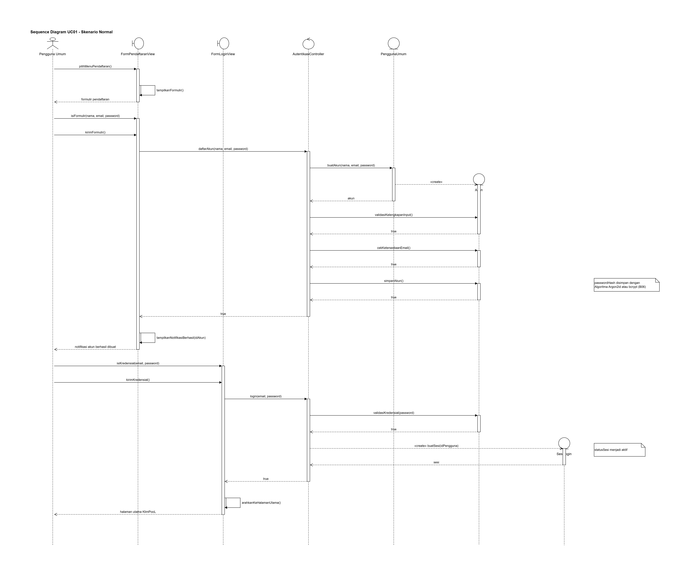
</p>
<p align="center">
<i>Gambar 3.1.1. Sequence Diagram UC01 - Skenario Normal</i>
</p>

Pengguna Umum membuka formulir pendaftaran melalui `FormPendaftaranView`, mengisi nama, email, dan password, lalu mengirimkannya. `AutentikasiController` meminta `PenggunaUmum` membuat objek `Akun`, kemudian memanggil `validasiKelengkapanInput()`, `cekKetersediaanEmail()`, dan `simpanAkun()` secara berurutan. Setelah akun tersimpan, Pengguna Umum memasukkan kredensial pada `FormLoginView`. `AutentikasiController` memverifikasi kredensial melalui `validasiKredensial()` pada `Akun`, lalu membuat `SesiLogin` dan mengarahkan pengguna ke halaman utama.

- **Skenario Alternatif 1: Email Sudah Terdaftar**

<p align="center">
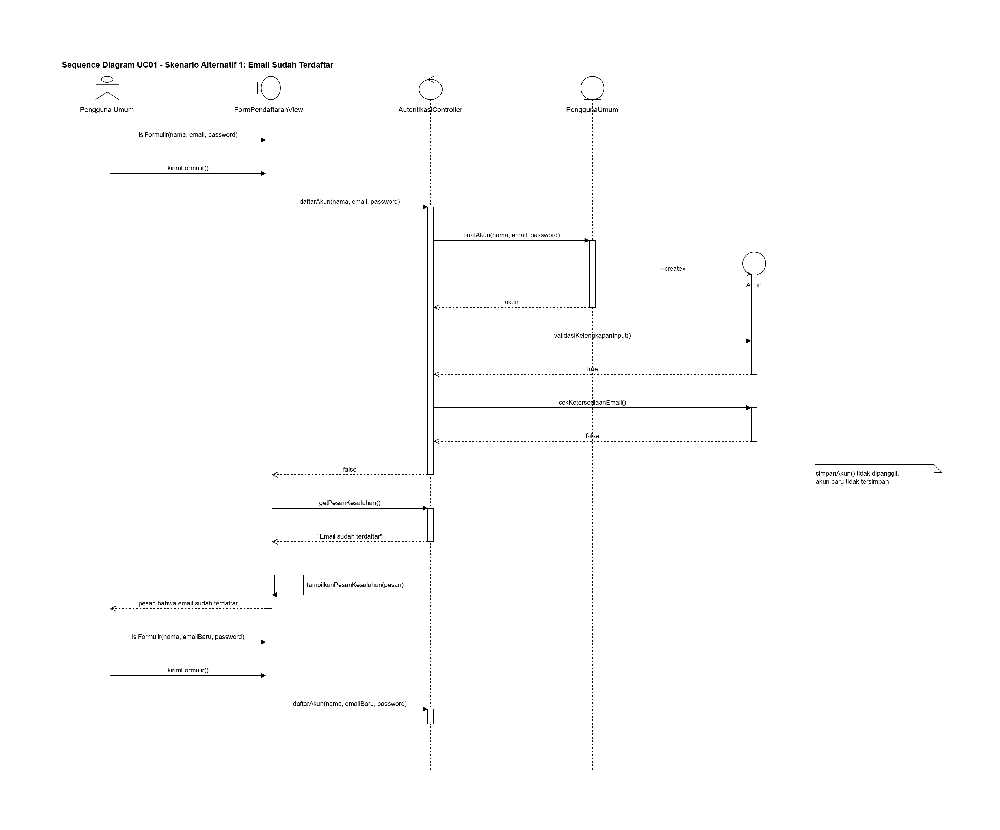
</p>
<p align="center">
<i>Gambar 3.1.2. Sequence Diagram UC01 - Email Sudah Terdaftar</i>
</p>

Alur berjalan sama dengan skenario normal sampai pemeriksaan ketersediaan email. `cekKetersediaanEmail()` mengembalikan `false`, sehingga `simpanAkun()` tidak dipanggil dan akun baru tidak tersimpan. `FormPendaftaranView` mengambil pesan kesalahan melalui `getPesanKesalahan()` dan menampilkannya, lalu pengguna dapat mengirim ulang formulir dengan email lain.

- **Skenario Alternatif 2: Kredensial Login Tidak Valid**

<p align="center">
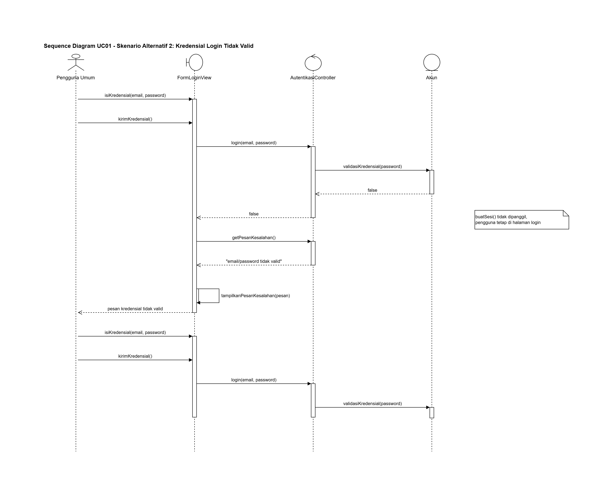
</p>
<p align="center">
<i>Gambar 3.1.3. Sequence Diagram UC01 - Kredensial Login Tidak Valid</i>
</p>

`validasiKredensial()` pada `Akun` mengembalikan `false`, sehingga `buatSesi()` tidak dipanggil dan pengguna tidak memperoleh sesi login. `FormLoginView` menampilkan pesan kesalahan dan pengguna tetap berada pada halaman login untuk memasukkan kembali kredensialnya.

### 3.1.3 Diagram Kelas

<p align="center">
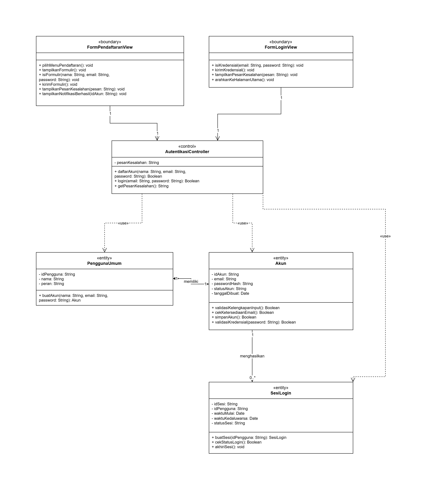
</p>
<p align="center">
<i>Gambar 3.1.4. Diagram Kelas Melakukan Pendaftaran dan Autentikasi (UC01)</i>
</p>

`FormPendaftaranView` dan `FormLoginView` masing-masing berasosiasi satu-ke-satu dengan `AutentikasiController`. `AutentikasiController` memiliki dependensi «use» terhadap ketiga kelas *entity* karena hanya memakai objeknya selama use case berlangsung tanpa menyimpannya. `PenggunaUmum` berelasi komposisi dengan `Akun`, karena akun tidak dapat ada tanpa pengguna pemiliknya dan ikut terhapus ketika pengguna dihapus. Satu `Akun` dapat menghasilkan nol sampai banyak `SesiLogin` sepanjang masa hidupnya, yaitu satu sesi untuk setiap kali pengguna berhasil login.

---

## 3.2 Use Case Membuat Campaign Penggalangan Donasi

**ID Use Case:** UC02  
**Nama Use Case:** Membuat Campaign Penggalangan Donasi

### 3.2.1 Identifikasi Kelas

`FormCampaignView` menerima judul, deskripsi, target nominal, dan periode campaign serta menampilkan pesan kesalahan atau notifikasi keberhasilan, sedangkan `DetailCampaignView` menampilkan informasi campaign beserta status verifikasinya. Keduanya berinteraksi dengan `CampaignController`, kelas *control* yang mengoordinasikan pembuatan campaign. Validasi kelengkapan data, target, dan periode, serta penyimpanan campaign dengan status "Menunggu Verifikasi", tetap menjadi tanggung jawab `Campaign` sesuai deskripsi C03. `PembuatProject` (C10) berperan sebagai aktor sekaligus pemilik campaign. Pada tingkat komponen (Tabel 2.3), kelas-kelas ini dihimpun oleh `CampaignProjectView`, `CampaignProjectController`, `CampaignProjectService`, dan `CampaignProjectRepository`, sehingga komponen tersebut tidak digambar lagi sebagai kelas pada diagram.

Tabel 3.2. Identifikasi Kelas Use Case UC02

| No | Nama Kelas Perancangan | Nama Kelas Analisis Terkait |
|:--- | :--- | :--- |
| 1 | FormCampaignView | PembuatProject (C10) |
| 2 | DetailCampaignView | Campaign (C03) |
| 3 | CampaignController | PembuatProject (C10), Campaign (C03) |
| 4 | PembuatProject | PembuatProject (C10) |
| 5 | Campaign | Campaign (C03) |


### 3.2.2 Sequence Diagram

- **Skenario Normal**

<p align="center">
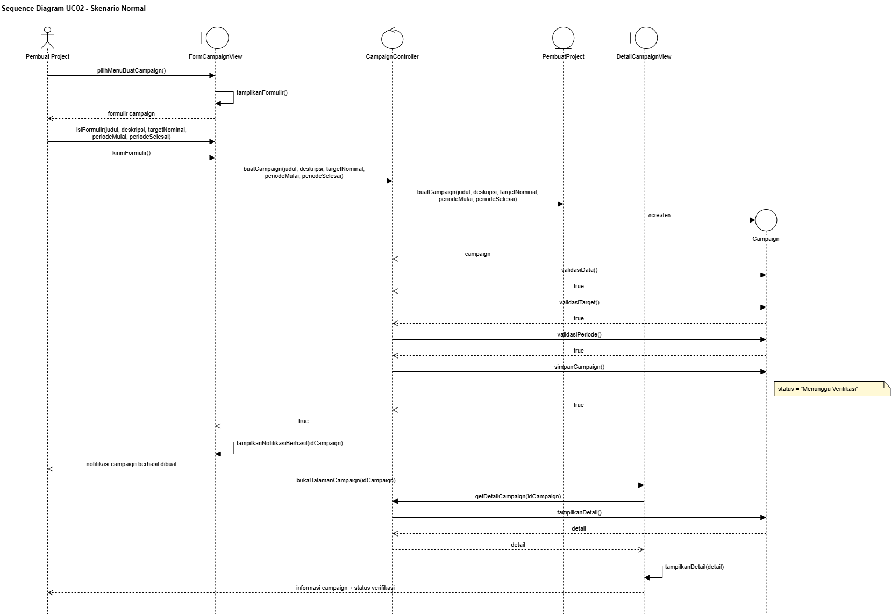
</p>
<p align="center">
<i>Gambar 3.2.1. Sequence Diagram UC02 - Skenario Normal</i>
</p>

- **Skenario Alternatif 1: Data Campaign Tidak Lengkap**

<p align="center">

</p>
<p align="center">
<i>Gambar 3.2.2. Sequence Diagram UC02 - Data Campaign Tidak Lengkap</i>
</p>

- **Skenario Alternatif 2: Target atau Periode Campaign Tidak Valid**

<p align="center">

</p>
<p align="center">
<i>Gambar 3.2.3. Sequence Diagram UC02 - Target atau Periode Campaign Tidak Valid</i>
</p>

### 3.2.3 Diagram Kelas

<p align="center">

</p>
<p align="center">
<i>Gambar 3.2.4. Diagram Kelas Membuat Campaign Penggalangan Donasi (UC02)</i>
</p>

---

## 3.3 Use Case Membuat Project Aksi Iklim

**ID Use Case:** UC03  
**Nama Use Case:** Membuat Project Aksi Iklim

### 3.3.1 Identifikasi Kelas

Realisasi UC03 memakai pembagian yang sama dengan UC02. Perbedaannya, entitas yang dikelola adalah `Project`, dan terdapat validasi kebutuhan project (dana, logistik, dan kriteria volunteer) yang dijalankan sebelum formulir dikirim. `FormProjectView` menerima informasi dasar dan kebutuhan project, `DetailProjectView` menampilkan project beserta status verifikasinya, dan `ProjectController` mengoordinasikan keduanya. Pemetaan ke komponen pada Tabel 2.3 sama dengan UC02.

Tabel 3.3. Identifikasi Kelas Use Case UC03

| No | Nama Kelas Perancangan | Nama Kelas Analisis Terkait |
|:--- | :--- | :--- |
| 1 | FormProjectView | PembuatProject (C10) |
| 2 | DetailProjectView | Project (C02) |
| 3 | ProjectController | PembuatProject (C10), Project (C02) |
| 4 | PembuatProject | PembuatProject (C10) |
| 5 | Project | Project (C02) |

### 3.3.2 Sequence Diagram

- **Skenario Normal**

<p align="center">
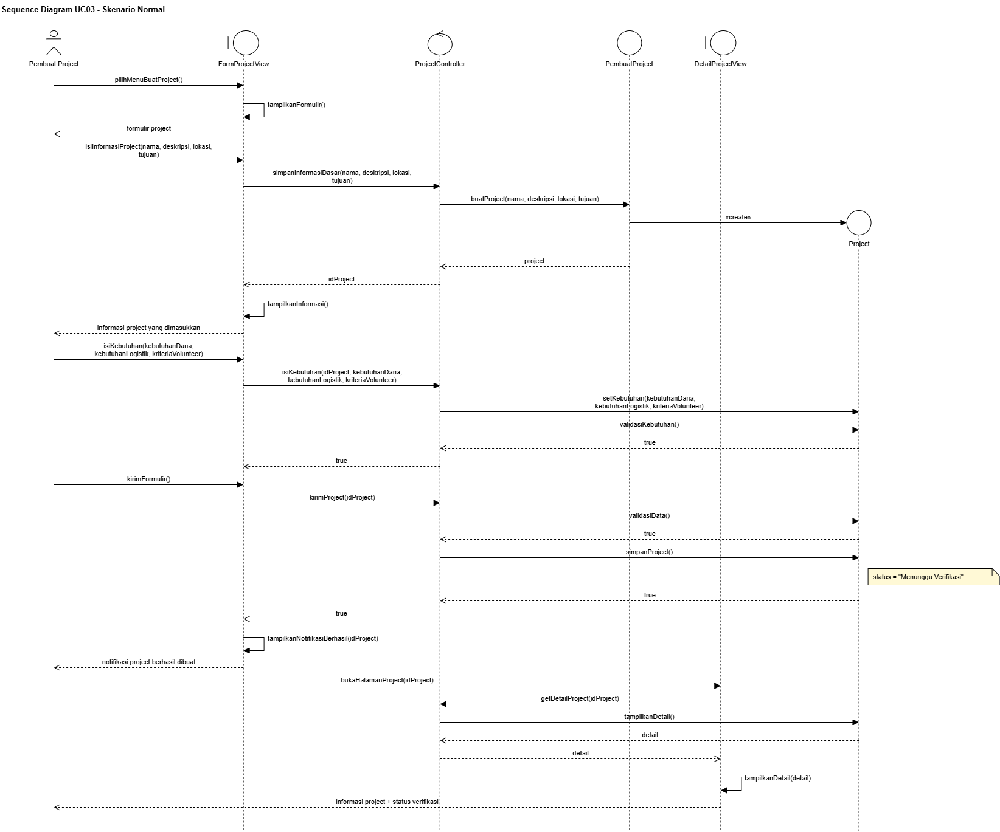
</p>
<p align="center">
<i>Gambar 3.3.1. Sequence Diagram UC03 - Skenario Normal</i>
</p>

- **Skenario Alternatif 1: Informasi Project Tidak Lengkap**

<p align="center">
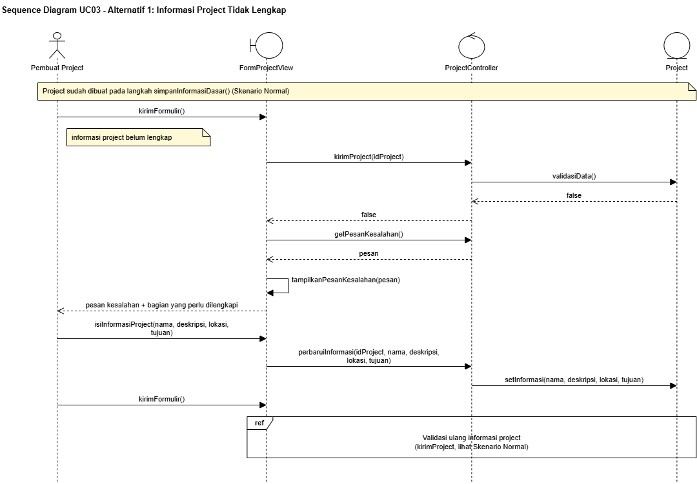
</p>
<p align="center">
<i>Gambar 3.3.2. Sequence Diagram UC03 - Informasi Project Tidak Lengkap</i>
</p>

- **Skenario Alternatif 2: Data Kebutuhan Project Tidak Valid**

<p align="center">

</p>
<p align="center">
<i>Gambar 3.3.3. Sequence Diagram UC03 - Data Kebutuhan Project Tidak Valid</i>
</p>

### 3.3.3 Diagram Kelas

<p align="center">

</p>
<p align="center">
<i>Gambar 3.3.4. Diagram Kelas Membuat Project Aksi Iklim (UC03)</i>
</p>

---

## 3.4 Use Case Meninjau dan Memverifikasi Project

**ID Use Case:** UC04  
**Nama Use Case:** Meninjau dan Memverifikasi Project

### 3.4.1 Identifikasi Kelas

Realisasi UC04 melibatkan dua aktor, yaitu Pembuat Project yang mengajukan verifikasi melalui `PengajuanView` dan Admin Sistem yang meninjau pengajuan melalui `DaftarPengajuanView` dan `DetailPengajuanView`. Ketiganya berinteraksi dengan `VerifikasiController`. Tindakan menyetujui dan menolak diwujudkan melalui `AdminSistem` (C11), sedangkan perubahan status dan alasan penolakan disimpan oleh `Campaign` atau `Project` melalui `ubahStatus()`.


Tabel 3.4. Identifikasi Kelas Use Case UC04

| No | Nama Kelas Perancangan | Nama Kelas Analisis Terkait |
|:--- | :--- | :--- |
| 1 | PengajuanView | PembuatProject (C10) |
| 2 | DaftarPengajuanView | AdminSistem (C11) |
| 3 | DetailPengajuanView | AdminSistem (C11) |
| 4 | VerifikasiController | PembuatProject (C10), AdminSistem (C11) |
| 5 | PembuatProject | PembuatProject (C10) |
| 6 | AdminSistem | AdminSistem (C11) |
| 7 | Campaign | Campaign (C03) |
| 8 | Project | Project (C02) |

### 3.4.2 Sequence Diagram

- **Skenario Normal**

<p align="center">
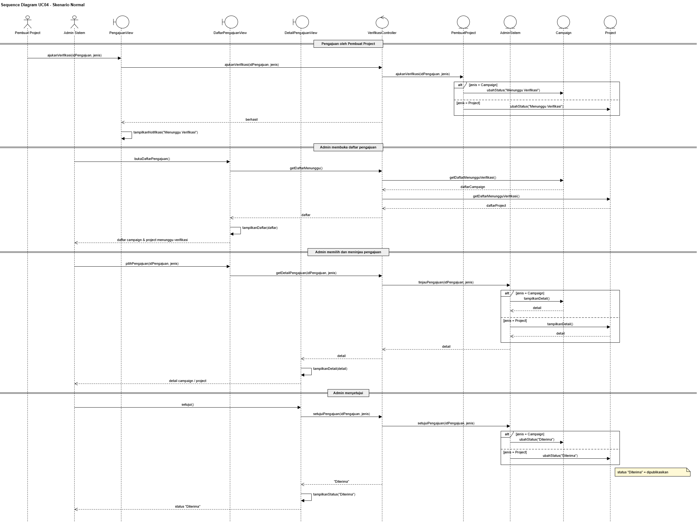
</p>
<p align="center">
<i>Gambar 3.4.1. Sequence Diagram UC04 - Skenario Normal</i>
</p>

- **Skenario Alternatif 1: Campaign atau Project Ditolak**

<p align="center">
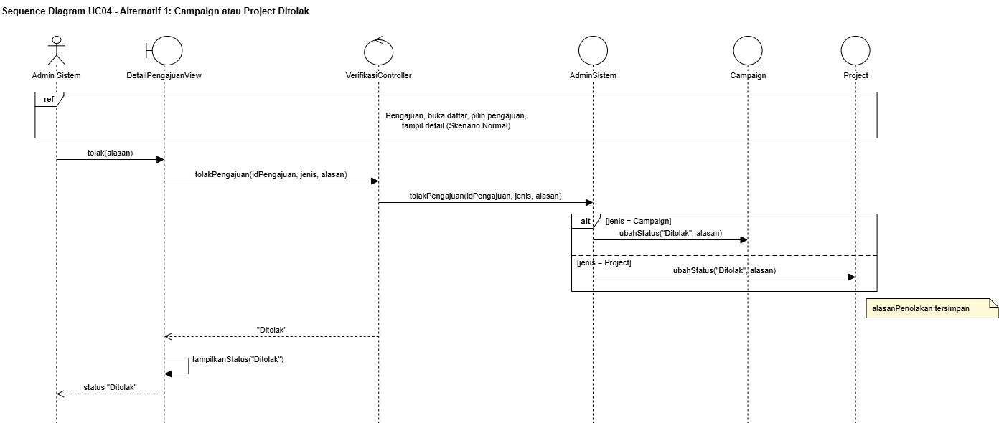
</p>
<p align="center">
<i>Gambar 3.4.2. Sequence Diagram UC04 - Campaign atau Project Ditolak</i>
</p>

### 3.4.3 Diagram Kelas

<p align="center">

</p>
<p align="center">
<i>Gambar 3.4.3. Diagram Kelas Meninjau dan Memverifikasi Project (UC04)</i>
</p>

---

## 3.5 Use Case Mencari dan Menelusuri Project

**ID Use Case:** UC05  
**Nama Use Case:** Mencari dan Menelusuri Project

### 3.5.1 Identifikasi Kelas

Realisasi UC05 memisahkan antarmuka pencarian dari antarmuka detail campaign dan project. `FormPencarianView` menerima kata kunci dan filter serta menampilkan hasil pencarian, sedangkan `DetailCampaignView` dan `DetailProjectView` digunakan kembali untuk menampilkan informasi kegiatan yang dipilih. Ketiga kelas *boundary* tersebut berinteraksi dengan `PencarianController` sebagai kelas *control* yang mengoordinasikan pencarian dan pengambilan detail. Kelas analisis PenggunaUmum (C00) tetap dipertahankan sebagai kelas *entity* untuk data pengguna, sementara tindakan pencariannya ditangani oleh antarmuka. Parameter pencarian dan penyaringan tetap menjadi tanggung jawab `Katalog` sesuai deskripsi C01, sedangkan informasi kegiatan tetap berada pada `Project` dan `Campaign`. Hasil pencarian dibatasi pada campaign dan project yang telah dipublikasikan sesuai KF13–KF14; apabila tidak ada hasil yang sesuai, antarmuka menampilkan pesan agar pengguna dapat mengubah kata kunci atau filter.

Tabel 3.5. Identifikasi Kelas Use Case UC05

| No | Nama Kelas Perancangan | Nama Kelas Analisis Terkait |
|:--- | :--- | :--- |
| 1 | FormPencarianView | PenggunaUmum (C00), Katalog (C01) |
| 2 | DetailCampaignView | Campaign (C03) |
| 3 | DetailProjectView | Project (C02) |
| 4 | PencarianController | PenggunaUmum (C00), Katalog (C01) |
| 5 | PenggunaUmum | PenggunaUmum (C00) |
| 6 | Katalog | Katalog (C01) |
| 7 | Project | Project (C02) |
| 8 | Campaign | Campaign (C03) |

### 3.5.2 Sequence Diagram

- **Skenario Normal**

<p align="center">
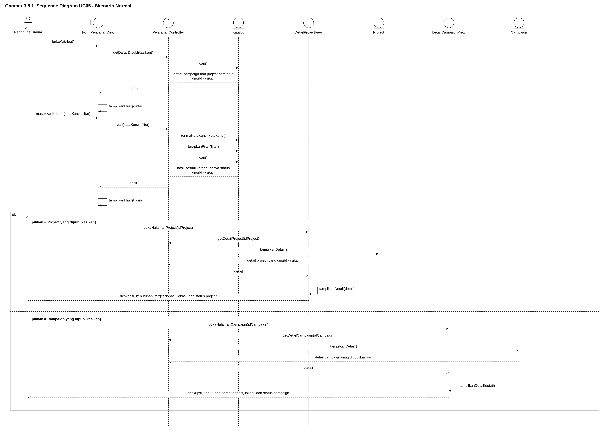
</p>
<p align="center">
<i>Gambar 3.5.1. Sequence Diagram UC05 - Skenario Normal</i>
</p>

- **Skenario Alternatif 1: Project Tidak Ditemukan**

<p align="center">
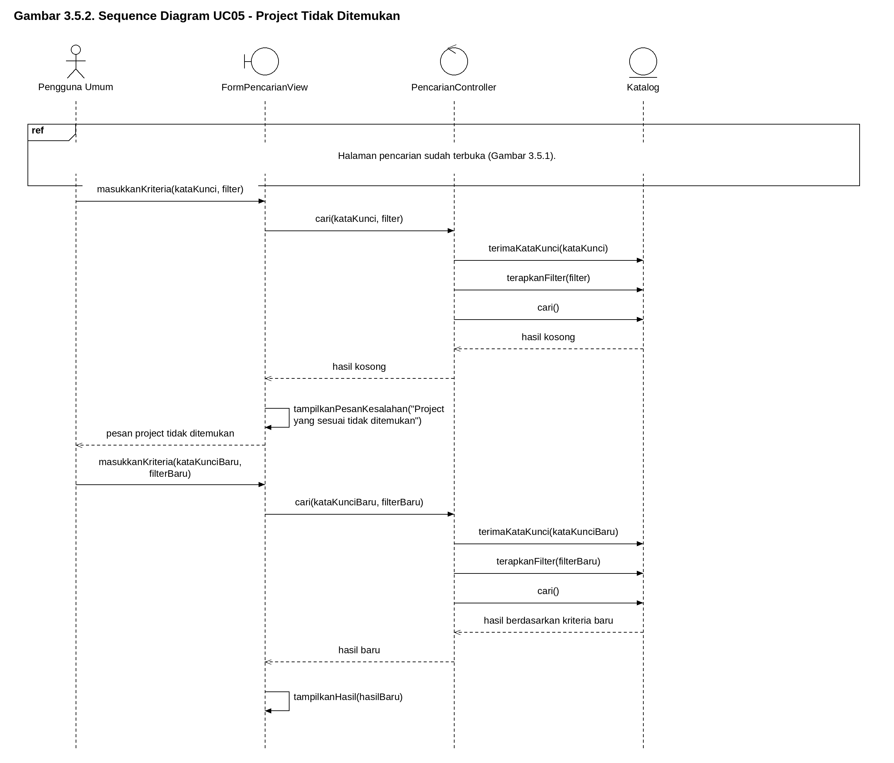
</p>
<p align="center">
<i>Gambar 3.5.2. Sequence Diagram UC05 - Project Tidak Ditemukan</i>
</p>

### 3.5.3 Diagram Kelas

<p align="center">
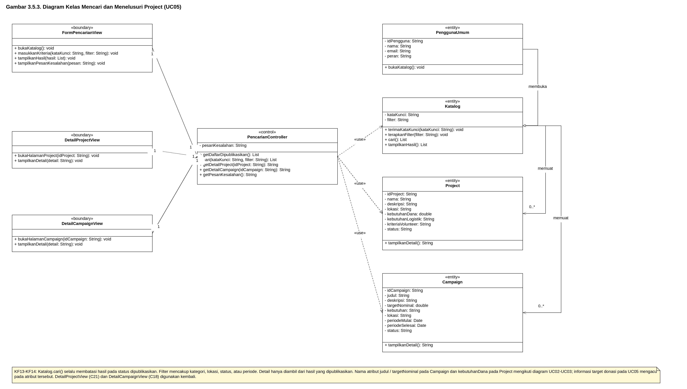
</p>
<p align="center">
<i>Gambar 3.5.3. Diagram Kelas Mencari dan Menelusuri Project (UC05)</i>
</p>

---

## 3.6 Use Case Melakukan Transaksi Donasi

**ID Use Case:** UC06  
**Nama Use Case:** Melakukan Transaksi Donasi

### 3.6.1 Identifikasi Kelas

Realisasi UC06 memisahkan antarmuka peta, formulir donasi, dan tampilan bukti transaksi menjadi tiga kelas *boundary*, yaitu `FormPetaWilayahView`, `FormDonasiView`, dan `DetailBuktiTransaksiView`. `DonasiController` mengoordinasikan alur donasi, termasuk pemeriksaan status login melalui `SesiLogin`. Kelas analisis `PetaWilayah` tetap menyimpan parameter wilayah dan menyediakan data sebaran kegiatan, sedangkan `Donatur` menyimpan data pengguna beserta saldonya. Validasi nominal, pemeriksaan duplikasi berdasarkan *idempotency key*, serta pemrosesan dan pencatatan donasi tetap menjadi tanggung jawab `TransaksiDonasi` sesuai deskripsi C06. `Project` atau `Campaign` menjadi tujuan dana yang diperiksa statusnya dan diperbarui dana terkumpul serta persentase pencapaian targetnya. Pengurangan saldo, penambahan dana tujuan, dan pencatatan transaksi dijalankan secara atomik, sehingga seluruh perubahan dibatalkan apabila salah satu tahap gagal sesuai KF15–KF18 dan KF26. Setelah transaksi berhasil, `BuktiTransaksi` menghasilkan rincian bukti untuk ditampilkan kepada Donatur.

Tabel 3.6. Identifikasi Kelas Use Case UC06

| No | Nama Kelas Perancangan | Nama Kelas Analisis Terkait |
|:--- | :--- | :--- |
| 1 | FormPetaWilayahView | PetaWilayah (C05) |
| 2 | FormDonasiView | Donatur (C04), TransaksiDonasi (C06) |
| 3 | DetailBuktiTransaksiView | BuktiTransaksi (C07) |
| 4 | DonasiController | Donatur (C04), TransaksiDonasi (C06) |
| 5 | SesiLogin | SesiLogin (C13) |
| 6 | PetaWilayah | PetaWilayah (C05) |
| 7 | Donatur | Donatur (C04) |
| 8 | TransaksiDonasi | TransaksiDonasi (C06) |
| 9 | Project | Project (C02) |
| 10 | Campaign | Campaign (C03) |
| 11 | BuktiTransaksi | BuktiTransaksi (C07) |

### 3.6.2 Sequence Diagram

- **Skenario Normal**

<p align="center">
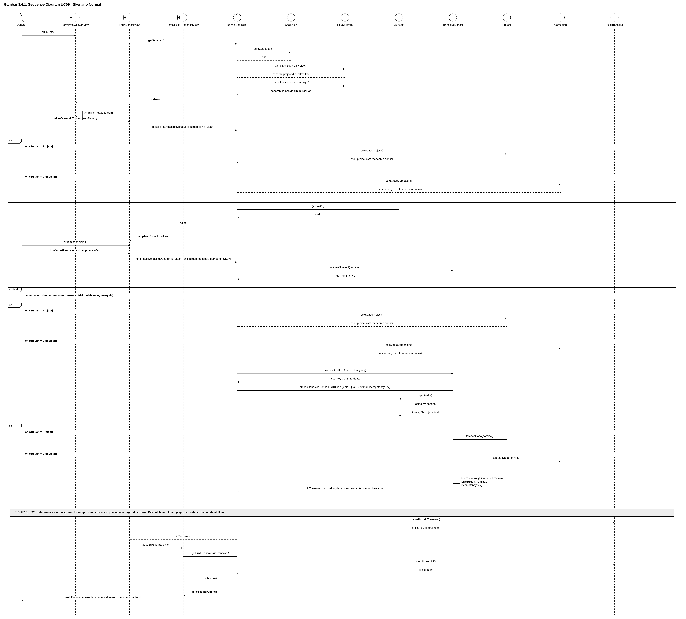
</p>
<p align="center">
<i>Gambar 3.6.1. Sequence Diagram UC06 - Skenario Normal</i>
</p>

- **Skenario Alternatif 1: Saldo Tidak Mencukupi / Kegagalan Transaksi**

<p align="center">
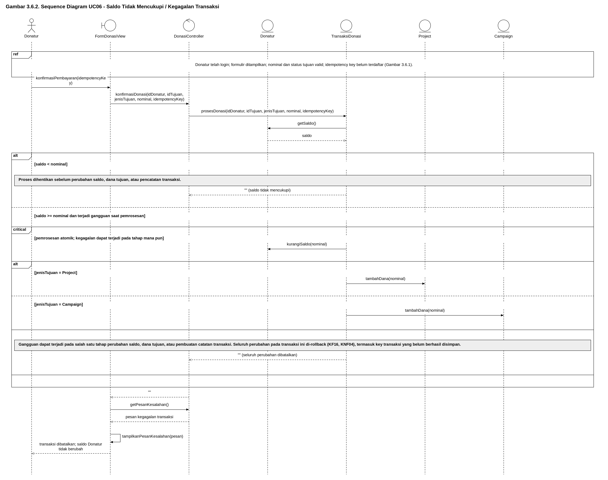
</p>
<p align="center">
<i>Gambar 3.6.2. Sequence Diagram UC06 - Saldo Tidak Mencukupi / Kegagalan Transaksi</i>
</p>

- **Skenario Alternatif 2: Duplikasi Permintaan Transaksi**

<p align="center">
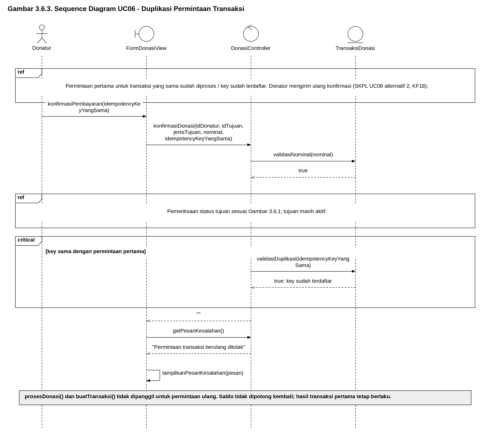
</p>
<p align="center">
<i>Gambar 3.6.3. Sequence Diagram UC06 - Duplikasi Permintaan Transaksi</i>
</p>

- **Skenario Alternatif 3: Campaign Sudah Berakhir / Ditutup**

<p align="center">
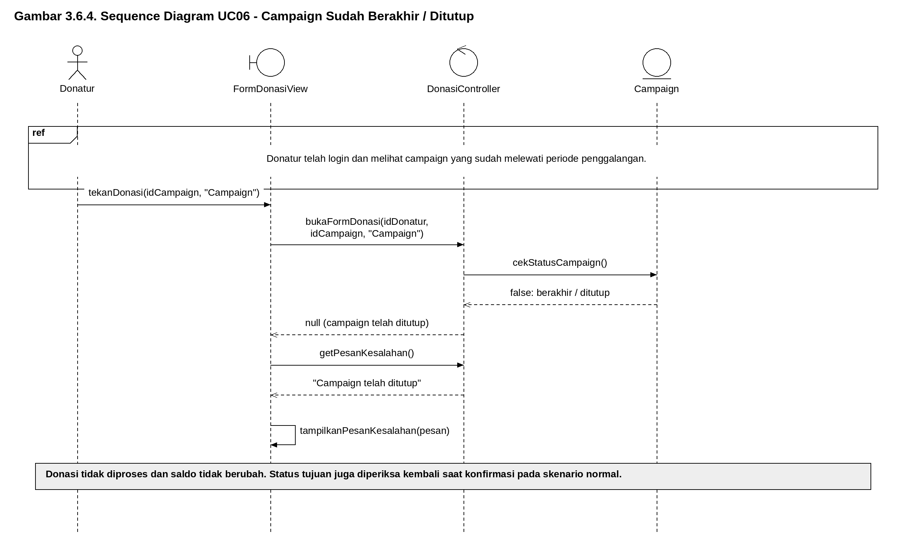
</p>
<p align="center">
<i>Gambar 3.6.4. Sequence Diagram UC06 - Campaign Sudah Berakhir / Ditutup</i>
</p>

- **Skenario Alternatif 4: Nominal Donasi Tidak Valid**

<p align="center">
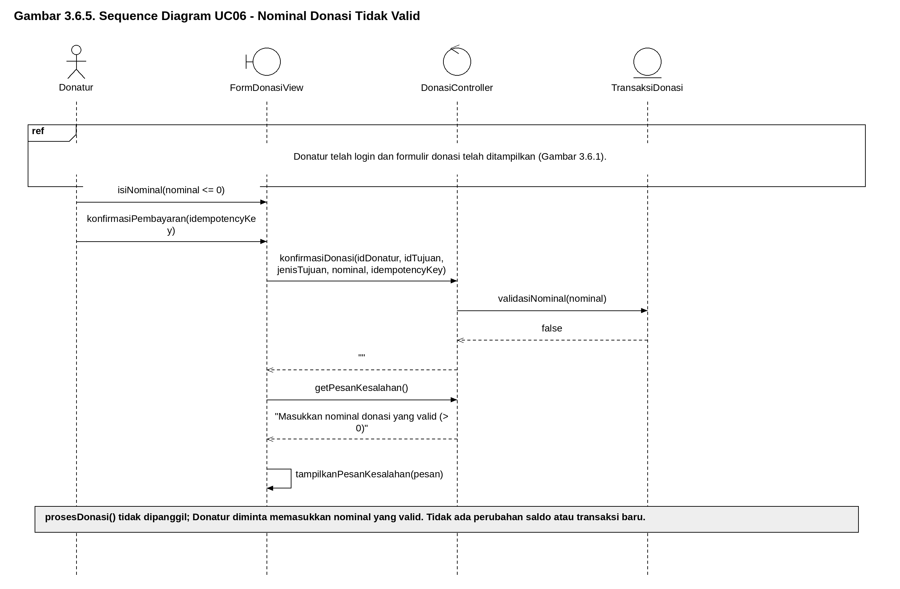
</p>
<p align="center">
<i>Gambar 3.6.5. Sequence Diagram UC06 - Nominal Donasi Tidak Valid</i>
</p>

### 3.6.3 Diagram Kelas

<p align="center">
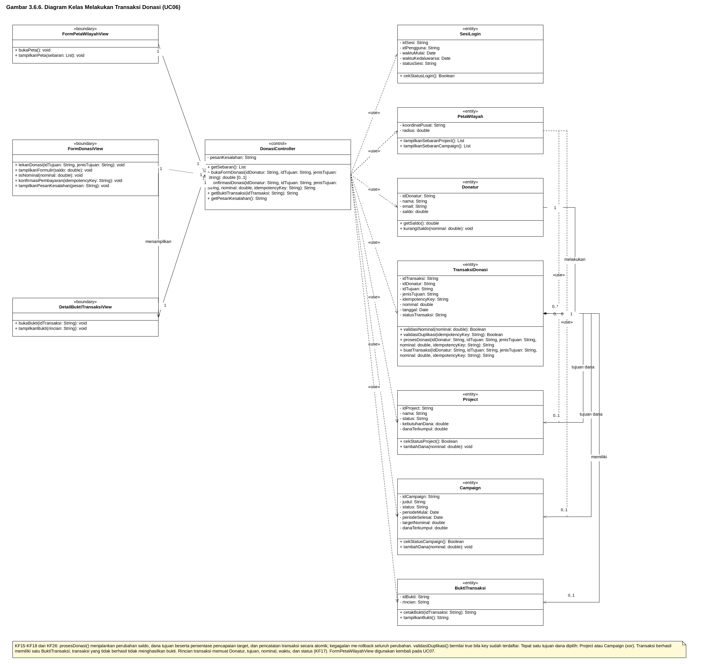
</p>
<p align="center">
<i>Gambar 3.6.6. Diagram Kelas Melakukan Transaksi Donasi (UC06)</i>
</p>

---

## 3.7 Use Case Mendaftar Sebagai Volunteer

**ID Use Case:** UC07  
**Nama Use Case:** Mendaftar Sebagai Volunteer

### 3.7.1 Identifikasi Kelas

Realisasi UC07 memakai kembali `FormPetaWilayahView` untuk menampilkan sebaran project dan menambahkan `FormPendaftaranRelawanView` sebagai kelas *boundary* untuk menerima data diri, keahlian, pengalaman, dan ketersediaan jadwal Volunteer. `RelawanController` mengoordinasikan pembukaan formulir dan pengiriman pendaftaran, dengan pemeriksaan status login tetap menjadi tanggung jawab `SesiLogin`. Data pengguna dan parameter wilayah tetap berada pada kelas *entity* `Volunteer` dan `PetaWilayah`, sedangkan data formulir, validasi kelengkapan, pemeriksaan pendaftaran ganda, serta penyimpanan status tetap menjadi tanggung jawab `PendaftaranRelawan` sesuai deskripsi C09 dan KF19–KF20. Ketersediaan kuota dan status pembukaan pendaftaran diperiksa melalui `Project` sesuai skenario alternatif UC07. Pendaftaran yang memenuhi ketentuan disimpan dengan status awal `pending` dan diteruskan kepada `PembuatProject` untuk ditinjau; keputusan penerimaan atau penolakan ditangani pada UC08.

Tabel 3.7. Identifikasi Kelas Use Case UC07

| No | Nama Kelas Perancangan | Nama Kelas Analisis Terkait |
|:--- | :--- | :--- |
| 1 | FormPetaWilayahView | PetaWilayah (C05) |
| 2 | FormPendaftaranRelawanView | Volunteer (C08), PendaftaranRelawan (C09) |
| 3 | RelawanController | Volunteer (C08), PendaftaranRelawan (C09) |
| 4 | SesiLogin | SesiLogin (C13) |
| 5 | PetaWilayah | PetaWilayah (C05) |
| 6 | Volunteer | Volunteer (C08) |
| 7 | PendaftaranRelawan | PendaftaranRelawan (C09) |
| 8 | Project | Project (C02) |
| 9 | PembuatProject | PembuatProject (C10) |

### 3.7.2 Sequence Diagram

- **Skenario Normal**

<p align="center">
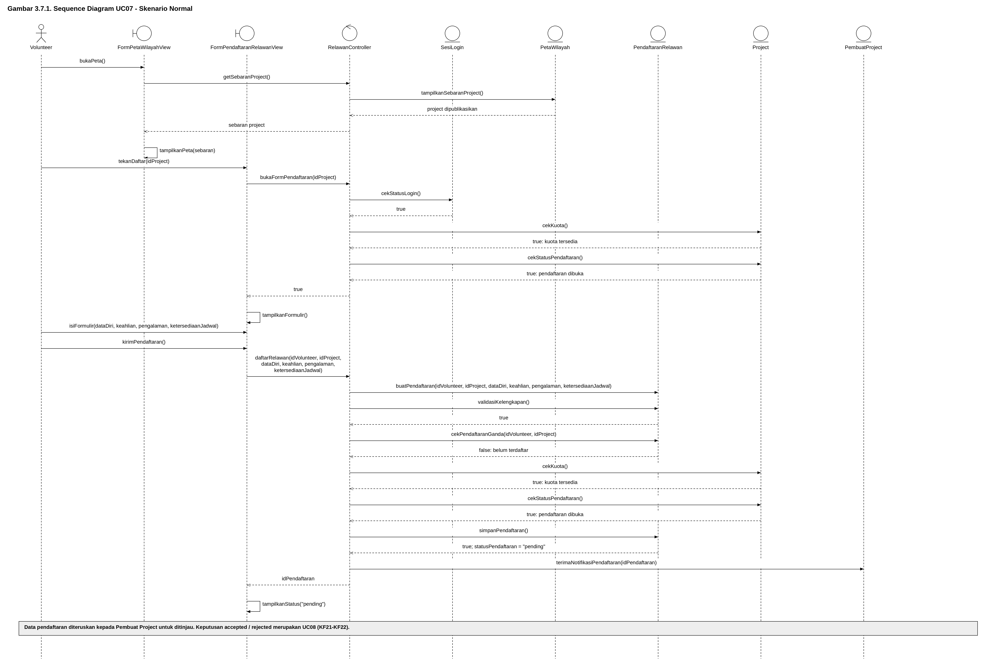
</p>
<p align="center">
<i>Gambar 3.7.1. Sequence Diagram UC07 - Skenario Normal</i>
</p>

- **Skenario Alternatif 1: Formulir Tidak Lengkap**

<p align="center">
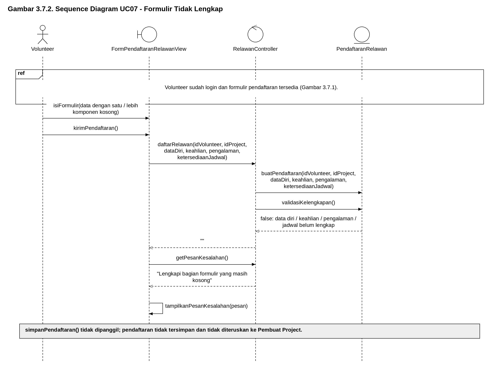
</p>
<p align="center">
<i>Gambar 3.7.2. Sequence Diagram UC07 - Formulir Tidak Lengkap</i>
</p>

- **Skenario Alternatif 2: Pendaftaran Ganda**

<p align="center">
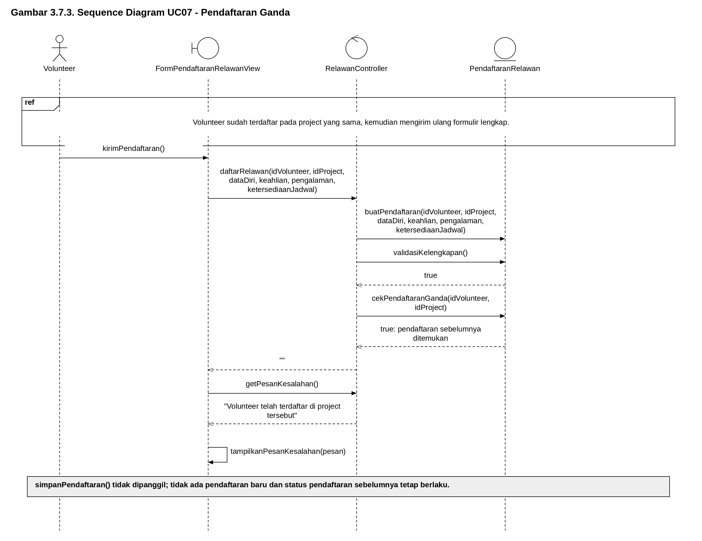
</p>
<p align="center">
<i>Gambar 3.7.3. Sequence Diagram UC07 - Pendaftaran Ganda</i>
</p>

- **Skenario Alternatif 3: Kuota Volunteer Penuh / Pendaftaran Ditutup**

<p align="center">
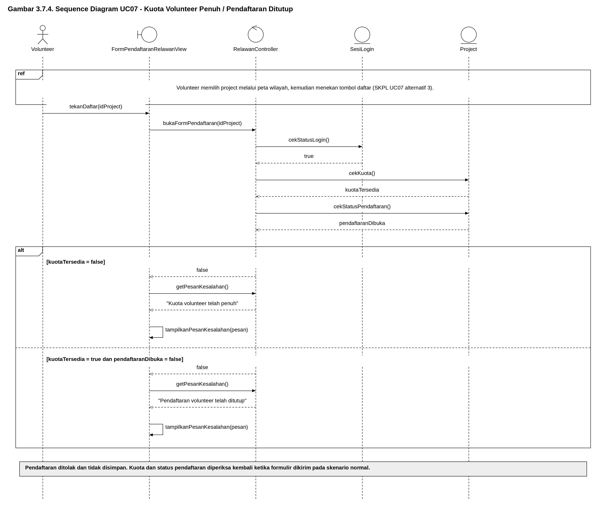
</p>
<p align="center">
<i>Gambar 3.7.4. Sequence Diagram UC07 - Kuota Volunteer Penuh / Pendaftaran Ditutup</i>
</p>

### 3.7.3 Diagram Kelas

<p align="center">
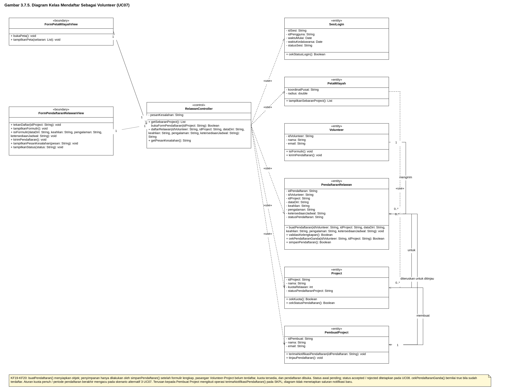
</p>
<p align="center">
<i>Gambar 3.7.5. Diagram Kelas Mendaftar Sebagai Volunteer (UC07)</i>
</p>

Berkas sumber seluruh diagram UC05–UC07 yang dapat diedit di draw.io tersedia pada [XML Diagram UC05–UC07](./assets/diagram/uc05-uc07.xml), dengan satu diagram pada setiap tab.

---

## 3.8 Use Case Mengelola Pendaftaran Relawan

**ID Use Case:** UC08  
**Nama Use Case:** Mengelola Pendaftaran Relawan

### 3.8.1 Identifikasi Kelas

Realisasi UC08 memisahkan antarmuka pengelolaan pendaftar yang dipakai Pembuat Project dari antarmuka status pendaftaran yang dilihat Volunteer menjadi dua kelas *boundary*, yaitu `FormVolunteerManagementView` dan `DetailStatusPendaftaranView`. Keduanya berinteraksi dengan `RelawanController`, yaitu kelas *control* yang sudah dipakai pada UC07 dan kini juga mengoordinasikan peninjauan pendaftar serta pengambilan keputusan terima/tolak. Pemeriksaan status login tetap menjadi tanggung jawab `SesiLogin`. Kelas analisis PembuatProject (C10) dan Volunteer (C08) berperan sebagai aktor sekaligus pemilik data, sehingga tindakan antarmukanya (membuka menu, meninjau, memilih keputusan, melihat instruksi) diwujudkan melalui kelas *boundary*, sedangkan data pengguna beserta operasi analisisnya tetap berada pada kelas *entity* `PembuatProject` dan `Volunteer`. Setelah status diperbarui, `DetailStatusPendaftaranView` menampilkan hasil keputusan kepada Volunteer, disertai instruksi lokasi dan jadwal apabila pendaftaran diterima.

Tabel 3.8. Identifikasi Kelas Use Case UC08

| No | Nama Kelas Perancangan | Nama Kelas Analisis Terkait |
|:--- | :--- | :--- |
| 1 | FormVolunteerManagementView | PembuatProject (C10), PendaftaranRelawan (C09) |
| 2 | DetailStatusPendaftaranView | Volunteer (C08), PendaftaranRelawan (C09) |
| 3 | RelawanController | PembuatProject (C10), PendaftaranRelawan (C09), Volunteer (C08) |
| 4 | SesiLogin | SesiLogin (C13) |
| 5 | PembuatProject | PembuatProject (C10) |
| 6 | Project | Project (C02) |
| 7 | PendaftaranRelawan | PendaftaranRelawan (C09) |
| 8 | Volunteer | Volunteer (C08) |

### 3.8.2 Sequence Diagram

- **Skenario Normal**

<p align="center">
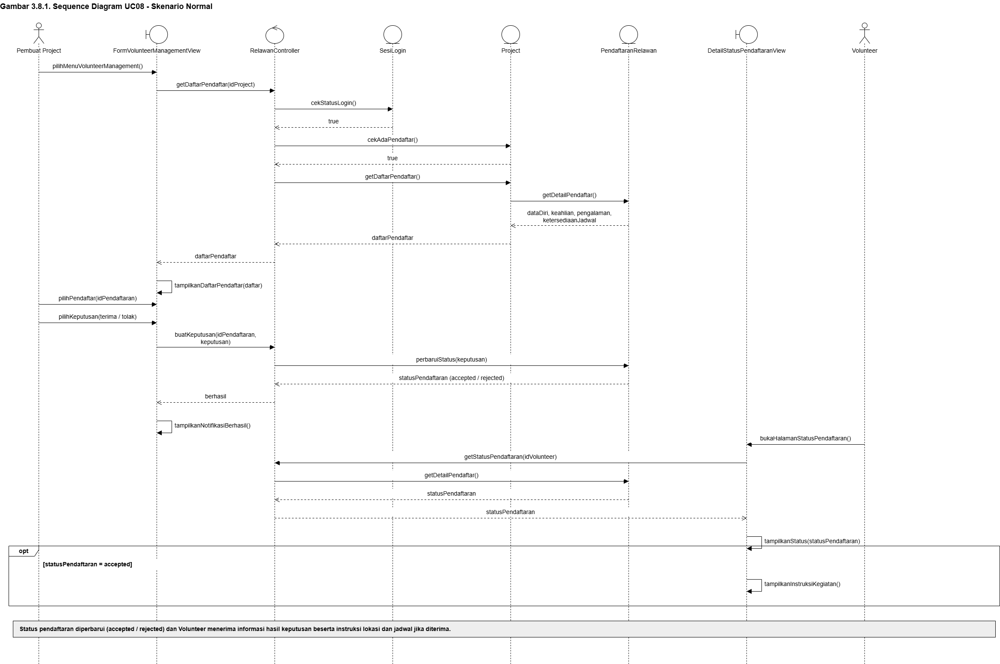
</p>
<p align="center">
<i>Gambar 3.8.1. Sequence Diagram UC08 - Skenario Normal</i>
</p>

Pembuat Project memilih menu volunteer management pada `FormVolunteerManagementView`. `RelawanController` memeriksa status login melalui `SesiLogin.cekStatusLogin()`, lalu meminta `Project` memeriksa keberadaan pendaftar dengan `cekAdaPendaftar()` dan mengambil daftarnya dengan `getDaftarPendaftar()`. Detail setiap pendaftar (data diri, keahlian, pengalaman, dan ketersediaan jadwal) diambil dari `PendaftaranRelawan` melalui `getDetailPendaftar()` dan ditampilkan oleh `tampilkanDaftarPendaftar()`. Setelah meninjau data, Pembuat Project memilih keputusan terima atau tolak. `RelawanController` memanggil `buatKeputusan()`, yang meneruskan keputusan ke `PendaftaranRelawan.perbaruiStatus()` sehingga status berubah menjadi `accepted` atau `rejected`. Selanjutnya `DetailStatusPendaftaranView` menampilkan hasil keputusan kepada Volunteer, disertai instruksi lokasi dan jadwal apabila pendaftaran diterima.

- **Skenario Alternatif 1: Belum Ada Pendaftar Volunteer**

<p align="center">
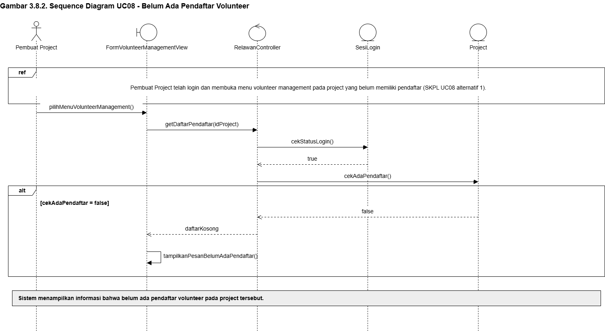
</p>
<p align="center">
<i>Gambar 3.8.2. Sequence Diagram UC08 - Belum Ada Pendaftar Volunteer</i>
</p>

Alur berjalan sama dengan skenario normal sampai pemeriksaan pendaftar. `cekAdaPendaftar()` pada `Project` mengembalikan `false`, sehingga `getDaftarPendaftar()` dan `perbaruiStatus()` tidak dipanggil. `FormVolunteerManagementView` menampilkan pesan bahwa belum ada pendaftar volunteer pada project tersebut melalui `tampilkanPesanBelumAdaPendaftar()`.

### 3.8.3 Diagram Kelas

<p align="center">
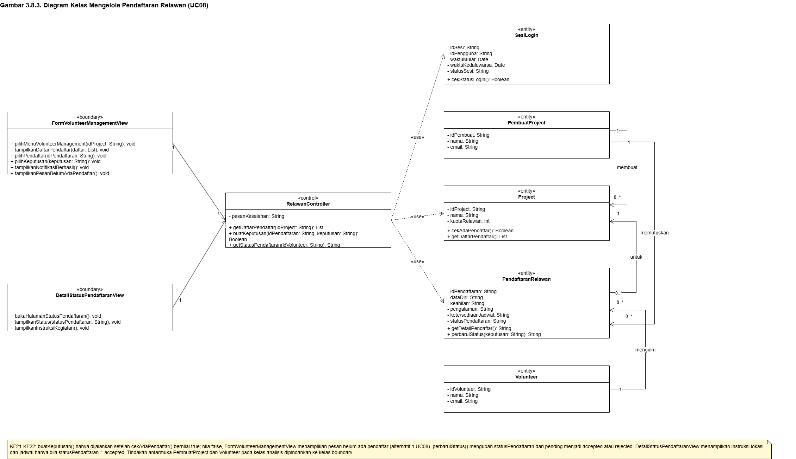
</p>
<p align="center">
<i>Gambar 3.8.3. Diagram Kelas Mengelola Pendaftaran Relawan (UC08)</i>
</p>

---

## 3.9 Use Case Memperbarui Progres Project

**ID Use Case:** UC09  
**Nama Use Case:** Memperbarui Progres Project

### 3.9.1 Identifikasi Kelas

Realisasi UC09 memakai satu kelas *boundary*, yaitu `FormProgresProjectView`, yang menerima data milestone, status pelaksanaan, dan berkas dokumentasi dari Pembuat Project serta menampilkan pesan kesalahan atau notifikasi keberhasilan. `ProgresController` berperan sebagai kelas *control* yang mengoordinasikan pembukaan halaman, pemeriksaan hak akses, dan penyimpanan pembaruan. Pemeriksaan status login tetap menjadi tanggung jawab `SesiLogin`. Kelas analisis PembuatProject (C10) berperan sebagai aktor sekaligus pemilik data, sehingga tindakan antarmukanya (membuka halaman, mengisi milestone, mengunggah dokumentasi) diwujudkan melalui `FormProgresProjectView`, sedangkan data pengguna beserta operasi analisisnya tetap berada pada kelas *entity* `PembuatProject`. Validasi hak akses, validasi format dan ukuran dokumentasi, penyimpanan pembaruan progres, serta pencatatan stempel waktu tetap menjadi tanggung jawab `Project` sesuai deskripsi C02. Peran Admin Sistem yang memastikan pengguna adalah Pembuat Project pada skenario diimplementasikan sebagai pemeriksaan otomatis `validasiHakAkses()` pada `Project`, sehingga tidak menjadi kelas tersendiri.

Tabel 3.9. Identifikasi Kelas Use Case UC09

| No | Nama Kelas Perancangan | Nama Kelas Analisis Terkait |
|:--- | :--- | :--- |
| 1 | FormProgresProjectView | PembuatProject (C10), Project (C02) |
| 2 | ProgresController | PembuatProject (C10), Project (C02) |
| 3 | SesiLogin | SesiLogin (C13) |
| 4 | PembuatProject | PembuatProject (C10) |
| 5 | Project | Project (C02) |

### 3.9.2 Sequence Diagram

- **Skenario Normal**

<p align="center">
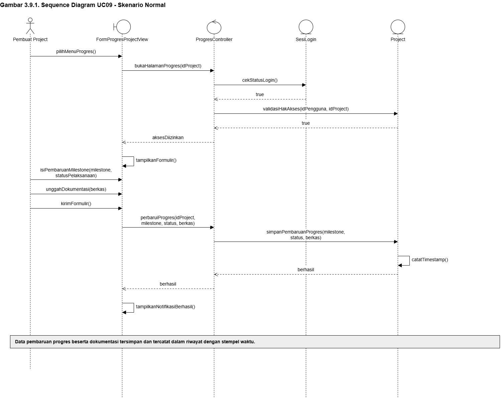
</p>
<p align="center">
<i>Gambar 3.9.1. Sequence Diagram UC09 - Skenario Normal</i>
</p>

Pembuat Project membuka halaman pembaruan progres melalui `FormProgresProjectView`. `ProgresController` memeriksa status login melalui `SesiLogin.cekStatusLogin()`, kemudian meminta `Project` menjalankan `validasiHakAkses()` untuk memastikan pengguna adalah Pembuat Project dari project tersebut. Setelah lolos, `tampilkanFormulir()` menampilkan formulir pembaruan progres. Pembuat Project mengisi milestone dan status pelaksanaan, mengunggah dokumentasi, lalu mengirim formulir. `ProgresController` memanggil `simpanPembaruanProgres()` pada `Project`, yang memeriksa format dan ukuran berkas dokumentasi sebelum menyimpan milestone, status pelaksanaan, dan dokumentasi progres. Setelah tersimpan, `catatTimestamp()` mencatat riwayat pembaruan beserta stempel waktunya dan menghubungkannya dengan project. `FormProgresProjectView` menampilkan notifikasi keberhasilan.

- **Skenario Alternatif 1: Akses Ditolak (Bukan Pembuat Project)**

<p align="center">
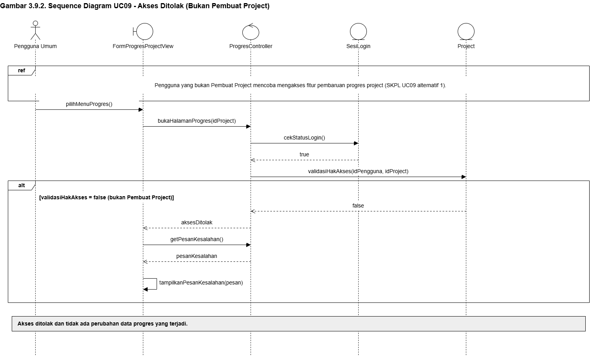
</p>
<p align="center">
<i>Gambar 3.9.2. Sequence Diagram UC09 - Akses Ditolak (Bukan Pembuat Project)</i>
</p>

Alur berjalan sama dengan skenario normal sampai pemeriksaan hak akses. `validasiHakAkses()` pada `Project` mengembalikan `false`, sehingga `tampilkanFormulir()` dan `simpanPembaruanProgres()` tidak dipanggil dan tidak ada data progres yang berubah. `FormProgresProjectView` menampilkan pesan bahwa tindakan tidak diizinkan melalui `tampilkanPesanKesalahan()`.

- **Skenario Alternatif 2: Gagal Mengunggah Dokumentasi Progres**

<p align="center">
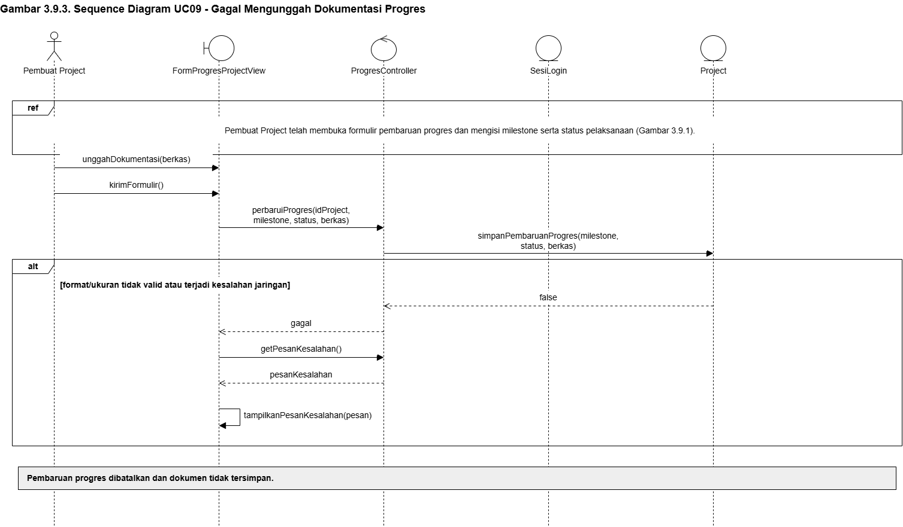
</p>
<p align="center">
<i>Gambar 3.9.3. Sequence Diagram UC09 - Gagal Mengunggah Dokumentasi Progres</i>
</p>

Alur berjalan sama dengan skenario normal sampai pengiriman formulir. `simpanPembaruanProgres()` pada `Project` mengembalikan `false` karena format atau ukuran berkas tidak valid, atau pengunggahan terputus akibat kesalahan jaringan. Data tidak disimpan dan `catatTimestamp()` tidak dipanggil, sehingga pembaruan progres dibatalkan dan dokumen tidak tersimpan. `ProgresController` menyediakan pesan melalui `getPesanKesalahan()`, lalu `FormProgresProjectView` menampilkannya sebagai pesan kesalahan unggah berkas.

### 3.9.3 Diagram Kelas

<p align="center">
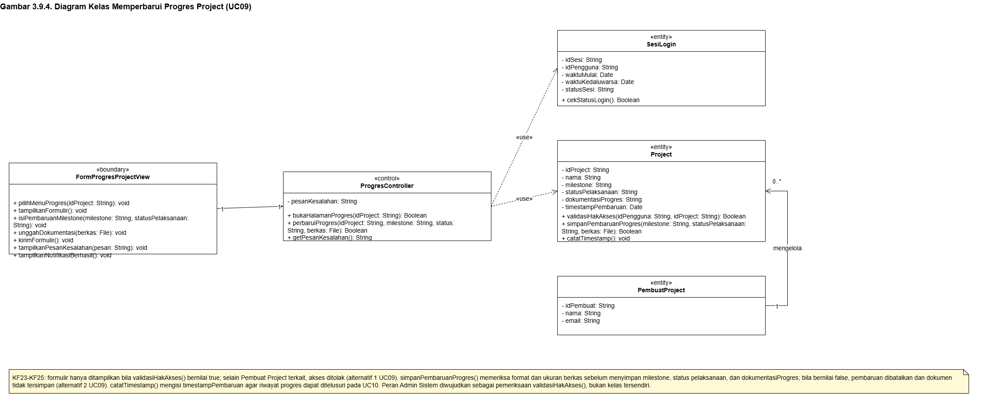
</p>
<p align="center">
<i>Gambar 3.9.4. Diagram Kelas Memperbarui Progres Project (UC09)</i>
</p>

---

## 3.10 Use Case Melihat Riwayat dan Penelusuran

**ID Use Case:** UC10  
**Nama Use Case:** Melihat Riwayat dan Penelusuran

### 3.10.1 Identifikasi Kelas

Realisasi UC10 memisahkan antarmuka daftar riwayat dari antarmuka detail riwayat menjadi dua kelas *boundary*. `FormRiwayatView` menampilkan menu dan daftar riwayat secara kronologis atau pesan bahwa riwayat belum tersedia, sedangkan `DetailRiwayatView` menampilkan rincian transaksi donasi (nominal, waktu, status) atau rincian laporan progres project. Keduanya berinteraksi dengan `RiwayatController` sebagai kelas *control* yang mengoordinasikan pengambilan riwayat dan detail, dengan pemeriksaan status login tetap menjadi tanggung jawab `SesiLogin`. Kelas analisis PenggunaUmum (C00) tetap dipertahankan sebagai kelas *entity* untuk data pengguna (termasuk perannya sebagai Pembuat Project, Donatur, atau Volunteer) beserta operasi `bukaMenuRiwayat()`, sementara tampilan menu dan daftar riwayat diwujudkan melalui `FormRiwayatView`. Catatan transaksi donasi tetap berada pada `TransaksiDonasi` sesuai deskripsi C06, sedangkan riwayat pembaruan progres (milestone dan status pelaksanaan) tetap berada pada `Project` sesuai deskripsi C02.

Tabel 3.10. Identifikasi Kelas Use Case UC10

| No | Nama Kelas Perancangan | Nama Kelas Analisis Terkait |
|:--- | :--- | :--- |
| 1 | FormRiwayatView | PenggunaUmum (C00) |
| 2 | DetailRiwayatView | TransaksiDonasi (C06), Project (C02) |
| 3 | RiwayatController | PenggunaUmum (C00), TransaksiDonasi (C06), Project (C02) |
| 4 | SesiLogin | SesiLogin (C13) |
| 5 | PenggunaUmum | PenggunaUmum (C00) |
| 6 | TransaksiDonasi | TransaksiDonasi (C06) |
| 7 | Project | Project (C02) |

### 3.10.2 Sequence Diagram

- **Skenario Normal**

<p align="center">
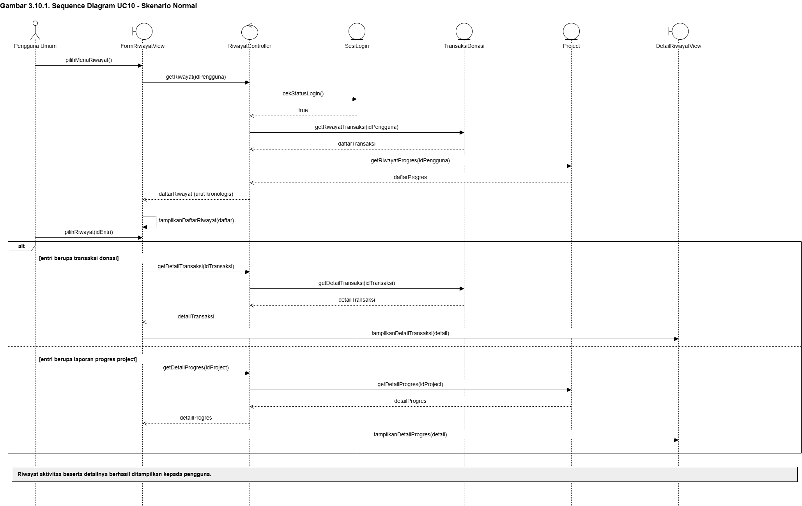
</p>
<p align="center">
<i>Gambar 3.10.1. Sequence Diagram UC10 - Skenario Normal</i>
</p>

Pengguna Umum membuka menu riwayat melalui `FormRiwayatView`. `RiwayatController` memeriksa status login melalui `SesiLogin.cekStatusLogin()`, lalu mengambil riwayat transaksi dari `TransaksiDonasi.getRiwayatTransaksi()` dan riwayat pembaruan progres dari `Project.getRiwayatProgres()`. Hasilnya ditampilkan oleh `tampilkanDaftarRiwayat()` dalam urutan kronologis. Ketika Pengguna Umum memilih salah satu entri, `RiwayatController` memanggil `getDetailTransaksi()` pada `TransaksiDonasi` atau `getDetailProgres()` pada `Project` sesuai jenis entri, dan `DetailRiwayatView` menampilkan rincian transaksi atau rincian laporan progres.

- **Skenario Alternatif 1: Riwayat Belum Tersedia**

<p align="center">
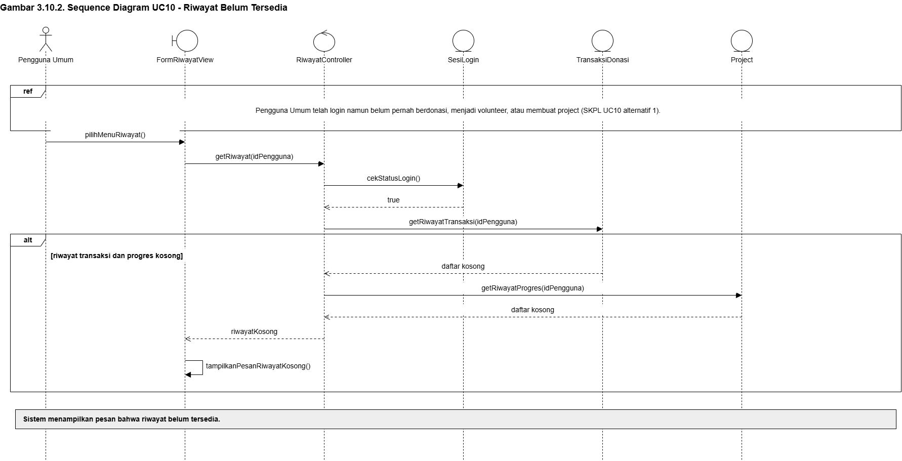
</p>
<p align="center">
<i>Gambar 3.10.2. Sequence Diagram UC10 - Riwayat Belum Tersedia</i>
</p>

Alur berjalan sama dengan skenario normal sampai pengambilan riwayat. `getRiwayatTransaksi()` dan `getRiwayatProgres()` tidak mengembalikan data karena pengguna belum pernah berdonasi, menjadi volunteer, atau membuat project. `FormRiwayatView` menampilkan pesan bahwa riwayat belum tersedia melalui `tampilkanPesanRiwayatKosong()`, dan `DetailRiwayatView` tidak ditampilkan.

### 3.10.3 Diagram Kelas

<p align="center">
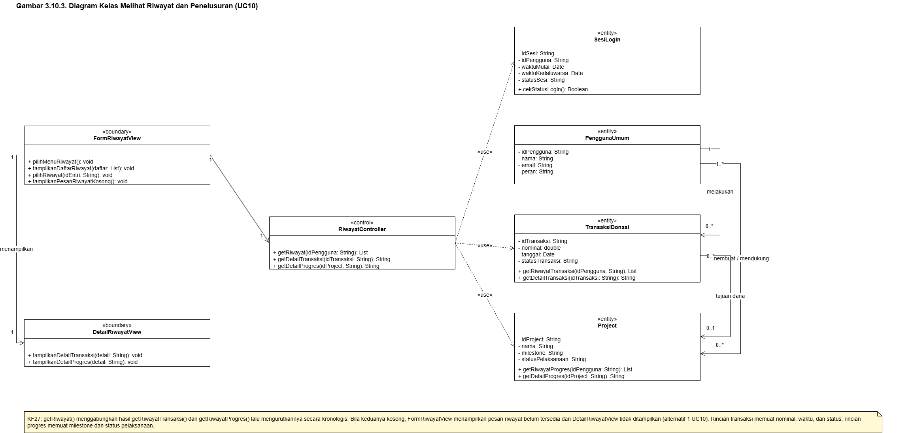
</p>
<p align="center">
<i>Gambar 3.10.3. Diagram Kelas Melihat Riwayat dan Penelusuran (UC10)</i>
</p>

---

# BAB 4: Diagram Kelas Keseluruhan

## 4.1 Diagram Kelas

Diagram kelas keseluruhan menggabungkan seluruh kelas perancangan dari BAB 3, yaitu kelas *boundary*, *control*, dan *entity* dari UC01 sampai UC10. Kelas *entity* yang dipakai oleh lebih dari satu use case digambarkan satu kali saja dengan atribut dan operasi gabungan. Visibilitas ditulis `+` (public) dan `-` (private). Tipe data memakai notasi yang sama dengan diagram kelas dan sequence diagram per use case (`String`, `double`, `Boolean`, `Date`, `List<T>`), yang dipetakan ke tipe TypeScript saat implementasi sesuai Tabel 2.1. Nilai yang diizinkan untuk atribut berstatus dijelaskan pada Tabel 4.2.

<p align="center">
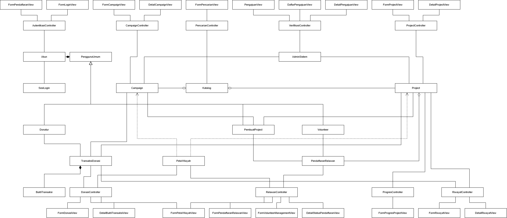
</p>
<p align="center">
<i>Gambar 4.1. Diagram Kelas Perancangan Keseluruhan KlimPooL</i>
</p>

Tabel 4.1. Daftar Kelas Perancangan Keseluruhan

| ID Kelas | Nama Kelas | Atribut | Metode/Operasi |
| :--- | :--- | :--- | :--- |
| C00 | PenggunaUmum | `- idPengguna: String`<br>`- nama: String`<br>`- email: String`<br>`- peran: String` | `+ buatAkun(nama: String, email: String, password: String): Akun`<br>`+ bukaKatalog(): void`<br>`+ bukaMenuRiwayat(): void` |
| C12 | Akun | `- idAkun: String`<br>`- email: String`<br>`- passwordHash: String`<br>`- statusAkun: String`<br>`- tanggalDibuat: Date` | `+ validasiKelengkapanInput(nama: String, email: String, password: String): Boolean`<br>`+ cekKetersediaanEmail(email: String): Boolean`<br>`+ simpanAkun(): Boolean`<br>`+ validasiKredensial(email: String, password: String): Boolean` |
| C13 | SesiLogin | `- idSesi: String`<br>`- idPengguna: String`<br>`- waktuMulai: Date`<br>`- waktuKedaluwarsa: Date`<br>`- statusSesi: String` | `+ buatSesi(idPengguna: String): SesiLogin`<br>`+ cekStatusLogin(idSesi: String): Boolean`<br>`+ akhiriSesi(): void` |
| C14 | FormPendaftaranView | - | `+ pilihMenuPendaftaran(): void`<br>`+ tampilkanFormulir(): void`<br>`+ isiFormulir(nama: String, email: String, password: String): void`<br>`+ kirimFormulir(): void`<br>`+ tampilkanPesanKesalahan(pesan: String): void`<br>`+ tampilkanNotifikasiBerhasil(): void` |
| C15 | FormLoginView | - | `+ isiKredensial(email: String, password: String): void`<br>`+ kirimKredensial(): void`<br>`+ tampilkanPesanKesalahan(pesan: String): void`<br>`+ arahkanKeHalamanUtama(): void` |
| C16 | AutentikasiController | `- pesanKesalahan: String` | `+ daftarAkun(nama: String, email: String, password: String): Boolean`<br>`+ login(email: String, password: String): Boolean`<br>`+ getPesanKesalahan(): String` |
| C10 | PembuatProject | `- idPembuat: String`<br>`- nama: String`<br>`- email: String` | `+ buatCampaign(judul: String, deskripsi: String, targetNominal: double, periodeMulai: Date, periodeSelesai: Date): Campaign`<br>`+ buatProject(nama: String, deskripsi: String, lokasi: String, tujuan: String): Project`<br>`+ ajukanVerifikasi(idPengajuan: String, jenis: String): void`<br>`+ bukaMenuVolunteerManagement(idProject: String): void`<br>`+ tinjauPendaftar(idPendaftaran: String): PendaftaranRelawan`<br>`+ buatKeputusan(idPendaftaran: String, keputusan: String): Boolean`<br>`+ bukaHalamanProgres(idProject: String): void`<br>`+ isiPembaruanMilestone(milestone: String, statusPelaksanaan: String): void`<br>`+ unggahDokumentasi(berkas: File): void` |
| C03 | Campaign | `- idCampaign: String`<br>`- judul: String`<br>`- deskripsi: String`<br>`- targetNominal: double`<br>`- periodeMulai: Date`<br>`- periodeSelesai: Date`<br>`- status: String`<br>`- alasanPenolakan: String`<br>`- kebutuhan: String`<br>`- lokasi: String`<br>`- danaTerkumpul: double` | `+ validasiData(): Boolean`<br>`+ validasiTarget(): Boolean`<br>`+ validasiPeriode(): Boolean`<br>`+ simpanCampaign(): Boolean`<br>`+ tampilkanDetail(): String`<br>`+ ubahStatus(statusBaru: String, alasan: String = ""): void`<br>`+ getDaftarMenungguVerifikasi(): List<String>`<br>`+ cekStatusCampaign(): Boolean`<br>`+ tambahDana(nominal: double): Boolean`<br>`+ hitungPersentaseCapaian(): double` |
| C17 | FormCampaignView | - | `+ pilihMenuBuatCampaign(): void`<br>`+ tampilkanFormulir(): void`<br>`+ isiFormulir(judul: String, deskripsi: String, targetNominal: double, periodeMulai: Date, periodeSelesai: Date): void`<br>`+ kirimFormulir(): void`<br>`+ tampilkanPesanKesalahan(pesan: String): void`<br>`+ tampilkanNotifikasiBerhasil(idCampaign: String): void` |
| C18 | DetailCampaignView | - | `+ bukaHalamanCampaign(idCampaign: String): void`<br>`+ tampilkanDetail(detail: String): void` |
| C19 | CampaignController | `- pesanKesalahan: String` | `+ buatCampaign(judul: String, deskripsi: String, targetNominal: double, periodeMulai: Date, periodeSelesai: Date): Boolean`<br>`+ getPesanKesalahan(): String`<br>`+ getDetailCampaign(idCampaign: String): String` |
| C02 | Project | `- idProject: String`<br>`- nama: String`<br>`- deskripsi: String`<br>`- lokasi: String`<br>`- tujuan: String`<br>`- kebutuhanDana: double`<br>`- kebutuhanLogistik: String`<br>`- kriteriaVolunteer: String`<br>`- status: String`<br>`- alasanPenolakan: String`<br>`- danaTerkumpul: double`<br>`- kuotaRelawan: int`<br>`- statusPendaftaranProject: String`<br>`- milestone: String`<br>`- statusPelaksanaan: String`<br>`- dokumentasiProgres: String`<br>`- timestampPembaruan: Date` | `+ setInformasi(nama: String, deskripsi: String, lokasi: String, tujuan: String): void`<br>`+ setKebutuhan(kebutuhanDana: double, kebutuhanLogistik: String, kriteriaVolunteer: String): void`<br>`+ validasiData(): Boolean`<br>`+ validasiKebutuhan(): Boolean`<br>`+ simpanProject(): Boolean`<br>`+ tampilkanDetail(): String`<br>`+ ubahStatus(statusBaru: String, alasan: String = ""): void`<br>`+ getDaftarMenungguVerifikasi(): List<String>`<br>`+ cekStatusProject(): Boolean`<br>`+ tambahDana(nominal: double): Boolean`<br>`+ hitungPersentaseCapaian(): double`<br>`+ cekKuota(): Boolean`<br>`+ cekStatusPendaftaran(): Boolean`<br>`+ cekAdaPendaftar(): Boolean`<br>`+ getDaftarPendaftar(): List<PendaftaranRelawan>`<br>`+ validasiHakAkses(idPengguna: String): Boolean`<br>`+ simpanPembaruanProgres(milestone: String, statusPelaksanaan: String, dokumentasi: File): Boolean`<br>`+ catatTimestamp(): void`<br>`+ getRiwayatProgres(idPengguna: String): List<String>`<br>`+ getDetailProgres(idProgres: String): String` |
| C20 | FormProjectView | - | `+ pilihMenuBuatProject(): void`<br>`+ tampilkanFormulir(): void`<br>`+ isiInformasiProject(nama: String, deskripsi: String, lokasi: String, tujuan: String): void`<br>`+ tampilkanInformasi(): void`<br>`+ isiKebutuhan(kebutuhanDana: double, kebutuhanLogistik: String, kriteriaVolunteer: String): void`<br>`+ kirimFormulir(): void`<br>`+ tampilkanPesanKesalahan(pesan: String): void`<br>`+ tampilkanNotifikasiBerhasil(idProject: String): void` |
| C21 | DetailProjectView | - | `+ bukaHalamanProject(idProject: String): void`<br>`+ tampilkanDetail(detail: String): void` |
| C22 | ProjectController | `- pesanKesalahan: String` | `+ simpanInformasiDasar(nama: String, deskripsi: String, lokasi: String, tujuan: String): String`<br>`+ perbaruiInformasi(idProject: String, nama: String, deskripsi: String, lokasi: String, tujuan: String): void`<br>`+ isiKebutuhan(idProject: String, kebutuhanDana: double, kebutuhanLogistik: String, kriteriaVolunteer: String): Boolean`<br>`+ kirimProject(idProject: String): Boolean`<br>`+ getPesanKesalahan(): String`<br>`+ getDetailProject(idProject: String): String` |
| C11 | AdminSistem | `- idAdmin: String`<br>`- nama: String`<br>`- email: String` | `+ tinjauPengajuan(idPengajuan: String, jenis: String): String`<br>`+ setujuiPengajuan(idPengajuan: String, jenis: String): void`<br>`+ tolakPengajuan(idPengajuan: String, jenis: String, alasan: String): void` |
| C23 | PengajuanView | - | `+ ajukanVerifikasi(idPengajuan: String, jenis: String): void`<br>`+ tampilkanNotifikasi(pesan: String): void` |
| C24 | DaftarPengajuanView | - | `+ bukaDaftarPengajuan(): void`<br>`+ tampilkanDaftar(daftar: List<String>): void`<br>`+ pilihPengajuan(idPengajuan: String, jenis: String): void` |
| C25 | DetailPengajuanView | `- idPengajuan: String`<br>`- jenis: String` | `+ tampilkanDetail(detail: String): void`<br>`+ setujui(): void`<br>`+ tolak(alasan: String): void`<br>`+ tampilkanStatus(status: String): void` |
| C26 | VerifikasiController | - | `+ ajukanVerifikasi(idPengajuan: String, jenis: String): void`<br>`+ getDaftarMenunggu(): List<String>`<br>`+ getDetailPengajuan(idPengajuan: String, jenis: String): String`<br>`+ setujuiPengajuan(idPengajuan: String, jenis: String): String`<br>`+ tolakPengajuan(idPengajuan: String, jenis: String, alasan: String): String` |
| C01 | Katalog | `- kataKunci: String`<br>`- filter: String` | `+ terimaKataKunci(kataKunci: String): void`<br>`+ terapkanFilter(filter: String): void`<br>`+ cari(): List<String>`<br>`+ tampilkanHasil(): List<String>` |
| C04 | Donatur | `- idDonatur: String`<br>`- nama: String`<br>`- email: String`<br>`- saldo: double` | `+ getSaldo(): double`<br>`+ kurangiSaldo(nominal: double): Boolean` |
| C05 | PetaWilayah | `- koordinatPusat: String`<br>`- radius: double` | `+ tampilkanSebaranProject(): List<Project>`<br>`+ tampilkanSebaranCampaign(): List<Campaign>` |
| C06 | TransaksiDonasi | `- idTransaksi: String`<br>`- idDonatur: String`<br>`- idTujuan: String`<br>`- jenisTujuan: String`<br>`- idempotencyKey: String`<br>`- nominal: double`<br>`- tanggal: Date`<br>`- statusTransaksi: String` | `+ validasiNominal(nominal: double): Boolean`<br>`+ validasiDuplikasi(idempotencyKey: String): Boolean`<br>`+ prosesDonasi(): Boolean`<br>`+ buatTransaksi(idDonatur: String, idTujuan: String, jenisTujuan: String, nominal: double, idempotencyKey: String): TransaksiDonasi`<br>`+ getRiwayatTransaksi(idPengguna: String): List<String>`<br>`+ getDetailTransaksi(idTransaksi: String): String` |
| C07 | BuktiTransaksi | `- idBukti: String`<br>`- idTransaksi: String`<br>`- rincian: String` | `+ cetakBukti(): void`<br>`+ tampilkanBukti(): String` |
| C08 | Volunteer | `- idVolunteer: String`<br>`- nama: String`<br>`- email: String` | `+ isiFormulir(dataDiri: String, keahlian: String, pengalaman: String, ketersediaanJadwal: String): void`<br>`+ kirimPendaftaran(idProject: String): Boolean` |
| C09 | PendaftaranRelawan | `- idPendaftaran: String`<br>`- idVolunteer: String`<br>`- idProject: String`<br>`- dataDiri: String`<br>`- keahlian: String`<br>`- pengalaman: String`<br>`- ketersediaanJadwal: String`<br>`- statusPendaftaran: String` | `+ buatPendaftaran(idVolunteer: String, idProject: String, dataDiri: String, keahlian: String, pengalaman: String, ketersediaanJadwal: String): PendaftaranRelawan`<br>`+ validasiKelengkapan(): Boolean`<br>`+ cekPendaftaranGanda(): Boolean`<br>`+ simpanPendaftaran(): Boolean`<br>`+ getDetailPendaftar(): String`<br>`+ perbaruiStatus(statusBaru: String): void` |
| C27 | FormPencarianView | - | `+ bukaKatalog(): void`<br>`+ masukkanKriteria(kataKunci: String, filter: String): void`<br>`+ tampilkanHasil(hasil: List<String>): void`<br>`+ tampilkanPesanKesalahan(pesan: String): void` |
| C28 | PencarianController | `- pesanKesalahan: String` | `+ getDaftarDipublikasikan(): List<String>`<br>`+ cari(kataKunci: String, filter: String): List<String>`<br>`+ getDetailProject(idProject: String): String`<br>`+ getDetailCampaign(idCampaign: String): String`<br>`+ getPesanKesalahan(): String` |
| C29 | FormPetaWilayahView | - | `+ bukaPeta(): void`<br>`+ tampilkanPeta(sebaran: List<String>): void` |
| C30 | FormDonasiView | - | `+ tekanDonasi(): void`<br>`+ tampilkanFormulir(saldo: double): void`<br>`+ isiNominal(nominal: double): void`<br>`+ konfirmasiPembayaran(): void`<br>`+ tampilkanPesanKesalahan(pesan: String): void` |
| C31 | DetailBuktiTransaksiView | - | `+ bukaBukti(idTransaksi: String): void`<br>`+ tampilkanBukti(bukti: String): void` |
| C32 | DonasiController | `- pesanKesalahan: String` | `+ getSebaran(): List<String>`<br>`+ bukaFormDonasi(idTujuan: String, jenisTujuan: String): Boolean`<br>`+ konfirmasiDonasi(idTujuan: String, jenisTujuan: String, nominal: double, idempotencyKey: String): Boolean`<br>`+ getBuktiTransaksi(idTransaksi: String): String`<br>`+ getPesanKesalahan(): String` |
| C33 | FormPendaftaranRelawanView | - | `+ tekanDaftar(idProject: String): void`<br>`+ tampilkanFormulir(): void`<br>`+ isiFormulir(dataDiri: String, keahlian: String, pengalaman: String, ketersediaanJadwal: String): void`<br>`+ kirimPendaftaran(): void`<br>`+ tampilkanPesanKesalahan(pesan: String): void`<br>`+ tampilkanStatus(status: String): void` |
| C34 | RelawanController | `- pesanKesalahan: String` | `+ getSebaranProject(): List<String>`<br>`+ bukaFormPendaftaran(idProject: String): Boolean`<br>`+ daftarRelawan(idProject: String, dataDiri: String, keahlian: String, pengalaman: String, ketersediaanJadwal: String): Boolean`<br>`+ getPesanKesalahan(): String`<br>`+ getDaftarPendaftar(idProject: String): List<String>`<br>`+ buatKeputusan(idPendaftaran: String, keputusan: String): void`<br>`+ getStatusPendaftaran(idPendaftaran: String): String` |
| C35 | FormVolunteerManagementView | - | `+ pilihMenuVolunteerManagement(idProject: String): void`<br>`+ tampilkanDaftarPendaftar(daftar: List<String>): void`<br>`+ pilihPendaftar(idPendaftaran: String): void`<br>`+ pilihKeputusan(keputusan: String): void`<br>`+ tampilkanNotifikasiBerhasil(): void`<br>`+ tampilkanPesanBelumAdaPendaftar(): void` |
| C36 | DetailStatusPendaftaranView | - | `+ bukaHalamanStatusPendaftaran(idPendaftaran: String): void`<br>`+ tampilkanStatus(status: String): void`<br>`+ tampilkanInstruksiKegiatan(lokasi: String, jadwal: String): void` |
| C37 | FormProgresProjectView | - | `+ pilihMenuProgres(idProject: String): void`<br>`+ tampilkanFormulir(): void`<br>`+ isiPembaruanMilestone(milestone: String, statusPelaksanaan: String): void`<br>`+ unggahDokumentasi(berkas: File): void`<br>`+ kirimFormulir(): void`<br>`+ tampilkanPesanKesalahan(pesan: String): void`<br>`+ tampilkanNotifikasiBerhasil(): void` |
| C38 | ProgresController | `- pesanKesalahan: String` | `+ bukaHalamanProgres(idProject: String): Boolean`<br>`+ perbaruiProgres(idProject: String, milestone: String, statusPelaksanaan: String, berkas: File): Boolean`<br>`+ getPesanKesalahan(): String` |
| C39 | FormRiwayatView | - | `+ pilihMenuRiwayat(): void`<br>`+ tampilkanDaftarRiwayat(daftar: List<String>): void`<br>`+ pilihRiwayat(idEntri: String, jenis: String): void`<br>`+ tampilkanPesanRiwayatKosong(): void` |
| C40 | DetailRiwayatView | - | `+ tampilkanDetailTransaksi(detail: String): void`<br>`+ tampilkanDetailProgres(detail: String): void` |
| C41 | RiwayatController | - | `+ getRiwayat(idPengguna: String): List<String>`<br>`+ getDetailTransaksi(idTransaksi: String): String`<br>`+ getDetailProgres(idProgres: String): String` |

Tabel 4.2. Catatan Tipe dan Nilai Domain pada Tabel 4.1

| Tipe atau atribut | Keterangan |
| :--- | :--- |
| `String`, `double`, `int`, `Boolean`, `Date`, `void` | Notasi tipe yang sama dengan diagram kelas dan sequence diagram per use case. Saat implementasi dipetakan ke `string`, `number`, `number`, `boolean`, `Date`, dan `void` pada TypeScript. |
| `List<T>` | Kumpulan objek bertipe T. `List<String>` dipakai untuk daftar ringkas yang ditampilkan antarmuka (daftar pengajuan, hasil pencarian, sebaran peta, riwayat). |
| `File` | Berkas unggahan dari peramban (dokumentasi progres, maksimal 50 MB). |
| `status` (Campaign, Project), `statusBaru` | Menunggu Verifikasi, Diterima, atau Ditolak. KF06 juga menyebut Draft. |
| `jenis`, `jenisTujuan` | `campaign` atau `project`. |
| `statusPendaftaran`, `keputusan` | `pending`, `accepted`, atau `rejected`. Nilai `keputusan` hanya `accepted` atau `rejected`. |
| `statusPendaftaranProject` | `dibuka` atau `ditutup`. |
| `statusTransaksi` | `berhasil` atau `gagal`. |
| `peran` | Pembuat Project, Donatur, Volunteer, atau Admin Sistem. |
| `statusAkun`, `statusSesi` | `aktif` atau `nonaktif` (akun); `aktif` atau `berakhir` (sesi). |
<br>

---

# BAB 5: Perancangan Rinci Kelas

Bagian ini merinci seluruh kelas perancangan menjadi daftar
operasi dan atribut beserta *visibility*-nya, lalu menuliskan algoritma untuk
operasi yang memuat aturan bisnis atau mengakses basis data. Tipe data pada
tabel atribut ditulis dalam notasi TypeScript sesuai bahasa pemrograman yang
ditetapkan pada Tabel 2.1, dengan pemetaan dari notasi diagram kelas mengikuti
Tabel 4.2.

Tabel 5.1. Daftar Kelas Perancangan dan Kelas Analisis Terkait

| No | Nama Kelas Perancangan | Nama Kelas Analisis Terkait |
| :--- | :--- | :--- |
| 1 | PenggunaUmum (C00) | PenggunaUmum (C00) |
| 2 | Akun (C12) | Akun (C12) |
| 3 | SesiLogin (C13) | SesiLogin (C13) |
| 4 | FormPendaftaranView (C14) | PenggunaUmum (C00) |
| 5 | FormLoginView (C15) | PenggunaUmum (C00) |
| 6 | AutentikasiController (C16) | PenggunaUmum (C00) |
| 7 | PembuatProject (C10) | PembuatProject (C10) |
| 8 | Campaign (C03) | Campaign (C03) |
| 9 | FormCampaignView (C17) | PembuatProject (C10) |
| 10 | DetailCampaignView (C18) | Campaign (C03) |
| 11 | CampaignController (C19) | PembuatProject (C10), Campaign (C03) |
| 12 | Project (C02) | Project (C02) |
| 13 | FormProjectView (C20) | PembuatProject (C10) |
| 14 | DetailProjectView (C21) | Project (C02) |
| 15 | ProjectController (C22) | PembuatProject (C10), Project (C02) |
| 16 | AdminSistem (C11) | AdminSistem (C11) |
| 17 | PengajuanView (C23) | PembuatProject (C10) |
| 18 | DaftarPengajuanView (C24) | AdminSistem (C11) |
| 19 | DetailPengajuanView (C25) | AdminSistem (C11) |
| 20 | VerifikasiController (C26) | PembuatProject (C10), AdminSistem (C11) |
| 21 | Katalog (C01) | Katalog (C01) |
| 22 | FormPencarianView (C27) | PenggunaUmum (C00), Katalog (C01) |
| 23 | PencarianController (C28) | PenggunaUmum (C00), Katalog (C01) |
| ... | *...* | *...* |

## 5.1 Kelas PenggunaUmum
 
**Nama Kelas:** PenggunaUmum  
**ID Kelas:** C00
 
Tabel 5.1.a. Operasi Kelas PenggunaUmum
 
| Nama Operasi | Visibility (private, public) | Keterangan |
| :--- | :--- | :--- |
| `buatAkun(nama: String, email: String, password: String): Akun` | public | Membentuk objek Akun baru dari nama, email, dan password yang diisi pengguna. |
| `bukaKatalog(): void` | public | Membuka halaman katalog kegiatan bagi pengguna. |
| `bukaMenuRiwayat(): void` | public | Membuka halaman riwayat transaksi dan progres milik pengguna. |
 
Tabel 5.1.b. Atribut Kelas PenggunaUmum
 
| Nama Atribut | Visibility (private, public) | Tipe |
| :--- | :--- | :--- |
| `idPengguna` | private | `string` |
| `nama` | private | `string` |
| `email` | private | `string` |
| `peran` | private | `string` |
 
## 5.2 Kelas Akun
 
**Nama Kelas:** Akun  
**ID Kelas:** C12
 
Tabel 5.2.a. Operasi Kelas Akun
 
| Nama Operasi | Visibility (private, public) | Keterangan |
| :--- | :--- | :--- |
| `validasiKelengkapanInput(nama: String, email: String, password: String): Boolean` | public | Memastikan nama, email, dan password terisi serta memenuhi format yang ditetapkan. |
| `cekKetersediaanEmail(email: String): Boolean` | public | Memeriksa apakah email belum dipakai akun lain (KF02). Lihat Algo-001. |
| `simpanAkun(): Boolean` | public | Menyimpan akun baru dengan password yang sudah di-hash (KF01, KF03). Lihat Algo-002. |
| `validasiKredensial(email: String, password: String): Boolean` | public | Memverifikasi email dan password saat login. Lihat Algo-003. |
 
Tabel 5.2.b. Atribut Kelas Akun
 
| Nama Atribut | Visibility (private, public) | Tipe |
| :--- | :--- | :--- |
| `idAkun` | private | `string` |
| `email` | private | `string` |
| `passwordHash` | private | `string` |
| `statusAkun` | private | `string` |
| `tanggalDibuat` | private | `Date` |
 
### 5.2.1 Algoritma/Query
 
**Nama Kelas:** Akun  
**Nama Operasi:** `+ cekKetersediaanEmail(email: String): Boolean`  
**ID Algoritma:** Algo-001
 
```text
FUNCTION cekKetersediaanEmail(email: String) -> Boolean
    {true bila email belum dipakai akun lain (KF02).}
 
    emailNormal <- toLowerCase(trim(email))
 
    IF emailNormal = "" OR NOT cocokPolaEmail(emailNormal) THEN
        LEMPAR GalatValidasi("Format email tidak valid")
    ENDIF
 
    jumlah <- jalankanQuery(Q-001, emailNormal)
    RETURN jumlah = 0
ENDFUNCTION
```
 
Email dinormalkan menjadi huruf kecil sebelum diperiksa agar `Budi@mail.com` dan
`budi@mail.com` tidak menjadi dua akun berbeda. Hasil `false` diterjemahkan
`AutentikasiController` menjadi pesan "Email sudah terdaftar". Kolom `email`
diberi *unique index* sehingga pemeriksaan ini tetap aman bila dua pendaftaran
dikirim bersamaan; galat *duplicate key* pada Algo-002 menjadi lapis pengaman
terakhir.
 
Tabel 5.2.1. Query Operasi cekKetersediaanEmail()
 
| No Query | Query | Keterangan |
| :--- | :--- | :--- |
| Q-001 | `SELECT COUNT(*) AS jumlah FROM akun WHERE email = ?;` | Menghitung akun yang sudah memakai email tersebut. Hasil 0 berarti email tersedia. |
 
### 5.2.2 Algoritma/Query
 
**Nama Kelas:** Akun  
**Nama Operasi:** `+ simpanAkun(): Boolean`  
**ID Algoritma:** Algo-002
 
```text
FUNCTION simpanAkun() -> Boolean
    {Menyimpan akun baru dengan password ter-hash (KF01, KF03, B06).}
 
    {passwordSementara hanya hidup di memori sejak PenggunaUmum.buatAkun()
      dan tidak pernah menjadi kolom basis data.}
    IF this.passwordSementara = NULL THEN
        LEMPAR GalatValidasi("Password wajib diisi")
    ENDIF
 
    this.passwordHash      <- bcryptHash(this.passwordSementara, costFactor = 12)
    this.passwordSementara <- NULL        {dihapus segera setelah di-hash}
 
    this.idAkun        <- buatUUID()
    this.statusAkun    <- "aktif"
    this.tanggalDibuat <- waktuSekarang()
 
    TRY
        jalankanQuery(Q-002, this.idAkun, this.pemilik.idPengguna, this.email,
                             this.passwordHash, this.statusAkun, this.tanggalDibuat)
    CATCH galatKunciGanda
        RETURN false
    ENDTRY
 
    RETURN true
ENDFUNCTION
```
 
Password tidak pernah disimpan maupun dicatat dalam bentuk aslinya. `costFactor`
12 dipilih karena bcrypt dengan nilai tersebut masih di bawah satu detik pada
*runtime* Node.js 22, sehingga tidak melanggar batas waktu tanggap 3 detik pada
Tabel 1.1, namun cukup lambat untuk menghambat serangan *brute force*. Blok
`CATCH galatKunciGanda` menangani kasus dua pendaftaran beremail sama yang lolos
Algo-001 karena dikirim pada saat yang hampir bersamaan. `this.pemilik` adalah
sisi `PenggunaUmum` dari relasi komposisi pada Gambar 4.1.
 
Tabel 5.2.2. Query Operasi simpanAkun()
 
| No Query | Query | Keterangan |
| :--- | :--- | :--- |
| Q-002 | `INSERT INTO akun (id_akun, id_pengguna, email, password_hash, status_akun, tanggal_dibuat) VALUES (?, ?, ?, ?, ?, ?);` | Menyimpan satu baris akun baru. Kolom `email` memiliki *unique index*. |
 
### 5.2.3 Algoritma/Query
 
**Nama Kelas:** Akun  
**Nama Operasi:** `+ validasiKredensial(email: String, password: String): Boolean`  
**ID Algoritma:** Algo-003
 
```text
FUNCTION validasiKredensial(email: String, password: String) -> Boolean
    {Memverifikasi kredensial login (KF01, KF03).}
 
    emailNormal <- toLowerCase(trim(email))
    baris       <- jalankanQuery(Q-003, emailNormal)
 
    IF baris = KOSONG THEN
        {Hash tiruan tetap diverifikasi agar lama prosesnya sama dengan email
          yang terdaftar, sehingga email yang sudah dipakai tidak dapat ditebak
          dari selisih waktu tanggapan.}
        bcryptVerify(password, HASH_TIRUAN)
        RETURN false
    ENDIF
 
    IF baris.status_akun <> "aktif" THEN
        RETURN false
    ENDIF
 
    IF NOT bcryptVerify(password, baris.password_hash) THEN
        RETURN false
    ENDIF
 
    this.idAkun       <- baris.id_akun
    this.email        <- baris.email
    this.passwordHash <- baris.password_hash
    this.statusAkun   <- baris.status_akun
    RETURN true
ENDFUNCTION
```
 
Ketiga jalur kegagalan sengaja mengembalikan `false` tanpa membedakan
penyebabnya, dan `AutentikasiController` menampilkan satu pesan yang sama untuk
semuanya, yaitu "Email atau password tidak valid". Membedakan "email tidak
terdaftar" dari "password salah" akan memberi tahu penyerang email mana yang
terdaftar di KlimPooL.
 
Tabel 5.2.3. Query Operasi validasiKredensial()
 
| No Query | Query | Keterangan |
| :--- | :--- | :--- |
| Q-003 | `SELECT id_akun, id_pengguna, email, password_hash, status_akun FROM akun WHERE email = ?;` | Mengambil hash dan status akun untuk dibandingkan di sisi aplikasi. Password tidak pernah dibandingkan di dalam query. |
 
## 5.3 Kelas SesiLogin
 
**Nama Kelas:** SesiLogin  
**ID Kelas:** C13
 
Tabel 5.3.a. Operasi Kelas SesiLogin
 
| Nama Operasi | Visibility (private, public) | Keterangan |
| :--- | :--- | :--- |
| `buatSesi(idPengguna: String): SesiLogin` | public | Membuat sesi login baru beserta waktu kedaluwarsanya (KF04). Lihat Algo-004. |
| `cekStatusLogin(idSesi: String): Boolean` | public | Memastikan pengguna masih berada dalam sesi aktif (KF04). Lihat Algo-005. |
| `akhiriSesi(): void` | public | Menutup sesi pengguna dan mengubah statusnya menjadi berakhir. |
 
Tabel 5.3.b. Atribut Kelas SesiLogin
 
| Nama Atribut | Visibility (private, public) | Tipe |
| :--- | :--- | :--- |
| `idSesi` | private | `string` |
| `idPengguna` | private | `string` |
| `waktuMulai` | private | `Date` |
| `waktuKedaluwarsa` | private | `Date` |
| `statusSesi` | private | `string` |
 
### 5.3.1 Algoritma/Query
 
**Nama Kelas:** SesiLogin  
**Nama Operasi:** `+ buatSesi(idPengguna: String): SesiLogin`  
**ID Algoritma:** Algo-004
 
```text
FUNCTION buatSesi(idPengguna: String) -> SesiLogin
    {Membuat sesi login baru setelah kredensial terverifikasi (KF04).}
 
    sesi <- SesiLogin BARU
    sesi.idSesi           <- buatTokenAcak(32)      {32 byte dari CSPRNG}
    sesi.idPengguna       <- idPengguna
    sesi.waktuMulai       <- waktuSekarang()
    sesi.waktuKedaluwarsa <- sesi.waktuMulai + DURASI_SESI
    sesi.statusSesi       <- "aktif"
 
    jalankanQuery(Q-004, sesi.idSesi, sesi.idPengguna, sesi.waktuMulai,
                         sesi.waktuKedaluwarsa, sesi.statusSesi)
    RETURN sesi
ENDFUNCTION
```
 
`DURASI_SESI` ditetapkan 24 jam. `idSesi` dibangkitkan dari pembangkit acak
kriptografis, bukan dari nomor urut atau dari `idPengguna`, agar tidak dapat
ditebak. Sesi lama milik pengguna yang sama tidak dihapus, sehingga satu
pengguna boleh login dari lebih dari satu peramban sekaligus.
 
Tabel 5.3.1. Query Operasi buatSesi()
 
| No Query | Query | Keterangan |
| :--- | :--- | :--- |
| Q-004 | `INSERT INTO sesi_login (id_sesi, id_pengguna, waktu_mulai, waktu_kedaluwarsa, status_sesi) VALUES (?, ?, ?, ?, ?);` | Menyimpan sesi baru berstatus `aktif`. |
 
### 5.3.2 Algoritma/Query
 
**Nama Kelas:** SesiLogin  
**Nama Operasi:** `+ cekStatusLogin(idSesi: String): Boolean`  
**ID Algoritma:** Algo-005
 
```text
FUNCTION cekStatusLogin(idSesi: String) -> Boolean
    {Dipanggil setiap kali pengguna mengakses fitur yang butuh login (KF04).}
 
    IF idSesi = NULL OR idSesi = "" THEN
        RETURN false
    ENDIF
 
    baris <- jalankanQuery(Q-005, idSesi)
 
    IF baris = KOSONG THEN
        RETURN false
    ENDIF
 
    IF baris.status_sesi <> "aktif" THEN
        RETURN false
    ENDIF
 
    IF baris.waktu_kedaluwarsa <= waktuSekarang() THEN
        jalankanQuery(Q-006, idSesi)     {tandai berakhir agar tidak dicek ulang}
        RETURN false
    ENDIF
 
    this.idSesi           <- baris.id_sesi
    this.idPengguna       <- baris.id_pengguna
    this.waktuKedaluwarsa <- baris.waktu_kedaluwarsa
    this.statusSesi       <- baris.status_sesi
    RETURN true
ENDFUNCTION
```
 
Kedaluwarsa dibandingkan terhadap waktu peladen, bukan waktu perangkat pengguna,
supaya tidak dapat dilewati dengan mengubah jam di komputer sendiri. Operasi ini
dipanggil oleh hampir seluruh *controller* pada UC02–UC10, sehingga `id_sesi`
dijadikan *primary key* agar pencariannya hanya satu kali akses indeks.
 
Tabel 5.3.2. Query Operasi cekStatusLogin()
 
| No Query | Query | Keterangan |
| :--- | :--- | :--- |
| Q-005 | `SELECT id_sesi, id_pengguna, waktu_kedaluwarsa, status_sesi FROM sesi_login WHERE id_sesi = ?;` | Mengambil satu sesi beserta waktu kedaluwarsa dan statusnya. |
| Q-006 | `UPDATE sesi_login SET status_sesi = 'berakhir' WHERE id_sesi = ?;` | Menutup sesi yang sudah melewati waktu kedaluwarsa. |

## 5.4 Kelas FormPendaftaranView
 
**Nama Kelas:** ...
**ID Kelas:** ...

.............

<br>

---

# BAB 6: Perancangan Antarmuka

## 6.1 Rancangan Antarmuka [ID Layar 1]

Masukkan versi awal prototipe antarmuka, dimana untuk setiap antarmuka/layar, tuliskan spesifikasi rinci objek yang ditampilkan dan reaksi sistem terhadap interaksi pengguna.

**Antarmuka:** *[ID layar]*  
**Nama Layar:** *[Nama layar]*

<p align="center">

</p>
<p align="center">
<i>Gambar 6.1. Rancangan Antarmuka [ID Layar] - [Nama Layar]</i>
</p>

Tabel 6.1. Spesifikasi Objek Antarmuka [ID Layar]

| Id_Objek | Jenis | Konten | Keterangan |
| :--- | :--- | :--- | :--- |
| *[ID objek]* | *[Jenis objek, misalnya Button, RTF Box, dll]* | *[String yang tampil pada layar]* | *[Reaksi sistem, layar tujuan, tautan, atau ID algoritma yang dijalankan]* |
| *[ID objek]* | *[Jenis objek]* | *[Konten yang ditampilkan]* | *[Reaksi sistem atau nama file terkait beserta deskripsi ringkasnya]* |
| *...* | *...* | *...* | *...* |


## 6.X Rancangan Antarmuka [ID Layar X]

*[Ulangi pola 6.1 untuk layar berikutnya sampai semua layar teridentifikasi]*

## 6.Y Rancangan Antarmuka Keseluruhan

Tuliskan daftar gambar seluruh antarmuka. Berikan ID unik untuk setiap tampilan dan gunakan ID yang sama pada subbab perancangan antarmuka masing-masing.

Tabel 6.Y. Rancangan Antarmuka Keseluruhan

| No | Tampilan Antarmuka |
| :--- | :--- |
| *[I-01]* |  |
| *[I-02]* | *[Sisipkan gambar antarmuka I-02]* |
| *[I-XX]* | *[Sisipkan gambar antarmuka berikutnya]* |

<br>

---

# BAB 7: Matriks Kerunutan

Petakan kelas perancangan dengan use case yang terkait. Gunakan **BAB 6 Traceability pada dokumen SKPL** sebagai acuan keterkaitan kelas analisis dan use case, lalu sesuaikan dengan realisasi use case dan kelas perancangan pada BAB 3–BAB 5 DPPL.

Tabel 7.1. Matriks Kerunutan Kelas terhadap Use Case


| Kelas | Use Case Terkait |
| :--- | :--- |
| C00 - PenggunaUmum | UC01 - Melakukan Pendaftaran dan Autentikasi, UC05 - Mencari dan Menelusuri Project, UC10 - Melihat Riwayat dan Penelusuran |
| C01 - Katalog | UC05 - Mencari dan Menelusuri Project |
| C02 - Project | UC03 - Membuat Project Aksi Iklim, UC04 - Meninjau dan Memverifikasi Project, UC05 - Mencari dan Menelusuri Project, UC06 - Melakukan Transaksi Donasi, UC07 - Mendaftar Sebagai Volunteer, UC08 - Mengelola Pendaftaran Relawan, UC09 - Memperbarui Progres Project, UC10 - Melihat Riwayat dan Penelusuran |
| C03 - Campaign | UC02 - Membuat Campaign Penggalangan Donasi, UC04 - Meninjau dan Memverifikasi Project, UC05 - Mencari dan Menelusuri Project, UC06 - Melakukan Transaksi Donasi |
| C04 - Donatur | UC06 - Melakukan Transaksi Donasi |
| C05 - PetaWilayah | UC06 - Melakukan Transaksi Donasi, UC07 - Mendaftar Sebagai Volunteer |
| C06 - TransaksiDonasi | UC06 - Melakukan Transaksi Donasi, UC10 - Melihat Riwayat dan Penelusuran |
| C07 - BuktiTransaksi | UC06 - Melakukan Transaksi Donasi |
| C08 - Volunteer | UC07 - Mendaftar Sebagai Volunteer, UC08 - Mengelola Pendaftaran Relawan |
| C09 - PendaftaranRelawan | UC07 - Mendaftar Sebagai Volunteer, UC08 - Mengelola Pendaftaran Relawan |
| C10 - PembuatProject | UC02 - Membuat Campaign Penggalangan Donasi, UC03 - Membuat Project Aksi Iklim, UC04 - Meninjau dan Memverifikasi Project, UC07 - Mendaftar Sebagai Volunteer, UC08 - Mengelola Pendaftaran Relawan, UC09 - Memperbarui Progres Project |
| C11 - AdminSistem | UC04 - Meninjau dan Memverifikasi Project |
| C12 - Akun | UC01 - Melakukan Pendaftaran dan Autentikasi |
| C13 - SesiLogin | UC01 - Melakukan Pendaftaran dan Autentikasi, UC06 - Melakukan Transaksi Donasi, UC07 - Mendaftar Sebagai Volunteer, UC08 - Mengelola Pendaftaran Relawan, UC09 - Memperbarui Progres Project, UC10 - Melihat Riwayat dan Penelusuran |
| C14 - FormPendaftaranView | UC01 - Melakukan Pendaftaran dan Autentikasi |
| C15 - FormLoginView | UC01 - Melakukan Pendaftaran dan Autentikasi |
| C16 - AutentikasiController | UC01 - Melakukan Pendaftaran dan Autentikasi |
| C17 - FormCampaignView | UC02 - Membuat Campaign Penggalangan Donasi |
| C18 - DetailCampaignView | UC02 - Membuat Campaign Penggalangan Donasi, UC05 - Mencari dan Menelusuri Project |
| C19 - CampaignController | UC02 - Membuat Campaign Penggalangan Donasi |
| C20 - FormProjectView | UC03 - Membuat Project Aksi Iklim |
| C21 - DetailProjectView | UC03 - Membuat Project Aksi Iklim, UC05 - Mencari dan Menelusuri Project |
| C22 - ProjectController | UC03 - Membuat Project Aksi Iklim |
| C23 - PengajuanView | UC04 - Meninjau dan Memverifikasi Project |
| C24 - DaftarPengajuanView | UC04 - Meninjau dan Memverifikasi Project |
| C25 - DetailPengajuanView | UC04 - Meninjau dan Memverifikasi Project |
| C26 - VerifikasiController | UC04 - Meninjau dan Memverifikasi Project |
| C27 - FormPencarianView | UC05 - Mencari dan Menelusuri Project |
| C28 - PencarianController | UC05 - Mencari dan Menelusuri Project |
| C29 - FormPetaWilayahView | UC06 - Melakukan Transaksi Donasi, UC07 - Mendaftar Sebagai Volunteer |
| C30 - FormDonasiView | UC06 - Melakukan Transaksi Donasi |
| C31 - DetailBuktiTransaksiView | UC06 - Melakukan Transaksi Donasi |
| C32 - DonasiController | UC06 - Melakukan Transaksi Donasi |
| C33 - FormPendaftaranRelawanView | UC07 - Mendaftar Sebagai Volunteer |
| C34 - RelawanController | UC07 - Mendaftar Sebagai Volunteer, UC08 - Mengelola Pendaftaran Relawan |
| C35 - FormVolunteerManagementView | UC08 - Mengelola Pendaftaran Relawan |
| C36 - DetailStatusPendaftaranView | UC08 - Mengelola Pendaftaran Relawan |
| C37 - FormProgresProjectView | UC09 - Memperbarui Progres Project |
| C38 - ProgresController | UC09 - Memperbarui Progres Project |
| C39 - FormRiwayatView | UC10 - Melihat Riwayat dan Penelusuran |
| C40 - DetailRiwayatView | UC10 - Melihat Riwayat dan Penelusuran |
| C41 - RiwayatController | UC10 - Melihat Riwayat dan Penelusuran |
---
