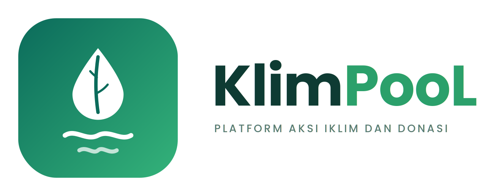

<h1>
IF2150 REKAYASA PERANGKAT LUNAK
<br>
TUGAS 9
<br>
IMPLEMENTASI PERANGKAT LUNAK
</h1>
<br>

## KlimPooL
<p align="left">
  
</p>

### Untuk: Made Branenda Jordhy
 
Dipersiapkan oleh:
| Informasi | Keterangan |
| --- | --- |
| Kelas | 02 |
| Kelompok | 08  |
 
| NIM | Nama |
|---|---|
| 13525023 | Shaquille Nathan Kalevi |
| 13525080 | Neysa Alya Mukhbita |
| 13525092 | Bryan Pamungkas Prahara |
| 13525134 | Sahla Nailah Salsabilla |
| 13525140 | Nayla Putri Ghaisani |
---

> **Petunjuk pengerjaan:** *[Silahkan hapus bagian ini setelah selesai mengerjakan]*
>
> Dokumen ini adalah **spesifikasi sekaligus template laporan singkat** Tugas 9. Bagian **Ketentuan Implementasi** (Bagian A) adalah aturan yang harus kalian ikuti, boleh dihapus dari laporan akhir. Bagian **Laporan Implementasi** (Bagian B) adalah yang **wajib kalian isi**. Gunakan nama, ID, kebutuhan, use case, dan kelas yang konsisten dengan SKPL, APL, dan DPPL.

---

**Deadline:** Rabu, 11 November 2026, 21.50 WIB
**Asistensi akbar:** Senin, 2 November 2026, 19.00 WIB, MS Teams 2026 IF2150 RPL. 

---

# BAGIAN A: Ketentuan Implementasi

## A.1 Deskripsi Tugas

Pada tugas ini, kalian mengimplementasikan perangkat lunak yang telah dirancang pada tugas-tugas sebelumnya (SKPL, APL, DPPL) menjadi aplikasi yang **dapat dijalankan**. Platform bebas (web, desktop, atau mobile) selama aplikasi dapat dijalankan ulang oleh asisten mengikuti petunjuk kalian.

Ketentuan umum:
- Setiap anggota bertanggung jawab atas **minimal satu fitur atau modul** dan harus terlihat jelas di riwayat commit/PR.
- Implementasi harus **mengacu pada DPPL**. Jika ada yang berubah (kelas, layar, basis data, dsb.), catat di Bagian B.1. Perubahan itu wajar, tetapi harus tercatat dan beralasan.
- Implementasi **tidak harus berupa kelas** (misalnya fungsi, komponen, *route/handler*, *stored procedure*, atau skrip). Namun, setiap kelas perancangan pada DPPL **wajib dapat ditelusuri** ke implementasinya, dan penelusuran ini dicatat di Bagian B.5.
- Seluruh use case pada SKPL **diprioritaskan** untuk diimplementasikan. Status tiap use case akan dilaporkan pada HIUPL (Tugas 10).
- Seluruh mahasiswa **wajib** mengikuti asistensi akbar.

## A.2 Platform, Bahasa, dan Teknologi

Kalian **bebas** memilih bahasa, framework, library, dan basis data, dengan syarat:

1. **Dapat dijalankan ulang** oleh asisten pada mesin biasa dengan mengikuti README. Versi bahasa/runtime dan seluruh dependensi harus tertulis jelas.
2. **Dependensi dikelola lewat file standar**, misalnya `package.json` + lockfile, `requirements.txt`/`pyproject.toml`, `pom.xml`/`build.gradle`, `composer.json`, `pubspec.yaml`, dan sejenisnya. Jangan meng-commit folder hasil instalasi (`node_modules/`, `venv/`, `build/`, dll.).
3. **Jika memakai layanan eksternal** (basis data cloud, API pihak ketiga, auth, dll.), sediakan cara menjalankan tanpa akun pribadi kalian, atau sediakan data/akun uji pada README. Basis data **sangat disarankan** dapat dijalankan lokal (SQLite, atau Docker Compose untuk PostgreSQL/MySQL/MongoDB).
4. **Arsitektur sesuai DPPL.** Pola arsitektur yang kalian pilih di APL/DPPL (MVC, layered, client-server, dll.) harus terlihat pada struktur kode.

Ketentuan tambahan per platform:

| Platform | Ketentuan |
| :--- | :--- |
| **Web** | Berjalan lokal lewat satu-dua perintah yang terdokumentasi. Boleh juga di-*deploy*; jika ya, cantumkan URL, tetapi **tetap wajib bisa dijalankan lokal** (URL deploy bisa mati). |
| **Desktop** | Berjalan dari source lewat perintah yang terdokumentasi. Build/installer opsional. |
| **Mobile** | Berjalan di emulator/simulator atau perangkat. Sertakan langkah menjalankan, dan **sangat disarankan** melampirkan APK/build di Release. |

## A.3 Keamanan Repository

Repo fork kelompok bersifat **public**, sehingga:

- **Dilarang** meng-commit password, API key, token, `.env` asli, sertifikat/private key, atau data pribadi. Hal ini dapat mengurangi nilai.
- Sediakan `.env.example` berisi nama variabel tanpa nilai rahasia, dan masukkan `.env` ke `.gitignore`.
- Jika sudah terlanjur ter-commit, **cabut/ganti** kredensial tersebut. Menghapus commit saja tidak cukup.
- Data uji/seed harus berupa data fiktif.

## A.4 Struktur Folder

Seluruh kode ditempatkan di `src/` pada repo fork. Jangan mengubah folder milestone lama.

```
src/                              # SELURUH kode implementasi
	README.md                     # dokumentasi utama aplikasi (lihat A.5)
	.env.example                  # jika memakai environment variable
	<struktur kode kalian>        # bebas, mengikuti pola arsitektur DPPL
	tests/                        # test case (jika ada)
docs/
	M9/
		KXX_GYY_Implementasi.md   # laporan ini (Bagian B)
		KXX_GYY_Form-Asistensi.md
```

Catatan:
- `README.md` aplikasi diletakkan di **`src/README.md`**, bukan di root repo.
- Jika kerangka kerja kalian mewajibkan struktur tertentu (misalnya Maven `src/main/java`, Flutter `lib/`, monorepo `frontend/` dan `backend/`), letakkan semuanya **di dalam `src/`**.
- Nama file dan folder pada `docs/M9/` mengikuti aturan penamaan milestone sebelumnya (`KXX_GYY_...`).

## A.5 Isi Minimal `src/README.md`

README harus cukup bagi orang yang belum pernah melihat proyek kalian untuk menjalankan aplikasi dari nol. Minimal berisi:

1. **Deskripsi singkat** aplikasi.
2. **Teknologi yang digunakan** beserta versi (bahasa, framework, basis data).
3. **Prasyarat dan instalasi** (software yang harus ada, perintah instalasi dependensi).
4. **Konfigurasi** (environment variable, setup basis data, migrasi/seed) dan langkah demi langkah menjalankannya.
5. **Cara menjalankan aplikasi** (dan cara menjalankan test, jika ada).
6. **Akun/data uji** untuk mencoba tiap peran pengguna (jika ada login).
7. **Daftar modul/fitur yang diimplementasi** beserta pembagian anggota.
8. **Daftar tabel/koleksi basis data** beserta atributnya (atau tautan ke skema/ERD).

## A.6 Best Practices

Kalian dianjurkan menerapkan praktik berikut. Bukti penerapannya dirangkum pada Bagian B.2.

### 1. Branching
Sesuai aturan umum di README repository, `main` fork kelompok dijaga agar tetap bisa menerima sync dari asisten. Pada tugas ini **sangat disarankan** memakai branch per fitur dengan format `<tipe>/<nama-fitur>` (contoh: `feat/login-page`, `fix/null-cart`), lalu digabungkan ke `main` melalui Pull Request. Skema Gitflow penuh (dengan `develop`) boleh dipakai, tetapi tidak diwajibkan.

### 2. Semantic Commit
Gunakan format `<tipe>(<scope>): <deskripsi>`, misalnya `feat(auth): tambah validasi email`.

| Tipe | Kegunaan |
| :--- | :--- |
| `feat` | Menambahkan fitur baru |
| `fix` | Memperbaiki bug |
| `docs` | Mengubah dokumentasi |
| `style` | Perubahan format/spasi, tanpa mengubah logika |
| `refactor` | Perubahan kode yang tidak menambah fitur atau memperbaiki bug |
| `test` | Menambah/memperbaiki pengujian |
| `chore` | Tugas rutin (build, dependensi, konfigurasi) |

### 3. Track Tasks
Gunakan **GitHub Issues** (dan opsional GitHub Projects) untuk membagi tugas dan melacak progres.
- Pecah fitur besar menjadi issue yang lebih kecil dan tetapkan penanggung jawabnya.
- Hubungkan PR dengan issue (`Closes #12`) dan tutup issue ketika selesai.

### 4. Pull Request dan Code Review
- Setiap PR berisi penjelasan deskriptif tentang apa yang dikerjakan, beserta bukti (tangkapan layar/rekaman/hasil test).
- Setiap PR di-*review* minimal **1 anggota lain**, dengan komentar konstruktif atau approval.

### 5. Pengujian dan Optimasi Performa
- Tulis pengujian untuk logika inti (unit test dan/atau pengujian alur utama). Cakupan penuh tidak diwajibkan, tetapi pengujian pada logika utama dinilai.
- Lakukan **profiling** pada setidaknya satu fitur yang berat (query besar, proses pengolahan data, render list panjang, dsb.), lalu catat temuan dan perbaikannya. Contoh alat:

| Platform | Contoh alat |
| :--- | :--- |
| Web (frontend) | Chrome DevTools (Performance/Network), Lighthouse |
| Web (backend) | Profiler bawaan bahasa, `EXPLAIN` pada query basis data, logging waktu respons |
| Python | `cProfile`, `PyInstrument` |
| Java | VisualVM, JProfiler |
| Mobile | Android Studio Profiler, Flutter DevTools, Xcode Instruments |

### 6. Penggunaan AI
Penggunaan AI **tetap harus dicatat** pada `docs/KXX_GYY_AI-Usage.md` sesuai ketentuan yang sudah berlaku.

## A.7 Pengumpulan

Pengumpulan dinilai dari **tag release**, bukan commit terakhir.

1. Pastikan seluruh pekerjaan sudah di-*commit* dan di-*push* ke `main` fork kelompok.
2. Buat release dengan tag **`v9.0`** (revisi berikutnya `v9.1`, `v9.2`, dst.) dengan target branch `main`.
3. Yang dinilai adalah **tag terakhir yang dibuat sebelum deadline**.

## A.8 Aturan Tanya Jawab

Agar semua kelompok mendapat jawaban yang sama, pertanyaan dibagi menjadi dua jalur:

| Jenis Pertanyaan | Jalur |
| :--- | :--- |
| **Ketentuan tugas**, misalnya teknologi yang diperbolehkan, struktur folder, format pengumpulan, dan penilaian | **Sheets QnA:** *[tautan sheets QnA]* |
| **Kendala teknis kelompok sendiri**, misalnya error, setup, dan penggunaan git | Grup kelompok bersama asisten masing-masing |

Ketentuan:
1. Pertanyaan tentang ketentuan tugas **wajib** diajukan melalui Sheets QnA. Periksa terlebih dahulu apakah pertanyaan serupa sudah dijawab.
2. Jika pertanyaan tentang ketentuan tugas tetap diajukan langsung kepada asisten kelompok, asisten **berhak menolak menjawab** dan meminta kelompok memasukkan pertanyaannya ke Sheets QnA.
3. Jika pertanyaan di Sheets QnA **belum dijawab dalam 24 jam**, kelompok boleh menghubungi asisten kelompok masing-masing. Cantumkan pertanyaan yang sudah diajukan di sheets tersebut.
4. Jawaban pada Sheets QnA berlaku untuk **seluruh kelompok** dan menjadi acuan jika terjadi perbedaan pemahaman.

---

# BAGIAN B: Laporan Implementasi

## B.1 Perubahan dari DPPL

Tabel B.1. Perubahan dari DPPL
 
| No | Bagian DPPL | Rancangan Awal | Implementasi Akhir | Alasan |
| :--- | :--- | :--- | :--- | :--- |
| 1 | Kelas C04 Donatur, tabel baru | Tidak ada top-up saldo; saldo hanya berkurang oleh donasi (tidak ada use case top-up di SKPL) | Top-up saldo simulasi tanpa payment gateway. Tabel `topup_saldo` (`id_topup`, `id_donatur`, `nominal`, `metode`, `waktu`); saldo bertambah dalam satu transaksi MySQL. Muncul di riwayat dengan filter Top-ups | Prototipe memiliki top-up dan alur saldo kurang; tanpa top-up donasi tidak dapat didemokan. Tabel terpisah agar atomisitas `transaksi_donasi` (KF15–KF18) tidak tercampur |
| 2 | Kelas C02 Project, atribut `statusPelaksanaan` | Atribut `statusPelaksanaan: String` tanpa daftar nilai | ENUM empat nilai: `persiapan`, `berjalan`, `ditunda`, `selesai`. Awalnya `persiapan` saat project terpublikasi; tiap pembaruan progres menyimpan nilai pada saat itu | Mengikuti empat nilai pada prototipe, dan mencegah nilai di luar daftar |
| 3 | Kelas C02 Project dan C03 Campaign, lokasi dan peta (C05) | Atribut `lokasi: String`; sebaran peta dihitung dengan `ST_Distance_Sphere` | Kolom `provinsi`, `kota`, `latitude`, `longitude`. Lat/lng diisi otomatis dari tabel koordinat provinsi (`src/lib/provinsi.ts`) saat disimpan; query peta tetap memakai `ST_Distance_Sphere` | Formulir tetap sederhana seperti prototipe (pengguna memilih provinsi dan kota), tanpa mengubah algoritma peta di DPPL. Pin dalam satu provinsi berada di titik yang sama |
| 4 | Kelas C02 Project dan C03 Campaign, `status` (UC02, UC03, UC04) | Pembuatan langsung menyimpan data; status mengikuti KF06 (draft, pending verification, published) | Pembuatan dua langkah: simpan draf (`draft`), lalu kirim (`menunggu_verifikasi`); admin mengubah menjadi `terpublikasi` atau `ditolak` (alasan wajib). Yang `ditolak` dapat diedit dan dikirim ulang. `ubahStatus` dipakai pada setiap transisi | Mengikuti prototipe (Draft, Pending review, Published, Rejected) dan KF06; memungkinkan tab "My actions" menampilkan status, alasan penolakan, dan kirim ulang |
| 5 | Kelas C02 Project, atribut jadwal (KF08, KF10, KF22) | Tidak ada atribut jadwal dan titik kumpul pada `Project`, padahal KF08, KF10, dan KF22 memerlukannya | Kolom `jadwal_mulai`, `jadwal_selesai` (DATE, wajib, mulai ≤ selesai) dan `lokasi_kumpul`. `tampilkanInstruksiKegiatan` mengambil lokasi dan jadwal ini untuk relawan berstatus `accepted` | Memenuhi KF10 (jadwal kosong ditolak) dan KF22 tanpa tabel baru; `ketersediaanJadwal` milik relawan tetap terpisah |
| 6 | Halaman Akun (UC10), saldo penggalangan | Tidak ada saldo penggalangan pada rancangan | Kartu "Fundraising balance" dihitung dari `SUM(dana_terkumpul)` project dan campaign milik pengguna; tidak disimpan di kolom | Menghindari dua sumber kebenaran untuk dana yang sama, sehingga tidak perlu sinkronisasi dan atomisitas donasi tidak terganggu |
| 7 | Penyimpanan, `Project.dokumentasiProgres` (UC09) | Berkas dokumentasi disimpan pada object storage (DPPL, Tabel 2.1) | Berkas disimpan di folder lokal `uploads/` (tidak di-commit) melalui satu antarmuka penyimpanan sehingga dapat diganti object storage | Aplikasi harus dapat dijalankan asisten tanpa akun cloud pribadi (ketentuan A.2) |
| 8 | Kelas C08 Volunteer, C10 PembuatProject, C11 AdminSistem | Tiga kelas aktor terpisah | Peran (`volunteer`, `pembuat_project`, `admin`) pada tabel `pengguna`; hak akses ditegakkan oleh `requireRole()` dan pemeriksaan kepemilikan di query | Ketiganya adalah peran satu akun, bukan entitas dengan data berbeda; operasinya dipanggil lewat controller. Dicatat di Tabel B.5 |
| 9 | Halaman Home dan tab My actions | Tidak ada use case untuk beranda dan tab My actions | Beranda (hero, cara kerja, angka dampak, ajakan bertindak) dan tab My actions diimplementasikan sesuai prototipe | Keduanya ada di prototipe dan mendukung navigasi, tetapi tidak dipetakan ke use case SKPL |
| 10 | Kelas C07 BuktiTransaksi dan C31 DetailBuktiTransaksiView (KF17) | Operasi `cetakBukti()` hanya membentuk dan menyimpan rincian bukti di basis data setelah donasi berhasil (Algo-111). Tidak ada fitur untuk mencetak bukti atau menyimpannya sebagai berkas. | Selain penyimpanan bukti oleh `cetakBukti()`, ditambahkan tombol "Print receipt" pada modal bukti dan halaman `/donasi/bukti/[idTransaksi]`. Tombol ini memanggil `window.print()`, sehingga dialog cetak browser terbuka dan pengguna dapat memilih printer atau "Save as PDF". Lembar cetak berisi rincian bukti tanpa elemen antarmuka lain. | Memenuhi kriteria penerimaan issue #28 agar donatur dapat menyimpan atau mencetak bukti donasi. Dialog cetak bawaan browser dipilih agar tidak perlu pustaka pembuat PDF atau pemrosesan tambahan di server. |
| 11 | Tabel 2.1 Rancangan Lingkungan Implementasi, *development tools* (issue #8, #9) | Pengembangan memakai VS Code, Git/GitHub, npm, dan draw.io; aplikasi berjalan di Vercel dengan MySQL | Kerangka Next.js 16 (App Router, `cacheComponents`) + TypeScript + Tailwind CSS di `src/`, dengan folder per lapisan: `components/` (View), `server/controllers`, `server/services`, `server/repositories`, `models/` (entity), dan `shared/` (tipe dan aturan yang dipakai klien dan server). Untuk pengembangan lokal ditambahkan Docker Compose (MySQL 8.4, port 3307; XAMPP port 3306 tetap didukung), ESLint, Prettier, serta `node:test` dan Vitest untuk pengujian | Aplikasi harus dapat dijalankan asisten tanpa akun cloud (ketentuan A.2). Struktur folder yang sama dengan lapisan pada *Layered Architecture* (DPPL 2.2) membuat seluruh anggota menaruh kode di tempat yang sama |
| 12 | Komponen `DatabaseConnection` (Tabel 2.3) dan skema basis data (issue #9) | `DatabaseConnection` sebagai komponen pendukung; DPPL hanya memuat query per operasi (Q-xxx), tanpa DDL lengkap | `DatabaseConnection` diwujudkan sebagai modul `server/db.ts` (bukan kelas) berisi *connection pool* `mysql2` yang dibuat saat pertama dipakai, serta fungsi `query()`, `execute()`, dan `withTransaction()`. Pool menyimpan dan membaca waktu dalam UTC (`timezone: 'Z'`) dan membaca DECIMAL sebagai angka. DDL seluruh entitas ada di `db/migrations/001_schema.sql` dan data contoh di `002_seed.sql`; keduanya dijalankan otomatis saat volume Docker masih kosong | Satu pool bersama mencegah setiap repository membuka koneksi sendiri. Pool disimpan di `globalThis` agar *hot reload* tidak membuat pool baru. Migrasi otomatis membuat basis data anggota tim dan asisten selalu sama |
| 13 | Komponen antarmuka bersama (issue #11) | Tidak ada komponen bersama; DPPL hanya memuat kelas *boundary* per use case | Ditambahkan `AppShell` yang membungkus semua halaman dengan `Navbar` (menampilkan status login, saldo, dan menu akun), `Footer`, `Modal`, dan notifikasi `Toast` di `components/ui/` | Navbar, modal, dan toast ada di seluruh layar prototipe. Satu komponen bersama menjaga tampilan konsisten dan mencegah setiap anggota membuat versinya sendiri. Komponen ini tidak memiliki kelas perancangan karena tidak memuat logika use case |
| 14 | Kelas C14 FormPendaftaranView dan C15 FormLoginView (UC01, issue #15) | Formulir pendaftaran dan login berada pada halaman yang berbeda; setelah login, `arahkanKeHalamanUtama()` mengarahkan pengguna ke halaman utama | Keduanya menjadi dua tab dalam satu modal (`AuthModal`) yang dapat dibuka dari navbar, halaman penghalang login, atau aksi yang memerlukan login. Setelah pendaftaran berhasil, pengguna langsung login. Setelah login, pengguna tetap di halaman yang sama, halaman dirender ulang, dan aksi yang tadi diminta (mis. formulir donasi) langsung dilanjutkan melalui `useWajibLogin()` | Mengikuti prototipe (modal auth dengan tab Daftar/Masuk) dan catatan issue #15 agar pengguna tidak kehilangan konteks. `arahkanKeHalamanUtama()` diwujudkan sebagai pemuatan ulang halaman saat ini |
| 15 | Kelas C16 AutentikasiController (UC01, issue #13, #14) | Atribut `pesanKesalahan` dan operasi `daftarAkun()`, `login()`, `getPesanKesalahan()` | Tidak ada atribut `pesanKesalahan`; galat dikembalikan sebagai JSON `{ ok: false, kode, pesan, bidang? }` dengan status HTTP sesuai kode galat. Ditambahkan `logout()` (`POST /api/auth/keluar`) dan `saya()` (`GET /api/auth/saya`) | Controller berupa *route handler* tanpa keadaan antarpermintaan, sehingga pesan galat dikirim dalam respons. `bidang` menunjuk kolom yang salah sesuai KF01. `logout()` diperlukan untuk menjalankan `akhiriSesi()`. `saya()` diperlukan karena layout bersifat statis (`cacheComponents`), sehingga navbar membaca status login dari klien |
| 16 | Operasi validasi dan penyimpanan pada C12 Akun (Algo-001, Algo-002) | `validasiKelengkapanInput()`, `cekKetersediaanEmail()`, `simpanAkun()`, `validasiKredensial()` mengembalikan `Boolean`; `simpanAkun()` hanya menjalankan Q-002 dan mengembalikan `false` bila email ganda | Validasi melempar `GalatAplikasi` dengan kode (`VALIDASI`, `EMAIL_TERPAKAI`, `KREDENSIAL_SALAH`, `AKUN_NONAKTIF`) dan nama kolom. Penyimpanan akun menulis baris `pengguna`, `akun`, dan `donatur` (saldo 0) dalam satu transaksi, dengan peran awal `volunteer`. Galat *duplicate key* diubah menjadi `EMAIL_TERPAKAI` | Nilai `Boolean` tidak dapat membawa pesan per kolom yang diminta KF01. Akun baru langsung dapat berdonasi dan top-up tanpa langkah tambahan; transaksi mencegah akun setengah jadi. Peletakan operasi pada service dan repository dicatat di Tabel B.5 |
| 17 | Kelas C13 SesiLogin, penyimpanan sesi di peramban (KF04, issue #14) | DPPL tidak menetapkan cara `idSesi` dibawa peramban | `idSesi` disimpan pada cookie `klimpool_sesi` dengan atribut `HttpOnly`, `SameSite=Lax`, `Secure` (di produksi), dan `maxAge` 24 jam, sama dengan `DURASI_SESI`. Logout menghapus cookie dan menandai sesi `berakhir` | Cookie `HttpOnly` tidak dapat dibaca skrip sehingga sesi lebih aman dari XSS, dan `SameSite=Lax` mengurangi risiko CSRF. Masa berlaku cookie disamakan dengan masa sesi di basis data |
| 18 | Operasi C13 `cekStatusLogin()` (Algo-005, Q-005, Q-006) | Q-005 hanya membaca `sesi_login`; sesi kedaluwarsa ditandai `berakhir` melalui Q-006 saat diperiksa | Q-005 digabung dengan `pengguna`, `akun`, dan `donatur` sehingga satu query menghasilkan sesi, data pengguna, saldo, dan status akun. Sesi juga ditolak bila akun berstatus `nonaktif`. Sesi kedaluwarsa cukup ditolak tanpa ditulis ulang; Q-006 dipakai saat logout | Navbar dan controller membutuhkan data pengguna setiap kali sesi diperiksa, sehingga satu query menghindari query kedua. Akun yang dinonaktifkan langsung kehilangan akses. Pemeriksaan tidak menulis ke basis data, sehingga tetap ringan meskipun dipanggil di hampir setiap permintaan |
| 19 | Pemeriksaan login dan peran pada controller UC02–UC10 (KF04, issue #14) | Setiap controller memanggil `SesiLogin.cekStatusLogin()` sendiri | Disediakan `penggunaSaatIni()`, `requireLogin()`, dan `requireRole()` di `server/controllers/guard.ts`; `requireLogin()` melempar `BELUM_LOGIN` dan `requireRole()` melempar `DILARANG`. Modul yang lebih dulu dibuat memakai `getIdPenggunaSaatIni()` di `server/auth/sesiSementara.ts`, yang kini membaca sesi login yang sama. Halaman `/account` memeriksa sesi di server dan menampilkan penghalang login bagi tamu | Satu titik pemeriksaan menjamin semua modul memakai aturan sesi yang sama dan memenuhi catatan issue #14. Nama berkas `sesiSementara.ts` dipertahankan agar modul relawan, dokumentasi, detail, dan progres tidak perlu diubah |
| 20 | Kelas C01 Katalog, atribut dan operasi pencarian (UC05, KF13, KF14, issue #23) | Atribut `kataKunci: String` dan `filter: String`, diisi lewat `terimaKataKunci()` dan `terapkanFilter()`, lalu `cari()` mengembalikan `List<String>` | Kata kunci dan filter menjadi satu objek `FilterKatalog` yang dibentuk per permintaan oleh `bacaFilter()`: `q` (maks. 100 karakter), `tipe` (semua, project, campaign), `kategori`, `lokasi` (provinsi atau kota), `status` (donasi, relawan, selesai), `periode` (berjalan, segera dalam 90 hari, lalu), serta paginasi `halaman` dan `batas` (bawaan 20, maks. 50). Project dan campaign terpublikasi digabung dengan `UNION ALL` menjadi satu daftar `ItemKatalog`. Ditambahkan `getOpsi()` (`GET /api/katalog/opsi`) yang mengembalikan daftar kategori dan provinsi yang memiliki aksi terpublikasi | Halaman Explore pada prototipe memiliki beberapa filter yang dapat dikombinasikan (kriteria issue #23), sehingga satu `String` filter tidak cukup. Service tidak menyimpan keadaan antarpermintaan. Paginasi membatasi ukuran respons dan mendukung tombol "Show more"; opsi provinsi diambil dari data agar filter tidak menawarkan lokasi tanpa hasil |
| 21 | Kelas C28 PencarianController, `pesanKesalahan` dan `getPesanKesalahan()` (UC05, issue #23) | Atribut `pesanKesalahan` dibaca lewat `getPesanKesalahan()` | Parameter yang tidak valid melempar `GalatValidasi` dan dikembalikan sebagai JSON `{ pesan }` dengan status 400 sebelum basis data disentuh; galat lain menjadi status 500 dengan pesan umum. Hasil kosong dikembalikan sebagai `data: []`, bukan galat | Controller berupa *route handler* tanpa keadaan antarpermintaan, sama seperti No. 15. Kriteria issue #23 meminta hasil kosong tidak dianggap galat |
| 22 | Kelas C28 PencarianController, `getDetailProject()` dan `getDetailCampaign()` (UC05, KF14, issue #25) | Detail project dan campaign diambil melalui `PencarianController` lalu ditampilkan oleh `DetailProjectView` (C21) dan `DetailCampaignView` (C18) | Detail diambil oleh `DetailService.ambil(tipe, id, idPengguna)` dan `DetailRepository`, yang dipanggil langsung oleh Server Component `MuatDetail` pada route `/project/[id]` dan `/campaign/[id]`; tidak ada endpoint API detail. Query hanya mengambil data berstatus `terpublikasi`; selain itu halaman 404 ditampilkan. `lokasi_kumpul` hanya disertakan bila pengguna adalah relawan berstatus `accepted` pada project tersebut | Halaman detail dirender di server, sehingga data tidak perlu melewati HTTP. Logika tetap berada di lapisan service dan repository, bukan di View. Pembatasan `terpublikasi` memenuhi kriteria issue #25, dan pembatasan titik kumpul menjaga data KF22 tidak terbuka untuk publik |
| 23 | Kelas C05 PetaWilayah, operasi sebaran (UC06, UC07, issue #29) | `tampilkanSebaranProject(): List<Project>` dan `tampilkanSebaranCampaign(): List<Campaign>` berdasarkan atribut `koordinatPusat` dan `radius`; peta dibuka dalam alur `DonasiController` (UC06) dan `RelawanController` (UC07) | `koordinatPusat` dan `radius` menjadi parameter konstruktor; radius 0 berarti seluruh wilayah, radius > 0 memakai `ST_Distance_Sphere`. Kedua operasi mengembalikan `TitikSebaran` (id, tipe, judul, lokasi, kategori, koordinat, target dan dana terkumpul), bukan objek lengkap. Campaign hanya diambil bila periodenya belum berakhir. Ditambahkan `PetaController` dan `GET /api/peta?jenis=&pusat=lat,lng&radius=` (radius maks. 20.000 km). `DonasiController` dan `RelawanController` tidak memanggil `PetaWilayah` | Pin dan popup hanya memerlukan ringkasan, sehingga respons tetap kecil. Satu kelas dan satu endpoint dipakai untuk UC06 dan UC07 tanpa duplikasi kode (kriteria issue #29). Peta adalah langkah penelusuran sebelum donasi atau pendaftaran, sehingga dipisahkan dari kedua controller tersebut |
| 24 | Kelas C27 FormPencarianView dan C29 FormPetaWilayahView, halaman Explore (UC05, UC06, UC07, issue #24, #29) | Dua kelas *boundary* terpisah: `FormPencarianView` untuk pencarian (UC05) dan `FormPetaWilayahView` untuk peta sebaran (UC06, UC07) | Keduanya berada pada satu halaman `/explore` (`ExploreView`): kolom cari dan filter, daftar kartu hasil, dan peta Indonesia (SVG) berdampingan. Titik peta diambil dari hasil katalog yang sama, sehingga peta selalu mengikuti filter, termasuk aksi yang donasinya sudah tutup. Menyorot kartu ikut menyorot pin, dan memilih pin membuka popup bertaut ke detail. Filter disimpan di URL sehingga tautan footer (mis. "Find volunteer work") langsung membuka filter yang sesuai. `GET /api/peta` dan `PetaSebaranMemuat` tetap tersedia untuk halaman lain | Mengikuti prototipe yang menampilkan pencarian, filter, dan peta dalam satu halaman Explore. Satu sumber data mencegah daftar dan peta menampilkan hasil berbeda, dan menghindari permintaan kedua ke server |
| 25 | Operasi pada kelas C04 Donatur, C06 TransaksiDonasi, dan C07 BuktiTransaksi (UC06, issue #26, #28) | Setiap kelas *entity* menjalankan sendiri operasinya, termasuk akses basis data: `kurangiSaldo()`, `validasiDuplikasi()`, `prosesDonasi()`, `getRiwayatTransaksi()`, `getDetailTransaksi()`, dan `cetakBukti()` | Operasi dipecah ke tiga lapisan. Kelas *entity* di `models/` hanya memuat aturan tanpa basis data (`validasiNominal()`, `buatTransaksi()`, `cukupUntuk()`, `BuktiTransaksi.cetakBukti()`). Seluruh query (Q-105 s.d. Q-114) berada di `DonasiRepository`. `prosesDonasi()` dan penyimpanan bukti dikoordinasikan `DonasiService` | Mengikuti *Layered Architecture* (DPPL 2.2) dan struktur folder pada No. 11. Transaksi atomik donasi melibatkan beberapa tabel sekaligus (donatur, tujuan, transaksi), sehingga harus dikendalikan satu tempat dengan satu koneksi, bukan oleh tiap *entity*. Aturan tanpa basis data dapat diuji unit. Pemetaan lengkap dicatat di Tabel B.5 |
| 26 | Kelas C07 BuktiTransaksi, atribut `rincian` dan operasi `cetakBukti()` (KF17, issue #28) | `rincian: String`; `cetakBukti()` dijalankan sebagai bagian dari alur donasi (Algo-111) | `rincian` bertipe `RincianBukti` dan disimpan sebagai JSON pada kolom `rincian`. Bukti dibuat setelah transaksi donasi di-*commit*; bila pembuatannya gagal, donasi tetap berhasil dan bukti dibuat ulang saat pertama kali diminta. `simpanBukti()` memakai `ON DUPLICATE KEY` sehingga permintaan bersamaan tidak membuat bukti ganda | JSON menjadikan bukti sebagai salinan tetap: isinya tidak berubah bila nama project atau campaign diubah. Kegagalan membuat bukti tidak boleh membatalkan donasi yang saldonya sudah terpotong (KF16) |
| 27 | Kelas C32 DonasiController dan C41 RiwayatController (UC06, UC10, issue #26, #38) | `DonasiController` memiliki atribut `pesanKesalahan` yang dibaca lewat `getPesanKesalahan()`. Operasi `RiwayatController` menerima `idPengguna` sebagai parameter. Keduanya berupa kelas | `DonasiController` berupa objek tanpa atribut; galat dikirim sebagai JSON `{ ok: false, kode, pesan }` dengan status HTTP sesuai kode, dan `getPesanKesalahan(e)` hanya mengubah galat menjadi pesan. `RiwayatController` berupa tiga fungsi (`getRiwayat()`, `getDetailTransaksi()`, `getDetailProgres()`). Pada keduanya, id pengguna selalu diambil dari sesi login, bukan dari parameter atau badan permintaan | Controller berupa *route handler* tanpa keadaan antarpermintaan, sama seperti No. 15 dan No. 21. Id pengguna dari sesi mencegah pengguna membaca atau memakai data milik orang lain dengan mengganti id pada permintaan |
| 28 | Query Q-119 dan Q-114, pembacaan bukti transaksi (Algo-122, issue #42) | Dua query berurutan: Q-119 memeriksa pemilik transaksi, lalu Q-114 mengambil bukti | Satu query `LEFT JOIN` antara `transaksi_donasi` dan `bukti_transaksi` (`DonasiRepository.getBuktiMilik()`) yang memeriksa pemilik sekaligus mengambil bukti | Mengurangi jumlah query pembacaan bukti dari 2 menjadi 1 tanpa mengubah perilaku. Hasil pengukuran dicatat di B.2.1 |
| 29 | C02, C03, C10, C11 dan C19/C22/C26 (UC02–UC04) | Operasi entity/aktor dan controller terpisah menurut diagram kelas | `AksiService` mengoordinasi pembuatan, perubahan, pengajuan dan keputusan; `AksiRepository` menyimpan/query kedua jenis aksi. DTO bersama berada pada `shared/aksi.ts`; validasi pada `shared/validasiAksi.ts`. Controller campaign/project/verifikasi tetap menjadi batas HTTP | Menghindari duplikasi aturan dan transaksi; fungsi DTO/service/repository menggantikan kelas entity/aktor yang tidak memerlukan keadaan sendiri. Operasi donasi dan progres pada C02/C03 tidak diambil alih |
| 30 | C17, C20, C23–C25 (KF05–KF12) | Boundary formulir, pengajuan dan antrean terpisah | `FormAksi` berbagi kolom campaign/project. Project menyimpan tahap informasi terlebih dahulu lalu melengkapi kebutuhan lewat PATCH dengan ID yang sama. Preview Draft/Ditolak memakai `/manage/[jenis]/[id]` privat; publikasi hanya melalui keputusan admin | Tombol Kembali tidak menghasilkan project ganda; draft tidak bergantung pada detail publik yang hanya boleh membuka aksi terpublikasi |
| 31 | C10 dan tab My Actions (#45) | Navigasi Kelola/Progres dan pengajuan ulang dari daftar aksi pemilik | `TabMyActions` membaca sesi server dan `AksiService.milikSaya()`, dipasang pada slot `aksi` Account tanpa mengganti slot riwayat/relawan. `/progress/[id]` memeriksa pemilik/status lalu membuka `FormProgresProjectView` milik tim | Memenuhi tujuan tautan tanpa menduplikasi UC09. Adapter `aksesAksi.ts` kini memakai `AutentikasiService` resmi; penolakan sesi yang belum dimulai dipertahankan pada pemeriksaan sesi bersama |

## B.2 Bukti Penerapan Best Practices

Tabel B.2. Bukti Best Practices

| Praktik | Bukti | Keterangan |
| :--- | :--- | :--- |
| Branching | [Daftar branch](https://github.com/Brynpamungkas/IF2150-RPL-K02-G08/branches/all) | Gitflow: branch per issue (`<tipe>/<nama-fitur>`) digabung ke `develop` lewat PR, lalu `develop` ke `main` |
| Semantic commit | [Riwayat commit `develop`](https://github.com/Brynpamungkas/IF2150-RPL-K02-G08/commits/develop) | Format `<tipe>(<scope>): <deskripsi>`. Contoh: `chore(test): tambah kerangka vitest`, `feat(katalog): endpoint searching & opsi filter`, `feat(explore): implement UI for explore + map`, `feat(detail): halaman detail project`, `fix(katalog): campaign yang belum mulai tidak terbuka donasi` |
| Track tasks | [Issues](https://github.com/Brynpamungkas/IF2150-RPL-K02-G08/issues) | 1 issue/fitur dengan PIC dan reviewer. |
| Pull request dan review | [PR #53](https://github.com/Brynpamungkas/IF2150-RPL-K02-G08/pull/53), [PR #54](https://github.com/Brynpamungkas/IF2150-RPL-K02-G08/pull/54), [PR #56](https://github.com/Brynpamungkas/IF2150-RPL-K02-G08/pull/56) | Contoh: PR Neysa (#52 kerangka Vitest, #53 API katalog, #54 dan #75 Explore, #55 detail, #56 peta) di-merge oleh Bryan. |
| Pengujian | [`src/tests/`](https://github.com/Brynpamungkas/IF2150-RPL-K02-G08/tree/develop/src/tests) | Kerangka Vitest (`src/vitest.config.ts`). Contoh: tes katalog, Explore, detail, dan peta: 11 berkas `*.spec.ts`, **143 tes, 143 lulus, 0 gagal** (dijalankan 10 Nov 2026 pada `develop` commit `bb95d5c`, Node v24.13.0). |
| Pull request fitur aksi | [PR #67](https://github.com/Brynpamungkas/IF2150-RPL-K02-G08/pull/67), [PR #85](https://github.com/Brynpamungkas/IF2150-RPL-K02-G08/pull/85) | API dan integrasi campaign, project, verifikasi admin, serta My Actions direview Sahla dan merged ke develop |
| Pengujian fitur aksi | `src/tests/aksi.akses.test.ts`, `aksi.validasi.test.ts`, `aksi.integrasi.test.ts`; `npm run test:aksi` | **15/15 lulus**, tanpa skip, pada MariaDB khusus uji dengan `AKSI_TEST_DB=1`; mencakup validasi, sesi/peran/pemilik dan perubahan status |
| Pengujian integrasi aksi | `account-actions.spec.ts`, `aksi.auth.spec.ts`, `aksi.progress.spec.ts`, `scripts/aksi.browser.mjs` | Browser produksi menguji login, empat status My Actions, pengajuan ulang, isolasi antar-akun, project dua tahap, penyimpanan progres dan form mobile 375 px |
| Runner pengujian | `scripts/test-node.mjs`, `node-runner.spec.ts`, `shell-suspense.spec.ts` | File `*.test.ts` ditemukan secara rekursif untuk node:test; `*.spec.ts` tetap dijalankan dengan Vitest |

Pengujian ulang pada develop `392e3e9`, 13 November 2026: **175 Vitest dan 83 node:test lulus**, dengan 37 tes database dilewati pada run default. Tes aksi/database dijalankan terpisah dan seluruhnya lulus. Lint, typecheck, build dan browser produksi (`next start`) juga lulus. Pengujian browser dijalankan dengan `AKSI_TEST_DB=1 AKSI_TEST_SERVER_MODE=production npm run test:aksi:browser` pada database khusus uji.

### B.2.1 Profiling dan Optimasi

| Informasi | Keterangan |
| :--- | :--- |
| Fitur / proses yang diprofil | Pembacaan bukti transaksi donasi (UC06, KF17), yaitu `DonasiService.getBuktiTransaksi`, yang dipanggil setiap kali donatur membuka bukti donasi. |
| Alat | Skrip pengukuran `src/scripts/ukur-performa-bukti.ts` (dijalankan dengan `npm run perf:bukti`) yang menghitung jumlah query ke MySQL dan waktu respons, serta perintah `EXPLAIN` MySQL. |
| Temuan (sebelum) | Satu kali pembacaan bukti mengirim 2 query berurutan ke database: satu untuk memeriksa pemilik transaksi (Q-119) dan satu untuk mengambil bukti (Q-114). Median waktu respons 1,766 ms. Hasil `EXPLAIN` kedua query sudah `type: const`, sehingga bottleneck-nya adalah jumlah bolak-balik ke database, bukan indeks. |
| Perbaikan | Kedua query digabung menjadi satu query `LEFT JOIN` antara `transaksi_donasi` dan `bukti_transaksi` (`DonasiRepository.getBuktiMilik`), yang memeriksa pemilik sekaligus mengambil bukti. Tidak ada indeks yang ditambah. |
| Hasil (sesudah) | Kasus normal turun dari 2 query menjadi 1 query, dan median waktu respons turun dari 1,766 ms menjadi 1,027 ms (sekitar 42% lebih cepat). Dua skenario lain ikut berkurang satu query (lihat tabel di bawah). |

**Kondisi pengukuran.** Pengukuran dilakukan pada MySQL 8.4 lokal (Docker). Setiap skenario dipanggil 500 kali setelah 50 pemanggilan pemanasan, dengan data uji yang dibuat dan dihapus otomatis oleh skrip.

**Perbandingan sebelum dan sesudah.**

| Skenario | Jumlah query sebelum | Jumlah query sesudah | Median sebelum (ms) | Median sesudah (ms) | Selisih |
| :--- | :---: | :---: | :---: | :---: | :---: |
| Bukti sudah ada (kasus normal) | 2 | 1 | 1,766 | 1,027 | −42% |
| Rincian format lama (data seed) | 3 | 2 | 2,933 | 2,041 | −30% |
| Bukti belum ada (dibuat ulang) | 5 | 4 | 9,227 | 7,892 | −14% |

**Hasil `EXPLAIN`.**

| Query | Tabel | type | key | rows |
| :--- | :--- | :--- | :--- | :---: |
| Lama 1: cek pemilik (Q-119) | `transaksi_donasi` | const | PRIMARY | 1 |
| Lama 2: ambil bukti (Q-114) | `bukti_transaksi` | const | uq_bukti_transaksi | 1 |
| Baru: gabungan | `transaksi_donasi` | const | PRIMARY | 1 |
| | `bukti_transaksi` | const | uq_bukti_transaksi | 1 |

Query gabungan tetap memakai indeks yang sama dengan dua query lama, sehingga penggabungan tidak menambah beban pencarian di database.

**Query sebelum**

```sql
SELECT COUNT(*) AS jumlah FROM transaksi_donasi
 WHERE id_transaksi = ? AND id_donatur = ?;

SELECT id_bukti, rincian FROM bukti_transaksi WHERE id_transaksi = ?;
```

**Query sesudah**

```sql
SELECT b.id_bukti, b.rincian
  FROM transaksi_donasi t
  LEFT JOIN bukti_transaksi b ON b.id_transaksi = t.id_transaksi
 WHERE t.id_transaksi = ? AND t.id_donatur = ?;
```

**Verifikasi**

Perilaku fitur tidak berubah: seluruh pengujian integrasi donasi dan bukti transaksi tetap lulus, termasuk penolakan untuk transaksi milik donatur lain. Dua pengujian baru di *src/tests/donasi.integrasi.test.ts* memastikan jumlah query tetap 1 (kasus normal) dan 2 (rincian format lama).

## B.3 Kendala dan Catatan Penting

- Pengujian integrasi fitur aksi menggunakan MariaDB lokal. Pengujian pada MySQL 8.4 dan UAT manual belum dilakukan.
- Build berhasil, tetapi masih mencetak warning tracing penyimpanan dokumentasi dan log percobaan prerender saat konfigurasi database belum tersedia.
- Fitur aksi sudah terintegrasi di develop `392e3e9`. Penggabungan kode ke main dan rilis M9 masih menunggu penyelesaian tim.

## B.4 Kontribusi Anggota

Tabel B.4. Kontribusi Anggota

| NIM | Nama | Modul / Fitur yang Dikerjakan | Persentase Kontribusi |
| :--- | :--- | :--- | :--- |
| *13525134* | Sahla Nailah Salsabilla | donasi; API atomic, modal + idempotency key, bukti transaksi (#26, #27, #28), halaman Akun dan dompet beserta top-up saldo (#44, #30), riwayat transaksi dan progres (API dan UI; #38, #39), serta pengukuran dan optimasi performa (#42) | *20%* |
| *13525140* | Nayla Putri Ghaisani | Kerangka proyek (#8), basis data dan *connection pool* (#9), komponen UI bersama (#11), UC01 registrasi, login, sesi, dan hak akses (#13–#15), beranda (#40) | *20%* |
| *13525080* | Neysa Alya Mukhbita | UC05 penelusuran: API pencarian dan penyaringan katalog (#23), halaman Explore (#24), halaman detail project dan campaign (#25); peta sebaran project dan campaign untuk UC06 dan UC07 (#29); kerangka pengujian Vitest beserta tes katalog, Explore, detail, dan peta; `src/README.md` | *20%* |
| 13525092 | Bryan Pamungkas Prahara | Pembuatan campaign dan project (#16–19), pengajuan dan verifikasi admin (#20–22), My Actions (#45), pengujian fitur aksi, integrasi ke Account dan form progres, dokumentasi, serta review PR tim | 20% |
| *...* | *...* | *...* | *...* |

## B.5 Traceability Kelas Perancangan ke Implementasi

Pemetaan dari **setiap kelas perancangan** pada DPPL (Tabel 4.1) ke wujud implementasinya. Bentuk implementasi bebas (kelas, fungsi, komponen, *route/handler*, *stored procedure*, skrip, dsb.), tetapi tiap kelas perancangan harus muncul pada tabel ini. Jika implementasi berupa kelas dengan nama yang sama, tetap dicantumkan.

Tabel B.5. Traceability Kelas Perancangan ke Implementasi

| ID Kelas | Nama Kelas Perancangan | Bentuk Implementasi | Lokasi (File dan Nama) | Keterangan |
| :--- | :--- | :--- | :--- | :--- |
| C01 | Katalog | Kelas service, kelas repository, dan tipe | `src/server/services/katalog.service.ts` - `KatalogService`, `keItem()`; `src/server/repositories/katalog.repository.ts` - `KatalogRepository`, `bangunKueri()`; `src/shared/katalog.ts` - `FilterKatalog`, `ItemKatalog` | Atribut `kataKunci` dan `filter` disatukan dalam objek `FilterKatalog` (kata kunci, tipe, kategori, lokasi, status, periode, halaman, batas) yang dikirim per permintaan, bukan disimpan di objek. `terimaKataKunci()` dan `terapkanFilter()` diwujudkan oleh `bacaFilter()` pada C28. `cari()` adalah `KatalogService.cari()`, yang menyusun query berparameter lewat `bangunKueri()` dan hanya mengambil data berstatus `terpublikasi` (KF14). `tampilkanHasil()` diwujudkan oleh `keItem()`, yang membentuk `ItemKatalog` (persentase dana, status donasi dan relawan) |
| C04 | Donatur | Kelas entity dan objek repository; ditambah modul top-up (di luar DPPL) | `src/models/Donatur.ts` - `Donatur`; `src/server/repositories/DonasiRepository.ts` - `getDonatur()`, `kunciDonatur()`, `kurangiSaldo()`; top-up: `src/models/TopupSaldo.ts` - `TopupSaldo`; `src/server/services/TopupService.ts` - `TopupService`; `src/server/repositories/TopupRepository.ts` - `TopupRepository`; `src/server/controllers/TopupController.ts` - `TopupController`; `src/app/api/topup/route.ts`; `src/components/views/TopupView/FormTopupView.tsx` - `FormTopupView`; `src/components/views/DonasiView/DompetKartu.tsx` - `DompetKartu` | Atribut sesuai DPPL; `nama` dibaca dari tabel `pengguna` dan `email` dari tabel `akun`, sedangkan tabel `donatur` hanya menyimpan `saldo`. `getSaldo()` (Algo-103) adalah `Donatur.getSaldo()`, dengan data yang dimuat `DonasiRepository.getDonatur()` (Q-105). `kurangiSaldo()` (Algo-104) dipecah dua: pengurangan sebenarnya dilakukan `DonasiRepository.kurangiSaldo()` dengan `UPDATE ... WHERE saldo >= ?` (Q-106), yang mengembalikan `false` bila saldo tidak cukup; `Donatur.kurangiSaldo()` hanya menyamakan saldo di memori. Ditambahkan `cukupUntuk()` dan `kunciDonatur()` (Q-109, `SELECT ... FOR UPDATE`) agar donasi bersamaan dari donatur yang sama antre (KF15). Top-up saldo simulasi adalah tambahan di luar DPPL (B.1 No. 1): `Donatur.tambahSaldo()`, `TopupService.prosesTopup()` yang berjalan dalam satu transaksi MySQL dan mengunci baris donatur yang sama, endpoint `GET` dan `POST /api/topup`, serta modal `FormTopupView` yang dibuka dari tombol "Top up" pada `DompetKartu` |
| C05 | PetaWilayah | Kelas service dan kelas repository | `src/server/services/peta.service.ts` - `PetaWilayah`; `src/server/repositories/peta.repository.ts` - `PetaRepository` | Atribut `koordinatPusat` dan `radius` menjadi parameter konstruktor; radius 0 berarti seluruh wilayah. `tampilkanSebaranProject()` dan `tampilkanSebaranCampaign()` mengembalikan daftar `TitikSebaran` (id, judul, lokasi, koordinat, dana), bukan objek `Project`/`Campaign` lengkap. Bila radius > 0, query memakai `ST_Distance_Sphere` (Q-101 s.d. Q-104); campaign hanya diambil bila periodenya belum berakhir. Dipanggil oleh `PetaController.getSebaran()` (`src/server/controllers/peta.controller.ts`, `GET /api/peta`) |
| C06 | TransaksiDonasi | Kelas entity, objek service, dan objek repository | `src/models/TransaksiDonasi.ts` - `TransaksiDonasi`; `src/server/services/DonasiService.ts` - `DonasiService.prosesDonasi()`, `getRiwayatTransaksi()`; `src/server/repositories/DonasiRepository.ts` - `validasiDuplikasi()`, `simpanTransaksi()`, `getRiwayatTransaksi()`, `getDetailTransaksi()`; `src/shared/donasi.ts` - `nominalValid()`, `PermintaanDonasi`, `HasilDonasi` | Atribut sama dengan DPPL. `validasiNominal()` (Algo-105) dan `buatTransaksi()` (Algo-107) adalah metode statis pada kelas entity; `buatTransaksi()` membentuk transaksi berstatus `berhasil` dengan UUID, lalu disimpan oleh `simpanTransaksi()` (Q-108). Operasi yang memerlukan basis data berada di `DonasiRepository`: `validasiDuplikasi()` (Algo-106, Q-107), `getRiwayatTransaksi()` (Algo-109, Q-110), dan `getDetailTransaksi()` (Algo-110, Q-111). `prosesDonasi()` (Algo-108) diwujudkan oleh `DonasiService.prosesDonasi()` di dalam `withTransaction()`: kunci baris donatur, kurangi saldo, tambah dana tujuan, simpan transaksi, lalu hitung capaian (KF26); galat pada langkah mana pun membatalkan semuanya (KF16). *Unique index* pada `idempotency_key` menolak permintaan kembar yang lolos pemeriksaan secara bersamaan (KF18). Operasi C02 dan C03 yang dipakai donasi, yaitu `cekStatusProject()`/`cekStatusCampaign()`, `tambahDana()`, dan `hitungPersentaseCapaian()` (Algo-131 s.d. Algo-135), berada di `src/server/repositories/CampaignProjectRepository.ts` |
| C07 | BuktiTransaksi | Kelas entity, objek repository, dan fungsi service | `src/models/BuktiTransaksi.ts` - `BuktiTransaksi`; `src/server/repositories/DonasiRepository.ts` - `simpanBukti()`, `getBukti()`, `getBuktiMilik()`; `src/server/services/DonasiService.ts` - `cetakBukti()`, `getBuktiTransaksi()`; `src/shared/donasi.ts` - `RincianBukti`, `BuktiDTO` | Atribut `rincian` bertipe `RincianBukti` (donatur, tujuan, jenis tujuan, nominal, tanggal, status, pesan) dan disimpan sebagai JSON pada kolom `rincian`, sehingga bukti tidak berubah bila nama project atau campaign diubah. `cetakBukti()` (Algo-111) diwujudkan oleh `BuktiTransaksi.cetakBukti()`, yang hanya membentuk bukti untuk transaksi `berhasil`, dan fungsi `cetakBukti()` pada `DonasiService`, yang mengambil rincian transaksi (Q-112) lalu menyimpannya lewat `simpanBukti()` (Q-113, `ON DUPLICATE KEY` sehingga tidak ada bukti ganda). Bukti dibuat setelah transaksi donasi di-*commit*; bila pembuatannya gagal, bukti dibuat ulang saat diminta. `tampilkanBukti()` (Algo-112) mengembalikan `BuktiDTO`. Ditambahkan `uraiRincian()` untuk mengenali rincian berformat teks bebas pada data contoh. Pembacaan bukti memakai `getBuktiMilik()`, yaitu Q-114 yang digabung dengan pemeriksaan pemilik (lihat B.2.1) |
| C18 | DetailCampaignView | Komponen React dan route halaman | `src/components/views/DetailCampaignView.tsx` - `DetailCampaignView`; `src/app/campaign/[id]/page.tsx`; `src/components/detail/MuatDetail.tsx` - `MuatDetail` | `bukaHalamanCampaign(idCampaign)` diwujudkan oleh route `/campaign/[id]`: `MuatDetail` mengambil data lewat `DetailService.ambil('campaign', id)` dan menampilkan 404 bila campaign tidak ada atau belum terpublikasi. `tampilkanDetail()` diwujudkan oleh `HeroDetail`, `KerangkaDetail` (tab About, Needs, Progress, Use of funds tanpa muat ulang halaman), dan `PanelSamping` dengan slot tombol donasi (`TombolDonasi`) dan aksi pemilik (`AksiPemilik`) |
| C21 | DetailProjectView | Komponen React dan route halaman | `src/components/views/DetailProjectView.tsx` - `DetailProjectView`; `src/app/project/[id]/page.tsx`; `src/components/detail/` - `KerangkaDetail`, `PanelSamping`, `PanelTentang`, `PanelKebutuhan`, `PanelProgres`, `PanelDana` | Sama dengan C18 untuk project. `PanelSamping` memuat slot tombol milik modul lain: `TombolDonasi` (donasi), `TombolRelawan` (pendaftaran relawan), dan `AksiPemilik` (kelola dan progres). Tab Progress hanya menampilkan data. Titik kumpul ditampilkan hanya untuk relawan yang diterima (KF22) |
| C27 | FormPencarianView | Komponen React dan route halaman | `src/components/views/FormPencarianView.tsx` - `FormPencarianView`; `src/components/views/ExploreView.tsx` - `ExploreView`; `src/components/ui/KartuHasil.tsx` - `KartuHasil`; `src/app/explore/page.tsx` | `bukaKatalog()` diwujudkan oleh route `/explore`. `masukkanKriteria()` adalah kolom cari dan filter (tipe, kategori, lokasi, status, periode) yang memperbarui URL dan memanggil `GET /api/katalog`. `tampilkanHasil()` menampilkan `KartuHasil` (progres dana dan status) dengan tombol "Show more" (`src/shared/explorePaging.ts`). `tampilkanPesanKesalahan()` menampilkan pesan galat dengan tombol coba lagi, serta pesan bila tidak ada hasil |
| C28 | PencarianController | Kelas controller dan route handler | `src/server/controllers/pencarian.controller.ts` - `PencarianController`, `bacaFilter()`, `GalatValidasi`; `src/app/api/katalog/route.ts` - `GET /api/katalog`; `src/app/api/katalog/opsi/route.ts` - `GET /api/katalog/opsi` | `cari()` dan `getDaftarDipublikasikan()` sesuai DPPL dan dapat diakses tanpa login; ditambah `getOpsi()` untuk pilihan filter kategori dan provinsi. Atribut `pesanKesalahan` dan `getPesanKesalahan()` diganti `GalatValidasi`, yang dikirim sebagai JSON `{ pesan }` dengan status 400. `getDetailProject()` dan `getDetailCampaign()` tidak berada di controller ini, tetapi diwujudkan oleh `DetailService.ambil()` (`src/server/services/detail.service.ts`) dan `DetailRepository` (`src/server/repositories/detail.repository.ts`), yang dipanggil langsung oleh Server Component `MuatDetail` |
| C29 | FormPetaWilayahView | Komponen React | `src/components/views/FormPetaWilayahView.tsx` - `FormPetaWilayahView`; `src/components/ui/PetaSebaran.tsx` - `PetaSebaran`; `src/components/ui/PetaSebaranMemuat.tsx` - `PetaSebaranMemuat`; `src/shared/peta.ts` | `bukaPeta()` diwujudkan oleh peta pada halaman Explore, yang dipakai baik oleh donatur (UC06) maupun relawan (UC07). `tampilkanPeta(sebaran)` diwujudkan oleh `PetaSebaran`: peta Indonesia (SVG) dengan pin per project/campaign dan popup ringkasan yang bertaut ke halaman detail. `PetaSebaranMemuat` memuat titik dari `GET /api/peta` untuk halaman lain |
| C30 | FormDonasiView | Komponen React dan route halaman | `src/components/views/DonasiView/FormDonasiView.tsx` - `FormDonasiView`; `src/components/views/DonasiView/AlurDonasi.tsx` - `AlurDonasi`; `src/components/views/DonasiView/logikaDonasi.ts` - `validasiFormDonasi()`, `buatIdempotencyKey()`, `NOMINAL_CEPAT`; `src/components/views/DonasiView/panggilApi.ts` - `panggilApi()`; `src/app/donasi/[jenis]/[id]/page.tsx` | `tekanDonasi()` adalah tombol "Donate now" pada `AlurDonasi`; pengguna yang belum login diminta login dahulu lewat `useWajibLogin()`, lalu modal donasi dibuka. `tampilkanFormulir(saldo)` memuat nama tujuan dan saldo dari `GET /api/donasi/form`. `isiNominal()` menerima nominal dari kolom isian atau tombol nominal cepat, dan `validasiFormDonasi()` memeriksanya sebelum dikirim. `konfirmasiPembayaran()` mengirim `POST /api/donasi` dengan *idempotency key* yang dibangkitkan sekali per formulir oleh `buatIdempotencyKey()` dan dipakai ulang saat "Try again" (KF18). `tampilkanPesanKesalahan()` diwujudkan sebagai pesan pada kolom nominal (saldo kurang, nominal tidak valid) dan pemberitahuan di dalam modal (tujuan ditutup, duplikasi, kegagalan transaksi). `AlurDonasi` dipasang pada route `/donasi/[jenis]/[id]` |
| C31 | DetailBuktiTransaksiView | Komponen React dan route halaman | `src/components/views/DonasiView/DetailBuktiTransaksiView.tsx` - `DetailBuktiTransaksiView`; `src/components/views/DonasiView/HalamanBuktiView.tsx` - `HalamanBuktiView`; `src/components/views/DonasiView/KartuBukti.tsx` - `KartuBukti`; `src/components/views/DonasiView/useBukti.ts` - `useBukti()`; `src/components/views/DonasiView/barisBukti.ts` - `barisBukti()`, `barisArsip()`; `src/components/views/DonasiView/LembarCetakBukti.tsx` - `LembarCetakBukti`, `TombolCetakBukti`; `src/app/donasi/bukti/[idTransaksi]/page.tsx` | `bukaBukti(idTransaksi)` diwujudkan oleh *hook* `useBukti()`, yang memanggil `GET /api/donasi/bukti/[idTransaksi]`; kepemilikan diperiksa di server. `tampilkanBukti()` diwujudkan oleh `KartuBukti` dengan baris dari `barisBukti()`: ID transaksi, waktu, status, donatur, tujuan, nominal, dan pesan. Bukti tampil sebagai modal tepat setelah donasi (`DetailBuktiTransaksiView`) dan sebagai halaman `/donasi/bukti/[idTransaksi]` untuk dibuka ulang (`HalamanBuktiView`). Tombol "Print receipt" dan lembar cetak adalah tambahan (B.1 No. 10) |
| C32 | DonasiController | Objek controller dan route handler | `src/server/controllers/DonasiController.ts` - `DonasiController`, `parsePermintaanDonasi()`; `src/app/api/donasi/route.ts` - `POST /api/donasi`; `src/app/api/donasi/form/route.ts` - `GET /api/donasi/form`; `src/app/api/donasi/bukti/[idTransaksi]/route.ts` - `GET /api/donasi/bukti/[idTransaksi]`; `src/server/services/DonasiService.ts` - `DonasiService`; `src/shared/galatDonasi.ts` - `GalatAplikasi` | `bukaFormDonasi()` (Algo-120), `konfirmasiDonasi()` (Algo-121), dan `getBuktiTransaksi()` (Algo-122) sesuai DPPL. Ketiganya memeriksa login lewat `AutentikasiService.wajibLogin()`, sehingga `idDonatur` selalu berasal dari sesi, bukan dari klien. `parsePermintaanDonasi()` hanya memeriksa bentuk masukan; aturan bisnis dijalankan `DonasiService` (`bukaFormDonasi()`, `prosesDonasi()`, `getBuktiTransaksi()`). Atribut `pesanKesalahan` tidak disimpan: galat dikirim sebagai JSON `{ ok: false, kode, pesan }` dengan status HTTP sesuai kode, dan `getPesanKesalahan(e)` mengubah galat menjadi pesan. `getSebaran()` (Algo-145) tidak berada di controller ini; sebaran diambil lewat `PetaController` (B.1 No. 23) |
| C39 | FormRiwayatView | Komponen React dan route halaman | `src/components/views/RiwayatView/FormRiwayatView.tsx` - `FormRiwayatView`; `src/components/views/RiwayatView/TabRiwayat.tsx` - `TabRiwayat`; `src/components/views/RiwayatView/mintaRiwayat.ts` - `mintaRiwayat()`; `src/shared/riwayat.ts` - `saringRiwayat()`, `kelompokkanPerBulan()`; `src/app/account/page.tsx`; `src/components/views/DonasiView/DompetKartu.tsx` - `DompetKartu` | `pilihMenuRiwayat()` diwujudkan oleh route `/account`, yang menampilkan penghalang login bagi tamu (KF04), dan tab "Activity history" pada `FormRiwayatView`. `FormRiwayatView` adalah kerangka tiga tab (Activity history, Volunteer applications, My actions); isi tab lain dipasang modul lain lewat props. `tampilkanDaftarRiwayat()` diwujudkan oleh `TabRiwayat`: riwayat diambil sekali dari `GET /api/riwayat`, lalu disaring menurut jenis (All, Donations, Progress) dengan `saringRiwayat()` dan dikelompokkan per bulan dengan `kelompokkanPerBulan()` di sisi klien. `pilihRiwayat()` adalah baris riwayat yang membuka `DetailRiwayatView` (C40). `tampilkanPesanRiwayatKosong()` adalah pesan saat riwayat kosong atau tidak ada entri pada jenis yang dipilih. Halaman ini juga memuat `DompetKartu` (saldo donasi dan saldo penggalangan), yang tidak ada pada DPPL (B.1 No. 6) |
| C40 | DetailRiwayatView | Komponen React | `src/components/views/RiwayatView/DetailRiwayatView.tsx` - `DetailRiwayatView`, `RincianTransaksi`, `RincianProgres`; `src/components/views/RiwayatView/label.ts` - `LABEL_STATUS_TRANSAKSI`, `LABEL_STATUS_PELAKSANAAN` | Modal rincian satu entri riwayat. `tampilkanDetailTransaksi()` diwujudkan oleh `RincianTransaksi` (ID transaksi, jenis, penerima, nominal, waktu, status) dengan data dari `GET /api/riwayat/transaksi/[idTransaksi]`. `tampilkanDetailProgres()` diwujudkan oleh `RincianProgres` (nama aksi, waktu pencatatan, status pelaksanaan, persentase, dana terpakai, catatan, dan tautan dokumentasi) dengan data dari `GET /api/riwayat/progres/[idProgres]` |
| C41 | RiwayatController | Fungsi controller, route handler, dan fungsi service | `src/server/controllers/RiwayatController.ts` - `getRiwayat()`, `getDetailTransaksi()`, `getDetailProgres()`; `src/app/api/riwayat/route.ts` - `GET /api/riwayat`; `src/app/api/riwayat/transaksi/[idTransaksi]/route.ts`; `src/app/api/riwayat/progres/[idProgres]/route.ts`; `src/server/services/riwayatService.ts` - `riwayatPengguna()`, `detailTransaksi()`, `detailProgres()`; `src/shared/riwayat.ts` - `gabungkanRiwayat()`, `bacaFilterRiwayat()` | Ketiga operasi bernama sama dengan DPPL, tetapi berupa fungsi, bukan kelas, karena controller tidak menyimpan keadaan. `idPengguna` diambil dari sesi, bukan dari parameter. `getRiwayat()` (Algo-129) menerima `?jenis=transaksi\|progres`, mengambil transaksi lewat `DonasiRepository.getRiwayatTransaksi()` (Q-110) dan progres lewat `daftarProgresPengguna()` (Algo-143), lalu `gabungkanRiwayat()` mengurutkannya dari yang terbaru; daftar kosong adalah hasil yang sah, bukan galat. `getDetailTransaksi()` dan `getDetailProgres()` (Algo-130) memeriksa kepemilikan di dalam query, sehingga data milik pengguna lain dijawab 404, sama seperti data yang tidak ada |
| C02 | Project | DTO, validasi, service dan repository (bagian UC03/UC04 milik Bryan) | `src/shared/aksi.ts` - `Aksi`, `DataAksi`; `src/shared/validasiAksi.ts` - `validasiAksi()`; `src/server/services/AksiService.ts` - `buat()`, `ubah()`, `lihat()`, `ajukan()`, `putuskan()`; `src/server/repositories/AksiRepository.ts` - `buat()`, `ubah()`, `cari()`, `daftar()`, `ajukan()`, `putuskan()` | `setInformasi()`/`setKebutuhan()` diwujudkan POST tahap informasi dan PATCH dengan ID yang sama. Penyimpanan/status menggunakan transaksi dan UPDATE bersyarat. Operasi donasi, relawan, progres dan riwayat pada C02 tetap modul anggota lain; tabel ini tidak mengklaimnya sebagai pekerjaan Bryan |
| C03 | Campaign | DTO, validasi, service dan repository (bagian UC02/UC04 milik Bryan) | `src/shared/aksi.ts`; `src/shared/validasiAksi.ts` - `validasiAksi()`; `src/server/services/AksiService.ts`; `src/server/repositories/AksiRepository.ts` | `validasiData()`/`validasiTarget()`/`validasiPeriode()` digabung pada validasi bersama; simpan/detail privat/perubahan status pada service/repository. Operasi cek status donasi, tambah dana dan capaian tetap pada `CampaignProjectRepository` milik modul donasi |
| C10 | PembuatProject | Peran sesi dan operasi service, bukan entity aktor baru | `src/server/auth/aksesAksi.ts` - `sesiAksi()`, `wajibPeranAksi()`; `src/server/services/AksiService.ts` - `buat()`, `ubah()`, `milikSaya()`, `ajukan()`; `src/components/aksi/MyActions.tsx`; `TabMyActions.tsx`; `src/app/progress/[id]/page.tsx` | Identitas dipetakan dari `AutentikasiService` resmi; tidak menerima id pemilik dari JSON. Operasi relawan/progres adalah modul tim; Bryan hanya menyambungkan tujuan Progres dan slot Account |
| C11 | AdminSistem | Peran sesi dan operasi service pada bagian verifikasi UC04 | `src/server/auth/aksesAksi.ts` - `wajibPeranAksi()`; `src/server/services/AksiService.ts` - `antrean()`, `putuskan()`; `src/app/admin/` | Admin melihat antrean menunggu dan membuat keputusan; penolakan wajib alasan. Operasi admin di luar UC04 tidak diatribusikan kepada Bryan |
| C17 | FormCampaignView | Komponen formulir bersama dan route | `src/components/aksi/FormAksi.tsx` - `FormAksi`; `src/app/start/page.tsx` | `/start?type=campaign`: validasi per kolom, simpan Draft, notifikasi ID dan navigasi preview privat. Respons API asli dipakai pada browser regression test |
| C19 | CampaignController | Fungsi controller dan route handler | `src/server/controllers/CampaignController.ts` - `buatCampaign()`; `src/server/controllers/AksiController.ts` - `buatAksi()`, `kelolaAksi()`; `src/app/api/campaigns/route.ts`; `src/app/api/aksi/[jenis]/[id]/route.ts` | `getDetailCampaign()` untuk preview privat diwujudkan `kelolaAksi()`/`AksiService.lihat()`; detail publik tetap modul detail. `pesanKesalahan` tidak disimpan antarsesi, melainkan dikirim pada JSON respons |
| C20 | FormProjectView | Komponen formulir dua tahap dan route | `src/components/aksi/FormAksi.tsx` - `FormAksi`; `src/app/start/page.tsx`; `src/app/manage/[jenis]/[id]/page.tsx` | `/start?type=project`: tahap informasi menyimpan ID; kebutuhan/logistik/relawan/jadwal/titik kumpul dilengkapi kemudian. Back mempertahankan isian dan tidak membuat project ganda |
| C22 | ProjectController | Fungsi controller bersama dan route handler | `src/server/controllers/ProjectController.ts` - `buatProject()`; `src/server/controllers/AksiController.ts` - `buatAksi()`, `kelolaAksi()`; `src/app/api/projects/route.ts`; `src/app/api/aksi/[jenis]/[id]/route.ts` | Informasi dasar dan kebutuhan dipetakan ke POST/PATCH tahap informasi/lengkap; pengiriman verifikasi ke controller C26. Detail Draft hanya pemilik/admin, bukan endpoint detail publik |
| C23 | PengajuanView | Komponen tombol pengajuan/pengajuan ulang | `src/components/aksi/TombolPengajuan.tsx` - `TombolPengajuan`; `src/app/manage/[jenis]/[id]/page.tsx`; `src/components/aksi/MyActions.tsx` | Mengirim POST pengajuan, menampilkan notifikasi/status dan memuat ulang data server. Ditolak dapat direvisi/diajukan ulang; alasan lama dibersihkan ketika pengajuan ulang berhasil |
| C24 | DaftarPengajuanView | Komponen daftar dan route admin | `src/components/aksi/DaftarPengajuan.tsx` - `DaftarPengajuan`; `src/app/admin/page.tsx` | Memuat `AksiService.antrean()` di server dengan peran admin; hanya Menunggu Verifikasi; pemilihan menuju detail pengajuan privat |
| C25 | DetailPengajuanView | Komponen detail/keputusan dan route admin | `src/components/aksi/DetailAksiPrivat.tsx`; `src/components/aksi/KeputusanPengajuan.tsx`; `src/app/admin/pengajuan/[jenis]/[id]/page.tsx` | Menampilkan isi pengajuan dan aksi Setujui/Tolak. Alasan wajib; status terbaru ditampilkan; keputusan ganda ditolak pada service/database |
| C26 | VerifikasiController | Fungsi controller, service dan route handler | `src/server/controllers/VerifikasiController.ts` - `ajukan()`, `antrean()`, `putuskan()`; `src/server/services/AksiService.ts` - `lihat()`, `ajukan()`, `antrean()`, `putuskan()`; `src/app/api/aksi/[jenis]/[id]/pengajuan/route.ts`; `src/app/api/verifikasi/route.ts`; `src/app/api/verifikasi/[jenis]/[id]/route.ts` | Detail diambil melalui `AksiService.lihat()` setelah penjagaan peran admin pada route UI. Mutasi memeriksa asal, sesi, peran, pemilik/status; mengunci baris dan memakai perubahan status bersyarat dalam transaksi |
| *...* | *...* | *...* | *...* | *...* |

Catatan:
- Satu kelas perancangan boleh diwujudkan oleh beberapa file/unit, dan satu file/unit boleh mewujudkan beberapa kelas perancangan. Tuliskan semuanya.
- Kelas perancangan yang **tidak diimplementasikan** atau **digabung/dipecah** tetap dicantumkan, dan alasannya dicatat di Bagian B.1.
