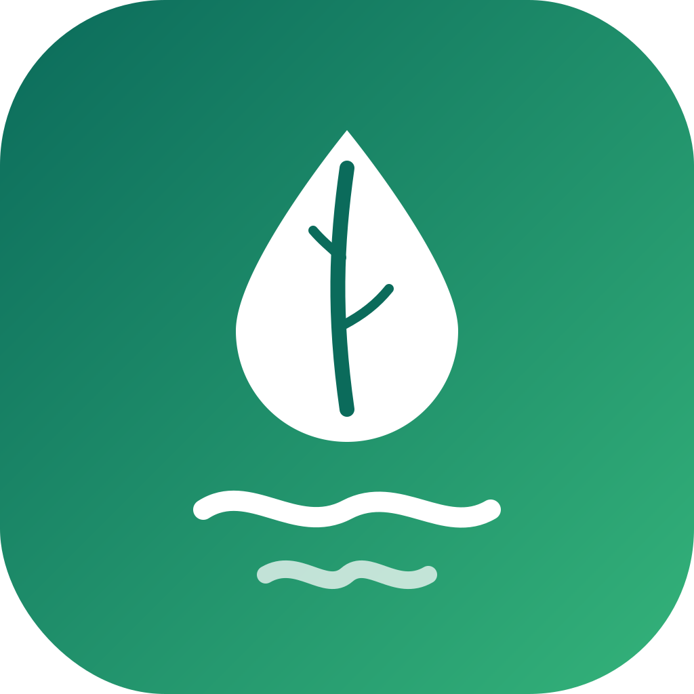

#  KlimPooL

> A climate-action platform where people can **donate** to and **volunteer** for local climate projects, all in one place.

IF2150 Software Engineering · Class 02 · Group 08 (BS3N)

---

## 📑 Table of Contents

1. [About](#about)
2. [Features](#features)
3. [Tech Stack](#tech-stack)
4. [Prerequisites and Installation](#installation)
5. [Configuration](#configuration)
6. [Database Setup](#database-setup)
7. [Running the App](#running-the-app)
8. [Running the Tests](#running-the-tests)
9. [Demo Accounts](#demo-accounts)
10. [Project Structure](#project-structure)
11. [Modules and Team](#modules-and-team)
12. [Database Tables](#database-tables)

---

<a id="about"></a>

## ℹ️ About
KlimPooL connects people who want to help with climate action and the people who run it on the ground.

- **Project creators** publish fundraising **campaigns** and field **projects** (mangrove planting, clean water, waste banks, and so on).
- **Admins** review each submission before it goes public.
- **Users** explore published actions on a list and a map, **donate** from an in-app balance, and **sign up as volunteers**.
- Project creators post **progress updates** with photos and documents, so donors can see how their money is used.

The app is a Next.js web application with a layered architecture (View → Controller → Service → Repository → MySQL), following the design in our DPPL document.

---

<a id="features"></a>

## 🚀 Features
| Feature | Description | Page |
| --- | --- | --- |
| Account | Register, log in, and log out. What you can do depends on your role: user, project creator, or admin. | Login button in the navbar |
| Explore | Search campaigns and projects by keyword, filter them, and see where they are on a map. | `/explore` |
| Action details | See a campaign or project in tabs: about, needs, fund usage, and progress. | `/project/[id]`, `/campaign/[id]` |
| Donation | Donate from your in-app balance and get a printable receipt. A double click never charges you twice. | Donate button on a detail page |
| Balance top-up | Add balance to your wallet. This is a simulation, so no real payment is made. | `/account` |
| Create a campaign or project | Fill in the form, save it as a draft, and submit it for review when it is ready. | `/start` |
| Admin verification | Admins review each submission and approve it or reject it with a reason. Only approved actions are shown to the public. | `/admin` |
| My actions | See the status of your campaigns and projects, read the rejection reason, and submit again after fixing it. | `/my-actions` |
| Volunteer sign-up | Sign up as a volunteer for a project and follow the status of your application. | Detail page, `/account` |
| Volunteer management | Project creators accept or reject volunteer applications. | `/manage/[jenis]/[id]` |
| Progress updates | Project creators post progress with photos and PDF documents, so donors can see how the money is used. | `/progress/[id]` |
| History | See your past donations, plus progress updates of projects you created or joined as an accepted volunteer. | `/history`, `/account` |

---

<a id="tech-stack"></a>

## 🛠️ Tech Stack
| Layer | Technology | Version |
| --- | --- | --- |
| Runtime | Node.js | 20 or newer (see `.nvmrc`) |
| Framework | Next.js (App Router) + React | 16.4.4 + 19.3.0 |
| Language | TypeScript | 5 |
| Styling | Tailwind CSS | 4 |
| Database | MySQL (InnoDB, utf8mb4) via `mysql2` | 8.4 |
| Password hashing | `bcryptjs` (cost 12) | 3 |
| Testing | Vitest + Node test runner (`node:test` with `tsx`) | Vitest 3 |
| Code quality | ESLint + Prettier | 9 + 3 |
| Local database (optional) | Docker Compose | – |

All dependencies are listed in `package.json` and pinned in `package-lock.json`.

---

<a id="installation"></a>

## ⚙️ Prerequisites and Installation
**You need:**

- [Node.js 20+](https://nodejs.org/) (npm comes with it)
- **One** of these for the database:
  - [Docker Desktop](https://www.docker.com/products/docker-desktop/) (recommended), or
  - [XAMPP](https://www.apachefriends.org/) with its MySQL module

**Install the dependencies** from the repository root:

```bash
cd src
npm ci
```

> 💡 `npm ci` installs the exact versions in `package-lock.json`. Use it instead of `npm install` so everyone gets the same dependencies.

---

<a id="configuration"></a>

## 🔐 Configuration
The app reads its settings from `src/.env`. This file holds passwords, so it is **never committed** (it is already in `.gitignore`). Copy the example and edit it:

```powershell
# Windows PowerShell
Copy-Item .env.example .env
```

```bash
# macOS / Linux / Git Bash
cp .env.example .env
```

| Variable | Purpose | Example |
| --- | --- | --- |
| `DB_HOST` | MySQL host | `localhost` |
| `DB_PORT` | MySQL port | `3307` (Docker) or `3306` (XAMPP) |
| `DB_NAME` | Database name | `klimpool` |
| `DB_USER` | Database user | `klimpool` |
| `DB_PASSWORD` | Password for `DB_USER` (**required**, cannot be empty) | your own password |
| `DB_ROOT_PASSWORD` | MySQL root password, used by Docker only | your own password |
| `DB_CONNECTION_LIMIT` | Maximum connections in the pool | `10` |
| `DOKUMENTASI_DRIVER` | Where progress files are stored (only `lokal` for now) | `lokal` |
| `DOKUMENTASI_DIR` | Folder for uploaded progress files | `./uploads` |

---

<a id="database-setup"></a>

## 🗄️ Database Setup
Both options use the same SQL files in `db/migrations/`:

1. `001_schema.sql` creates all 11 tables.
2. `002_seed.sql` fills them with demo data taken from our prototype. All of it is fictional.

### 🐳 Option A: Docker (port 3307)

Make sure Docker Desktop is running, then from `src/`:

```bash
npm run db:up
```

- The migrations run automatically, in order, the first time the database volume is created.
- Port **3307** is used so it does not clash with a local MySQL or XAMPP on 3306.
- Stop the database: `npm run db:down`
- Start over with fresh demo data: `npm run db:reset`

### 🧡 Option B: XAMPP (port 3306)

Start **MySQL** in the XAMPP Control Panel. In `.env`, set `DB_PORT=3306`, keep `DB_USER=klimpool`, and choose a password for `DB_PASSWORD`.

Then run these from `src/` in PowerShell, one line at a time (replace the path if XAMPP is installed elsewhere, and use the same password as in `.env`):

```powershell
$mysql = "C:\xampp\mysql\bin\mysql.exe"
& $mysql -u root -e "CREATE DATABASE klimpool CHARACTER SET utf8mb4 COLLATE utf8mb4_unicode_ci;"
& $mysql -u root -e "CREATE USER 'klimpool'@'localhost' IDENTIFIED BY 'your_password'; GRANT ALL PRIVILEGES ON klimpool.* TO 'klimpool'@'localhost';"
cmd /c "$mysql -u root klimpool < db\migrations\001_schema.sql"
cmd /c "$mysql -u root klimpool < db\migrations\002_seed.sql"
```

> ⚠️ The app refuses to start with an empty `DB_PASSWORD`, so do not connect as XAMPP's default `root` user (it has no password). Create the `klimpool` user above instead.

> ℹ️ The app is built for **MySQL 8.4**, while XAMPP ships **MariaDB**. XAMPP works well for trying the app and running most tests. **Donation and balance top-up** use a MySQL 8 feature to keep balances safe when several donations happen at once (`SELECT ... FOR UPDATE OF`), so use the Docker option to try or test these two features.

Prefer a GUI? Open phpMyAdmin (`http://localhost/phpmyadmin`), create the `klimpool` database and user, then use the **Import** tab for `001_schema.sql` followed by `002_seed.sql`.

To start over, run `& $mysql -u root -e "DROP DATABASE klimpool;"`, then run the `CREATE DATABASE` line and the two `cmd /c` import lines again.

### ✅ Check the result

```powershell
& $mysql -u root klimpool -e "SHOW TABLES; SELECT id_pengguna, nama, peran FROM pengguna;"
```

You should see **11 tables** and **10 users**. With Docker, run `docker exec -it klimpool-db mysql -uroot -p klimpool` and enter `DB_ROOT_PASSWORD`.

---

<a id="running-the-app"></a>

## ▶️ Running the App
From `src/`, with the database running:

```bash
npm run dev
```

Open **http://localhost:3000** 🎉

| Command | What it does |
| --- | --- |
| `npm run dev` | Start the development server |
| `npm run build` | Build for production |
| `npm start` | Run the production build |
| `npm run lint` | Check the code with ESLint |
| `npm run format` | Format the code with Prettier |

---

<a id="running-the-tests"></a>

## 🧪 Running the Tests
```bash
npm test
```

This runs two test suites:

| Command | Runner | Files | Needs a database? |
| --- | --- | --- | --- |
| `npm run test:vitest` | Vitest | `tests/*.spec.ts` (catalog, Explore, detail page, map) | No, they use fake repositories |
| `npm run test:node` | Node test runner | All `*.test.ts` discovered recursively under `tests/` by `scripts/test-node.mjs` | Only integration tests; the action suite requires `AKSI_TEST_DB=1` and a dedicated test database |

To run the integration tests too, start the database first (`npm run db:up`, or MySQL in XAMPP) and make sure `.env` is filled in. Without a database, these tests are skipped instead of failing.

> 💡 **Tips for a full test run**
>
> - The donation, receipt, and top-up integration tests need **MySQL 8.4** (see [Database Setup](#database-setup)), so run them with the Docker database. All other integration tests also run on XAMPP.
> - On **Windows**, turn on **Developer Mode** (Settings → System → For developers) before running the tests. One test creates a folder shortcut (symlink), which Windows only allows in this mode.

📊 Test results are reported in `docs/M9/K02_G08_Implementasi.md`.

---

<a id="demo-accounts"></a>

## 👤 Demo Accounts
Every demo account uses the password **`klimpool123`**. Passwords are stored as bcrypt hashes, and all data is fictional.

| Role | Name | Email |
| --- | --- | --- |
| 🛡️ Admin | Review Team | `admin@klimpool.id` |
| 🌱 Project creator | Sari Wulandari | `sari@klimpool.id` |
| 🌱 Project creator | Dimas Pratama | `dimas@klimpool.id` |
| 🌱 Project creator | Rina Hapsari | `rina@klimpool.id` |
| 🙋 Volunteer / donor | Andi Rahman | `andi@klimpool.id` |
| 🙋 Volunteer / donor | Nadia Putri | `nadia@klimpool.id` |
| 🙋 Volunteer / donor | Fajar Nugroho | `fajar@klimpool.id` |
| 🙋 Volunteer / donor | Lestari Ayu | `lestari@klimpool.id` |
| 🙋 Volunteer / donor | Bima Saputra | `bima@klimpool.id` |
| 🙋 Volunteer / donor | Sekar Ningrum | `sekar@klimpool.id` |

💡 Try logging in as **Andi** to donate, or as **Sari** to see a project creator's view :D

---

<a id="project-structure"></a>

## 📂 Project Structure
```
src/
├── app/                 # Next.js routes: pages and API route handlers
│   ├── api/             #   REST endpoints (auth, katalog, peta, donasi, projects, ...)
│   ├── explore/         #   Explore page (search, filters, map)
│   ├── project/[id]/    #   Project detail page
│   ├── campaign/[id]/   #   Campaign detail page
│   ├── donasi/          #   Donation and receipt pages
│   ├── account/         #   Account and wallet page (top-up, volunteer status, history tabs)
│   ├── history/         #   Donation and progress history
│   ├── start/           #   Campaign and project creation forms
│   ├── manage/          #   Owner's private page: verification, volunteers, progress
│   ├── my-actions/      #   The user's own campaigns and projects
│   ├── progress/[id]/   #   Progress update form
│   └── admin/           #   Admin verification queue and detail
├── components/
│   ├── ui/              # Shared UI: navbar, footer, modal, toast, map, cards
│   ├── views/           # Boundary classes from the DPPL (FormLoginView, ExploreView, ...)
│   ├── detail/          # Detail page parts: tabs, side panel, action buttons
│   └── aksi/            # Campaign/project forms and owner controls
├── server/              # Server-only code
│   ├── controllers/     #   Controller layer (one per use case group)
│   ├── services/        #   Business rules
│   ├── repositories/    #   SQL queries (parameterized)
│   ├── auth/            #   Session and access helpers
│   ├── storage/         #   Local file storage for progress documents
│   └── db.ts            #   MySQL connection pool
├── models/              # Entity classes (Akun, Donatur, TransaksiDonasi, ...)
├── shared/              # Types, constants, and pure helpers safe for the browser
├── db/migrations/       # 001_schema.sql and 002_seed.sql
├── tests/               # Unit and integration tests
├── public/              # Images and static files
├── docker-compose.yml   # Local MySQL 8.4
└── .env.example         # Configuration template (no secrets)
```

---

<a id="modules-and-team"></a>

## 👥 Modules and Team
| NIM | Name | Modules |
| --- | --- | --- |
| 13525140 | Nayla Putri Ghaisani | Project setup, database and connection pool, shared UI components, UC01 registration, login, session and access control, home page |
| 13525080 | Neysa Alya Mukhbita | UC05 catalog search and filter API, Explore page, project and campaign detail pages, map of actions, test setup (Vitest), README |
| 13525092 | Bryan Pamungkas Prahara | UC02–UC04 campaign and project creation, admin verification, "My actions" and manage pages |
| 13525134 | Sahla Nailah Salsabilla | UC06 atomic donation, idempotency key and receipt, account and wallet page, balance top-up, UC10 history, profiling |
| 13525023 | Shaquille Nathan Kalevi | UC07–UC08 volunteer sign-up and management, UC09 progress updates and document uploads |

---

<a id="database-tables"></a>

## 🗃️ Database Tables
There are 11 InnoDB tables. The full definitions, including keys and constraints, are in [`db/migrations/001_schema.sql`](db/migrations/001_schema.sql).

### 👥 Users and sessions

| Table | Primary key | Main columns | Description |
| --- | --- | --- | --- |
| `pengguna` | `id_pengguna` | `nama`, `peran`, `telepon`, `kota`, `tanggal_bergabung` | User profile and role (`volunteer`, `pembuat_project`, `admin`) |
| `akun` | `id_akun` | `id_pengguna`, `email` (unique), `password_hash`, `status_akun`, `tanggal_dibuat` | Login credentials |
| `sesi_login` | `id_sesi` | `id_pengguna`, `waktu_mulai`, `waktu_kedaluwarsa`, `status_sesi` | Login sessions (24 hours) |
| `donatur` | `id_donatur` | `saldo` | Donation balance of each non-admin user (never negative) |

### 🌍 Climate actions

| Table | Primary key | Main columns | Description |
| --- | --- | --- | --- |
| `campaign` | `id_campaign` | `id_pembuat`, `judul`, `deskripsi`, `kategori`, `target_nominal`, `periode_mulai`, `periode_selesai`, `provinsi`, `kota`, `latitude`, `longitude`, `kebutuhan`, `rincian_penggunaan_dana`, `status`, `alasan_penolakan`, `dana_terkumpul`, `tanggal_dibuat`, `tanggal_pengajuan`, `tanggal_verifikasi` | Fundraising campaigns and their review status |
| `project` | `id_project` | `id_pembuat`, `nama`, `deskripsi`, `tujuan`, `kategori`, `provinsi`, `kota`, `latitude`, `longitude`, `kebutuhan_dana`, `kebutuhan_logistik`, `kriteria_volunteer`, `rincian_penggunaan_dana`, `kuota_relawan`, `status_pendaftaran_project`, `jadwal_mulai`, `jadwal_selesai`, `lokasi_kumpul`, `status`, `alasan_penolakan`, `dana_terkumpul`, `milestone`, `status_pelaksanaan`, `timestamp_pembaruan`, `tanggal_dibuat`, `tanggal_pengajuan`, `tanggal_verifikasi` | Field projects, volunteer quota, schedule, and progress |
| `progres_project` | `id_progres` | `id_project`, `id_pengguna`, `milestone`, `status_pelaksanaan`, `catatan`, `persentase`, `dana_terpakai`, `dokumentasi_url`, `timestamp_pembaruan` | Progress updates with documentation |
| `pendaftaran_relawan` | `id_pendaftaran` | `id_volunteer`, `id_project`, `data_diri`, `keahlian`, `pengalaman`, `ketersediaan_jadwal`, `status_pendaftaran`, `tanggal_daftar`, `tanggal_keputusan` | Volunteer sign-ups (one per user per project) |

### 💸 Money

| Table | Primary key | Main columns | Description |
| --- | --- | --- | --- |
| `transaksi_donasi` | `id_transaksi` | `id_donatur`, `id_tujuan`, `jenis_tujuan`, `idempotency_key` (unique), `nominal`, `tanggal`, `status_transaksi` | Donations. Unique key prevents double charges |
| `bukti_transaksi` | `id_bukti` | `id_transaksi` (unique), `rincian` | One receipt per donation |
| `topup_saldo` | `id_topup` | `id_donatur`, `nominal`, `metode`, `waktu` | Simulated balance top-ups |

> 📝 `dana_terkumpul` in the seed data uses the prototype's numbers, so it does not equal the sum of `transaksi_donasi`. New donations are added on top of it.

---

## 📚 Documents

All project documents (SKPL, APL, DPPL, M9 report, AI usage, logbook) are in the [`docs/`](../docs) folder at the repository root.

<p align="center">Made with 💚 by BS3N </p>

